# Fata urugendo muri Far West y'ivy'imari

Kaze muri iki cigwa cerekeye amateka ya Bitcoin yo hagati y'impeshi yo mu 2011 n'ici ryo mu 2012! Naho woba umaze kwumva rimwe na rimwe bavuga ivy'ico kiringo kubera iherezo ribabaje rya Silk Road na Mt. Gox, birashoboka ko utakizi neza, kuko ico gihe Bitcoin yari ikiri ikintu abantu benshi batitaho kandi abayikoresha bari bakiri bake. Iki cigwa rero ni akaryo uronse ko kumenyera ico kiringo c'abatanguzi kandi c'umuryango w'abayikoresha, ikiringo co mu mateka y'amafaranga ya crypto catumye Bitcoin imera uko imeze. Uzomenya mu buryo burambuye ibintu vyabaye, abantu, amasoko, serivisi z'ivy'imari be n'imigambi ya porogaramu vyaranze ico kiringo.

Canecane, ikiringo kiva mu mpeshi yo mu 2011 gushika mu ci co mu 2012 kirangwa n'agatima k'ukutizigira kari mu bari bakigizemwo uruhara be n'uko hafi ata tegeko na rimwe rigenga ivy'imari ryariho, ku buryo aha tucita "Far West y'ivy'imari". Ni ikiringo c'umwidegemvyo n'ic'ibintu vy'ubwoko bwinshi, aho hadutse imigambi myinshi, rimwe na rimwe isekeje, imwe ikaroranirwa kuruta iyindi, ariko muri rusangi yari igamije kuryohora ikoreshwa rya Bitcoin. Naho ari kigufi (umwaka n'igice gusa), kirimwo ivyigwa vyinshi; kiracari igihe co kwiga no kwubaka cuzuyemwo ibintu vyabaye "ubwa mbere" be n'ivyageragejwe vyahavuye bicika ibintu nyamukuru bigize inyubako ya Bitcoin mu vy'ubuhinga, mu vy'ubutunzi no mu vy'imico.

+++

# Intangamarara
<partId>a4a46ce3-6430-5ac7-bc4d-ab1e68e94390</partId>

## Incamake y'icigwa
<chapterId>ce630c81-dd1d-59a0-afea-8e6d3313e8ad</chapterId>

Iki cigwa kigamije kuvuga inkuru y'igice ca mbere c'ikiringo ca kabiri c'amateka ya Bitcoin (2011–2014). Ico kiringo gikurikira ica mbere (2008–2011), citwa ic'"ukwerekana ko iciyumviro gishoboka", caranzwe n'uko Satoshi yari ahari be n'uko uwo mugambi wari ukivugwa gake. Kandi kibanziriza ikiringo ca gatatu (2014–2018), caranzwe canecane n'intambara y'ubunini bw'ama block (*blocksize war*), ya matati yo hagati mu muryango wa Bitcoin yawuciyemwo ibice mu myaka itari mike. Tuzogerageza kwerekana igituma ico gihe kidasanzwe be n'ingene ari intambwe yari ikenewe mu kwubaka Bitcoin.

### Far West y'ivy'imari

Inkuru twigana aha yibanda ku kiringo kiva ku kugenda kwa Satoshi Nakamoto mu mpeshi yo mu 2011 gushika kw'ishingwa ry'ishirahamwe Bitcoin Foundation muri Nyakanga 2012. Ico gice c'amateka ya Bitcoin gihuye n'ikiringo citwa "Far West y'ivy'imari", kirangwa n'uko ata mategeko yari ahari bivuye ku kuntu ifaranga rya crypto ari ikintu gishasha kitari bwigere kibaho. Ico gihe, vyari vyamaze kugaragara ko Bitcoin ishoboka, kandi ibimenyeshamakuru vyariko birushiriza kuyivuga. Muri ico kiringo, ikoreshwa rya Bitcoin ryarakwiragiye rishika ku bantu ubusanzwe batari bitayeho ivy'amafaranga ya crypto. Uburyo bwo kuyikoresha butemewe n'amategeko bwaragwiriye, bituma ico "kiringo c'icaha" (dusubiyemwo imvugo [yakoreshejwe](https://theses.fr/2024EHES0127) n'umuhinga mu vy'imibano w'Umufaransa Maël Rolland) kigira akaranga kihariye.

Imvugo Far West yama igaruka mu vyavuzwe n'abakora muri urwo rwego be n'abamenyeshamakuru b'ico gihe. Kuva muri Munyonyo 2010, Gavin Andresen [yise](https://bitcointalk.org/index.php?topic=1647.msg20650#msg20650) ikiringo cariko kiratangura "igihe ca Far West y'amahera ya open-source", avuga kandi ko yari yiteze "ko abantu bazoshikirwa n'ubuhendanyi, ivyiganano, amapiramide ya Ponzi be n'amafuro y'ibiciro". Mu kiganiro casohowe na Reuters kw'igenekerezo rya 2 Ndamukiza 2012, umumenyeshamakuru Naomi O'Leary [yanditse](https://www.reuters.com/article/2012/04/01/traders-bitcoin-idUSL6E8ET5K620120401/) ko "Bitcoin yari yacitse Far West y'ivy'imari, irangwa n'ukugwira kw'imbuga za internet zitanga serivisi zigana izisanzwe zo mu rwego rw'imari, ariko zigengwa n'amategeko make cane". Kuva mu 2013, ukwo kuyigereranya na Far West kwarakwiragiye mu muryango wa Bitcoin, kukavugwa mu buryo bwiza na Erik Voorhees na [Charlie Shrem](https://calvinayre.com/2013/07/03/conference/bitcoin-london-recap-bl-video), abaserukizi babiri nyamukuru b'ishirahamwe ry'ivunjisha BitInstant, canke kukavugwa mu buryo butari bwiza n'abantu nka [Brian Armstrong](https://a16z.com/bringing-bitcoin-to-everyone/), umwe mu bashinze urubuga Coinbase. Kwarasubiwemwo kandi n'abanegura Bitcoin, nka Benjamin Lawsky, umukuru w'Igisata kijejwe serivisi z'imari ca Leta ya New York, uwo muri Myandagaro 2013 [yise](https://www.cbsnews.com/news/ny-regulator-may-crack-down-on-bitcoin/) amafaranga ya crypto "Far West yo kuri internet y'abadandaza ibiyayuramutwe n'izindi nkozi z'ikibi".

Far West ifise ishusho ikomeye mu vyiyumviro vy'Abanyamerika, eka no mu bihugu vyose vyo mu Burengero vyakwiragiyemwo imico y'Abanyamerika, canecane biciye kuri western, ubwoko bwa sinema bwakunzwe cane hagati mu kinjana ca XX. Iserukira intumbero y'ukwigenga, haba mu biyiranga vyiza (umwidegemvyo) canke mu bibi (akaga). Ni yo shimikiro ry'intango ry'"indoto y'Abanyamerika": gushobora kuja kuba mu karere katazwi no kwihangira imirimo kugira ngo umuntu ashike ku butunzi ahereye ku tuntu dukeyi cane. Ntibitangaje rero kubona Bitcoin yaragereranijwe n'ico kibanza c'umwidegemvyo, kubera ko itagengwa n'intwaro ya politike iriho: Bitcoin yatuma vyose bishoboka, ivyiza n'ibibi. Ico kigereranyo caravyuriye ivyiyumviro canecane Erik Voorhees, uwo mu kiganiro yatanze mu 2013 [yemeje](https://bitcoinmagazine.com/culture/erik-voorhees-new-frontier-1374794545) ko Bitcoin yari Urubibe rushasha, ikiri hagati y'isi isanzwe itunganijwe n'intara zitaragenderwa. Yavuze ati:

> Ni ko biri rwose, Bitcoin ni Far West y'ivy'imari, kandi Imana ishimwe. Iserukira umugwi wose w'intatinyurukamvye n'abihangira imirimo, abatinyuka kwishira mu kaga, abavumbuzi n'abatorera umuti ingorane. Ni rwo Rubibe. Ubutunzi bwinshi cane buzoremwa kandi buzosambuka uko ako karere gashasha kazogenda kiyerekana. Niyumvira yuko ingaruka z'urwo rugendo zizoba nini cane, kuko naho "Far West" yabaye ikintu c'Abanyamerika gusa, Bitcoin yoyo ni umuhari w'isi yose.

Kandi si ku busa umwanditsi wa blog Jimbobway [yise](https://web.archive.org/web/20100828094955/http://www.bitcoinblogger.com/2010/08/bitcoins-new-digital-gold-rush.html) iterambere ry'ugucukura Bitcoin mu 2010 "ukwirukira inzahabu y'ubuhinga bwa none", ikigereranyo [casubiwemwo](https://www.hpcwire.com/2012/10/09/digital_gold_rush_powered_by_gpus/) n'abandi mu myaka yakurikiye. Mu 2013, umumenyeshamakuru Alec Liu na we [yarakigarutseko](https://web.archive.org/web/20130328041052/http://motherboard.vice.com/blog/engineering-the-bitcoin-gold-rush-an-interview-with-yifu-guo-creator-of-the-first-asic-based-miner) mu kiganiro yandikiye Motherload cerekeye Yifu Guo, uwahinguye imwe mu ma ASIC ya mbere akora. Mu rugendo rwabandanije n'imiburiburi gushika mu 2014, abantu ku giti cabo bari bashoboye kwicukurira ama bitcoins bakoresheje ibikoresho vyagenda birushiriza kuryohorwa, gushika aho ibikoresho vyabigenewe bikwiragira hose, hagashingwa n'ibigo vya mbere vyo gucukura bingana n'amahinguriro.

"Far West y'amafaranga ya crypto" ni ikiringo aho, nk'uko [Michael del Castillo](https://www.forbes.com/sites/michaeldelcastillo/2019/01/03/bitcoins-last-gunslinger/) yabisiguye, "vyiyumvirwa ko bitcoin itagengwa n'amategeko, kandi ko *idashobora* kugengwa na yo". Ivyo vyatumye uburyo bwo kuyikoresha ubusanzwe bwiyamirizwa n'abantu benshi — butemewe n'amategeko, buteye kubiri n'inyifato runtu, canke bushobora gucika gutyo — buba ari bwo bwa mbere butera imbere.

Ni muri ubwo buryo twabonye urudandaza rw'ibiyayuramutwe rushirwa imbere n'urubuga Silk Road, rwagize igihe carwo c'ubuninahazwa muri ico kiringo, rukiharira gushika kuri 20 % vy'ibikorwa vyo kuri Blockchain mu 2012. Rwashinzwe n'umusore wo muri Texas yitwa Ross Ulbricht, rukaba rwari ryo soko rya mbere ryo kuri internet rikoresha Tor na Bitcoin. Rwatuma umuntu ashobora kuronka ibidandazwa vy'ubwoko bwose, canecane ibiyayuramutwe, ari na co gituma rwiswe Amazon y'ibiyayuramutwe. Ross Ulbricht ubwiwe [yabona](https://antilop.cc/sr/users/dpr/threads/20110622-0106-Keep_your_guard_up.html) ko Silk Road itari "Wal-Mart, eka mbere si Amazon.com", ariko ko yari Far West kandi ko hariho "abahendanyi bangana n'abadandaza b'abagabo n'abagore b'abanyakuri". Urwo rubuga rwatanguye kuroranirwa kuva muri Ruheshi 2011, inyuma y'ikiganiro casohowe kuri Gawker, ku buryo rwakwegereye abategetsi.

Uretse Silk Road, Bitcoin yaracitse amahera akoreshwa mu ngeso mbi no mu bukozi bw'ikibi muri rusangi, bituma ironka izina ribi ryahavuye rigorana cane kurikuraho. Inkino z'akamari zo kuri internet zarateye imbere cane, hashingwa imbuga za poker, izo gutega amahera n'iz'inkino za kazino z'ubwoko bwose. Harabaye ibitero vyinshi vy'abasuma bo kuri internet, vyatumye hatakara amahera atagira uko angana vyongera bituma amashirahamwe akomeye yo muri urwo rusobe ahomba, nka Bitcoinica. Harakozwe ubuhendanyi bwinshi, nk'uburyo bwa piramide Bitcoin Savings & Trust bwasenyutse muri Myandagaro 2012.

Mu vy'imari, imbuga z'ivunjisha zarateye imbere bimwe bidasanzwe, mu ntango zikora ata ruhusha rw'ibanki zifise kandi ata n'uburyo bwo kumenya umukiriya zikurikiza. Zari ikiraro gihuza amahera ya Leta na bitcoin, rimwe na rimwe ziciye ku bundi buryo nka Liberty Reserve. Ugucuruza harondewe inyungu ku ihindagurika ry'ibiciro hakoreshejwe amahera y'ingurane kwadutse ico gihe. Amasoko y'imigabane yo kuri internet nka GLBSE yaratumye imigambi imwimwe ishobora gutera imbere mu gusohora imigabane ata kwiyandikisha ku bategetsi. Ubwa nyuma, umwidegemvyo mu vy'amahera wazanywe na Bitcoin waratumye abantu benshi bashobora gutanguza amafaranga ya crypto yabo bwite, bafise intumbero nziza canke mbi bivanye n'umugambi.

Ico gihe Bitcoin yarakwegereye abantu b'ubwoko bwose badasanzwe, abantu badakurikira ivyo abandi bose bakora. Kuri Naomi O'Leary, abakoresha Bitcoin bari "uruvange rutangaje rw'aba geek bakabije, aba anarchist, aba libertarian, abahendanyi n'aba trader bo kuri Forex". Mu 2017, mu kiganiro cuzuye inkumbu cerekeye "imisi ya nyuma ya Far West ya Bitcoin", umu libertarian Bruce Fenton [yise](https://www.coindesk.com/markets/2017/04/18/miami-2014-the-last-days-of-bitcoins-wild-west) umuryango wa Bitcoin "umugwi w'aba geek, abahanga n'abagarariji ushimishije kandi urimwo abantu b'ubwoko bwinshi kuruta iyindi yose yari bwigere abona".

Ikindi ciyumviro gifitaniye isano na Far West cakoreshejwe ico gihe ni ic'ubwambuzi bwo mu mabahari. Kukaba nkako, ubwo bwambuzi na bwo nyene burafise ikibanza kinini mu mateka y'Abanyamerika (umuntu aca yibuka canecane abambuzi bo mu mabahari bo mu kinjana ca XVII mu karere ka Karayibe). Iciyumviro c'umuntu yigenga agendagenda mu mabahari cari gikora ku mutima canecane abayoboke ba mbere b'amafaranga ya crypto, ari na co gituma bamwebamwe muri bo biyegereje ayo mashusho, mu vyiza no mu bibi. Mu ntango z'umwaka wa 2012, Ross Ulbricht yaciye yiyita Dread Pirate Roberts, nka wa mwambuzi wo mu mabahari w'agatangaza wo muri sinema *The Princess Bride*. Trendon Shavers, uwatwara Bitcoin Savings & Trust, na we nyene yakoresha izina ry'irihimbano PirateAt40, ryibutsa ururirimbo "*A Pirate Looks At Forty*" rwa Jimmy Buffett.

Ikintu ca nyuma kiranga ico kiringo gishobora kuba ari imyaka y'abateje imbere Bitcoin nyamukuru: kukaba nkako, benshi muri bo bari bakiri bato, mbere bato cane. Abatari bake muri bo bari aba *millenials*, abo mw'iyaruka Y: bavutse hagati ya 1981 na 1996, bakaba bari bafise imyaka iri hagati ya 16 na 31 mu 2011, igihe Satoshi yazimangana buhere. Kubera ko bari bakiri bato, bari bafise umwete udasanzwe, ku buryo twovuga ko ari bo babaye igitoro catumye Bitcoin ishobora guhaguruka. Yamara, bari kandi abantu batarakura mu bwenge kandi batiyubara, canecane ku bijanye n'ingingo abategetsi bashobora gufata mu vy'amategeko. Naho bari bahagarikiwe n'abo mw'iyaruka ryababanjirije (akenshi batiyerekana cane), barakoze amakosa menshi cane, yatumye bamwebamwe muri bo bahanwa bimwe bikomeye n'abategetsi canke baherera mw'ibohero.

### Indinganizo y'icigwa

Iki cigwa kigabuwemwo ibice bine, vyihweza kimwekimwe ukwubakwa kwa Bitcoin mu vy'ubutunzi mu gihe c'ifuro rinini ryo mu 2011 (ibigabane 4), iterambere ryayo mu vy'ubuhinga (ibigabane 3) be n'ibirenze urugero biva ku kuba ari iy'umwidegemvyo kandi idashobora gukumirwa n'uwo ari we wese (ibigabane 4). Vyose hamwe, kirimwo ibigabane 11 bitondetse aha hepfo (ikiringo kivugwa canecane kiratangwa mu dukubo):

- Silk Road, Amazon y'ibiyayuramutwe (Nzero–Munyonyo 2011)
- Ihererekanywa rya Mt. Gox (Ntwarante–Myandagaro 2011)
- Bitcoin n'uguharanira ivya politike (Ntwarante–Munyonyo 2011)
- Bear market ya mbere (Ruheshi 2011–Ndamukiza 2012)
- Ukuryohorwa kw'ikoreshwa rya Bitcoin (Ntwarante 2011–Munyonyo 2011)
- Ukwaguka kw'amakoperative y'ugucukura (Ruhuhuma 2011–Nyakanga 2012)
- Urugamba rwa Pay to Script Hash (Myandagaro 2011–Ndamukiza 2012)
- Iseruka ry'ayandi mafaranga ya crypto (Ndamukiza 2011–Myandagaro 2012)
- Ubudandaji, ubwemewe n'ubutemewe (Nzero–Nyakanga 2012)
- Ifaranga ry'ingeso mbi: inkino z'amahera n'akazi k'ivy'igitsina (Myandagaro 2011–Myandagaro 2012)
- Ifaranga ry'ivyaha: ibitero vy'aba hackers n'uruhendo (Ntwarante–Nyakanga 2012)

### Ivyo gutomora

Gusoma icigwa ca mbere cerekeye amateka ya Bitcoin (citwa *Amateka y'iremwa rya Bitcoin*) birakenewe imbere yo gutangura, canecane nimba ata na kimwe uzi kuri ivyo. Naho vyose bitiganwa hakurikijwe urutonde rw'ibihe, iki cigwa ca kabiri kibandaniriza inkuru aho ica mbere cari cagarukirije, nko mu mpeshi yo mu 2011. Urashobora gufyonda kuri iyi link ikurikira kugira ngo ukurikire icigwa ca mbere:

https://planb.academy/courses/a51c7ceb-e079-4ac3-bf69-6700b985a082

Amagenekerezo n'amasaha vyose bitangwa hakurikijwe isaha y'akarere ya UTC (ihuye na meridiyani ya Greenwich), ku bw'ivyo amagenekerezo arashobora gutandukana n'ayo muri Amerika. Amajambo menshi yasubiwemwo ava mu congereza co muri Amerika kandi yahinduwe mu rundi rurimi ku bw'iki cigwa, kiretse aho vyerekanywe ukundi.

Uretse inkomoko zitangwa mu nyandiko ubwayo biciye ku ma link, twisunga ibi bitabu ngenderwako bikurikira:

- [*Digital Gold: Bitcoin and the Inside Story of the Misfits and Millionaires Trying to Reinvent Money*](https://www.amazon.com/Digital-Gold-Bitcoin-Millionaires-Reinvent/dp/006236250X) ca Nathaniel Popper, casohowe mu 2014;
- [*Pay the Devil in Bitcoin: The Creation of a Cryptocurrency and How Half a Billion Dollars of It Vanished from Japan*](https://www.goodreads.com/book/show/36238082-pay-the-devil-in-bitcoin) ca Jake Adelstein na Nathalie Stucky, casohowe mu 2017 mu buryo bwa elegitoronike gusa; canecane impinduro yaco y'igifaransa yasohowe mu 2019, ifise ibiyirimwo bitandukanye gatoyi: [*J'ai vendu mon âme en bitcoins*](https://www.editions-marchialy.fr/livre/j-ai-vendu-mon-ame-en-bitcoins/);
- [*American Kingpin: The Epic Hunt for the Criminal Mastermind behind the Silk Road Drugs Empire*](https://www.amazon.fr/American-Kingpin-Criminal-Mastermind-Behind/dp/1591848148/) ca Nick Bilton, casohowe mu 2017.

Twarisunze kandi amasinema yigana ivyabaye yerekeye ico gice c'amateka ya Bitcoin, na yo akaba ari aya:

- [*The Bitcoin Phenomenon*](https://www.youtube.com/watch?v=6pWblf8COH4), yakozwe na Bhu Srinivasan igasohorwa kw'igenekerezo rya 12 Ndamukiza 2014;
- [*The Rise and Rise of Bitcoin*](https://www.youtube.com/watch?v=Yh1dOmQJoWQ), yakozwe na Nicholas Mross igasohoka kw'igenekerezo rya 10 Gitugutu 2014;
- [*Deep Web*](https://www.youtube.com/watch?v=L7emWKAMEvI), yakozwe na Alex Winter, yerekanywe kw'igenekerezo rya 31 Rusama 2015.

Ubwa nyuma, twarakoresheje ububiko butari buke bw'inyandiko za kera be n'ibindi biboneka kuri Internet, harimwo:

- Ibiganiro Vitalik Buterin yandikiye [Bitcoin Weekly](https://web.archive.org/web/20111101152804/http://bitcoinweekly.com/articles) na [Bitcoin Magazine](https://bitcoinmagazine.com/authors/vitalik-buterin);
- [Ububiko bw'inyandiko za Silk Road](https://antilop.cc/sr/) bwegeranijwe na [Moustache](https://twitter.com/lamoustache);
- Ibiganiro vya [*Bitcoin Show*](https://www.youtube.com/watch?v=tBou4h0t5-A&list=PL7A7844F28DBED26A), vyakozwe na Bruce Wagner hagati ya Ndamukiza 2011 na Ruhuhuma 2012;
- Podcast [*Untold Stories*](https://www.youtube.com/playlist?list=PLvER9nHSRN3xyQdrUAXKIgZ_hxeLI-kzy), yakozwe inyuma y'ico kiringo, aho Charlie Shrem yakiriye abatari bake mu bagize uruhara muri ico gihe.

### Ugukenguruka

Turakengurukiye cane Loïc Morel ku kuba yarasubiye gusoma iki cigwa avyitondeye!

# Ifuro rinini ryo mu 2011
<partId>eb634403-627b-5b21-a0b7-11a4ca8aa2d1</partId>

## Silk Road, Amazon y'ibiyayuramutwe
<chapterId>23e6297e-75b3-5c7f-bc29-ce1f6c1b56a4</chapterId>

Ikibazo c'imigenderanire hagati y'[ifaranga rya crypto](https://planb.academy/resources/glossary/cryptocurrency) n'ubutegetsi caravyutse ningoga muri kahise ka Bitcoin. Muri Kigarama 2010, Satoshi Nakamoto yaravuye ku mugaragaro kubera isohoka ry'inkuru ya PC World, yahamagarira WikiLeaks gukoresha Bitcoin. Nk'aho yoba ije kwemeza ivyo yari yaketse, iyo nkuru yatumye abantu benshi cane bitaho Bitcoin, igiciro cayo kiva kuri 0,20 $ gishika kuri 32 $ mu mezi makeyi. Satoshi yarabandanije kwandikirana mu mwiherero n'abo bakorana ba hafi cane, hanyuma aranyika burundu mu mpeshi yo mu 2011. Mu buryo busa n'ikimenyetso, ubutumwa bwa nyuma bwa Gavin Andresen, umuhinguzi yari yafashe ubuyobozi bw'umugambi, bwamenyesha uwahinguye Bitcoin ko yari yahamagawe na In-Q-Tel, ikigega c'ishoramari gicungwa na CIA. Isandugu ya Pandore yari yuguruwe vy'ukuri.

Satoshi Nakamoto yari afise imvo zumvikana zo kwikura ku mugaragaro ico gihe, kuko imyaka yakurikiye yaranzwe n'ukugwira kw'ikoreshwa rya Bitcoin mu bintu bitemewe n'amategeko. Nk'uko vyumvikana, abarenga ku mategeko bari bafise inyungu mu gukoresha ukudashobora kuzibirwa kwa Bitcoin kugira ngo bahunge igenzura rya Leta. Ikoreshwa ryamenyekanye kuruta ayandi kumbure ryari urudandazwa rw'ibiyayuramutwe kuri internet, rwakorerwa kw'isoko ry'agashasha: Silk Road.

Urwo rubuga, rwaciye rutazirwa ningoga Amazon y'ibiyayuramutwe, rwashinzwe n'umusore w'imyaka 26 wo muri Texas yitwa Ross Ulbricht. Uwo yari afise ivyiyumviro bikomeye vya libertarian, ari na vyo vyamuhaye iciyumviro c'umugambi wiwe. Silk Road yaratsinze ningoga cane, amaherezo iragira uruhara rukomeye mu butunzi bwa Bitcoin, ku buryo tuyihebera hano ikigabane cose. Tuzobanza kwerekana Ross Ulbricht, umutwe wari inyuma ya Silk Road, hanyuma tuvuge ku ntango z'iryo soko, imbere yo kuvuga ku ntsinzi zaryo za mbere zo mu 2011.

### Ross Ulbricht, libertarianisme na agorisme

Ross William Ulbricht yavutse mu 1984, akurira i Austin, muri Leta ya Texas muri Leta Zunze Ubumwe za Amerika, aho yamaze ubuto butagira ingorane, akikujwe n'umuryango umukunda. Yaramaze imyaka myinshi ari umuskuti, ivyo bikaba vyatumye akunda ibikorwa vyo hanze, nk'ukugendagenda mu misozi no kurara mu mahema, hamwe n'inkino ngororamubiri. Kubera yari umunyabwenge, yararonse buruse yuzuye yo kwiga kaminuza, aho yaronse urupapuro rw'umutsindo rwa licence muri physique n'urwa master mu bumenyi n'ubuhinga bw'ibikoresho, yibanda kuri cristallographie.

*Ross Ulbricht, kw'igenekerezo ritazwi (inkomoko: FreeRoss.org)*

Imyaka Ross yamaze muri kaminuza yamubereye akaryo ko kugerageza ibiyayuramutwe bitandukanye, na canecane ivyitwa psychédéliques. Ariko ikiruta vyose, muri ico kiringo ni ho yatanguye kwitaho bimwe bigera kure ivyiyumviro vya libertarian n'ishure ry'ubutunzi ryo muri Otriche, asoma canecane Ludwig von Mises na Murray Rothbard, ariko kandi na Joseph Salerno na Lew Rockwell. Biciye mu mugwi wa *College Libertarians*, [yaragira uruhara](http://web.archive.org/web/20171024194209/http://www.collegian.psu.edu:80/archives/article_1cb3e5e4-6ed2-5bb8-b980-1df989c663f9.html) mu biganiro mpaka aho yashigikira ko urwego rw'amagara rurekurirwa isoko be n'uko ibiyayuramutwe vyemerwa n'amategeko. Mu 2008, [yarashigikiye](https://web.archive.org/web/20170804183125/http://www.collegian.psu.edu:80/archives/article_239513a3-a577-5732-bab0-9cc27c5d4610.html) ukwiyamamaza kwa Ron Paul, umu libertarian, mu matora y'imbere mu mugambwe w'aba Républicains.

Yarakunze cane kandi agorisme, filozofiya ya politike yashizwe mu nyigisho mu myaka ya 1970 na Samuel Edward Konkin III, mu buryo bumwe ikaba ari ugushira mu ngiro ata guca ku ruhande inyigisho ya libertarian. Ishimikiro rya agorisme (ijambo rikomoka mu kigiriki ca kera άγορά, *agora*, risobanura "isoko") ni ugushira imbere ubutunzi bwo mu mpisho (ubwo Konkin yita "ubutunzi buhangana n'ubusanzwe") nk'uburyo bw'amahoro bwo kugabanya ububasha bwa Leta. Iciyumviro ni ico guhuza amajambo n'ibikorwa, mu gufatanya inyigisho ya libertarian, ishingiye ku ngingo ngenderwako yo kudatera abandi, n'ingiro y'isoko rya magendu, ishingiye ku kurondera inyungu.

Kumenya filozofiya ya agorisme vyabereye Ross nk'ihishurirwa. Kukaba nkako, ivyiyumviro vya libertarian vyaramukwegera cane, ariko kandi vyamutera kwumva ko ata co ashoboye, kuko vyerekana ko Leta iri hose. Agorisme yamubereye uburyo bwo kugira ico akoze bumukiza. Mu [butumwa burebure](https://antilop.cc/sr/users/dpr/threads/20120320-1103-chat.html) bwasohowe ku wa 20 Ntwarante 2012, azosigura ati:

> Narasomye ivyo nashobora vyose kugira ngo ndushirize gutahura ubutunzi n'umwidegemvyo, ariko vyose vyari ivy'ubwenge gusa, ata kindi bimpamagarira gukora atari ukubwira abantu bankikuje ivyo nari nize no kwizigira ko nobafasha kubona umuco. Vyagumye gutyo gushika aho nsomeye "Alongside night" n'ibikorwa vya Samuel Edward Konkin III. Agace kari kabuze kugira ngo ishusho yuzure amaherezo kari kabonetse! Bukwi na bukwi, vyose vyaciye bitomoka: igikorwa cose umuntu akoze hanze y'igenzura ry'intwaro gikomeza isoko kandi kigaca intege Leta. Narabonye ingene Leta ibeshwaho no kunyunyuza abantu bo kw'isi batanga umwimbu, n'ingene yotemba ningoga itaronse amahera y'amakori. Nta basoda babaho iyo udashobora kubahemba. Nta ntambara yo kurwanya ibiyayuramutwe ibaho hatari amamiliyaridi y'amadolari yakwa abantu bahahazwa.

### Inkomoko ya Silk Road

Iciyumviro c'isoko ryo kuri internet catanguye kumera mu muzirikanyi wa Ross Ulbricht kuva mu 2009. Amaze kugomba kuryita "Underground Brokers", yaciye ahitamwo izina "Silk Road" risa n'irikwega abantu kuruta: iryo zina ryerekeza koko ku Nzira y'Ihariri, urusobe rw'amabarabara y'ubudandaji rwahuza Uburaya na Aziya gushika mu kinjana ca XV, kandi rwacamwo ibidandazwa vyinshi, ivyiyumviro n'ubuhinga biva impande zose z'isi. Umugambi w'uwo musore wo muri Texas [wari](https://antilop.cc/sr/exhibits/GX-240A.pdf) uwo "gushinga urubuga rwa internet aho abantu boshobora kugura ikintu cose batamenyekanye, ata kimenyetso na kimwe cotuma bakurikiranwa gushika kuri bo".

Nk'uko twabisiguye, intumbero yiwe imbere ya vyose yari iyo guhindura ibintu, ntiyari iyo kwirondera akaryo. Muri iryo soko yabonamwo uburyo bwo kugabanya ikibanza Leta ifise mu kibano. Muri Ntwarante 2010, ku [rupapuro rwiwe rwa Linkedin](https://web.archive.org/web/20100309115348/https://www.linkedin.com/in/rossulbricht/) hasomwa ibi:

> Nshaka gukoresha inyigisho y'ubutunzi nk'uburyo bwo gukuraho ikoreshwa ry'agahato n'iry'ugutera abandi mu bantu. Nk'uko ubuja bwakuweho nka hose, nemera ko ubukazi, agahato n'uburyo bwose umuntu ahatira uwundi bishobora guhera. Ikoreshwa ry'inguvu ryakwiragiye kuruta ayandi kandi ritunganijwe kuruta ni iry'inzego n'iry'amaleta, ni co gituma ari ho nshize utwigoro twanje muri kino gihe. Ariko rero, uburyo bwiza kuruta ubundi bwo guhindura Leta ni uguhindura ivyiyumviro vy'abo itwara. Kubera iyo ntumbero, ndiko ndategura uburyo bwo kwigana ubutunzi kugira ngo mpe abantu akaryo ko kwibonera ubwabo ingene ubuzima bwomera mw'isi itagira ikoreshwa ry'inguvu ritunganijwe.

Ico ciyumviro si gishasha vy'ukuri. Uretse ko ari intumbero ya agorisme, ni n'akarorero k'ikoreshwa aba [cypherpunks](https://planb.academy/resources/glossary/cypherpunks) bashaka kugira ry'"amasoko ya magendu" kugira ngo bakoreshe umwidegemvyo wabo mu vy'ubutunzi, ikintu dusanga muri [*Cyphernomicon*](https://ia801307.us.archive.org/7/items/cyphernomicon/cyphernomicon.txt) ya Tim May.

Vyongeye, ico ciyumviro cari kimaze gushirwa mu ngiro, kuko ico gihe hari hasanzwe amasoko atari make atarakomera, nk'urubuga [Adamflowers](https://sg.news.yahoo.com/police-bust-online-narcotics-farmers-market-013544208.html) rwatanguye nko mu 2006. Ayo masoko yari acumbikiwe kuri Web isanzwe kandi yakoresha uburyo bwo kwishura busanzwe nka PayPal canke Western Union. Ariko Silk Road yarazanye agashasha, iritandukanya n'izo mbuga biciye ku buhinga bubiri bushasha: Tor na Bitcoin.

Tor (impfunyapfunyo yacitse ijambo ya *The Onion Router*) ni umuhora w'ibanga wubakiye hejuru y'uwundi (witwa kandi darknet) ushingiye kuri onion routing, utuma umuntu ashobora kugendagenda kuri Internet no guhanahana amakuru atamenyekanye kandi mu buryo bugoye gukurikirana. Iyo mucukumbuzi yahinguwe mu myaka ya 2000, itangura kumenyekana bikwiye nko mu 2010, kandi irabereye neza iterambere ry'isoko rya magendu ryo kuri internet.

Bitcoin na yo ni igikoresho ciza, kuko abategetsi badashobora kuyihagarika bukwi na bukwi (bitandukanye na sisitemu zishingiye ku buyobozi bumwe nka Liberty Reserve) kandi ibikorwa vyo gucuruza bica mu muhora ntibigengwa n'ivyo uwa gatatu yizigirwa yishakiye. Igihe Ross yategura umugambi wiwe mu 2009, [yiyumvira](https://antilop.cc/sr/exhibits/253456462-Silk-Road-exhibits-GX-270.pdf) gukoresha Pecunix, sisitemu y'ifaranga ry'inzahabu rya digitale rimeze nka e-gold. Ariko amaherezo yaramenye Bitcoin mu mwaka wa 2010, yasa n'iyibereye ivyo yashaka naho yari imaze igihe gito ibayeho.

Kuri forum, iciyumviro co gukoresha Bitcoin muri ubwo buryo cari kimaze kuvugwa ico gihe. Muri Ruheshi 2010, Teppy, umuyobozi wa MMORPG *A Tale in the Desert* akaba ari na we yatumye Bitcoin yerekanwa kuri Slashdot haciye ukwezi kumwe, [yaratanze](https://bitcointalk.org/index.php?topic=175.msg1430#msg1430) iciyumviro c'"iduka rya héroïne" ryotuma umuntu aronka ibiyayuramutwe mu kwishura mu ma bitcoins. Yanditse ati:

> Nk'umu libertarian, ico nkunda kuruta ibindi mu mugambi wa Bitcoin ni uko ushobora vy'ukuri guhindura ibintu bimwe bikomeye. Niyumvira ko ukubuza ibiyayuramutwe ari kimwe mu bintu vyononye ikibano kuruta ibindi Leta Zunze Ubumwe za Amerika zigeze gukora, ni co gituma nipfuza gukora igerageza ryo mu muzirikanyi ku kuntu iduka rya héroïne ryokora, ryemera ama bitcoins, kandi muri ivyo rigaheza ibuzwa ry'ibiyayuramutwe...

Inyuma y'imyaka yiwe ya kaminuza, Ross yaragarutse i Austin, igisagara yavukiyemwo. Kubera atari akwegerwa cane n'inzira y'ubumenyi, yarakoze utuzi dutandukanye two kwibeshaho. Mu 2010, yari ayoboye [Good Wagon Books](https://web.archive.org/web/20101107054013/http://goodwagon.com/), ishirahamwe ryo gusubira kugurisha ibitabu vyakoreshejwe, yari yarekuriwe n'umugenzi. Yari afise abakozi bakeyi ayoboye, ariko ako kazi ntikamushimisha. Yari ahugijwe cane kuruta n'umugambi wiwe bwite.

Mu ci ryo mu 2010, Ross yarafashe ingingo yo kurima ibiyoga bituma umuntu abona ibitariho kugira ngo bibe ari co kidandazwa ca mbere kigurishwa ku rubuga rwiwe. Ku bw'ivyo yarakodesheje inzu i Bastrop, mu nkengero za Austin, ararondera ibikoresho bikenewe, maze, nka Walter White wo mu rukurikirane rwa televiziyo *Breaking Bad*, aca ahinduka uwuhingura ibiyayuramutwe, kandi gushika ico gihe yari umuntu akunda chimie gusa.

Kugira ngo yubake urwo rubuga, [yarasavye](https://antilop.cc/sr/files/2015_01_22_Ulbricht_trial_transcript_W2_D3.pdf) imfashanyo Richard Bates, umugenzi wo muri kaminuza yari yarakoreye PayPal na eBay. Mu ntango Ross ntiyamubwiye ico umugambi wiwe ari co, ariko Richard yaremeye kumuha impanuro zimwezimwe mu vy'ubuhinga bw'inyabwonko. Mu mpera z'umwaka wa 2010, urubuga Silk Road rwari rero rwiteguriye gutangura.

### Itangura ry'urubuga

Amaze gushiraho urubuga, Ross Ulbricht yaciye yihebera kurumenyekanisha. Ku wa 27 Nzero 2011, yariyandikishije kw'izina ry'irihimbano Altoid kuri forum ya *The Shroomery*, urubuga rwahariwe ibiyoga bituma umuntu abona ibitariho, maze [ahashira](https://www.shroomery.org/forums/showflat.php/Number/13860995) ubutumwa buvuga iryo soko, aho yavuga ko yaribonye ku mpanuka. Ku wa 29 Nzero, [yarasubiriye](https://bitcointalk.org/index.php?topic=175.msg42670#msg42670) ayo mayeri kuri forum ya Bitcoin, mu kiganiro cahariwe "iduka rya héroïne" rya Teppy. Ico gihe yanditse ati:

>  Hari uwumaze kuja kuri Silk Road? Ni nka Amazon.com itamenyekanisha abayikoresha. Sinibaza ko hari héroïne, ariko hari ibindi bintu bihagurishirizwa. Urwo rubuga rukoresha canecane bitcoin na tor kugira ngo rufashe gukora ibikorwa vyo gucuruza abantu batamenyekanye. 

Muri ubwo butumwa, yaratanze aderesi y'urwo rubuga kuri Tor (`tydgccykixpbu6uz.onion` hanyuma `ianxz6zefk72ulzz.onion`), hamwe n'ihuza rijana kuri [blog ya Wordpress](https://web.archive.org/web/20110204025853/http://silkroad420.wordpress.com/) irimwo insiguro zitomoye z'ingene umuntu ashika kuri urwo rubuga. Iyo blog izoca [ihagarikwa ningoga](https://web.archive.org/web/20110309130446/http://silkroad420.wordpress.com/), ku buryo Ross azobwirizwa gushiraho urundi rubuga rushasha rwo guhuza kuri aderesi [Silkroadmarket.org](https://web.archive.org/web/20110304201806/http://silkroadmarket.org/).

Umwe mu bagize forum, akoresha izina ry'irihimbano ShadowOfHarbringer, yarasubiyemwo ubutumwa bwiwe maze yishura ati:

> Rero turahashitse: iduka rya mbere ry'ibiyayuramutwe rikoresha Bitcoin. Turiko twinjira mu mazi maremare ningoga kuruta uko navyibaza. Ndibaza igihe bizotwara kugira ngo amaleta atangure gutohoza kuri Bitcoin.

Ariko rero, urwo rubuga rwaciye ruhura ningoga n'ingorane z'ubuhinga maze ruba rurakuwe kuri internet akanya gato. Mu kwezi kwa Ruhuhuma, Ross yarasubiye gusaba impanuro z'ubuhinga umugenzi wiwe Richard. Ku wa 1 Ntwarante, amaherezo yaratanze [itangazo](https://bitcointalk.org/index.php?topic=3984.msg57080#msg57080) ryemewe akoresheje konti yabigenewe kuri forum ya Bitcoin, aho yatomoye ko "ibikorwa vyo gucuruza 28 vyakozwe" kuva urubuga rutanguye.

Muri ico gihe, forum ya Bitcoin yari icumbikiye *marketplace* aho abantu bashobora kugura no kugurisha ibintu mu ma bitcoins. Yamara, ico gihe nta tegeko na rimwe ryabuza ibiyayuramutwe bitemewe n'amategeko. Martti Malmi, [yiboneye](https://bitcointalk.org/index.php?topic=175.msg42790#msg42790) itangura rya Silk Road, amaherezo [yarabujije](https://bitcointalk.org/index.php?topic=3535.msg51426#msg51426) igurishwa ry'ibintu bitemewe n'amategeko ku wa 19 Ruhuhuma.

Silk Road yarakwegereye abakoresha Bitcoin, na canecane aba agoriste, [babona](https://web.archive.org/web/20110606111034/http://www.bitcoinweekly.com/articles/counter-economics-and-bitcoin) ko "kubera ukutamenyekana kwayo n'umutekano wayo, Bitcoin ibereye rwose ibikorwa vy'ubutunzi buhangana n'ubusanzwe". Iryo soko ryaravuzwe kandi ahantu henshi, na canecane mu kiganiro co kw'iradiyo [*Free Talk Live*](https://bitcointalk.org/index.php?topic=3984.msg66567#msg66567) no kuri [4Chan](https://bitcointalk.org/index.php?topic=3984.msg68196#msg68196).

### Ingene Silk Road ikora

Silk Road ni isoko, ni ukuvuga ko ihuza abaguzi n'abagurisha, nk'uko Amazon canke eBay bibigenza. Harashizweho uburyo bwo gupima icubahiro c'umwe wese kugira ngo uruhendo rwirindwe. Uguhanahana gukorwa mu ma bitcoins, kandi mu ntango bitcoin ni yo yanakoreshwa nk'igipimo c'ibiciro aho gukoresha idolari. Vyongeye, Silk Road ikoresha uburyo bwo kubitsa amahera ku muhuza yizigirwa butuma abayobozi b'urubuga (mu ntango Ross wenyene) baca urubanza igihe habaye amahane hagati y'umugurisha n'umuguzi.

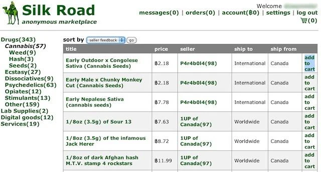

*Ifoto ya ecran ya Silk Road muri Rusama 2011 (inkomoko: [ububiko](https://web.archive.org/web/20110603015735/http://gawker.com/5805928/the-underground-website-where-you-can-buy-any-drug-imaginable) bwa Gawker)*

Ibidandazwa birungikwa biciye mw'iposita (*United States Postal Service* ku vyerekeye Leta Zunze Ubumwe za Amerika), kuko gusaka ibintu vyose ku rutonde bibujijwe mu bihugu vyinshi vyo kw'isi. Kugira ngo isakwa ritunguranye ntirigire ico rifashe, amapaki arahishwa n'ubuhanga kugira ngo asange ari ibintu bisanzwe birungitswe. Ibidandazwa bifise akamoto gashobora kumenywa n'imbwa zimoterwa bishirwa mu dusashi twakuwemwo impemu.

Bihuye na filozofiya ya libertarian ya Ross, ibidandazwa bishobora gushirwa ku rutonde rw'urubuga [bitegerezwa](https://antilop.cc/sr/exhibits/GX-120_Redacted.pdf) kuba bitaronswe hagiriwe nabi abandi: ni ho rero hasangwa ibiyayuramutwe, imiti, ibiceri vy'ivyuma vy'agaciro, ariko nta na rimwe amakarata ya banki yibwe, amashusho y'ubushegabo akoreshwamwo abana canke ibikorwa vy'abicanyi bakodeshwa. Muri rusangi, urwo rubuga rukoreshwa canecane mu rudandazwa rw'ibiyayuramutwe bitemewe, na canecane mu kugurisha urumogi ku rugero rutoyi. Harasangwa kandi ibidandazwa vyemewe n'amategeko, nk'ibitabu, ibikorwa vy'ubugeni, ibice vy'ivyuma vya elegitoronike, inzahabu, n'ibindi, mugabo ivyo ni agace gatoyi cane k'ubudandaji bukorerwa kuri urwo rubuga.

Mu ntango, Ross Ulbricht yemeza igurisha ryose n'intoke. Kubera yiyigishije wenyene ivy'inyabwonko, urubuga yashizeho rwuzuyemwo amakosa n'ivyuho. Inyuma y'ukwiyongera kw'abarugendera kwatewe n'itangura ryarwo, izo ngorane zaciye ziba izitihanganirwa. Ni co gituma Ross yafashe ingingo yo gusubira kwandika kode y'urubuga, ari ko abandanya gutunganya amakomande n'intoke no gukora akazi mu buzima bwiwe buzwi. Akazi kari kenshi cane: [mu kayi yiwe y'ivya misi yose](https://antilop.cc/sr/exhibits/253456476-Silk-Road-exhibits-GX-240B.pdf), asigura ko "amezi abiri yo gusubira kwandika urubuga ari yo yamuruhije kuruta ayandi mu buzima bwiwe".

Verisiyo nshasha ya Silk Road amaherezo [yasohotse](https://bitcointalk.org/index.php?topic=3984.msg128554#msg128554) ku wa 18 Rusama 2011. Irimwo uburyo bwo gutunganya ukwishura bwikoresha hamwe na mixer y'ama bitcoins, ituma ama bitcoins yaciyemwo atamenyekana aho avuye. Yamara, na yo nyene yari ifise icuho catumye ico gihe hatakara "ibihumbi vy'amadolari" bitari bike, bituma Ross asubiramwo inzira yose yo gutunganya ukwishura kugira ngo atorere umuti iyo ngorane. Naho vyari bimeze gutyo, urwo rubuga rwarashoboye kumenyekana kubera abantu babwirana.

### Inkuru ya Gawker

Ukubaho kwa Silk Road kwari kuzwi kuri forum ya Bitcoin kuva mu ntango zayo. Ariko rero, mu ntango ibimenyeshamakuru rusangi ntivyari bwayibone. Gutyo, naho akarorero k'iciyumviro k'urudandazwa rw'ibiyayuramutwe [kavuzwe](https://www.forbes.com/forbes/2011/0509/technology-psilocybin-bitcoins-gavin-andresen-crypto-currency.html) muri Ndamukiza na Andy Greenberg mu nkuru yandikiye Forbes, uwo mumenyeshamakuru ntiyari bwamenye urwo rubuga.

Ubwa mbere Silk Road ivugwa mu kimenyeshamakuru gikomeye hari ku wa 1 Ruheshi 2011, igihe inkuru ya Adrien Chen [yasohoka](https://www.gawkerarchives.com/the-underground-website-where-you-can-buy-any-drug-imag-30818160) kuri Gawker, blog izwi cane yandikwako n'abanditsi benshi. Iyo nkuru, ifise umutwe uvuga ngo "Urubuga rwo mu mpisho aho ushobora kugura ikiyayuramutwe cose ushobora kwiyumvira", yerekana urwo rubuga mu buryo bwiza kandi irimwo intahe z'abakoresha batari bake bashimye.

*Inkuru yo ku wa 1 Ruheshi 2011 yerekeye Silk Road (inkomoko: [ububiko](https://web.archive.org/web/20110603015735/http://gawker.com/5805928/the-underground-website-where-you-can-buy-any-drug-imaginable) bwa Gawker)*

Uwayanditse yaranashizemwo amajambo makeyi ya Ross Ulbricht, uwo yari yaritwararitse kubaza biciye kuri email kandi yerekana nk'"umuyobozi wa Silk Road". Gutyo Ross yarashoboye kumenyesha imvo ziwe nyakuri aho kureka umumenyeshamakuru ngo agereranye. Muri iyo nkuru, yavuze ati:

>  Leta ni yo nkomoko nyamukuru y'ubukazi, agahahazo, ubusuma n'ubwoko bwose bw'agahato. ... Nimureke guha Leta amahera biciye ku makori yanyu maze inguvu zanyu zitanga umwimbu muzerekeze kw'isoko rya magendu. 

Iyo nkuru yatumye abantu bose bamenya ko Silk Road ibaho, ayo makuru asubirwamwo n'ibimenyeshamakuru rusangi, nka [*The Atlantic*](https://www.theatlantic.com/technology/archive/2011/06/libertarian-dream-a-site-where-you-buy-drugs-with-digital-dollars/239776/). Ukwo kumenyekana kutari bwigere kubaho kwatumye abagendera urwo rubuga bongerekana bimwe bidasanzwe. Amaseriveri yaragorwa no kwihanganira uwo muzigo, ku buryo Ross [yabwirijwe](https://bitcointalk.org/index.php?topic=3984.msg189007#msg189007) guhagarika ukwiyandikisha.

Haraboneka kandi [abahiganwa](https://gwern.net/dnm-survival) bavyuka, bigana uburyo bwa Silk Road, nka Black Market Reloaded yatanguye mu mpera z'ukwezi kwa Ruheshi. Yamara Silk Road izoguma ari iya mbere gushika ifunzwe, kubera "akarusho k'uwatanguye imbere" na filozofiya yayo idasanzwe.

### Ingene abantu bakiriye ukumenyekana kw'urubuga

Ukumenyekana kwatewe n'inkuru ya Gawker ntikwahimbaye bose. Kuba Silk Road iri mu maso ya bose bifise ingaruka yo ku ruhande yo kwongereza ukuntu abantu bitaho Bitcoin (n'aho vyoba gusa kubera ko abakiriya bategerezwa kurondera bitcoin kugira ngo bagure ibidandazwa). Kandi biragaragara ko igice kimwe c'umuryango wa Bitcoin kirwanya iryo hurizwa hamwe ry'ifaranga rya crypto n'urudandazwa rw'ibiyayuramutwe.

Na canecane, umwanditsi wa porogaramu Jeff Garzik, ico gihe yari yihebeye iterambere rya porogaramu, ntiyabona neza ukwo guhuzwa kutari gukwiye. Inyuma y'isohoka ry'iyo nkuru, [yarandikiye](https://www.theatlantic.com/technology/archive/2011/06/libertarian-dream-a-site-where-you-buy-drugs-with-digital-dollars/239776/) ubwiwe Adrien Chen kuri email kugira ngo amusigurire ko Bitcoin idahisha abayikoresha nk'uko bisa, kuko ibikorwa vyo gucuruza vyose vyandikwa ubutagisibangana kuri [Blockchain](https://planb.academy/resources/glossary/blockchain). Yasozereye email yiwe n'iki ciyumviro:

> Turavye ubuhinga bwo gusesangura ibiharuro buriho bukoreshwa n'inzego z'igipolisi, ni ubujuju rwose kugerageza gukora ibikorwa vyo gucuruza bitemewe n'amategeko bikomeye ukoresheje ama bitcoins.

Inkuru ya Gawker yarakwegereye kandi n'abategetsi. Gutyo, ku wa 5 Ruheshi, hashize imisi mikeyi isohotse, abakenguzamateka Chuck Schumer (New York) na Joe Manchin (Virginie-Occidentale) baragize ico bavuze icese basaba ko urwo rubuga rufungwa. Mw'[ikete ryuguruye](https://web.archive.org/web/20180918162447/https://www.manchin.senate.gov/newsroom/press-releases/manchin-urges-federal-law-enforcement-to-shut-down-online-black-market-for-illegal-drugs) barungikiye umushikirizamanza mukuru w'Ubushikiranganji bw'Ubutungane n'umuyobozikazi wa DEA, banditse bati:

>  Tubandikiye kugira ngo tubamenyeshe amakenga akomeye dufise inyuma y'aho hamenyekaniye isoko ryo kuri internet ry'ibiyayuramutwe bitemewe, rizwi kw'izina rya "Silk Road". Urwo rubuga rwo mu mpisho, rwatanguye muri Ruhuhuma, rutuma abarukoresha bahisha akaranga kabo, bakagura kandi bakagurisha ata nkomanzi ibiyayuramutwe bitemewe, nka cocaïne, héroïne, ecstasy na marijuana. ... Hisunzwe agace (a)(2) k'ingingo ya 853 y'umutwe wa 21 w'Igitabu c'amategeko ca Leta Zunze Ubumwe za Amerika, umushikirizamanza mukuru arafise ububasha bwo kwugara inzego zigira uruhara mu gushikana no gukwiragiza ibintu bigengwa n'amategeko mu gufatira izina rya domaine ry'urubuga. Drug Enforcement Administration yaritwararitse kandi irabandanya kwitwararika idahengeshanya ko amategeko n'amabwirizwa yacu yerekeye ibintu bigengwa n'amategeko yubahirizwa. Mu ntumbero y'ico gikorwa nyamukuru, turabasavye dushimitse gufata ingingo ubu nyene no kwugara umuhora wa Silk Road. 

Vyongeye, mu kiganiro n'abamenyeshamakuru, umukenguzamateka Schumer [yagirije](https://web.archive.org/web/20120804222559/http://www.nbcnewyork.com/news/local/123187958.html) Bitcoin ko ari "uburyo bwo gutyorora amahera kuri internet bukoreshwa mu guhisha aho amahera ava n'akaranga k'abantu bagurisha n'abagura ibiyayuramutwe". Ivyo vyatumye Gavin Andresen, umubungabunzi mukuru wa porogaramu, agira ico avuze; ntashigikiye Silk Road, ariko arababazwa n'uko ikintu nk'ico kivugwa kuri Bitcoin. Kuri blog yiwe, [yanditse](https://gavinthink.blogspot.com/2011/06/but-you-can-use-it-to-buy-drugs.html) ati:

> Nta n'umwe ashobora kugenzura ibigurwa n'ama bitcoins, nk'uko banki yanje yo hafi idashobora kugenzura ico nkoresha amahera y'inoti nkura mu cuma gitanga amahera. Ndibaza nimba abakenguzamateka Schumer na Manchin bipfuza gusubiriza amahera y'inoti yose ikarata ifise puce itangwa na Leta; nakare, ico gihe inkozi z'ikibi zogorwa cane kuruta no kugura ibintu bitemewe n'amategeko zitamenyekanye, kandi nimba turi abanyagihugu bubaha amategeko, ntidukwiye guhagarika umutima ngo ni uko Leta imenya ivyo tugura vyose... si ko?

### Intsinzi ya Amazon y'ibiyayuramutwe

Kubera ukwitabwaho kwazanywe n'ibimenyeshamakuru, Silk Road yaragurutse, amaherezo itangura kuzana inyungu. Mu mpera z'ici, ibikorwa vy'urwo rubuga vyari bigeze [guserukira](https://www.chainalysis.com/blog/silk-road-doj-seizure-november-2020/) hafi 10 % vy'ibihanahanwa kuri Blockchain ya Bitcoin. Urwo rubuga, rubeshwaho n'amakomisiyo akurwa ku bigurishwa, ico gihe [rwinjiza](https://antilop.cc/sr/exhibits/253456480-Silk-Road-exhibits-GX-250.pdf) amahera aharurwa mu bihumbi mirongo vy'amadolari ku kwezi, ku giciro kiri hasi cane y'ayo. Gutyo Ross yarashoboye kwihemba umushahara ushimishije maze areka akazi kiwe kazwi.

Imbere y'intsinzi yiyongera y'umugambi wiwe, yategerezwa kandi kwiga gushinga abandi ibikorwa. Gutyo yarafashe abakozi bo gutorera umuti amatati yo ku rubuga no kuyobora ibiganiro kuri forum. Mu kayi yiwe y'ivya misi yose, [yanditse](https://antilop.cc/sr/exhibits/253456476-Silk-Road-exhibits-GX-240B.pdf) ko amaze kuronka 100 k$ hamwe na 20–25 k$ nziza ku kwezi, yafashe ingingo y'uko igihe cari kigeze co gufata abantu bakeyi bo kumufasha gushikana urubuga ku rugero rwo hejuru. Ni uko yatanguye guhemba abantu atazi akaranga kabo nyakuri mugabo yizigira.

Mu ci, yarabonanye n'umugenzi wiwe Richard i Austin, maze abo bagabo babiri [bategekanya](https://antilop.cc/sr/files/2015_01_22_Ulbricht_trial_transcript_W2_D3.pdf#page=120) kwugurura urubuga rw'ivunjisha rw'ama bitcoins. Ross amenyereye gukoresha Bitcoin kandi asanzwe yiyumvira ingene urwo rubuga rwomufasha gutyorora amahera yaronkeye kuri Silk Road. Ariko rero, ntiruzokwigera rubaho.

Muri iyo ntumbero ni ho Ross yakoze ikosa rikomeye. Ku wa 11 Gitugutu, yarashize [itangazo](https://bitcointalk.org/index.php?topic=47811.msg568744#msg568744) kuri forum ya Bitcoin aho yavuga ko ariko ararondera "umuhinga mu vy'inyabwonko" wo gukorera "startup ya bitcoin ishigikiwe na capital-risque". Ku bw'ivyo yakoresheje izina ry'irihimbano Altoid (iryo yari yarakoresheje imbere mu kumenyekanisha Silk Road). Muri ubwo butumwa, yarahishuye aderesi yiwe ya email, irimwo izina ryiwe ryo mu mpapuro: `rossulbricht@gmail.com`. Iryo kosa rizomuzimba, kuko rizofasha itohoza ry'igipolisi kuri Silk Road kumumenya no kumufata haciye imyaka ibiri...

### Ikintu nyamukuru mu kwubaka Bitcoin

Gutyo Ross Ulbricht yarashize mu ngiro iciyumviro c'agashasha, gishingiye ku vyo yemera vya libertarian na agorisme, akoresheje ukudashobora kuzibirwa kwa Bitcoin. Inyuma y'ikiringo c'imyiteguro kirenga umwaka, yaratanguje prototype muri Nzero 2011. Intango zaragoye, ariko utwigoro twiwe twarashitse aho tukama: muri Ruheshi 2011, Silk Road yari izwi kw'isi yose kubera inkuru yasohotse kuri Gawker.

Ukuvyuka kwa Silk Road kwabaye ikintu nyamukuru mu kwubaka Bitcoin. Intsinzi y'urwo rubuga yarerekanye koko ko Bitcoin ifise akamaro kayo bwite, gatandukanye n'amafaranga ya Leta be n'ibikorwa bisanzwe vyo kwishura kuri internet. Vyongeye, ikoreshwa rya Silk Road ryatumye abantu batari bake bitaho Bitcoin, nka [Peter McCormack](https://www.youtube.com/watch?v=3aDMnE6dnHk), azohava aba umuyobozi wa podcast *What Bitcoin Did*. Ubwa nyuma, Silk Road yaruguruye inzira ku ikoreshwa ryose ryegereye ibitemewe n'amategeko, mu vyiza no mu bibi.

Gutyo, haciye umwaka urengako gatoyi inyuma y'igurishwa rya pizza za Laszlo, Silk Road yari yacitse ishusho y'ubudandaji bukorwa na Bitcoin. Yamara, muri ico gihe nyene iryo koreshwa ryariko rirahiganwa n'ubundi bwoko bw'igikorwa: speculation. Kandi iyo yari ikomeye cane kuri Mt. Gox, urubuga nyamukuru rw'ivunjisha mw'isi ya Bitcoin, ico gihe rwayoborwa n'Umufaransa Mark Karpelès.

## Ihererekanywa rya Mt. Gox
<chapterId>451293d5-d691-5c36-91dd-4ee5e6dcc9e3</chapterId>

Ikiringo catanguye mu mpeshi yo mu 2011 kiranzwe n'iterambere ry'igikorwa c'ivunjisha hagati ya bitcoin n'amafaranga asanzwe, nk'idolari n'iyero. Ubwo bwoko bw'ibikorwa bwaragira koko uruhara nyamukuru mu butunzi bwa Bitcoin, kuko bwari butoyi cane ku buryo butoshobora gukora bwifungiye ukwabwo. [Abacukuzi](https://planb.academy/resources/glossary/miner) bari bakeneye kugurisha udushimwe twabo kugira ngo barihe amafagitire yabo y'umuyagankuba. Abadandaza, barimwo n'abagurisha bo kuri Silk Road, bategerezwa kuronka amadolari kugira ngo barihe ababazanira ibidandazwa. Abakiriya babo, muri rusangi batari bafise bitcoin, bari bakeneye kubanza kuyironka. Hariho kandi isabwa rikomeye rya speculation, riva ku bantu babona iryo faranga rya crypto nk'ishoramari.

Urubuga rwa mbere rw'ivunjisha rukomeye rwabaye Mt. Gox, rwatangujwe "ku ciyumviro c'ako kanya" muri Mukakaro 2010 na rwiyemezamirimo Jed McCaleb. Kubera gukora kwarwo kwikoresha, rwaciye rwigaragaza ningoga nk'uburyo nyamukuru bwo kuvunja amadolari mu ma bitcoins, n'ama bitcoins mu madolari. Mu ntango z'umwaka wa 2011, abonye ubunini bw'ako kazi, Jed McCaleb yafashe ingingo yo kurekurira urwo rubuga umuntu abishoboye kuruta mu vy'ubuhinga kandi abifitiye umwete kuruta: umuhinguzi w'Umufaransa Mark Karpelès.

Hamwe na Silk Road, urwo rubuga rwagize ikibanza nyamukuru muri iki gice ca kahise ka Bitcoin. Ni rwo rwabaye ikibanza nyamukuru c'ifuro ry'ibiciro rya mbere nyakuri ku giciro ca bitcoin, ryashitse ku rugero rwo hejuru rwa 32 $ muri Ruheshi. Rwaragiriwe kandi igitero gikomeye c'ubusuma, kandi rwari rufitaniye isano n'ingorane zitari nke zabaye ico gihe mw'isi ya Bitcoin. Muri iki kigabane, tuzovuga ku kuntu ihererekanywa rya Mt. Gox ryagenze, ku ntsinzi yihuta cane rwagize kuva mu mpeshi, ku bahiganwa barwo bavyutse muri ico gihe nyene, ku ngorane rwahuye na zo no ku ngaruka ivyo vyagize ku butunzi bwa Bitcoin. Ariko reka dutangure twerekana uwarwegukanye, Mark Karpelès.

### Mark Karpelès, umu geek

Mark Karpelès yavukiye mu Bufaransa mu 1985. Ni umwana w'ikinege, yarezwe na nyina wenyene. Yatanguye kare gukunda inyabwonko, inkino zo kuri videwo na manga. Mu myaka yiwe ya mirongo ibiri, yari umu geek [atiyumva neza muri we](https://web.archive.org/web/20140302234940/http://blog.magicaltux.net/2006/02/12/pensees-nocturnes/): mu 2007, yaraseruka mbere muri filime documentaire y'Abafaransa *Suck my Geek*, yahariwe abo bantu bakunda cane ivy'ivyiyumviro, ubuhinga n'inyabwonko. Mu 2009, kubera yipfuza kuva mu Bufaransa aho atigeze yumva vy'ukuri ko ari iwabo, yarimukiye mu Buyapani [muri Ruheshi 2009](https://web.archive.org/web/20090628035138/http://blog.magicaltux.net/2009/06/18/arrived-in-japan/) akwezwe n'imico yaho. Ashitseyo, yarashinze ishirahamwe Tibanne Co. Ltd. (ryitiranwa n'akayabu kiwe, Tibane), ari ryo yacishamwo akazi yakora yigenga. Yaratwara na canecane igikorwa co gucumbikira imbuga citwa [KalyHost](https://web.archive.org/web/20101231201212/https://www.kalyhost.com/).

*Mark Karpelès muri Suck My Geek mu 2007 (inkomoko: [MrReportageTV](https://www.youtube.com/watch?v=cAOLU4_4QGg) kuri Youtube)*

Yamenye ko Bitcoin ibaho mu gatasi ko mu 2010 biciye ku mukiriya w'Umufaransa aba muri Pérou (William Waisse [yitwa kandi](https://bitcointalk.org/index.php?topic=1719.msg21107#msg21107) Neofutur), yamubajije nimba yoshobora kwishura mu ma bitcoins kugira ngo arihe fagitire. Mark yaremeye ico kintu, aca akunda ningoga iyo sisitemu. Bitandukanye na Martti Malmi, Ross Ulbricht canke Roger Ver, uwo musore w'Umufaransa si umu libertarian asunikwa n'ivyiyumviro vya politike; kandi si n'umu speculator anyotewe inyungu. Ahubwo ugukunda Bitcoin kwiwe gukomoka ku matsiko y'ubuhinga. Nk'uko [azobivuga](https://web.archive.org/web/20140918220234/http://www.thedailybeast.com/articles/2014/09/17/mt-gox-s-karpeles-on-losing-a-half-billion-bucks-in-bitcoins.html) mu 2014:

> Icankwegereye muri bitcoin ni ibijanye n'ubuhinga. Ni ukuvuga, kuba ububiko bw'amakuru bw'isi yose bubungabungwa mu buryo butekanye. Kuba client yose ifise Wallet yayo bwite itekanye. Kuba hariho sisitemu itagira ubuyobozi bumwe bukuru na gato. Vyongeye, bitcoin ituma haboneka ububiko bw'amakuru buri ku mugaragaro.

Akimara kuyimenya, nk'umuntu akunda cane ivy'inyabwonko, yaciye yibira mu mikorere y'imbere ya Bitcoin maze atangura kwandika porogaramu ziyikoresha. Muri Munyonyo, [yaratanguye](https://bitcointalk.org/index.php?topic=30.msg20699#msg20699) kwemera ukwishurwa mu ma bitcoins kuri KalyHost (Ross Ulbricht [azokoresha](https://cdn.arstechnica.net/wp-content/uploads/2015/01/Govt.motion.1.19.pdf) nyene ico gikorwa mu gucumbikira urupapuro rwa web Silkroadmarket.org). Muri Kigarama 2010, [yarashinze](https://bitcointalk.org/index.php?topic=2321.msg30872#msg30872) wiki nshasha, Bitcoin.it, izoca iba ningoga wiki nyamukuru ya Bitcoin. Yarishizemwo kandi guhingura ishirwa mu ngiro rya porogaramu, ryiswe [QBitcoin](https://web.archive.org/web/20110326023018/http://bitcoinweekly.com/articles/interview-with-magicaltux-on-qbitcoin), ariko ntiyarishikana ku mpera.

### Igurwa rya Mt. Gox

Mu ntango z'umwaka wa 2011, Jed McCaleb yatwara Mt. Gox uko ashoboye. Urwo rubuga ntirwari rutekanye na gato, ivyo bikaba vyavugwa na bamwebamwe mu bagize umuryango, nka [Casascius](https://bitcointalk.org/index.php?topic=4187.msg66477#msg66477). Vyongeye, Jed ntiyari azi neza nimba igikorwa ciwe gikwije ivyo amategeko asaba. Inkuru ya PC World yari imaze kugira ingaruka ku giciro, kandi yatinya (bifise ishingiro) ko ukuduga kw'igiciro kwobandanya. Yaciye rero atangura kurondera uwomusubirira.

Yahisemwo Mark Karpelès, akora cane mu muryango w'abahinguzi, na canecane ku muyoboro wa IRC \#bitcoin-dev. Uwo Mufaransa yari yarafashije Martti Malmi mu gucumbikira Bitcoin.org kandi yari yarafashije Jed mu kwemera iyero, gutyo aba arerekanye ubushobozi bwiwe mu vy'ubuhinga. Ku wa 18 Nzero, Jed yaciye rero asaba Mark ko yokwegukana Mt. Gox. Muri email yiwe, [yanditse](https://web.archive.org/web/20170602025506/http://www.thedailybeast.com/behind-the-biggest-bitcoin-heist-in-history-inside-the-implosion-of-mt-gox) ati:

> Amahoro Mark,
>
> Ndagusavye ugumize ivyo vyose mw'ibanga, kuko sinshaka gutera ubwoba, kandi nta kintu kiramenyekana neza, ariko ndiko ndiyumvira kugurisha mtgox. Mfise iyindi migambi nipfuza kwihebera. Mbega vyogushimisha? Nshobora kuyigurisha ku mahera makeyi nkaronka umugabane ku nyungu, nk'akarorero. Hariho kandi ikigega c'ishoramari cemeye gushora muri mtgox. Kumbure nka 158 k$. Rero woshobora gusa kwegukana iryo shirahamwe ririmwo n'amahera. (Vyahinduwe na Cyril Gay)

Inyuma y'ibiganiro ku biri mu masezerano, amasezerano yashizweko umukono amaherezo ku wa 3 Ruhuhuma. Jed McCaleb yagumanye 12 % vy'ishirahamwe na 50 % vy'ivyinjira mu kiringo c'amezi atandatu, ibisigaye na vyo bihabwa ishirahamwe rya Mark Karpelès, Tibanne Co. Ltd. Ingingo imwe y'ayo masezerano ikura kuri Jed ibanga ryose imbere y'amategeko.

Ku wa 6 Ntwarante, Jed McCaleb [yaremeje](https://bitcointalk.org/index.php?topic=4187.msg60610#msg60610) icese iryo hererekanywa kuri forum ya Bitcoin. Mu butumwa bwiwe bwa nyuma akoresheje konti ya Mt. Gox, asigura ati:

> Nashinze mtgox ku ciyumviro c'ako kanya maze gusoma inkuru yerekeye ama bitcoins mu ci riheze. Ico gikorwa cambereye ikintu gishimishije kandi kiryoheye. N'ubu ndacemera ko ama bitcoins afise kazoza keza. Ariko kugira ngo mtgox ishike vy'ukuri ku vyo ishoboye vyose, hokenerwa umwanya uruta uwo mfise ubu. Ni co gituma nafashe ingingo yo guhereza urumuri umuntu azoshobora kuruta jewe gushikana urubuga ku rugero rwo hejuru.

Mu mezi yakurikiye, Jed yarabandanije gufasha Mark mu gutwara urwo rubuga. Ariko rero, azoca atwarwa ningoga n'[umugambi mushasha](https://bitcointalk.org/index.php?topic=10193.msg146250#msg146250) w'ifaranga rya digitale, uzoshirwa mu ngiro biciye mu gusubiramwo Ripple mu 2012, hanyuma mu gushinga Stellar mu 2014.

### Ingorane za mbere

Nk'uko twabivuze, mu ntango z'umwaka wa 2011, urubuga Mt. Gox ntirwari rutekanye. Kandi nk'uko vyumvikana, rwaragiriwe ibitero bitari bike bikomeye ku rugero rutandukanye, na canecane injection XML yatumye umukoresha afise imigambi mibi [akura](https://blog.bitmex.com/wp-content/uploads/2018/02/CrackingMtGox.pdf) ata ruhusha 50 000 $ ayarungika kuri konti yiwe ya Liberty Reserve. Igihe Mt. Gox yahindura nyeneyo, urwo rubuga rwari rero rumaze kuba ingabirano irimwo ubumara kuri Mark Karpelès. Ariko ingorane ntizagarukiye aho.

Ku wa 1 Ntwarante 2011, igihe ihererekanywa ryari rigiye kwemezwa icese, ama bitcoins 80 000 [yaranyitse](https://mempool.space/tx/e67a0550848b7932d7796aeea16ab0e48a5cfe81c4e8cca2c5b03e0416850114) kubera umuntu yinjiye ku bubisha muri dosiye wallet.dat y'urubuga. Ku wa 3, Jed McCaleb yarabonye ayo mahera yakuweko maze [amenyesha](https://web.archive.org/web/20200427200314/https://courts.ms.gov/appellatecourts/docket/sendPDF.php?f=dc00001_live.SCT.17.M.1681.102741.5.pdf&c=87490&a=N&s=2) Mark kuri IRC ko "hari ikintu giteye ubwoba cabaye". Ni igihombo gikomeye (ico gihe bitcoin imwe igurwa 0,92 $), kizogenda kirushiriza kwongerekana uko amezi aheraheza kubera ukuduga kw'igiciro kutari bwigere kuboneka.

Iyo ngorane [yaravuzwe](https://web.archive.org/web/20170602025506/http://www.thedailybeast.com/behind-the-biggest-bitcoin-heist-in-history-inside-the-implosion-of-mt-gox) na Jed ku wa 18 Ndamukiza muri email yarungikiye Mark, aho yanditse ati:

> Sinshobora kukubwira ingene iyo ngorane izoba ingana nimba habuze 80 kBTC kandi agaciro kazo kakaduga gushika ku 100 $ n'ibindi. Bizoba ari ideni rinini, ariko gushika ico gihe mtgox ikwiye kuba imaze kwinjiza BTC nyinshi cane. Turashobora kandi kwizigira ko igitigiri ca BTC zisigaye kumbure kitazokwigera kija munsi ya 80k. Rero kumbure ntukwiye guhagarika umutima. (Vyahinduwe na Cyril Gay, bihinduwe gatoyi)

### Ugutwara ifuro ry'ibiciro rya mbere

Mu mpera z'impeshi yo mu 2011, ifuro ry'ibiciro rya mbere ku giciro ca bitcoin ryarabaye. Nk'uko ryadondowe mu [kigabane ca nyuma](https://planb.academy/courses/a51c7ceb-e079-4ac3-bf69-6700b985a082/16c5e6d6-2412-48c6-9687-6af92cf0d89a) c'icigwa cacu ca mbere kuri kahise ka Bitcoin, iryo furo riranzwe n'ukugwira kw'imigwi ikoranira kuri Bitcoin, n'ukwitabwaho n'ibimenyeshamakuru kuva ku banditsi ba blog bigenga no ku binyamakuru vyo kuri internet, hamwe n'ibikorwa vyinshi ku mbuga z'ivunjisha. Haciye umwaka, [rizokwitwa](https://web.archive.org/web/20120613180823/https://bitcoinmagazine.net/anniversary-of-the-great-bubble-of-2011) "ifuro rinini ryo mu 2011" na Vitalik Buterin, umwanditsi mukuru akiri muto wa Bitcoin Magazine.

Muri Ndamukiza, inyuma y'isohoka ry'[inkuru ya Forbes](https://www.forbes.com/forbes/2011/0509/technology-psilocybin-bitcoins-gavin-andresen-crypto-currency.html), igiciro cararenze urugero rwaco rwo hejuru rwa kera maze gishika kuri 3 $. Igishika ca speculation carabandanije muri Rusama maze igiciro gishikanwa ku 10 $. Ubwa nyuma, isohoka ry'inkuru ya Gawker ryarangije gukwiragiza ukwitabwaho kwa Bitcoin maze ritanguza igice ca nyuma ca speculation, igiciro gishika akanya gato kuri 32 $ ku wa 8 Ruheshi.

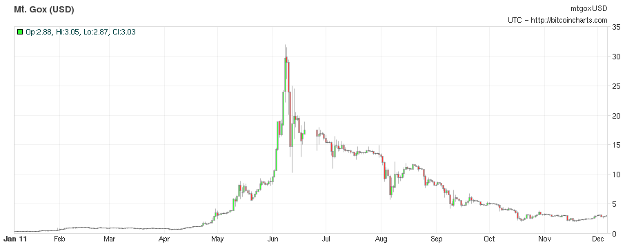

*Ihinduka ry'igiciro ca bitcoin kuri Mt. Gox mu 2011 (inkomoko: Bitcoin Charts biciye kuri [Bitcoin.com](https://news.bitcoin.com/look-bitcoin-bubble-will-next-one/))*

Ukwo kuduga kudasanzwe kwagiriye akamaro canecane Mt. Gox, yabonye abayigendera bongerekana bimwe bidasanzwe. Hagati y'igihe Mark yayegukana vy'ukuri muri Ntwarante n'impera z'ukwezi kwa Rusama, igitigiri ca konti z'abakoresha cavuye ku 3 000 gishika ku 60 000. Muri ico kiringo nyene, ibivunjwa ku musi na vyo vyavuye ku bihumbi bikeyi vy'amadolari bishika ku bihumbi *amajana* bitari bike vy'amadolari. Muri Ruheshi, vyararenze mbere imiliyoni zibiri z'amadolari mu misi mikeyi!

Ariko gutwara ukwo gukura vyabaye nk'inzozi mbi: Mark yaronka email n'amatike y'abasaba imfashanyo bitagira igitigiri. Yategerezwa gutunganya [uburyo bwinshi](https://bitcointalk.org/index.php?topic=9808.msg141011#msg141011) bwo kwishura, bubiri bwa nyuma bukaba ari [ukurungika amahera kwa SEPA](https://bitcointalk.org/index.php?topic=5461.msg80087#msg80087) (Mark yaruguruje konti muri banki y'Abafaransa) n'igikorwa [Dwolla](https://bitcointalk.org/index.php?topic=8280.msg120637#msg120637). Amahera amwamwe abikijwe yaratakara mu nzira.

Uko igihe cahaca, ibintu vyaragenda neza kuruta. Muri Ruheshi, Mark Karpelès yarafashe umukozi wo kumufasha, uwitwa Adam Turner, [izina ryiwe](https://www.reddit.com/r/Bitcoin/comments/3fe92x/im_ashley_barr_aka_adam_turner_the_first_mtgox/) ryo mu mpapuro rikaba Ashley Barr. Yarafashe kandi ingingo yo kwimurira ishirahamwe mu biro vyo muri Cerulean Tower y'icubahiro i Tokyo, ikimenyetso nyakuri c'intsinzi.

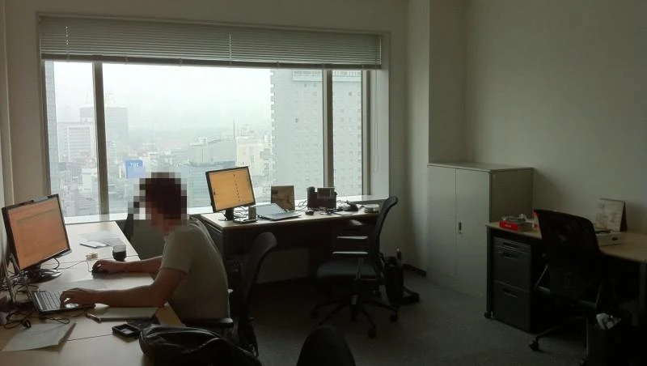

*Ibiro vya Mt. Gox muri Ruheshi 2011 (inkomoko: Mark Karpelès kuri [Twitter](https://twitter.com/MagicalTux/status/1310018500602130432))*

### Abahiganwa ba Mt. Gox

Intsinzi ya Mt. Gox yatumye haboneka abayigana, haba muri Leta Zunze Ubumwe za Amerika canke ahandi. Kubera ukuduga kw'igiciro n'ukw'isabwa, gutanguza urubuga rw'ivunjisha vyaciye biba ibizana inyungu. Gutyo, abahiganwa benshi, bubatswe ku karorero kamwe kandi barimwo uburyo bwikoresha bwo gutunganya amabwirizwa yo kugura no kugurisha, [baraseruka](https://web.archive.org/web/20110727192503/https://bitcoincharts.com/markets/) muri uwo mwaka na canecane kuva mu mpeshi.

Uretse Bitcoin Market (yavuzwe muri HIS201), urubuga rwa mbere rwahiganwe vy'ukuri na Mt. Gox ni Bitcoin-Central, urubuga rukorera mu Bufaransa. Rwo [rwatangujwe](https://bitcointalk.org/index.php?topic=2519.msg34080#msg34080) ku wa 29 Kigarama 2010 na David François, umuhinguzi wa web azi utuntu n'utundi yari yamenye Bitcoin muri Gitugutu, akoresha izina ry'irihimbano Davout kuri forum. Bihuye n'imico y'umuryango, source code y'iryo soko [iruguruye](https://bitcointalk.org/index.php?topic=2721.msg36980#msg36980) kandi yasohowe [ku ruhusha rwigenga](https://github.com/davout/bitcoin-central/blob/master/LICENSE) (AGPL). Mu ntango urwo rubuga rwemera gusa amadolari n'amayero ya Liberty Reserve, hamwe n'[ukurungika amahera gusanzwe mu mayero](https://bitcointalk.org/index.php?topic=2584.msg35109#msg35109). Mu ntango imikorere ya sisitemu yari iy'igerageza gatoyi, ariko izogenda iba nziza uko amezi aheraheza. David François azokwongerako na canecane [API](https://bitcointalk.org/index.php?topic=3174.msg44575#msg44575), [ukurungika amahera kwa SEPA](https://bitcointalk.org/index.php?topic=37494.msg459909#msg459909), n'ayandi mafaranga, nk'[inzahabu biciye kuri Pecunix](https://bitcointalk.org/index.php?topic=3098.msg43315#msg43315), [idolari rya Canada](https://bitcointalk.org/index.php?topic=40239.msg490360#msg490360) canke roupie y'Ubuhindi.

Urubuga rwa kabiri ni Britcoin, [rwatangujwe](https://bitcointalk.org/index.php?topic=4984.msg73066#msg73066) ku wa 26 Ntwarante na Amir Taaki (yitwa kandi Genjix), wa muhinguzi akiri muto w'Umwongereza akomoka muri Irani yashaka kurungikira ikete WikiLeaks muri Munyonyo 2010 kugira ngo ayihanure gukoresha Bitcoin. Nk'uko izina ryarwo ribivuga, urwo rubuga rukorera mu Bwongereza kandi rurimwo ivunjisha hagati ya livre sterling na bitcoin. Nka David François, Amir [yarasohoye](https://bitcointalk.org/index.php?topic=4579.msg67047#msg67047) porogaramu rwubakiyeko [ku ruhusha rwigenga](https://github.com/dooglus/intersango/blob/master/LICENSE) (AGPL), ayita "Intersango" (bivuye kuri espéranto *interŝanĝo* risobanura uguhanahana). Amir yaciye [yifatanya](https://web.archive.org/web/20120129171120/https://britcoin.co.uk/about-us.php) ningoga na Donald Norman na Patrick Strateman (azwi kandi kw'izina ry'irihimbano Phantomcircuit) kugira ngo batware urwo rubuga.

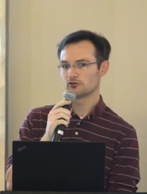

*Patrick Strateman mu 2016 (inkomoko: [SF Bitcoin Developers](https://www.youtube.com/watch?v=Y6kibPzbrIc))*

Muri Ndamukiza, abo bagabo batatu barashinze [Bitcoin Consultancy](https://web.archive.org/web/20110513023005/http://bitcoinconsultancy.com/), ishirahamwe ritanga ibikorwa vyo guhingura porogaramu n'impanuro z'ubuhinga. Bafashwa n'abandi bantu nka Nils Schneider (Tcatm) na Denis Rojo (Jaromil). Iryo shirahamwe rirafise kandi akosho, kuko rizotegura amanama ya mbere yo mu Buraya, i Prague n'i Londres. Yamara, inyuma y'ishusho yaryo y'ibintu bikomeye, hihishije umutima wamizwe na filozofiya y'aba *hackers*, nk'uko kamere ya Amir Taaki ibigaragaza.

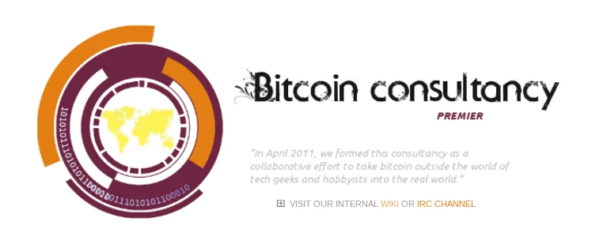

*Ifoto y'urubuga rwa Bitcoin Consultancy yo ku wa 13 Rusama 2011 (inkomoko: [ububiko](https://web.archive.org/web/20110513023005/http://bitcoinconsultancy.com/))*

Ku wa 6 Ruheshi, Bitcoin Consultancy [yaratanguje](https://bitcointalk.org/index.php?topic=26543.msg332466#msg332466) urubuga rushasha rw'ivunjisha, rugenewe isoko ry'i Buraya, rwitwa Intersango (nka porogaramu rwubakiyeko). Britcoin na Intersango amaherezo vyarifatanije haciye amezi makeyi kugira ngo bibe urubuga rumwe gusa.

Mu Buraya bw'Ubuseruko, urubuga Bitomat, rukorera muri Polonye, [rwatangujwe](https://web.archive.org/web/20171125014654/https://forum.bitcoin.pl/viewtopic.php?f=7&t=166) ku wa 4 Ndamukiza. Interface yarwo iroroshe cane, ariko ituma abarukoresha b'Abanyapolonye bavunja zloty zabo mu ma bitcoins. Twovuga kandi igikorwa Cavirtex, [cuguruwe](https://bitcointalk.org/index.php?topic=25312.msg314448#msg314448) ku wa 2 Mukakaro, gikorera muri Canada.

Urundi rubuga ni VirWoX (*Virtual World Exchange*), rukorera muri Otriche. Rwuguruwe mu 2007, ni isoko rikomeye rituma havunjwa amafaranga ya virtuelle yo mu nkino zo kuri videwo, aho hasangwa na canecane idolari Linden rya *Second Life*. Ku wa 27 Ndamukiza 2011, urwo rubuga [rwarongeyeko](https://web.archive.org/web/20110511075334/https://www.virwox.com/) bitcoin mu vyo rutanga, rwugurura gusa ivunjisha n'idolari Linden, ivyo bikaba bituma abarukoresha baronka ifaranga rya crypto rya Nakamoto.

Ubwa nyuma, isoko rya nyuma ryaserutse muri ico kiringo ni TradeHill, urubuga rwashinzwe na Jered Kenna, uwahoze ari umusoda wa marine yacitse rwiyemezamirimo, hamwe na Adam Stradling, umuhanuzi mu vy'ubuhinga bw'imari. Rwatangujwe ku wa 8 Ruheshi 2011 maze [rutangazwa](https://bitcointalk.org/index.php?topic=13650.msg186776#msg186776) kuri forum na Bruce Wagner, umuyobozi w'ikiganiro *Bitcoin Show*, akorana cane n'urwo rubuga. TradeHill ikorera muri Leta Zunze Ubumwe za Amerika kandi yorohereza ivunjisha n'idolari ry'Amerika, ku buryo ica iba ningoga urubuga rwa kabiri ku bijanye n'ibivunjwa, kure inyuma ya Mt. Gox, iguma ari yo ngereranyo.

### Ibitero vy'ubusuma vyo muri Ruheshi

Intsinzi ya bitcoin mu vy'amahera ntiyobura gukwegera abasuma bo mu buhinga bw'inyabwonko. Kuba ata muhuza ahari hamwe n'ukutamenyekana kutari kwuzuye kwa Bitcoin ni kamere ibereye rwose abasuma, bashobora gufata ama bitcoins y'abandi, ata nkomanzi y'uko ivyo bivye bifatirwa. Ku wa 13 Ruheshi, igitero ca mbere gikomeye c'ubusuma carabaye: umwe mu bagize umuryango akora cane, akoresha izina ry'irihimbano Allinvain, [yaribwe](https://mempool.space/tx/4885ddf124a0f97b5a3775a12de0274d342d12842ebe59520359f976721ac8c3) ama bitcoins 25 000 yari yibikiye ubwiwe, ni ukuvuga hafi amadolari 500 000! [Yaraganiye](https://bitcointalk.org/index.php?topic=16457.msg214423#msg214423) ivyamushikiye kuri forum ya Bitcoin, kandi iyo nkuru [yarakwiragijwe](https://www.forbes.com/sites/timworstall/2011/06/17/bitcoin-the-first-500000-theft/) mu binyamakuru vyo kuri internet. [Bisa](https://web.archive.org/web/20110618151605/https://www.wired.com/threatlevel/2011/06/bitcoin-malware/) n'uko yagiriwe nabi n'ifarasi ya Troie (porogaramu mbi) yitwa Coinbit, itwara dosiye `wallet.dat` yo ku mashini ikoresha Windows. Ivyo [vyasubije ikibazo](https://gavinthink.blogspot.com/2011/06/why-arent-bitcoin-wallets-encrypted.html) ca encryption ya [Wallet](https://planb.academy/resources/glossary/wallet) ku meza, ubushobozi [buzoshirwa](https://bitcointalk.org/index.php?topic=45410.msg541446#msg541446) muri porogaramu haciye amezi makeyi.

Nk'uko twabiciye amarenga, Mt. Gox ni intumbero ibereye. Iragabwako kenshi ibitero vyo kuyibuza gutanga ibikorwa (nk'akarorero ku wa [1 Rusama](https://bitcointalk.org/index.php?topic=6931.msg101451#msg101451)). Vyongeye, yari imaze guhonoka ikibi gikomeye muri Rusama, igihe umusuma yatwara 300 000 BTC imbere yo gusubiza 297 000.

Ni uko yagiriwe igitero gikomeye c'ubusuma kuva ku wa 16 Ruheshi. Umusuma (kumbure [akomoka](https://www.theguardian.com/technology/2011/jun/22/lulzsec-rogue-suspected-of-bitcoin-hack) mu mugwi LulzSec) yarashoboye gufata ububiko bw'amakuru burimwo amazina y'amahimbano y'abakoresha na hash z'amajambobanga yabo (zaharuwe na MD5, [nyinshi zitagira salt](https://news.ycombinator.com/item?id=2671669)). Ivyo vyamufashije kwinjira muri konti zikingiwe n'amajambobanga agoyagoya (ni ukuvuga magufi canke yoroshe gupfinda), no gukurako amahera ari munsi y'urugero ntarengwa rwa 1 000 $ ku musi. Amaganya [yaragwiriye](https://bitcointalk.org/index.php?topic=18050.0) kuri forum, maze atuma Mark Karpelès [agira ico avuze](https://bitcointalk.org/index.php?topic=18858.msg236884#msg236884) ku wa 18 Ruheshi. Uwo yarafashe minenegwe ubwo busuma, ashira imbere ko ari buke kandi ashigikira iciyumviro c'uko "ingorane iva canecane ku bakoresha".

Yamara, ku cumweru, ku wa 19 Ruheshi, ukuri kwarafashe Mark. Nko kw'isaha ya 17, umusuma yarashoboye kwinjira muri konti bwite ya Jed McCaleb, irimwo amahera menshi. Kubera ko urugero ntarengwa rwo gukurako amahera ku musi ari 1 000 $, yaciye arondera kumanura igiciro bishoboka kwose kugira ngo akureko ama bitcoins menshi ashoboka, aca rero atangura kugurisha ama bitcoins yo kuri iyo konti. Ico gikorwa catumye haba ugutemba kw'igiciro kw'umuravyo (canke *flash crash*): igiciro, cari gihagaze nko kuri 17,5 $ ku murango, caramanutse buhorobuhoro hanyuma kiratemba gushika kuri 0,01 $ kw'isaha ya 17 n'iminota 51. Gutyo umusuma yarashoboye kwiba 2 000 BTC, ni ukuvuga 35 000 $ ku giciro cariho.

*Bitcoin Report Volume 8*

Abakoresha bamwebamwe ba Mt. Gox baratekewe n'ubwoba maze baragurisha batwawe n'akanyengetera kugira ngo bazigame ivyo basigaranye. Abandi [barakoresheje](https://www.youtube.com/watch?v=jrikj7fy4MU) ako karyo kugira ngo baronke ama bitcoins ku giciro co hasi. Amaze kumenya ivyabaye, Mark yaciye akura ubwo nyene urubuga kuri internet maze [atangaza](https://news.ycombinator.com/item?id=2671549) ko afuta ivunjisha ryose ryabaye mu gihe c'iryo gurisha rikomeye, [yitwaje](https://bitcointalk.org/index.php?topic=20535.msg256505#msg256505) "ikintu kirengeye ubushobozi".

Ariko rero, hari abakiriya bashoboye gukurako amahera. Ni ko vyagenze ku witwa Kevin Day, yitwa kandi Toasty, [yashoboye](https://bitcointalk.org/index.php?topic=20207.msg252680#msg252680) kugura ama bitcoins 259 685 ku giciro ca 0,0101 $ kuri imwe, yose hamwe ku 2 623 $, no gukura 643 muri yo ku rubuga. Kubera iryo bwirizwa ryo kugura ridasanzwe, Mark Karpelès [yaramukekeye](https://bitcointalk.org/index.php?topic=20250.msg253411#msg253411) ko yoba akorana n'umusuma. Kugira ngo yerekane ko ata buryarya afise, [yaraserutse](https://www.youtube.com/watch?v=skBbFDcVuY4) muri *Bitcoin Show* bukeye bw'igitero c'ubusuma, amaherezo [ashira](https://bitcointalk.org/index.php?topic=20775.msg259984#msg259984) ayo ma bitcoins kuri konti y'ingwati muri ClearCoin, igikorwa co kubitsa amahera ku muhuza yizigirwa gitwarwa na Gavin Andresen. Ayo mahera [azorekurwa](https://mempool.space/tx/b95fb3675d580fea982c02adbffae4224606470ce3f5e6685c3977da337d52f1) kuri iyo konti haciye ukwezi, ata wuzi nimba Mt. Gox yaratsinze canke itatsinze.

Yamara ukwo gutemba kw'igiciro kw'umuravyo si co kintu conyene kibabaje cabaye uwo musi. Haciye amasaha makeyi, [nko kw'isaha ya 19 n'iminota 30](https://news.ycombinator.com/item?id=2671612), umusuma [yarashize ku mugaragaro](https://bitcointalk.org/index.php?topic=19576.msg244940#msg244940) ububiko bw'amakuru bw'abakoresha. Ivyo bizotuma abandi bantu bafise imigambi mibi kandi babimenyereye kuruta babukoresha bimwe vyuzuye. Gutyo bazokwinjira muri konti zo ku bindi bikorwa nka [GMail](https://bitcointalk.org/index.php?topic=19641.msg245714#msg245714), [TradeHill](https://www.youtube.com/watch?v=8ygb9D9vnL4&t=253s) canke MyBitcoin.

### Ingaruka z'ibitero vy'ubusuma

Ingaruka ni mbi cane kuri Mark, kuri Mt. Gox no kuri Bitcoin muri rusangi... Urubuga rw'ivunjisha rwarugaye igihe kinaka, ivyo bikaba bikuraho uburyo bwo gushika kw'isoko ryoroshe kuvunjirako kuruta ayandi mw'isi ya Bitcoin. Igishika ca speculation caracuramye, maze igiciro gitangura kumanuka. Ku wa 5 Mukakaro, bitcoin imwe yari isigaye ivunjwa 13 $ gusa.

Ibitero vy'ubusuma vyarahumanije ishusho ya Bitcoin mu maso y'abantu bose. Naho igitero c'ubusuma ku muntu umwe nk'ica Allinvain kitaserukira ibindi bisigaye vy'umuhora, kandi naho Mt. Gox ari igikorwa c'ivunjisha gusa gikoresha iryo faranga rya crypto, abantu basanzwe bakunda kwitiranya Bitcoin yose n'ivyo bintu vyabaye. Ku wa 20 Ruheshi, Tim Worstall [yaranditse](https://www.forbes.com/sites/timworstall/2011/06/20/so-thats-the-end-of-bitcoin-then/) inkuru ya Forbes aho atangaza "iherezo ry'igerageza rya Bitcoin", ivyo bikaba bituma iba imwe mu "matangazo y'urupfu rwa Bitcoin" ya mbere yasohowe n'ibinyamakuru (azoca [ategeranirizwa](https://web.archive.org/web/20150106024100/http://bitcoinobituaries.com/) ku rubuga rwa Jordan Tuwiner kuva mu 2014). Yemeza ati:

> Ama bitcoins ntatekanye, nk'uko bigaragazwa n'ubusuma buherutse kuba hamwe n'ingorane y'amajambobanga. Ntiyoroshe kuvunja, eka kandi si ububiko bw'agaciro nk'uko bigaragazwa n'ugutemba kw'igiciro, kandi nimba ata na kimwe muri ivyo ari co, ntazoba n'uburyo bwiza bwo guhanahana, kuko ni nde yoshaka kuyemera?

Ku wa 21 Ruheshi, kugira ngo batunganye ibintu kandi bahumurize abakiriya, Mark Karpelès na Adam Turner [baraserutse](https://www.youtube.com/watch?v=-0XvP841jaM) muri *Bitcoin Show* ya Bruce Wagner. Ku wa 23, Mark [yarimuye](https://bitcointalk.org/index.php?topic=21436.msg268800#msg268800) ama bitcoins 424 242 kuri Blockchain kugira ngo yerekane ko ishirahamwe rishoboye kuriha amadeni yaryo, maze amaherezo urubuga rusubira kwugurura ku wa 27. Kubera Mark yari yatahuye ko bikenewe kuvugana neza kuruta n'abantu, [azoseruka](https://www.youtube.com/watch?v=wG-Wt0dAm_U) kandi mu gice ca *Bitcoin Show* mu gifaransa kiyobowe na David François muri Mukakaro!

Ingaruka ya nyuma y'igitero c'ubusuma kuri Mt. Gox ni iterambere ryihuta ry'ukwemeza akaranga mu ntambwe zibiri (*two-factor authentication*) nk'uburyo bwo kwinjira muri konti. Ubwo buryo akenshi bwongera kw'ijambobanga risanzwe itegeko ryo kwandika amakuru ava ku kindi gikoresho, nka telefone ngendanwa nk'akarorero. Gutyo, kuva ku wa 7 Mukakaro, Mt. Gox [yarasavye](https://bitcointalk.org/index.php?topic=26917.msg338630#msg338630) abakiriya bayo gukomanda YubiKey zabigenewe, ari zo mfunguruzo za USB zidasanzwe zitanga amajambobanga akoreshwa rimwe gusa. Izo zatanguye gutangwa mu ndwi yakurikiye.

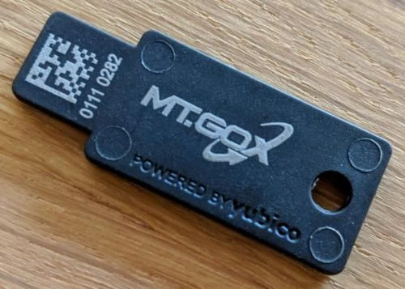

*YubiKey yagenewe Mt. Gox (inkomoko: [Tech Solvency](https://www.techsolvency.com/mfa/security-keys/yubikeys/rare/))*

Imbuga zihiganwa na zo nyene zarashizeho uburyo bwo kwemeza akaranga mu ntambwe zibiri. Bitcoin-Central [yahisemwo](https://bitcointalk.org/index.php?topic=21422.msg307138#msg307138) Google Authenticator kuva ku wa 30 Ruheshi. TradeHill yo [yaciye](https://bitcointalk.org/index.php?topic=28447.msg357955#msg357955) ku gikorwa Duo Security kuva ku wa 13 Mukakaro.

### Ukwugara kwa MyBitcoin

Mu ci ryo mu 2011, benshi mu bakoresha bashasha b'iryo faranga rya crypto baja kuri MyBitcoin, porogaramu y'ububitsi ituma umuntu atunganya ama bitcoins ata kwirirwa arazwa ishinga no gukoresha porogaramu igoye. Iraboneka kuri internet mu buryo bwa interface ya web, kandi umuntu akenera gusa ijambobanga kugira ngo yinjire muri konti yiwe. Iyo porogaramu [ishirwa imbere](https://www.youtube.com/watch?v=ejiqbzqmxSE) n'[inyigisho](https://web.archive.org/web/20110613053345/http://bitcoinme.com/index.php/accept) zo muri ico gihe nk'umuti woroshe wo kwakira ama bitcoins. Bruce Wagner [ayerekana](https://web.archive.org/web/20110424221921/http://www.bitcoinme.com/) ku rubuga rwiwe BitcoinMe.com nk'uburyo "bwihuta cane kandi bworoshe bwo gutangura gukoresha Bitcoin". Kuyikoresha biroroshe cane ku buryo abantu benshi badakurikiza [impanuro ya Satoshi](https://bitcointalk.org/index.php?topic=125.msg1149#msg1149) yo kubika gusa "uduhera dutoyi" kuri iyo porogaramu, bagaca bayikoresha nka konti yo kuziganya.

Mu misi yakurikiye ku wa 19 Ruheshi, MyBitcoin yarashikiwe n'ingaruka z'isohoka ry'amakuru ya Mt. Gox. Abantu b'ababisha barinjiye muri konti nyinshi zikingiwe n'ijambobanga rigoyagoya ryasubiye gukoreshwa kuri Mt. Gox. Nk'akarorero, [BrightAnarchist](https://bitcointalk.org/index.php?topic=20427.msg255193#msg255193), wa muntu wo kuri forum yari yarasunitse EFF kwemera bitcoin mu 2010, yaratakaje amahera yiwe yose. Ku wa 25 Ruheshi, Tom Williams, umukuru atazwi wa MyBitcoin, [yarasiguye](https://bitcointalk.org/index.php?topic=22221.msg279396#msg279396) ko 1 % vy'abakoresha bashikiwe n'isohoka ry'amakuru ya Mt. Gox ari bo bakozweko kandi ko ama bitcoins 4 019 yibwe, ni ukuvuga 70 000 $.

Yamara, ingorane z'iyo porogaramu ntizagarukiye aho. Ku wa 29 Mukakaro, MyBitcoin yarugaye bukwi na bukwi. Ama bitcoins nka 78 740 yari abuze kuri Wallet ifatanye n'iyo porogaramu, igitigiri kingana n'imiliyoni irenga imwe y'amadolari ico gihe kandi gihwanye na 51 % vy'amahera yari kuri konti z'abakiriya, ivyo bikaba vyahatiye ico gikorwa gusubiza ibisigaye no kuzimangana. Naho MyBitcoin [yitwaza](https://web.archive.org/web/20111018173154/https://www.mybitcoin.com/) igitero c'ubusuma (ikindi kandi!), hari ibimenyetso [vyerekana](https://observer.com/2011/08/search-for-owners-of-mybitcoin-loses-steam/) ko uwayitwara, Tom Williams, ari we yakoze ubwo busuma.

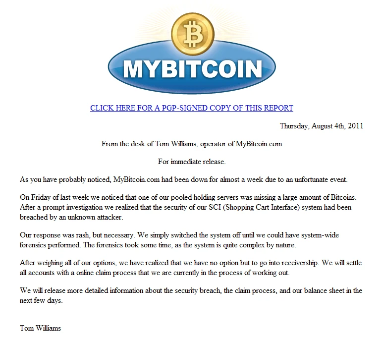

*Itangazo rya Tom Williams ryo ku wa 4 Myandagaro 2011 (inkomoko: [Bitcoin Wiki](https://en.bitcoin.it/wiki/MyBitcoin))*

Ibihombo bimwebimwe vy'abantu ku giti cabo ni [binini](https://bitcointalk.org/index.php?topic=33389.msg417455#msg417455). Na canecane, Bruce Wagner yarakozweko: [yemeza](https://www.youtube.com/watch?v=4FZldY-ZBBE&t=88s) ko yatakaje, hamwe n'uwo bubakanye, ama bitcoins arenga 25 000, ni ukuvuga arenga 300 000 $ igihe yugara. Yarakoze urukurikirane rw'ibiganiro vyahariwe ico kintu cabaye. Vyongeye, kuba Bruce yari yarahanuye abantu kuyikoresha vyarahumanije izina ryiwe, ku buryo *Bitcoin Show* izohava ihagarara haciye amezi makeyi.

Naho ukwizigirwa kwagabanutse gutyo, ama Wallet y'ububitsi yarabandanije gukundwa. Ni ko biri kuri Instawallet, [iriho](https://bitcointalk.org/index.php?topic=6785.msg99378#msg99378) kuva muri Ndamukiza. Mu kwishura ivyabaye, Bitcoin Consultancy [yaratanguje](https://bitcointalk.org/index.php?topic=35599.msg439954#msg439954) igikorwa cayo bwite, Vibanko, muri Myandagaro.

### Uguhomba kwa Bitomat

Muri ico gihe nyene, urubuga rwo muri Polonye Bitomat rwarahuye n'ingorane ikomeye. Ku wa 26 Mukakaro, umuyobozi warwo [yarongereje](https://www.reddit.com/r/Bitcoin/comments/j4t58/3rd_largest_bitcoin_exchange_has_lost_its/c2957nt/) ubushobozi bwa seriveri maze ico gikorwa kigira ingaruka (idasanzwe) yo gusubira kwatsa imashini ya virtuelle no gufuta amakuru yari ahari, harimwo n'[imfunguruzo z'ibanga](https://planb.academy/resources/glossary/private-key) za Wallet ya sisitemu. Igihombo cashitse ku ma bitcoins 17 000, ni ukuvuga nka 235 000 $ ico gihe. Naho ibivunjwa bitari vyinshi cane, ni urubuga rw'ivunjisha rwa gatatu mu bunini inyuma ya TradeHill na Mt. Gox, ari co gituma ico kintu cabaye gifise akamaro.

Kugira ngo ntahombeshe abakiriya biwe, uwo muyobozi yasavye kugurisha urubuga ku 17 000 BTC. Ivyo vyarashimishije Mark Karpelès, yipfuza kwungukira kw'isoko rya Polonye. Ku wa 11 Myandagaro, Mt. Gox [yaratangaje](https://web.archive.org/web/20120426023056/http://support.mtgox.com/entries/20357051-mt-gox-the-world-s-largest-bitcoin-exchange-to-acquire-bitomat-pl-compensate-loss-of-bitcoins) ko iguze Bitomat, kugira ngo "isubize ukwizigirwa mu butunzi bwa bitcoin". Ariko ivyo vyagize ingaruka yo kwongera 17 000 BTC ku madeni ya Mt. Gox.

Kuri ivyo bihombo, hiyongerako ikosa ryo gukoresha nabi rya Mt. Gox muri Gitugutu 2011: ama bitcoins nka 2 609 (ni ukuvuga arenga 8 000 $) [yararungitswe](https://bitcointalk.org/index.php?topic=50206.msg598125#msg598125) kuri Address itemewe, bituma adashobora gukoreshwa. Iryo kosa ryo mu kwandika porogaramu [rihishura](https://www.righto.com/2014/03/the-programming-error-that-cost-mt-gox.html) ukutiyubara kwa Mark muri rusangi, kwerekana imbere y'igihe iherezo ribabaje ry'urwo rubuga rw'ivunjisha.

### Ugukura kujegajega

Mu 2011, Mt. Gox yari rero ihuriro nyamukuru ry'ubutunzi bwa Bitcoin. Nk'uko vyari bimeze mw'isi ya Bitcoin yose, urwo rubuga rwagize intsinzi isagamvye mu gice ca mbere c'umwaka. Ruyobowe na Mark Karpelès, rwarashitse ku rundi rugero. Uwo yaruguruye ibiro kandi afata umukozi.

Yamara, ukwo gukura kwihuta cane kwari guhishije ukujegajega gukomeye. Urubuga Mt. Gox rwaragiriwe ibitero vy'ubusuma bitari bike muri ico kiringo, ari co gituma rwarundanije ibihombo uko amezi aheraheza: ama bitcoins arenga ibihumbi ijana yari abuze mu mpera z'ici. Ivyo vyabura ugutemba kw'akaravyo. Ariko Mt. Gox yari igiye kubanza gucika urubuga runini cane mu kiringo c'imyaka ibiri n'igice.

## Bitcoin n'uguharanira ivya politike
<chapterId>5545c513-74de-57e8-929e-a75406ed5829</chapterId>

Bitcoin ni ikintu ca politike bimwe bikomeye kuko ari igikoresho co kwibohora kandi gituma umuntu akora ibintu hanze y'ivyo amategeko ategekanya. Ni co gituma, nk'uko vyumvikana, yakwegereye abantu basunikwa n'ivyiyumviro vya politike, akenshi bakaba ari bo bayishigikiye n'umwete kuruta abandi. Vyongeye, iterambere ryayo ryaroroherejwe n'ukutizera gukomeye be n'ishavu ku rwego rw'amabanki, vyakomoka kw'ihungabana ry'imari ryo mu 2008: abaharanira ivya politike babona muri iryo faranga rya crypto ikindi kintu cosubirira inzego z'imari babona ko zononekaye.

Bitcoin yungukiye canecane ku muhari wa libertarian wo muri Amerika, washigikira icarimwe umwidegemvyo mu vy'ubutunzi (uranga aba Républicains) n'umwidegemvyo mu vy'inyifato (uranga aba Démocrates), gutyo ukaba wari nk'inzira ya gatatu ya politike muri Leta Zunze Ubumwe za Amerika. Gutyo aba libertarian benshi baracitse abamamaza bakomeye b'iryo faranga rya crypto, kandi barashigikiye na canecane iterambere ryaryo mu vy'ubutunzi muri Leta ya New Hampshire.

Muri iki kigabane, tuzobanza kwiga imigenderanire ya Bitcoin na libertarianisme yo muri Amerika, itari iyibonako ibintu kumwe. Hanyuma, tuzokwitaho uruhara rukomeye rw'abantu bamwebamwe bazwi, nka Ian Freeman, Roger Ver canke Erik Voorhees. Ubwa nyuma, tuzobona ingene Bitcoin yinjiye mu mihari ya politike nka *Free State Project* canke *Occupy Wall Street* mu mpera z'umwaka wa 2011.

### Imigenderanire na libertarianisme yo muri Amerika

Ukwegerana kwa libertarianisme yo muri Amerika na Bitcoin [gusa](https://www.metzdowd.com/pipermail/cryptography/2008-November/014853.html) n'ukwumvikana. Aba libertarian babona ko ukwinjira kwa Leta mu bintu atari ikintu co kwipfuza, harimwo no mu vy'ifaranga; mu gihe iryo faranga rya crypto ku ruhande rwaryo ari ikindi kintu cosubirira ifaranga rya Leta kubera ridashobora kuzibirwa kandi ritagwizwa ngo rite agaciro. Ni co gituma benshi mu bagize umuryango wo muri ico gihe na bo nyene ari aba libertarian: babona muri Bitcoin umuti w'ingorane biyamiriza.

Muri iki kiringo ca kahise ka Bitcoin, isi y'aba libertarian iranzwe n'ukwiyamamaza kwa Ron Paul mu matora y'umukuru w'igihugu yo mu 2012. Ron Paul ni umunyapolitike w'umu libertarian, aserukira akarere ka 14 ka Leta ya Texas mu Nama y'Abaserukira abanyagihugu. Yatazirwa "Doctor No" kubera yamenyereye gutora yiyamiriza imigambi y'amategeko yose igabanya umwidegemvyo w'abanyagihugu canke yongereza amahera Leta ikoresha. Amaze kurondera gutorwa n'aba Républicains ngo abaserukire mu matora yo mu 2008, yarasubiriye ku yo mu 2012. Naho kwitoza kwiwe kwari gufise amahirwe makeyi yo kuroranirwa, kwarahimbaye aba libertarian benshi kandi [kuvyura](https://reason.com/2012/05/11/welcome-to-ron-pauls-revolution-the-webs/) umuhari nyakuri wa rubanda. Ukwiyamamaza kwa kabiri kwa Ron Paul mu matora y'umukuru w'igihugu guhura nka hose n'ikiringo turiko turihweza: [kwatanguye](https://web.archive.org/web/20110516130810/http://politicalticker.blogs.cnn.com/2011/05/13/breaking-rep-ron-paul-announces-third-bid-for-presidency/) muri Rusama 2011 guhera muri Myandagaro 2012 kuri *Republican National Convention* yagenye icese Mitt Romney nk'umukandida w'umugambwe w'aba Républicains. Ni co gituma uwo munyapolitike avugwa kenshi mu biganiro vyo muri ico gihe.

Vyongeye, hariho kandi isano rikomeye cane hagati ya libertarianisme n'ishure ryo muri Otriche, ishure ry'ivyiyumviro mu vy'ubutunzi rifise uburyo bw'ukwiyumvira bushingiye ku nyifato y'umuntu ku giti ciwe aho gushingira ku y'ikibano. Koko rero, aba libertarian kenshi cane ni abashigikiye inyigisho z'uwo mugenzo, ziyamiriza ku rugero runini ukwinjira kwa Leta mu bintu. Bemera canecane icemezo c'uko ukwononekara kw'urwego rw'ifaranga, kwabaye mu kinjana ca XX mu kuva ku rugero rw'inzahabu (igiciro c'ivunjisha kidahinduka) kuja ku rwego rw'amafaranga ya fiat (ibiciro vy'ivunjisha bihindagurika), kwatumye amahera Leta ikoresha yongerekana bimwe bidasanzwe. Ni co gituma muri ico gihe nyene bakunda ivyuma vy'agaciro, babonamwo "ifaranga nyakuri", bitandukanye n'inoti za Réserve fédérale (ni ukuvuga amadolari), ziri mu "ifaranga ry'ikinyoma". Abarahira inzahabu yonyene bakunze kwitwa *gold bugs*.

Abaharanira ivya politike bamwebamwe baremejwe ningoga na Bitcoin, nka [Stefan Molyneux](https://odysee.com/@freedomain:b/stefan-molyneux-in-2011-bitcoins-digital:e) canke [Adam Kokesh](https://web.archive.org/web/20120517174507/https://bitcoinmagazine.net/adam-kokesh-on-bitcoin-and-free-market-money), bayitayeho kuva mu ci ryo mu 2011. Yamara, si ko biri ku ba libertarian bose. Benshi muri bo bafatanye runini n'umugenzo wo muri Otriche, uvuga ko ivyuma vy'agaciro vyonyene ari vyo bishobora kuba ishimikiro ry'ubutunzi bumeze neza, ivyo bikaba bibashikana ku kwanka Bitcoin ubwa mbere. Nk'uko twabibonye mu [kigabane ca 6](https://planb.academy/courses/a51c7ceb-e079-4ac3-bf69-6700b985a082/6b3418a7-125e-4ea1-a03a-f36090fac8a4) c'icigwa cacu ca mbere, kuri bo Bitcoin ivuguruza théorème de régression ya Ludwig von Mises, kubera itagira agaciro kayo bwite kandi idashingiye ku kintu gifatika. Babona ko gutyo idashobora gucika ifaranga uko igihe kirengana kandi ko ata co bimaze kwigora ngo umuntu ayikoreshe. Nk'uko Satoshi Nakamoto [yavyanditse](https://mmalmi.github.io/satoshi/#email-1), "bamenyereye cane kurwanya ifaranga rya fiat ku buryo babona ko ikintu cose kitari inzahabu kitabereye bihagije" kandi "baremera ko ikintu gishobora gusha, ariko bakemeza ko kitazokwigera gisha kuko hatazokwigera haba igishirira".

Ku wa 9 Ruheshi, David Kramer, umwanditsi wa blog kuri Lewrockwell.com, [yanditse](https://web.archive.org/web/20110612114125/http://www.lewrockwell.com/blog/lewrw/archives/89471.html) gutyo ibi bikurikira mu nkuru ifise umutwe uvuga ngo "Ikindi gikoresho c'uguhanahana c'ikinyoma":

> Igikoresho c'uguhanahana kivuka ku kintu cagize akamaro / agaciro gafatika kw'isoko imbere yo gucika igikoresho c'uguhanahana, ni ukuvuga ko na co nyene cari ikintu gihanahanwa n'ibindi bintu n'ibikorwa. Uko ibinjana vyaheraheza, ibidandazwa ari vyo inzahabu n'ifeza vyarigaragaje nk'ibikoresho bibiri vy'uguhanahana bishimwa kuruta ibindi, inzahabu ikagira ikibanza ca mbere kubera idakunda kuboneka kuruta ifeza. Ni akahe kamaro / agaciro gafatika bitcoin yagize imbere? Nta na kamwe. Ni bits gusa ziri mu nyabwonko.

Mu kwezi kwa Ruheshi, ukunegura kwarongerekanye. Peter Schiff, umuhungu wa Irwin Schiff yarwanya amakori akaba n'umushigikizi ntayegayezwa w'urugero rw'inzahabu, [yagiriza](https://www.youtube.com/watch?v=vTr_hTC90oQ) ama bitcoins ko atagira "agaciro kayo bwite k'ishimikiro". Doug Casey, umuhinga mu vy'imari akaba n'umwanditsi w'umu libertarian, [yemeza](https://www.lewrockwell.com/2011/06/doug-casey/the-bitcoin-flap/) ko "nk'amafaranga ya fiat ya Leta, ama bitcoins ari uruhendo, rukora gusa igihe cose abantu bayizigira, ukwo kwizigira kwaba gufise ishingiro canke kutarifise".

Kubera babona ko ukwo kwanka kubangamiye umwidegemvyo, abandi ba libertarian baragerageje kuvyiyamiriza, nk'abanditsi ba blog [Michael Suede](https://web.archive.org/web/20110609055336/http://www.libertariannews.org/2011/06/06/libertarian-goldbugs-hating-on-bitcoin-free-market-money/) na [Jon Matonis](https://themonetaryfuture.blogspot.com/2011/06/why-are-libertarians-against-bitcoin.html), canke wa mwanditsi akiri muto [Vitalik Buterin](https://web.archive.org/web/20110617050611/http://bitcoinweekly.com/articles/bitcoin-and-the-goldbugs). Ariko ivyiyumviro vyabo ntibizoheza ngo vyemeze abo baganira batava kw'izima kuruta abandi nka Peter Schiff, kandi Bitcoin ntizokwigera yemerwa na bose mu muhari wa libertarian.

### Ikiganiro co kw'iradiyo Free Talk Live

Mu bantu ba mbere bitayeho Bitcoin mw'isi y'aba libertarian, harimwo abayobozi b'ikiganiro Free Talk Live, Ian Freeman na Mark Edge. Free Talk Live ni ikiganiro c'iradiyo yigenga ca libertarian kiriho kuva mu 2002 kandi gifatirwa amajwi mu gisagara ca Keene muri New Hampshire. Gisabagizwa muri Leta Zunze Ubumwe za Amerika zose biciye ku muhora Genesis Communications Network (wa muhora nyene ukoreshwa na Alex Jones, umuyobozi w'ikiganiro *InfoWars*). Kiraboneka kandi nka podcast kuri Internet.

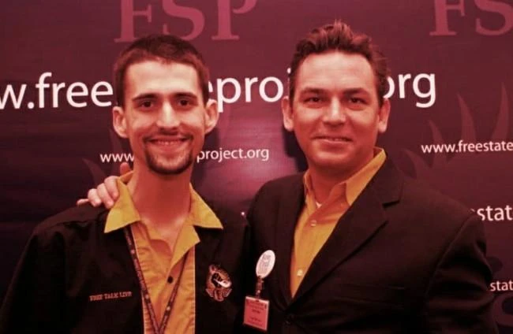

*Ian Freeman na Mark Edge, abayobozi b'ikiganiro Free Talk Live (inkomoko: Mark Edge kuri [Decrypt](https://decrypt.co/61894/fbi-raids-new-hampshire-bitcoin-operations-charges-radio-host))*

Ku wa 28 Kigarama 2010, mu nkurikizi z'inkuru ya PC World, ikiganiro kuri Bitcoin caravyuwe muri ico kiganiro n'umwe mu bacumviriza (uwitwa Jeremy West, azohava atwara igikorwa co kugurisha amakarata y'ingabirano [Spend Bitcoin](https://bitcointalk.org/index.php?topic=24653.msg306101#msg306101)). Ivyo vyatumye Ian Freeman na Mark Edge bitaho iryo faranga rya crypto, maze [bahura](https://cointelegraph.com/news/meet-the-man-who-introduced-roger-ver-to-bitcoin) na Gavin Andresen ku wa 8 Ruhuhuma. Uwo musi, abo bantu batatu barafunguriye hamwe ku murango i Keene maze Gavin ariha imfungurwa ziwe mu ma bitcoins, mu [kurungikira](https://mempool.space/tx/8dc70b8e15632becb2a070ea1ad01f292486487c5d97671535c2732e2c9131fb) Mark 25 BTC.

Abo bayobozi babiri b'ikiganiro barahimbawe na sisitemu ya Nakamoto be n'ico ishobora gukoreshwa. Na canecane, isoko Silk Road [ryaravyuye](https://bitcointalk.org/index.php?topic=3984.msg66567#msg66567) amatsiko ya Ian Freeman, we, haciye amezi makeyi, [azokwandika](https://bitcointalk.org/index.php?topic=12895.msg178537#msg178537) kuri forum ya Bitcoin ati: "dushimire Silk Road kuba yarampaye imvo yo gutahura n'aho coba igice gusa c'intumbero ya Bitcoin". Ku wa 16 Ntwarante, ica kabiri c'ikiganiro ca Free Talk Live [cahariwe](http://traffic.libsyn.com/ftl/FTL2011-03-16.mp3) Bitcoin na Silk Road, ivyo bikaba bitabuze gukwegera abacumviriza b'aba libertarian.

### Roger Ver, Yezu wa Bitcoin

Umwe mu bacumviriza b'intahemuka kuruta abandi ba Free Talk Live ni Roger Ver, kandi ivyahavugiwe kuri Bitcoin ntivyaguye mu matwi y'intumva. Roger Ver ni umudandaza w'Umunyamerika, yashinze ishirahamwe ryo gusubira kugurisha ibice vy'inyabwonko kuri internet ryitwa MemoryDealers mu mpera z'imyaka ya 90, kandi yacitse umumiliyoneri biciye muri iryo haciye imyaka mikeyi. Muri ico gihe nyene, yarakujije ivyo yemera vya libertarian, na canecane mu gusoma Ludwig von Mises, Murray Rothbard na Henry Hazlitt. Arafise kandi ukuntu abona neza iterambere ry'ubuhinga, kubera yamizwe na Ray Kurzweil, umuhinga mu vya kazoza w'umu transhumaniste.

Roger Ver ni umuntu w'ibikorwa. Mu 2000, yaritoje mu matora y'Inama Nshingamateka ya Leta ya Californie aserukira Umugambwe wa libertarian. Yamara, kubera ukuvuga ata co yinona kwiwe kutahimbaye abategetsi, yarafashwe mu 2002 azira kugurisha ibiturika vy'imihimbaro ata ruhusha maze apfungwa amezi 5. Ivyo bintu vyamushikiye vyaramuhungabanije bituma yimukira mu Buyapani, aho yacitse umuntu ahaba ubudahengeshanya. Mu 2011, aba i Tokyo.

*Roger Ver mu nama Money2020 muri Gitugutu 2012 (inkomoko: [Digital Trends](https://web.archive.org/web/20121212165432/http://www.digitaltrends.com/cool-tech/the-future-of-money-its-not-in-your-hands/))*

Yamenye ko Bitcoin ibaho muri Kigarama 2010 biciye kuri Free Talk Live maze aronka makeyi muri yo. Yamara, inyuma y'ikiganiro co ku wa 16 Ntwarante 2011 ni ho yatanguye gukunda cane iryo faranga rya crypto. Ico gihe yagize nk'ihishurirwa: yarasomye ivyo ashoboye vyose kuri ico kintu, ku buryo yamaze amajoro atari make akurikirana adasinziriye. Haciye imyaka itari mike [azobwira](https://londonlovesbusiness.com/meet-bitcoin-jesus-roger-ver-the-millionaire-who-distributes-free-bitcoins/) ikinyamakuru co kuri internet *London Loves Business* ati:

> Naratahuye ko ari bwo bwoko bw'ifaranga bwiza kuruta ubundi isi yose yigeze kumenya. Nari mfise umunezero urenze urugero vy'ukuri kuko numva ko umuhamagaro w'ubuzima bwanje wari ushitse mu ishusho ya Bitcoin. Sinasohotse i muhira mu kiringo kirenga indwi kandi namaze akanya kose nsoma ivyo nashobora kuronka vyose kuri Bitcoin. Ukubura itiro kwarandwaje cane ku buryo umukunzi wanje yabwirijwe kunjana ku bitaro.

Inyuma y'ivyo, Roger Ver yaritanze mu muryango. Ku wa 26 Ndamukiza, [yaratanguye](https://bitcointalk.org/index.php?topic=4667.msg95746#msg95746) kwemera ukwishurwa mu ma bitcoins mw'ishirahamwe ryiwe MemoryDealers. Ku wa 4 Ruheshi, yarakoresheje icapa c'amatangazo yari afise kugira ngo amenyekanishe Bitcoin n'ishirahamwe ryiwe. Ico capa kibonwa n'abari kw'ibarabara rinini rigendwa cane ry'i Sunnyvale, muri Silicon Valley, ivyo bikaba bifise ingaruka yo [gukwegera](https://www.instagram.com/p/FNIFl/) abantu kuri Bitcoin, mu gihe nyene igishika ca speculation kiri ku rugero rwo hejuru.

*Icapa c'amatangazo ya Bitcoin i Sunnyvale (inkomoko: Roger Ver kuri [Bitcointalk](https://web.archive.org/web/20130524003126/https://bitcointalk.org/index.php?topic=7961.40))*

Mu kwezi kwa Ruheshi, inyuma y'ingorane za mbere Mt. Gox yahuye na zo, Roger yasavye Mark Karpelès ko yoza kumufasha, kuko aba hafi cane y'ibiro vy'iryo shirahamwe i Tokyo. Mark yaremeye maze Roger aza kuri Cerulean Tower. Yari aherekejwe n'abantu batari bake, barimwo Jesse Powell, umugenzi wo mu mashure yisumbuye akaba na rwiyemezamirimo w'i San Francisco na we nyene yitaho Bitcoin (uwo azoshinga urubuga Kraken mu 2013). Naho Mark Karpelès yari afise [inyifato y'ubunebwe](https://www.wired.com/2014/03/bitcoin-exchange/), barashoboye gutekanisha ibintu no gusubira kwugurura urubuga haciye indwi imwe.

Ariko ukwitanga kwa Roger Ver kuri Bitcoin ntikwagarukiye aho. Nk'uko vyavuzwe, aremera adakeka ko Bitcoin ifise ubushobozi bwo guhindura ibintu kandi yumva ko afise igikorwa ategerezwa kurangura muri ivyo. Arondera kuronka abayoboke. [Yaraseruka](https://www.youtube.com/watch?v=IG_AvbfCEs4) muri *Bitcoin Show* ya Bruce Wagner muri Ruheshi. [Yaracisha](https://www.youtube.com/watch?v=5pV9ptoCMyc) amatangazo yamamaza Bitcoin kw'iradiyo ya Free Talk Live, asubirira ukumenyekanisha ishirahamwe ryiwe yahora akora biciye aho. Uko amezi aheraheza, yarigaragaje nk'umwe mu bamamaza Bitcoin b'umwete kuruta abandi, ku buryo [yatazirwa](https://web.archive.org/web/20120218230448/http://www.thebitcointrader.com/2012/02/bitcoin-jesus-is-getting-ready-to.html) "Yezu wa Bitcoin" ("*Bitcoin Jesus*" mu congereza) muri Ruhuhuma 2012 n'umu trader wo muri Canada GoWest. Iryo zina ry'iritazirano rizoguma, naho Roger atigeze aryiyitirira.

Vyongeye, Roger arafise icizigiro kidasanzwe ku giciro c'iryo faranga rya crypto kw'isoko kandi akora speculation muri iyo ntumbero mu kugura ama bitcoins menshi kuva muri Rusama. Ku wa 4 Myandagaro 2011, [yarahize ku mugaragaro](https://www.youtube.com/watch?v=gfydIbhduu0) ko igiciro mu madolari, ico gihe cari gihagaze nko ku 10 $, gikwiye kugwizwa incuro 100 mu myaka ibiri ikurikira (ubwo buhanuzi buzoranguka buciye inyuma amezi makeyi). Arashora kandi mu mashirahamwe yo mw'isi ya Bitcoin nka BitPay, Blockchain.info na BitInstant.

### Erik Voorhees, Ira Miller n'imigambi yabo

Ariko Roger si we mu libertarian w'umwete wenyene yitanze muri Bitcoin; hariho kandi na Erik Voorhees. Erik Voorhees yavutse mu 1984, akurira muri Colorado. Ni umuhungu wa Jacques Voorhees, yari umuyobozi mukuru w'urubuga rw'ubudandaji bwa diyama Polygon imbere yo kurugurisha ku miliyoni 8,4 z'amadolari mu 2004. Se wiwe, na we nyene w'umu libertarian, yamuraze umutima wo gukunda umwidegemvyo n'uwo kwihangira imigambi. Amaze kuronka impapuro z'umutsindo mu gutunganya amashirahamwe no mu vy'ubutunzi bwa politike kuri kaminuza ya Puget-Sound, Erik yarabaye i Dubaï igihe kinaka aho yari ajejwe itumatumanako mw'ishirahamwe ry'amazu. Yarakozweko canecane n'ihungabana ryo mu 2008, ryamusunitse kwitaho urwego rw'amabanki n'ifaranga.

*Erik Voorhees kuri Colorado Renaissance Festival y'i Larkspur muri Ruheshi 2007 (inkomoko: [Forbes](https://www.forbes.com/sites/michaeldelcastillo/2019/01/03/bitcoins-last-gunslinger/))*

Mu 2011, yarimukiye i Portsmouth muri New Hampshire mu ntumbero ya *Free State Project* (tuzodondora mu gice gikurikira). Aho ni ho [yamenyeye](https://www.maxraskin.com/interviews/erik-voorhees) ko Bitcoin ibaho, biciye ku nkuru yasangijwe kuri Facebook n'umunyapolitike wo muri ako karere [Keith Ammon](https://bitcoinmagazine.com/politics/rep-keith-ammon-is-new-hampshires-premier-bitcoin-advocate), akaba n'umugenzi wiwe. Ico gihe hari muri Rusama: igiciro ni 5 $ kandi kiraduga ningoga cane. Amaze amasaha makeyi yiga ico kibazo, amaherezo yaremejwe n'ico ciyumviro maze aragikunda cane. Mu 2013 [azovuga](https://bitcoinmagazine.com/culture/erik-voorhees-new-frontier-1374794545) ati:

> Uwo musi wabaye umwe mu misi ihambaye kuruta iyindi mu buzima bwanje. Numvise nk'uwuvumbuye ukuri gukomeye, nk'uwubona kazoza. Naretse ivyo nariko ndakora vyose maze nibira mu mwobo w'urukwavu.

Imvo yiwe ni iy'ivyiyumviro vya politike canecane: akwegwa n'uko iyo sisitemu idashobora guhagarikwa be n'uko bidashoboka guhingura amafaranga arenze ayategekanijwe. [Abona](https://silverunderground.com/2011/06/bitcoin-the-separation-of-money-and-state/) muri Bitcoin ishusho y'"ugutandukanya ifaranga na Leta". Vyongeye, aremejwe n'ingiro ya [agorisme](https://planb.academy/resources/glossary/agorism) yamamajwe na Samuel Konkin kandi [yibaza](https://bitcointalk.org/index.php?topic=34657.msg431717#msg431717) ko "Bitcoin kuri agorisme ari nk'uko imyanya yo guhema imeze ku ifi", ni ukuvuga igice nyamukuru.

Muri Ruheshi, Erik Voorhees yaraguze ama bitcoins menshi, mu gihe igiciro cari ku rugero rwo hejuru. [Yaragerageje](https://bitcointalk.org/index.php?topic=24198.msg300745#msg300745) kandi [ugucukura](https://planb.academy/resources/glossary/mining) akoresheje processeur graphique, ariko ivyo ntivyahimbaye umukunzi wiwe, maze abwirizwa kugurisha imashini ziwe. Muri Myandagaro, yaragiye i New York kwitaba inama yateguwe na Bruce Wagner, maze ahamenyanira n'abantu benshi bakora mw'isi ya Bitcoin.

Umwe mu bantu yahuriye na bo muri iyo nama ni Ira Miller, yitwa Bearbones kuri forum. Uwo ni umuhinguzi akiri muto akomoka muri Illinois kandi ico gihe yaba i Denver, muri Colorado. Naho ari umuntu w'ubuhinga canecane, Ira Miller na we nyene aritanga mu vya politike. Akurikije aho umuryango wiwe uhengamiye, mu ntango Ira Miller [yari](https://isysd.medium.com/change-by-example-not-politics-or-money-e232c25d58a7) umu social-démocrate (*liberal* mu nsobanuro yo muri Amerika) kandi yatoye Barack Obama mu 2008. Ariko rero, yaratengushwe cane n'imihango itashikijwe be na politike zirwanya umwidegemvyo z'uruhande rw'aba Démocrates. Kubera atakunda cane n'uruhande rw'aba Républicains, yaciye ahindukirira libertarianisme, ashigikira na canecane Ron Paul.

*Ira Miller muri Munyonyo 2011 (inkomoko: [Bitcoin Show](https://www.youtube.com/watch?v=VuLAhZsFc1A) kuri Youtube)*

Akoresheje Bitcoin, Ira Miller yipfuza "kwubaka sisitemu zindi, kugira ngo zihiganwe n'uko ibintu bisanzwe bimeze kwononekaye bimwe biteye ubwoba". Mu 2011, yarahuje amajambo n'ibikorwa. Muri Rusama, yaratanguje [BitMunchies](https://bitcointalk.org/index.php?topic=7078.msg103566#msg103566), iduka ryo kuri internet ryihariye mu vy'imfungurwa (*the munchies* ni ijambo ryo mu mvugo yo mu mabarabara risobanura "inzara ikomeye" mu congereza). Mu ci, yarahinguye kandi [BTCinch](https://bitcointalk.org/index.php?topic=40088.msg488726#msg488726), igikoresho co gutunganya ukwishura gituma abadandaza bavunja ama bitcoins yabo mu madolari, n'amadolari mu ma bitcoins.

Abo bagabo babiri barumvikana cane kandi ubushobozi bwabo burunganirana. Muri Myandagaro, Erik Voorhees yariko ararondera umwanditsi wa porogaramu wo guhingura kimwe mu vyiyumviro vyiwe maze Ira aremera. Ico ni FeedZeBirds (ijambo ku rindi "nimugaburire inyoni"), urubuga rw'amatangazo rutuma umuntu yishura kugira ngo ashire imbere ikintu kuri Twitter mu kugura retweets, [batanguje](https://bitcointalk.org/index.php?topic=52638.msg628165#msg628165) ku wa 23 Munyonyo. Ni ikoreshwa riri ku rubibe (Twitter nta nkeka ntiremesha inyifato nk'iyo), ryungukira ku kudashobora kuzibirwa kwa Bitcoin no ku kutabaho kw'[amafaranga y'ugucuruza](https://planb.academy/resources/glossary/transaction-fees). Ku wa 28 Munyonyo, abo bafatanije babiri [baraserutse](https://www.youtube.com/watch?v=VuLAhZsFc1A) muri *Bitcoin Show* kugira ngo bamenyekanishe ico bahinguye. Mu nyuma, bazohingura kandi igikoresho co gutunganya ukwishura Paysius n'igikorwa co kurungika amahera biciye kuri email Coinapult.

### Free State Project muri New Hampshire

Nk'uko twabiciye amarenga, abo bantu bafitaniye isano ryegeranye ku rugero rutandukanye na *Free State Project*. *Free State Project* ni umuhari wo kwimuka ku mvo za politike, ufise intumbero yo gukoraniriza aba libertarian muri Leta imwe kugira ngo bagire ico bahinduye ku ntwaro yaho. [Watangujwe](https://web.archive.org/web/20010727113202/http://www.webleyweb.com/tle/libe131-20010723-03.html) muri Mukakaro 2001 na Jason Sorens, umunyeshure wa doctorat kuri Yale, yababazwa n'uko utwigoro tw'aba libertarian mu matora twananiwe kandi yahamagarira "abashigikiye umwidegemvyo bo mu mpande zose" kuja kuba muri Leta ntoyi. Mu 2003, Leta ya New Hampshire yaracaguwe kubera imico yayo yo kwihagararako kw'umuntu ku giti ciwe, icivugo cayo cemewe kikaba ari "*Live Free or Die*" (kivuye ku gifaransa "Vivre libre ou mourir"). Abantu bategerezwa gushira umukono ku rwandiko rw'intumbero, bafise ihangiro ry'abantu 20 000. Urwo rugero ruzoshikwako mu 2016, ariko abantu babifitiye umwete kuruta abandi barimuka hagati aho.

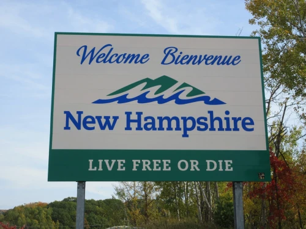

*Icapa c'ikaze ku bwinjiriro bwa New Hampshire mu 2018 (inkomoko: [New Hampshire Public Radio](https://www.nhpr.org/the-exchange/2018-02-28/its-tax-season-how-does-new-hampshires-complex-unique-tax-system-work))*

Mu 2011, New Hampshire yari imaze gucika ikibanza gikomeye ca libertarianisme. Ibirori bibiri birahategurwa buri mwaka na *Free State Project*. Ica mbere ni *New Hampshire Liberty Forum*, ikaba ari inama isanzwe ishikirizwamwo amajambo n'abantu bazwi cane ba libertarianisme kandi muri ico kiringo ibera kuri hoteri Crowne Plaza y'i Nashua, mu bumanuko bw'iyo Leta.

Ica kabiri ni *Porcupine Freedom Festival* (ikunze kwitwa "PorcFest"), ikaba ari festival y'indwi imwe ibera mu ci ku kibanza co gushingamwo amahema hafi ya Lancaster, mu buraruko kuruta. Umwuka waho ni uw'ukwisanzura kuruta, ku buryo ico kirori [citwa](https://aaeblog.com/2011/06/way-long-gone-part-2/) mu 2011 "Woodstock y'abantu bakoresha ubwenge" n'umwanditsi w'umu libertarian Roderick T. Long. Ikirori c'uwo mwaka, cabaye muri Ruheshi, caragenze neza kandi [cakoranije](https://mises.org/mises-daily/porcfest-2011) abantu barenga 1 000.

Nk'uko vyumvikana, Bitcoin yarakwegereye uwo muhari kuva mu mpeshi, uyibonamwo igikoresho gifatika co gukorera mu karere. Muri Gitugutu, uduce twa bitcoin [twaratanzwe](https://bitcointalk.org/index.php?topic=47350.msg563649#msg563649) ku bagize uwo mugambi kubera umwete wo kuronka abayoboke wa Roger Ver, Erik Voorhees na Ira Miller. Ico gikorwa gifise intumbero yo kwigisha: gutahuza abashize umukono kuri *Free State Project* ko bashobora kwimura amahera kuva ku mpera imwe y'isi gushika ku yindi, bidakenewe ko batanga akaranga kabo. Vyongeye, uwutegura Liberty Forum, Chris Lawless, yaratangaje ko iyo nama izokwemera ama bitcoins mu kwishura ukwiyandikisha.

New Hampshire, kubera ukwo gukoranira hamwe kw'aba libertarian, izocika uko imyaka iheraheza ihuriro nyamukuru ry'iyemerwa ry'iryo faranga rya crypto. Uretse ihinduka ryayo mu nzego, [izohinduka](https://www.forbes.com/sites/kashmirhill/2014/06/12/the-free-state-project-a-libertarian-testing-ground-for-bitcoin-3d-printers-and-drones/) "ikibanza c'igerageza" nyakuri ca Bitcoin n'ic'ubundi buhinga bushasha buteza imbere umwidegemvyo nk'imashini zicapura muri 3D.

### Umuhari Occupy Wall Street

Ariko rero libertarianisme si yo nyigisho ya politike yonyene ifitaniye ubucuti na Bitcoin. Ku rundi ruhande rw'ikibuga ca politike (turavye ko ivyiyumviro vya libertarianisme mu vy'ubutunzi biri ahanini iburyo), hari umuhari wose urwanya capitalisme n'urwego rw'imari ushikanwa ku kubona akamaro muri iryo faranga rya crypto.

Yamara, cokimwe n'aba libertarian, uwo muryango wa politike ukunda kwanka Bitcoin, kuko idahuye n'ukuntu babona ifaranga. Ntihindagurika na gato, kandi ntigengwa bikwiye na politike. Bitcoin si ifaranga ry'ikibano, rishobora [gutwarwa](https://diyhpl.us/~bryan/irc/bitcoin-satoshi/p2presearch-again/p2pfoundation.net/backups/p2p_research-archives/2009-February/001362.html) mu buryo bwa demokarasi, nk'uko abaharanira ivya politike baribona biciye mu mafaranga y'uturere. Yánis Varoufákis, umu marxiste libertaire azohava aba umushikiranganji w'imari w'Ubugiriki, [azoyagiriza](https://www.yanisvaroufakis.eu/2013/04/22/bitcoin-and-the-dangerous-fantasy-of-apolitical-money/) mu 2013 kuba itera igabanuka ry'ibiciro kandi ikazana ubusumbasumbane, mu kwandika na canecane ko "hadashobora kubaho ifaranga ryakuwemwo politike rishoboye "kugaburira" ikibano c'amahinguriro giteye imbere".

Muri Nyakanga 2011, umuhari *Occupy Wall Street* waje guhungabanya ubuzima bwa politike bwa Leta Zunze Ubumwe za Amerika. Imbere y'ivyago vy'isubira inyuma ry'ubutunzi ryatewe n'ihungabana rya subprimes, ishirahamwe ryo muri Canada *Adbusters* (bisunitswe n'uwarishinze, Kalle Lasn, n'umwe mu banditsi baryo, Micah White) [ryahamagariye](https://web.archive.org/web/20110717094726/https://www.adbusters.org/blogs/adbusters-blog/occupywallstreet.html) abantu "kwigarurira" Wall Street, ihuriro ry'ikimenyetso ry'imari y'i New York, mu gukora ikintu kimeze nka sit-in. Ico basaba nyamukuru ni ukugabanya akosho k'amashirahamwe manini n'ak'abakomeye b'amahera kuri politike y'igihugu, akosho kabonwa ko ari ko katumye haba iryo hungabana. Icivugo c'iyo myiyerekano [ni](http://occupywallst.org/) "Turi ba 99 %", bihushanye n'"umwina n'igiturire vya ba 1 %". Imyiyerekano yatanguye ku wa 17 Nyakanga mu busitani Zuccotti, hafi y'akarere k'imari ka New York, ikoranya abantu barenga igihumbi. Uko indwi ziheraheza, uwo muhari waragutse, ku buryo washitse no mu bindi bisagara bikomeye vy'igihugu, nka Chicago canke Los Angeles, hamwe no mu makungu.

Uwo muhari utegerezwa kuronka amahera: abari mu myiyerekano [bakeneye](https://web.archive.org/web/20111120054617/http://www.expanton.com/index.php/77-other/24-welcome) imfungurwa, impuzu z'imvura, n'ibikoresho kugira ngo ico kirori gishobore gusabagizwa ako kanya nyene kuri Internet. Intumbero ni uko abantu baguma aho hantu igihe kirekire gishoboka kwose. Yamara, kuronka ayo mahera biragoye kubera ko ukwo kwiyamiriza kurenze urugero: bimwebimwe mu bikorwa vyawo koko ntivyemewe n'amategeko nk'uko bigaragazwa n'abantu benshi bafatwa. Kubera ivyo, uwo muhari urashobora gukorwako n'ukuzibirwa mu vy'imari, ivyo bikaba vyigaragaza nk'akarorero igihe konti ya PayPal ya \#FeedtheProtest, umugwi w'amakuru umenyesha ivyabaye, [ifatirwa](https://web.archive.org/web/20110928152351/http://feedtheprotest.com/node/219) ata nteguza ku wa 26 Nyakanga.

Gutyo, amashirahamwe menshi ari muri uwo muhari yafashe ingingo yo kwemera bitcoin, abona nk'ifaranga rya digitale ritamenyekanisha abarikoresha kandi ryerekanye ico rishoboye igihe ryemerwa na WikiLeaks. Inama rusangi y'abari mu myiyerekano i New York [yakira](https://web.archive.org/web/20111004195625/http://nycga.cc/donate/) intererano kuva ku wa 19 Nyakanga, zose hamwe 686 BTC ni ukuvuga zirenga 3 000 $ igihe zakirwa. \#FeedtheProtest na yo nyene [yaremeye](https://web.archive.org/web/20111004164350/http://feedtheprotest.com/node/223) bitcoin kuva ku wa 27, mu kwishura ukwugarwa kwa konti yayo. Ku ruhande rwabo, abagize umuryango wa Bitcoin [baritaho](https://observer.com/2011/10/bitcoin-community-takes-an-interest-in-occupy-wall-street/) *Occupy Wall Street*, kuko na bo nyene barwanya isi y'imari isanzwe. Ni co gituma bamenyekanisha ikoreshwa rya Bitcoin muri uwo muhari (n'aho vyosaba kuja aho hantu, nka [Matt Cropp](https://web.archive.org/web/20110929140153/http://btcbusiness.net/?q=node/22)) kandi bagatanga n'intererano zitari nke.

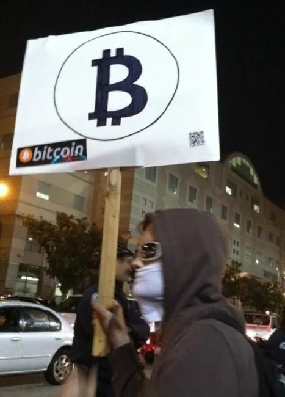

*Umukinyi wa poker Prahlad Friedman ari mu myiyerekano kuri Occupy Los Angeles muri Munyonyo 2011 (inkomoko: [Bryan Micon](https://twitter.com/BryanMicon/status/139154625638055936) kuri Twitter)*

*Occupy Wall Street* yatumye abantu benshi bibaza ku vyerekeye iryo faranga rya crypto, ico kiganiro kikaba mbere [caravuzwe](https://www.huffpost.com/entry/occupy-wall-street-money-donated-tension_n_1029377) mu bimenyeshamakuru rusangi. Uwo muhari waheze ku mugaragaro mw'ijoro ryo ku wa 14 rishira ku wa 15 Munyonyo, igihe igipolisi ca New York cirukana abari mu myiyerekano mu busitani Zuccotti kandi bikaba bitagishoboka kuhashinga amahema. Ariko rero, iciyumviro co gukoresha Bitcoin nk'igikoresho ca politike kizogumaho.

### Uruhara rw'ivyiyumviro vya politike

Ivyiyumviro vya politike vyabaye ikintu nyamukuru mu kwubaka Bitcoin mu myaka yayo ya mbere. Vyarafashije kubungabunga umwete abakoresha ba mbere bari barahaye iryo faranga rya crypto, bikwegera ba rwiyemezamirimo bitanze kandi bipfuza kubona uwo mugambi uroranirwa. Na canecane kubera umuhari wa libertarian wo muri Amerika, naho wari ufise amacakubiri y'imbere, ni ho Bitcoin yashoboye gusagamba, haba biciye ku bantu nka Roger Ver canke Erik Voorhees, canke biciye kuri *Free State Project*. Umuhari *Occupy Wall Street*, uhengamiye ibubamfu kuruta, na wo nyene waragize uruhara rukomeye mu iterambere rya bitcoin nk'ifaranga ry'ukugambarara.

Yamara, urwo ruhande rw'ivyiyumviro vya politike rwari ruhushanye n'inguvu ikwega cane kuruta: iy'inyungu y'amahera. Gutyo, uko imyaka yaheraheza harubatswe ugukwegana hagati y'izo mpande zibiri, kwigaragaje mu ihinduka ry'imvugo kuva mu 2013 no mu kuduga kudasanzwe kw'igiciro c'ivunjisha. Ariko imbere y'ivyo, vyari bikenewe gutunganya ibikoresho vyotumye abakora mu vy'imari baza gushora mw'isi ya Bitcoin. Kandi iryo terambere ryari rigiye kuba ahanini mu gihe ca "Bear market" ya mbere nyakuri muri kahise ka Bitcoin.

## Bear market ya mbere
<chapterId>e1a056ad-b7da-5bf0-ac17-0243d7bea605</chapterId>

Muri Ruheshi 2011, igishika ca speculation carahagaritswe bukwi na bukwi n'igitero c'ubusuma kuri Mt. Gox, catumye urubuga ruva kuri internet mu kiringo c'indwi imwe. Hanyuma, ugutsindwa gukomeye kwatewe n'ukwugara kwa MyBitcoin mu mpera z'ukwezi kwa Mukakaro amaherezo kwaratanguje ukuyonga kw'ifuro maze gushikana kuri Bear market ya mbere nyakuri ya bitcoin. Mu misi yakurikiye, igiciro caramanutse ningoga cane gushika kuri 6 $. Amaherezo caraguye gushika kuri 2 $ muri Munyonyo.

Ukwo guturika kw'"ifuro rinini ryo mu 2011" nta nkeka kwarakwegereye ibimenyeshamakuru, vyihutiye gutangaza ko Bitcoin idashobora kuramba. Ariko kwarabereye kandi akaryo keza ko kwubaka mu vy'ubutunzi, kandi ikiringo c'uguhagarara kw'igiciro caratumye hategurwa imigambi y'imari yeze ivyamwa mu nyuma.

Muri iki kigabane, tuzokwitaho imwimwe muri iyo migambi. Tuzovuga ingene urubuga rwa trading yo ku ngwati Bitcoinica rwazaniye abakoresha Bitcoin ingaruka y'ukugwiza n'ukugurisha ivyo umuntu adafise. Tuziga uruhara rw'igikorwa co kugura no kugurisha ako kanya nyene BitInstant mu kworohereza ivunjisha ku Banyamerika. Ubwa nyuma tuzosigura ingene amasoko y'imigabane yigenga GLBSE na MPEx yatumye ugukoranya amahera gushoboka mw'isi ya Bitcoin. Ariko ubwa mbere, reka tuvuge gatoyi ku kuntu ibimenyeshamakuru vyavuze ukuyonga kw'ifuro, bitagiriye impuhwe Bitcoin.

### Ingene ibimenyeshamakuru vyavuze ukumanuka kw'igiciro

Inyuma y'urugero rwo hejuru rwa 32 $ rwashitsweko ku wa 8 Ruheshi, igitero c'ubusuma kuri Mt. Gox n'ukwugara kwa MyBitcoin vyarahagaritse burundu umuhari wa speculation. Igiciro caratemvye gushika kuri 6 $ mu ntango za Myandagaro. Kuba Bitcoin yari imaze kumenyekana kw'isi, hiyongeyeko ukumanuka kw'igiciro c'ivunjisha, vyatanze imvo nziza yo kunegura iryo faranga rya crypto, ivyo abamenyeshamakuru banyotewe inkuru zitangaza bakaba bihutiye kubikora.

Ku wa 7 Myandagaro, Timothy Lee, umwanditsi w'urubuga rw'amakuru y'ubuhinga Arstechnica kandi [atizera](https://timothyblee.com/2011/04/19/bitcoins-collusion-problem/) Bitcoin kuva muri Ndamukiza, [yarasohoye](https://www.forbes.com/sites/timothylee/2011/08/07/the-bitcoin-crash/) inkuru ifise umutwe uvuga ngo "Ugutemba kwa bitcoin" aho asigura ko bitcoin "isa n'iyitagira agaciro k'ishimikiro na gato" kandi ko "ata ho ukumanuka kw'igiciro ca bitcoin gukwiye guhagararira bivanye n'ubwenge", ku bwiwe ivyo bikaba biri "mu ntambwe ya nyuma". Ivyiyumviro vyiwe [vyasubiwemwo](https://www.theatlantic.com/technology/archive/2011/08/the-bitcoin-economy-is-collapsing-with-no-sign-of-recovery/243253/) bukeye na Nicholas Jackson muri *The Atlantic*, we abona ko "ubutunzi bwa Bitcoin buriko buratemba ata kimenyetso na kimwe c'ugusubira kuvyuka", na Adrian Covert kuri Gizmodo, [yemeza](https://gizmodo.com/the-bitcoin-is-dying-whatever-5828710) ko "igihe c'ubuntu caheze" kandi ko "bitcoin iriko irapfa".

Hagati aho hararengutse ukundi kunegura, ahanini ku rugero rwa macroéconomie. Muri Nyakanga, James Surowiecki, umumenyeshamakuru w'Umunyamerika azwi kubera yasohoye *La Sagesse des foules* mu 2004, [yarasohoye](https://www.technologyreview.com/2011/08/23/191860/cryptocurrency/) inyandiko yagiriza Bitcoin muri *MIT Technology Review*. Yagiriza urugero ntarengwa rw'igitigiri c'ama bitcoins ko ruremesha abantu kuyabika ntibayakoreshe, ivyo bikaba vyoyibuza gucika igikoresho c'uguhanahana, amaherezo bikarema ibintu aho "igice kinini cane c'ama bitcoins gifiswe n'abantu bizigira kuyagurisha abandi bantu". Ku wa 7 Nyakanga, Paul Krugman, umuhinga mu vy'ubutunzi w'umu néokeynésien akaba yaratsindiye agashimwe ka Nobel k'ivy'ubutunzi mu 2008, [yarasubiyemwo](https://archive.nytimes.com/krugman.blogs.nytimes.com/2011/09/07/golden-cyberfetters/) ico ciyumviro mu nkuru yasohowe ku rubuga rwa *New York Times*, ifise umutwe "Golden Cyberfetters". Uwo mutwe (usobanura "iminyororo ya cyber y'inzahabu" mu kirundi) werekeza ku gitabu *Golden Fetters* casohowe mu 1992 na Barry Eichengreen, yashigikira ko ihungabana rikomeye ryo mu myaka ya 1930 ryari ingaruka y'urwego rw'urugero rw'inzahabu rwari rukazije cane. Muri iyo nkuru, Paul Krugman yemeza ko "Bitcoin yaremye akarorero kayo bwite kigenga k'urugero rw'inzahabu, aho igitigiri c'amafaranga kidahinduka" kandi ko igabanuka ry'ibiciro ryavuyemwo ryatumye "agaciro nyakuri k'ibikorwa vyo gucuruza mu ma bitcoins kagabanuka aho kwiyongera" kandi "umwimbu wose nyakuri mu ma bitcoins uragabanuka cane".

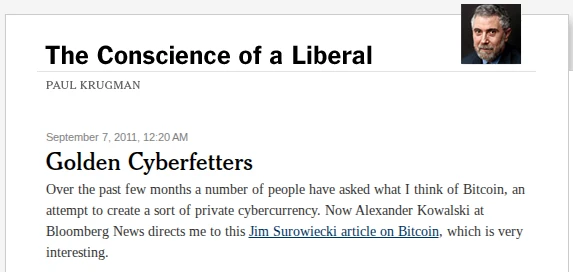

*Inkuru ya mbere ya Paul Krugman kuri Bitcoin (inkomoko: [ububiko](https://web.archive.org/web/20110909021607/http://krugman.blogs.nytimes.com/2011/09/07/golden-cyberfetters/) bwa New York Times)*

Ku wa 17 Gitugutu, igiciro ca BTC caraguye giturumbuka munsi ya 3,2 $, gutyo kiba kimanutse ibirenga 90 % ugereranije n'urugero rwo hejuru rw'ifuro, ikintu Timothy Lee atabuze [kwibutsa](https://arstechnica.com/tech-policy/2011/10/bitcoin-implodes-down-more-than-90-percent-from-june-peak/) bukeye. No kuri Arstechnica nyene, yaradondoye ingorane zijanye n'ikoreshwa ry'iryo faranga rya crypto, nk'ibitero vy'ubusuma canke ihindagurika ry'igiciro. Ntiyizigira ko Bitcoin izorokoka, kuko "amezi atanu y'inkuru mbi n'ay'ugutakaza agaciro yononye bikomeye" izina ryayo. Muri iyo nzira nyene, inkuru ya *The Economist* ifise [umutwe](https://web.archive.org/web/20181019113320/https://www.economist.com/babbage/2011/10/21/the-bursting-of-the-bitcoin-bubble) uvuga ngo "Uguturika kw'ifuro rya bitcoin" yasohowe ku wa 21 Gitugutu.

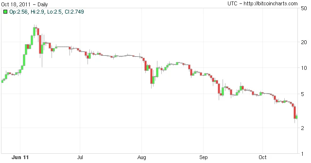

*Ihinduka ry'igiciro ca bitcoin kuri Mt. Gox hagati ya Ruheshi na Gitugutu 2011 (inkomoko: Bitcoin Charts biciye kuri [Arstechnica](https://arstechnica.com/tech-policy/2011/10/bitcoin-implodes-down-more-than-90-percent-from-june-peak/))*

Mu kwezi kwakurikiye, igiciro c'ivunjisha caragowe no gusubira kuduga, mbere gishika ku rundi rugero rwo hasi ku wa 18 Munyonyo nko kuri 2 $. Ku wa 23 Munyonyo, umwanditsi Benjamin Wallace [yarasohoye](https://web.archive.org/web/20111124022726/http://www.wired.com/magazine/2011/11/mf_bitcoin/all/1) inkuru ndende muri Wired ifise umutwe uvuga ngo "Ukuduga n'ugutemba kwa bitcoin", iyo, uretse umutwe wayo wagenewe gukwega abasomyi, ikaba ari inyandiko nziza cane kandi ivuga ingorane abakoresha Bitcoin bahuye na zo. Ico kiringo kiragoye canecane ku bacukuzi, baguze za processeur graphique mu ci, ariko [bakabona](https://bitcointalk.org/index.php?topic=47480.msg565196#msg565196) ko gucukura na zo bitakizana inyungu. Bamwebamwe mbere barahatirwa [kugurisha](https://bitcointalk.org/index.php?topic=48767.msg580225#msg580225) ibikoresho vyabo.

Yamara, naho igiciro catemvye kandi hakaba ukunegura, umutima w'umuryango uracakora kandi wakira ihindagurika rikomeye ry'igiciro n'umutima utekanye. Abashigikiye Bitcoin b'umwete kuruta abandi bariyemeje kugira uruhara mu kuyubaka no kuyisagamvya. Bamwebamwe mu bagize umuryango, nka [Amir Taaki](https://www.wired.com/2011/11/mf-bitcoin/), bagereranya ivyo bintu na "cycle y'igishika ya Gartner", idondora ko iyemerwa ry'ubuhinga bushasha ritegerezwa guca ku "isonga ry'ivyo abantu biteze birenze urugero", hanyuma ku "manga y'ugutenguhwa" kugira ngo amaherezo rishike ku "kibaya c'umwimbu", nk'uko vyagenze kuri Web n'ifuro rya Internet.

Buhorobuhoro, igiciro carasubiye kuduga gushika aho gisubira kurenga 4 $ mu mpera za Kigarama, ku buryo ibinyamakuru vyo kuri internet vyabwirijwe kwemera ko Bitcoin itapfuye. Ku wa 21 Kigarama, Timothy Lee [yanditse](https://arstechnica.com/tech-policy/2011/12/bitcoins-comeback-should-western-union-be-afraid/) ko "ugutekana kugaragara kw'iryo faranga mu kwezi guheze kwamuremesheje gusubira kwihweza aho ahagaze". Na canecane, yarashikanywe ku kuzirikana ku gituma bitcoin igira agaciro: ako gaciro ntakabona cane mu kuba ari "ifaranga risubirira ayandi", ahubwo akabona mu ruhara rwayo rwa "méta-monnaie" ituma haba "ukwimura ubutunzi ku giciro gito kandi ata mategeko abigenga hagati y'ibihugu", ihiganwa na Western Union.

### BitInstant, ihuriro ry'ivunjisha ry'ama bitcoins

Mu gihe ca Bear market, imbuga z'ivunjisha zaragwiriye. Uretse izatangujwe mu gihe c'ukuduga kw'ifuro, haraboneka izindi mbuga zitari nke zivyuka mu ci. Ni ko biri kuri BTC-e, [yatangujwe](https://bitcointalk.org/index.php?topic=29698.msg437237#msg437237) n'Abarusiya Alexander Vinnik na Aleksandr Bilyuchenko ku wa 7 Myandagaro; kuri Bitstamp, [yashizwe kuri internet](https://web.archive.org/web/20140430233930/https://bitcointalk.org/index.php?topic=20292.220) n'Abanyasloveniya Nejc Kodrič na Damijan Merlak ku wa 19 Myandagaro; no kuri Crypto X Change, [yatashwe](https://bitcointalk.org/index.php?topic=51457.msg613057#msg613057) ku wa 10 Munyonyo n'Abanyaustraliya Ken na Colin Armitt.

Yamara, urubuga Mt. Gox ruguma ari rwo rukomeye kure n'iyo. Ivyo biteza ingorane abakiriya (benshi) bo mu bihugu vyo mu Burengero, kuko urwo rubuga rukorera mu Buyapani, kandi kubitsa no gukurako amahera bisaba kurungika amahera hagati y'ibihugu bishobora gusaba imisi yo kurindira. Kandi PayPal irazibira igikorwa cose kijanye n'ivunjisha ry'ama bitcoins.

Iyo ngorane ni yo umuhinguzi akiri muto wo muri Pays de Galles w'imyaka 23, yitwa Gareth Nelson (yitwa GarethNelsonUK kuri forum), yagerageje gutorera umuti, akoresheje igikorwa c'ivunjisha ry'ako kanya nyene kizokwitwa BitInstant. Gareth yamenye Bitcoin mu mpeshi. Amaze [kwitaho](https://bitcointalk.org/index.php?topic=8780.msg131564#msg131564) ugucukura, na we nyene [yarahuye](https://bitcointalk.org/index.php?topic=9198.msg132990#msg132990) n'ingorane yo kurungika amahera kuri Mt. Gox, maze akora ihanahana ry'umuntu n'uwundi kugira ngo aronke ama bitcoins.

*Gareth Nelson nko mu 2011–2012 (inkomoko: [ububiko](https://web.archive.org/web/20130118073422/https://www.bitinstant.com/aboutus) bwa BitInstant.com)*

Ku wa 13 Ruheshi nko kw'isaha ya 4 yo mu gitondo, Gareth Nelson [yarashize](https://bitcointalk.org/index.php?topic=16134.msg210887#msg210887) kuri forum iciyumviro c'igikorwa co "kwishura kwihuta kwa Mt. Gox". Ni ugushinga umuhuza arungika amahera ku rubuga rw'ivunjisha, amaze kwakirwa mu gihugu aturutsemwo, akenshi Leta Zunze Ubumwe za Amerika. Yanditse ati:

> Nk'uko mubizi, mtgox irazwi ko itebagana mu gutunganya ukwishura n'ukwakira amahera. Nariyumviriye ku bishoboka vyo gutorera umuti iyo ngorane mu gushinga urubuga rushasha ruzokoresha API ya mtgox kugira ngo rwihutishe ukwishura (abakoresha bazokwishura ku rubuga rwanje maze baronke ako kanya nyene amadolari ya mtgox, hakuwemwo akakomisiyo gatoyi ka 1,5 %).

Arazi ko afise ubushobozi mu vy'ubuhinga bwo gushira mu ngiro ico ciyumviro, ariko abuze amahera yo gutuma gishoboka. Ni co gituma atomora mu butumwa bwiwe ko ariko ararondera abashoramari bo kugitanguza. Kandi ivyo vyaciye bikwegera ubwo nyene umusore w'i New York w'imyaka 21, yitwa Charlie Shrem.

Charlie Shrem [akomoka](https://fortune.com/2017/06/26/bitcoin-blockchain-cryptocurrency-market/) mu muryango w'Abayahudi b'aba orthodoxes bo muri Siriya ukomeye cane ku mategeko, kandi yakuriye muri karitiye Midwood i Brooklyn. Se wiwe akorera umudandaza w'ibisharizo acuruza ku rugero rutoyi. Kubera yari umunyamasoni kandi atazi kwifata neza akiri umwana, yahungiye mu vy'inyabwonko, yiyigisha wenyene kwandika kode maze amenyekana kuri forum z'aba hackers. Mu myaka yiwe y'amashure yisumbuye n'iya kaminuza, yaragize uruhara mu gutanguza amashirahamwe atari make, nka *Epiphany Design and Production*, igikorwa co gusanura imashini zicapura n'inyabwonko; na [Daily Checkout](https://web.archive.org/web/20110618225450/http://www.dailycheckout.com/), urubuga rw'ubudandaji bwo kuri internet bw'ibikoresho vya elegitoronike rwashinzwe muri Ntwarante 2009. Ico gihe ni ho yibonyemwo ingabire y'ubudandaji.

*Charlie Shrem muri Munyonyo 2011 (inkomoko: [Bitcoin Show](https://www.youtube.com/watch?v=PxMazut6-0U) kuri Youtube)*

Mu 2011, Charlie yiga kuri *Brooklyn College*, aho yiga kugira ngo aronke licence mu vy'ubutunzi n'imari. Aracaba mu cumba co munsi y'inzu y'umuryango wiwe. Nk'uko abivuga, [yumvise](https://www.youtube.com/watch?v=XM2712vOyus&t=96s) Bitcoin ubwa mbere mu 2009, igihe ishirahamwe ry'ubugiraneza yakorera, Tikvot, ryafatirwa konti yaryo ya PayPal. Yarabonye kandi ivugwa mu migwi y'aba hackers yagendera kuri IRC. Yamara, yayitayeho vy'ukuri gusa igihe yamenya Silk Road biciye ku nkuru ya Gawker yasohotse ku wa 1 Ruheshi 2011. Haciye amasaha makeyi iyo nkuru isohotse, [yarasohoye](https://twitter.com/CharlieShrem/status/76021290842079232) tweet kugira ngo aronke bitcoin; kubera na we nyene yari umuntu anywa urumogi, kumbure yariko ararondera kugerageza urwo rubuga. Ku wa 10 Ruheshi, [yariyandikishije](https://web.archive.org/web/20111127073246/https://bitcointalk.org/index.php?action=profile;u=21181) kuri forum ya Bitcoin, kw'izina ry'irihimbano Yankee.

Gutyo, igihe Gareth yasohora itangazo ryiwe ku wa 13 Ruheshi, Charlie yari rero ateze amatwi rwose. Yaramwandikiye maze baca barumvikana ningoga. Ku ruhande rwiwe, Charlie yarasavye abavyeyi biwe ko bomuha ingurane ya 10 000 $; se yaranse, ariko nyina aremera. Kuri uwo mugoroba nyene, Gareth [yaratangaje](https://bitcointalk.org/index.php?topic=16472.msg214518#msg214518) ko yaronse umushoramari ari we Charlie Shrem maze ahishura izina ry'umugambi: BitInstant.

Barahinguye ico gikorwa mu ci. Ku wa 23 Myandagaro, inyuma y'[ikiringo ca bêta](https://bitcointalk.org/index.php?topic=36184.msg469342#msg469342) c'indwi zibiri, BitInstant [yaruguruye](https://bitcointalk.org/index.php?topic=38914.msg476106#msg476106) imiryango yayo ku bantu bose. Iryo shirahamwe rifise ubufatanye n'urubuga rw'ivunjisha TradeHill, ku buryo rituma haba ukurungika amahera kw'ako kanya nyene kuri urwo rubuga hakoreshejwe Liberty Reserve canke Dwolla. Ku wa 21 Munyonyo, Mt. Gox amaherezo [yarongeweko](https://bitcointalk.org/index.php?topic=52476.msg626239#msg626239) nk'ubundi buryo muri ico gikorwa.

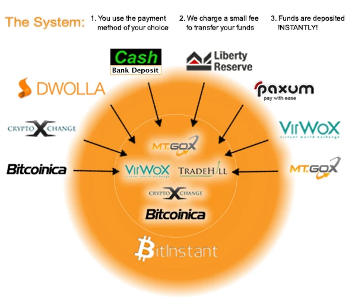

*Ifoto y'urubuga rwa BitInstant, ku wa 26 Nzero 2012 (inkomoko: [ububiko](https://web.archive.org/web/20120126191036/https://bitinstant.com/) bwa Bitinstant.com)*

Muri ico gihe nyene, Charlie Shrem yaramenyekanisha iyo startup nk'umwe mu bayishinze. Muri Myandagaro, yaritavye inama ya Bruce Wagner i New York, maze ahura imbonankubone n'abantu batari bake bakora mw'isi ya Bitcoin. Muri Nyakanga, [yaritavye](https://bitcointalk.org/index.php?topic=41932.msg510329#msg510329) *Open Video Conference* yateguwe n'ishirahamwe Mozilla n'Ishure ry'amategeko rya New York, kugira ngo ashikirize ijambo mu nama-nyigisho yerekeye amafaranga asubirira ayandi. Ukwezi kwakurikiye, [yaraserutse](https://www.youtube.com/watch?v=PxMazut6-0U) muri *Bitcoin Show* kugira ngo yerekane BitInstant.

Muri Kigarama, BitInstant [yarakoranije](https://observer.com/2011/12/brooklyn-based-bitcoin-startup-bitinstant-raises-seed-round/) amahera ku bashoramari b'abatabazi (canke *business angels*). Uwukomeye kuruta abandi muri bo nta wundi atari Roger Ver, yaronse 15 % vy'ishirahamwe ku 120 000 $ kandi yaciye aba ningoga umuyobozi waryo wa marketing. Roger Ver yahanuye Charlie Shrem gufata Erik Voorhees, yacitse uwujejwe itumatumanako na marketing vy'ishirahamwe muri Ruhuhuma 2012. Ira Miller na we nyene yarinjijwe mu mugwi nk'umuhinguzi. Naho Charlie Shrem adasunikwa na politike ubwayo, kubana n'abo bantu bizogira ingaruka yo guhindura ukuntu abona politike.

*Erik Voorhees, Charlie Shrem na Ira Miller mu biro vya BitInstant muri Ruhuhuma 2012 (inkomoko: Brian Patrick Eha kuri [Fortune](https://fortune.com/2017/06/26/bitcoin-blockchain-cryptocurrency-market/))*

Mu ntango z'umwaka wa 2012, BitInstant yaragwije uburyo bwo kurungika amahera kugira ngo ikorane n'imbuga nyamukuru zo mw'isi ya Bitcoin, mu kwongerako na canecane ukubitsa amahera y'inoti mu vyo itanga, maze itangura kumenyekana. Ku wa 2 Nzero, amahera yarungitswe kuva yugurura [ni](https://bitcointalk.org/index.php?topic=56392.msg671272#msg671272) imiliyoni 1,2 y'amadolari, ivyo bikaba ari intango nziza. Ikimenyetso c'amagara meza mu vy'ubutunzi: interface nshasha [yashizwe kuri internet](https://bitcointalk.org/index.php?topic=74624.msg826565#msg826565) mu mpera z'ukwezi kwa Ntwarante.

*Interface ya BitInstant muri Ruheshi 2012 (inkomoko: [ububiko](https://web.archive.org/web/20120630110945/https://www.bitinstant.com/) bwa Bitinstant.com)*

### Trading yo ku ngwati itangwa na Bitcoinica

Mu mpera z'ici ryo mu 2011, imbuga z'ivunjisha zariho zatanga gusa uburyo bwo kuvunja amafaranga asanzwe na bitcoin kandi nta gikorwa c'imari giteye imbere na kimwe zari zifise. Na canecane, hari habuze urubuga rwo gukorerako trading yo ku ngwati (*margin trading*) ituma hakoreshwa ingaruka y'ukugwiza (*leverage*) kandi yugurura akaryo k'ukugurisha ivyo umuntu adafise (*short selling*). Kugira ngo ico gikenewe kironke inyishu ni ho urubuga Bitcoinica rwaseruka.

Bitcoinica [yatangujwe](https://bitcointalk.org/index.php?topic=81581.msg897948#msg897948) ku wa 8 Nyakanga 2011 n'umusore w'Umushinwa w'imyaka 17 yiyita Zhou Tong, izina ryiwe nyakuri rikaba Ryan Tong Zhou. Uwo ni umwana afise ubwenge budasanzwe ico gihe yiga i Singapour. Aremeshwa n'ivy'ukwiteza imbere kw'umuntu, kubera na canecane yasomye *Père riche, père pauvre* ya Robert Kiyosaki kandi akaba yaritayeho ubuzima bwa ba rwiyemezamirimo baroraniwe nka Tony Hsieh (wa Zappos) na Steve Jobs (wa Apple). Yararonse kandi ubumenyi mu guhingura imbuga za web.

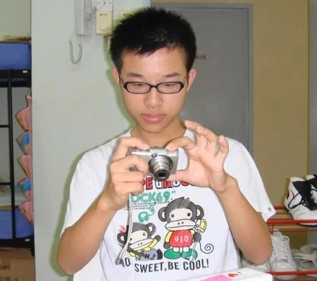

*Zhou Tong muri Nzero 2010 (inkomoko: Zhou Tong kuri [Flickr](https://www.flickr.com/photos/zhoutong/4359164894/))*

[Yumvise](https://bitcointalk.org/index.php?topic=67521.msg785510#msg785510) Bitcoin mu mpera z'umwaka wa 2010, ariko yayitayeho vy'ukuri gusa mu ci ryakurikiye, igihe ifuro ry'ibiciro ryari rikomeye cane. Yaguze ama bitcoins yiwe ya mbere ku madolari 8 kuri imwe muri Myandagaro. Maze yitanga mu butunzi bwa Bitcoin mu gutegura Bitcoinica mu ndwi imwe.

Yerekana Bitcoinica nk'"urubuga rwa trading y'ama bitcoins ruteye imbere", "rusa neza", "rw'umwuga" kandi "ruhindura ibintu". Mu ntango urwo rubuga ntirutwara Wallet, ama bitcoins akaba abikwa kuri konti yabigenewe kuri Mt. Gox. Kubitsa no gukurako bikorwa mu ma bitcoins, hakoreshejwe kode za Mt. Gox zishobora kuvunjwa canke ukurungika amahera hagati y'ibihugu biciye kuri banki.

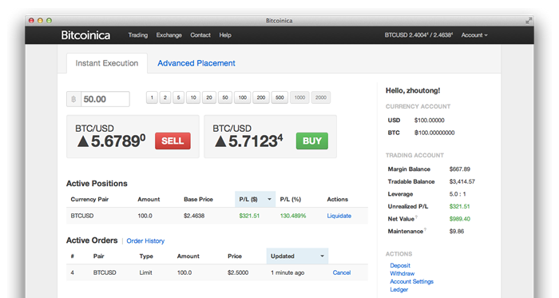

*Interface ya Bitcoinica muri Ruhuhuma 2012 (inkomoko: [ububiko](https://web.archive.org/web/20120209171119/http://bitcoinica.com/) bwa Bitcoinica.com)*

Intsinzi yarabonetse kuva mu ntango. Mu masaha 24 ya mbere, ama bitcoins 3 724 yaravunjwe n'abakoresha 290 batandukanye, ni ukuvuga ibingana na 19 000 $. Ibivunjwa mu misi 7 ya mbere [ni](https://web.archive.org/web/20111019032441/http://blog.bitcoinica.com/) ama bitcoins 160 865, ni ukuvuga arenga 800 000 $, bituma Bitcoinica iba urubuga rwa kabiri rwa trading ku gitigiri c'amadolari avunjwa inyuma ya Mt. Gox.

Urwo rubuga rucumbikira canecane speculation: ingaruka y'ukugwiza ituma inyungu (n'ibihombo) bigwizwa incuro cumi, ivyo bikaba bibereye abakinyi bakomeye bipfuza gushira vyose kw'ihinduka rimwe ry'igiciro. Intsinzi ya speculation ni nini cane ku buryo liquidation kuri urwo rubuga yaronse [izina](https://bitcointalk.org/index.php?topic=49445.msg588749#msg588749) ryayo bwite: "get Zhou Tonged" (umuntu yohindura ngo "gukorerwa zhou-tong" mu kirundi). Iyo mvugo [yatanze izina](https://www.youtube.com/watch?v=kdvTkddp1F0) kuri shene ya Youtube *Zhou Tonged*, yatangujwe muri Ntwarante 2012 kugira ngo icumbikire indirimbo z'urwenya ku vyerekeye Bitcoin na trading. Urwo rubuga rufise kandi akamaro ko gutanga ukugurisha ivyo umuntu adafise no gutuma abakora mu vy'ubutunzi (nk'abadandaza babitse bitcoin) bikingira ukumanuka kw'igiciro gushobora gushika.

Mu ntango za Ntwarante 2012, Bitcoinica [yemera](https://bitcointalk.org/index.php?topic=67521.msg785510#msg785510) uburyo burenga cumi bwo kubitsa no gukurako, harimwo bitcoin ubwayo, Liberty Reserve, PerfectMoney, Pecunix, hamwe n'ukurungika amahera kwa SEPA mu mayero. Ico gihe ifise ibivunjwa nka vyose bingana n'ivya Mt. Gox.

### Ugusohora impapuro z'agaciro z'imari hakoreshejwe GLBSE

Mu 2011, kuba Bitcoin idasaba uruhusha vyasunitse abagize umuryango kwiyumvira ikoreshwa rirenze ihanahana ry'amafaranga gusa na speculation. Gutyo bategekanya kurekurira ishoramari mu gutanga uburyo bwo gusohora imigabane n'impapuro z'amadeni ku mashirahamwe yo mw'isi ya Bitcoin. Ni ukuzunguruka amategeko ashingwa na canecane na *Securities and Exchange Commission* muri Leta Zunze Ubumwe za Amerika (igihwanye na AMF muri Amerika), mu [kwungukira](https://web.archive.org/web/20260609181633/http://trilema.com/2012/the-reasons-why-bitcoin-securities-cant-be-regulated-by-the-sec/) ku kuba Bitcoin ari agashasha no ku kutatomoka kw'amategeko ayikikuje. Iciyumviro ni ico gushinga akarorero gasubirira urwego rw'imari rusanzwe, koshobora kwibeshaho ubwako hakurikijwe uburyo bwa agorisme.

Umwe mu bantu bitanze muri uwo muhari ni James McCarthy, akoresha izina ry'irihimbano Nefario kuri forum ya Bitcoin, ryerekeza ku muntu yitwa gutyo nyene wo muri filime y'ibishushanyo binyiganyiga *Moi, moche et méchant*. Uwo ni Umunya Irlande aba mu Bushinwa, afise akazi k'umwigisha w'icongereza kuri kaminuza. Aritaho [ishure ryo muri Otriche](https://planb.academy/resources/glossary/austrian-school) n'ivyiyumviro vy'aba cypherpunks, [akivugira](https://web.archive.org/web/20110607050421/http://bitcoinweekly.com/articles/interview-with-nefario-founder-of-bitcoin-global) ubwiwe ko ari "mu buryo bumwe umu cypherpunk". [Yamenye](https://bitcointalk.org/index.php?topic=2502.msg33800#msg33800) ko Bitcoin ibaho mu mwaka wa 2010 kandi yaracukuye izirenga igihumbi. Mu nyuma yaritanze mu migambi itari mike, harimwo umugambi w'ikinyamakuru co kuri internet Bitcoin Weekly.

*James McCarthy (Nefario) muri Ruhuhuma 2012 (inkomoko: [ububiko](https://web.archive.org/web/20121008033716/https://www.tedxleeds.com/nefario-james-mccarthy/) bwa TEDxLeeds)*

Muri Ndamukiza 2011, James [yaratanguje](https://bitcointalk.org/index.php?topic=6500.msg94943#msg94943) GLBSE (ivugwa glib-zee), impfunyapfunyo ya *GLobal Bitcoin Stock Exchange*. Abakoresha baca kuri interface ya ligne de commande ituma bakorana na seriveri y'urubuga. Client ni verisiyo yahinduwe ya porogaramu yahinguwe na Amir Taaki. Nk'uko urubuga rwa internet rubivuga, urwo rubuga [rutuma](https://web.archive.org/web/20110427033244/http://glbse.com/) umuntu ashobora "gusohora imigabane kugira ngo akoranye imari; kuriha dividendes abanyamigabane; gushikiriza abanyamigabane ingingo no kuronka itora ryabo; gusohora no kugurisha impapuro z'amadeni; kugurana no kuguriza kw'isoko; kwishura no kwishurwa ingurane; gusohora amasezerano yo mu gihe kizoza; gukora meta-speculation ku mashirahamwe atanditswe (ku yandi masoko y'imigabane); no guhanahana ivyo vyose biri hejuru n'abandi ba trader kw'isoko".

*Ifoto y'urubuga rwa internet rwa GLBSE, ku wa 17 Myandagaro 2011 (inkomoko: [ububiko](https://web.archive.org/web/20110817072049/http://glbse.com/))*

"IPO" ya mbere (*Initial Public Offering*, ijambo rikunze guhindurwa ngo "introduction en bourse" mu gifaransa) [yakozwe](https://bitcointalk.org/index.php?topic=6838.msg100170#msg100170) kuva ku wa 30 Ndamukiza n'umugambi witwa Ubitex, urubuga rw'ivunjisha ry'imbonankubone rutuma abaguzi n'abagurisha bari mu karere kamwe bahuzwa. Ico gikorwa ni ukugurisha igitigiri kinaka c'imigabane (hano 1 000) ku ma bitcoins, abanyamigabane na bo bakazoronka ku nyungu z'ishirahamwe. Umuhinguzi umwe rudende w'uwo mugambi, Nathaniel Theis yitwa Cuddlefish kuri forum, yaronse 1 100 BTC muri ubwo buryo, ni ukuvuga nka 10 000 $. Yamara, uwo afise [imyaka 14 gusa](https://bitcointalk.org/index.php?topic=6584.msg707259#msg707259) kandi ntarakura mu bwenge: yarakoresheje ico gikorwa igihe gito, ariko amaherezo aranyika bukwi na bukwi igihe inyabwonko yiwe [yapfa](https://bitcointalk.org/index.php?topic=6584.msg414585#msg414585) muri Mukakaro, ntiyasubira gutanga ikimenyetso c'uko akiriho kandi ntiyasubiza amahera abashoramari.

Naho vyari bimeze gutyo, GLBSE yarabandanije gukora. Mu ntango z'agatasi, amatungo nka mirongo itatu [araboneka](https://web.archive.org/web/20110923234458/http://charts.glbse.com/markets/) ngo ahanahanwe. Muri Ntwarante 2012, verisiyo ya 2 y'urubuga [yarasohotse](https://bitcointalk.org/index.php?topic=73910.msg817887#msg817887).

### MPEx: options n'imigabane

Uwundi mugambi w'ubwo bwoko wabayeho haciye igihe gito ni MPEx. Urwo rubuga rwahinguwe n'umuntu ahazwako cane yitwa Mircea Popescu. Ni Umunyarumaniya, akomoka muri Transylvanie, akaba umwanditsi yandika vyinshi kuri blog yiwe [Trilema](https://web.archive.org/web/20260819184811/http://trilema.com/archives-categories/): yandika ku biganiro vyose (filozofiya, politike, ivy'igitsina), mu buryo bw'ugushotorana abigiranye ubwende, mu ntango akandika mu kinyarumaniya. Yatanguye kwitaho Bitcoin kuva mu ci ryo mu 2011 maze atangura [kuyivuga](https://web.archive.org/web/20260606201229/http://trilema.com/2011/ce-este-bitcoin/) kuri blog yiwe.

*Mircea Popescu, igenekerezo ritazwi (inkomoko: Mircea Popescu kuri [Wired](https://web.archive.org/web/20140405150603/https://www.wired.com/2014/01/openbsd/))*

Muri Myandagaro, Mircea [yaruguruye](https://bitcointalk.org/index.php?topic=15672.msg444367#msg444367) "Mircea Popescu's BTC Options Trading Emporium" (MPOE), [itanga](https://web.archive.org/web/20110824221522/http://polimedia.us/bitcoin/options.php) options zo kugura (*call*) n'izo kugurisha (*put*) BTC. Muri ivyo yiganye igikorwa gisa na co citwa Bitoption.org, [catangujwe](https://bitcointalk.org/index.php?topic=9611.msg138413#msg138413) muri Rusama. Muri rusangi urwo rubuga ruzana inyungu, rukaba rwaronse inyungu nyakuri zirenga 140 BTC mu mezi atandatu.

Mu mpera z'ukwezi kwa Ruhuhuma 2012, yarakoze [ugukoranya amahera](https://web.archive.org/web/20260420162641/http://trilema.com/2012/sa-ne-jucam-de-a-investitiile-n-bitcoini/#comment-78745) mu gusohora imigabane n'impapuro z'amadeni, bimufasha kuronka ama bitcoins arenga 3 200, ni ukuvuga nka 16 000 $ ico gihe. Ku wa 11 Ndamukiza, inyuma y'ikiringo ca bêta, urwo rubuga amaherezo [rwacitse](https://bitcointalk.org/index.php?topic=76239.msg845954#msg845954) isoko ry'imigabane ryo mu ma bitcoins rituma hasohorwa kandi hagahanahanwa imigabane itandukanye maze rusubira kwitwa MPEx (bisobanura "Mircea Popescu's Exchange").

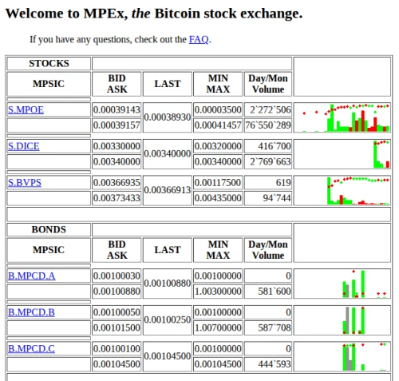

*Ifoto ya MPEx, Myandagaro 2012 (inkomoko: [ububiko](https://web.archive.org/web/20120829092213/http://polimedia.us/bitcoin/mpex.php) bwa Polymedia.us)*

Urwo rubuga ruzogira intsinzi itari nto kandi ruzocumbikira na canecane "IPO" ya SatoshiDICE, casino yo kuri internet itwarwa na Erik Voorhees. Ruzogenda ruhinduka uko igihe kirengana, [rwinjiza](https://web.archive.org/web/20260608143158/http://trilema.com/2012/futures-on-mpex/) amasezerano yo mu gihe kizoza muri Kigarama.

### Ikiringo co kwubaka

Bear market yakurikiye uguturika kw'ifuro rinini ryo mu 2011 yabaye igihe kigoye ku muryango wa Bitcoin. Koko rero, igiciro mu madolari caramanutse ibirenga 90 % ugereranije n'urugero rwaco rwo hejuru rwo muri Ruheshi, maze ibinyamakuru vyo kuri internet biboneraho akaryo ko gusiga iceyi iryo faranga rya crypto.

Naho umutima wari wacitse intege, ico kiringo cabereye akaryo keza ko kwubaka. Ni uko habonetse ibikorwa vy'imari vyinshi bisagamba, vyagize ico biterereye ku ntsinzi ya Bitcoin yo mu nyuma, nka BitInstant, Bitcoinica canke GLBSE. Ba rwiyemezamirimo babigizemwo uruhara baciye baba ningoga inkingi z'umuryango, bashigikira batiziganya ico Nakamoto yahinguye.

Vyongeye, iryo terambere mu vy'ubutunzi ryajanye n'iterambere ry'ubuhinga ryashigikiwe n'abanditsi ba porogaramu. Uretse ihinduka rya porogaramu nyamukuru (ikiganiro tuzovuga hirya), ico kiringo caranzwe gutyo n'ukurushiriza kworoha kw'ikoreshwa rya Bitcoin kwatewe n'iterambere ry'ama Wallet. Ni co kivugwa mu kigabane gikurikira.

# Iterambere mu vy'ubuhinga
<partId>8786cbbb-dbe9-51de-86ca-b835ba2529c5</partId>

## Ukuryohorwa kw'ikoreshwa rya Bitcoin
<chapterId>e73d02f8-c1cb-562b-ac80-8a6a672599fd</chapterId>

Ikiringo ca Far West y'ivy'imari cabaye ikiringo Bitcoin yashikiriyemwo abantu benshi kuruta, batari bazi cane ivy'ubuhinga bw'inyabwonko kandi batashaka gukoresha porogaramu iremereye ku nyabwonko yo ku meza. Ni co gituma cabaye igihe co kuryohora uburyo umukoresha akoresha Bitcoin, ivyo bikaba vyagaragariye mu kwaduka kw'ama Wallet yoroshe no mu kugwira kw'uburyo bwo kubika ama bitcoins.

Igihe Satoshi yigira ku ruhande muri Kigarama 2010, abashasha nta kindi bari bafise bahitamwo atari porogaramu nyamukuru canke porogaramu z'ububitsi nka MyBitcoin. Ariko kuva mu mwaka wa 2011, haradutse ubundi buryo. Ama Wallet yoroshe ya porogaramu, nka *Bitcoin Wallet for Android* na Electrum, yarashize mu ngiro igenzura ryorohejwe ry'ukuriha. Ama Wallet yo kuri interineti, nk'iya Blockchain.info, yaratumye amahera ashobora gucungerwa biciye muri mucukumbuzi. Ama Paper Wallet yaratanze uburyo bwo kubika amahera hatariho interineti. Bamwe mu bakunzi ba Bitcoin, nka Casascius w'ikirangirire, barahinguye ibikoresho bifadika, vyari nk'ishusho ifadika mw'isi nyakuri y'ibice vy'amahera bitagira umubiri.

Ukwibikira ama bitcoins ni ikibazo kitoroshe, kandi kirimwo ihurizo ryo guhitamwo hagati y'ugutakaza n'ukwibwa. Kugira ngo umuntu abike ama bitcoins yiwe, ategerezwa kuguma ashobora gushikira imfunguruzo ziwe z'ibanga, akongera akabuza abandi kuzishikira; ivyo ni ibintu bibiri bidashobora kwigera bishika vyompi icarimwe koko. Gutyo, iyo kuzishikira vyoroshe cane, Wallet ica yibwa bitagoranye, nk'uko vyabonetse mu gitero c'ubusuma cibwemwo 25 000 BTC za Allinvain muri Ruheshi 2011. Ku rundi ruhande, iyo kuzishikira bigoye cane, ama bitcoins arashobora gutakara bitagoranye, nk'uko vyagendeye BTC zishika 7 000 za Stefan Thomas [zatakaye](https://bitcointalk.org/index.php?topic=5400.msg259238#msg259238) kubera encryption igoye cane. Izo nzitizi ni zo abahinguzi b'ama Wallet bagerageje gutorera umuti.

Muri iki kigabane, tuziga uburyo butandukanye bwo gukoresha Bitcoin bwadutse muri ico kiringo. Tuzobanza kuvuga porogaramu z'ububitsi n'ayandi mashirwa mu ngiro ya porogaramu. Hanyuma, tuzosuzuma ido n'ido ivyerekeye ama Wallet yoroshe, yatumye mu bindi hategurwa imiterere ya deterministic yo kubika imfunguruzo z'ibanga. Tuzokwerekana ama Paper Wallet n'ama bitcoins afadika, vyabaye uburyo bwo gutunga ifaranga rya crypto rikingiwe ibitero vy'ubusuma. Tuzosozera tuvuga iterambere rya serivisi za mbere zo kuvanga ama bitcoins, zatumye ubuzima bwite bw'abakoresha burushiriza gukingirwa.

### Porogaramu z'ububitsi

Mu 2011, porogaramu y'ububitsi yari ikunzwe kuruta izindi, inyuma ya MyBitcoin yamenyekanye nabi, yari Instawallet. Ni porogaramu yo kuri interineti yoroshe gukoresha, [yatangujwe](https://bitcointalk.org/index.php?topic=6785.msg99378#msg99378) ku wa 29 Ndamukiza 2011 na Jan Vornberger, azwi kw'izina rya Jav, umuhinguzi akiri muto w'Umudagi. Ni serivisi y'ububitsi: amahera abikwa "ku ruhande rwa seriveri", bisigura ko Jav ari we ayacungera. Ntisaba kwiyandikisha; umuntu ayishikira biciye kuri URL, nka `https://instawallet.org/w/rq2SB02ai6BnWaEBywAlP52cw7qwUAA`, ikorwa igihe umuntu akoresheje iyo serivisi ubwa mbere kandi ikabikwa muri mucukumbuzi. Abakoresha bahabwa Address ya Bitcoin ibafasha kwakira no kurungika amahera. Amahera arungikiranwa hagati y'abakoresha Instawallet atunganywa imbere muri yo nyene, akaba rero ashika ubwo nyene. Vyongeye, kuva mu mpera za Mukakaro, iyo serivisi [yarashizemwo](https://bitcointalk.org/index.php?topic=32818.msg409974#msg409974) uburyo bwo gutanga icemezo (bwitwa "green address") butuma abandi bakorera kw'isoko bashobora kwemezwa ko igikorwa co gucuruza carungitswe kivuye kuri Instawallet, kugira ngo gitunganywe ningoga, mu rwego rw'ukwizigirana.

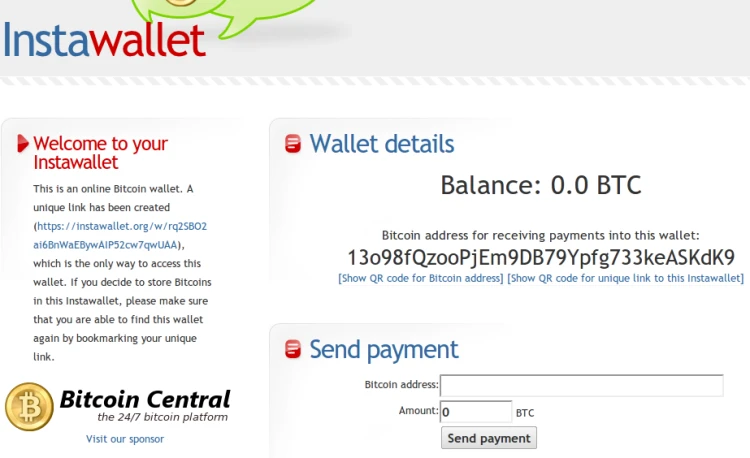

*Interface ya Instawallet muri Ruheshi 2012 (inkomoko: [Bitcoin Magazine](https://web.archive.org/web/20120922131335/http://bitcoinmagazine.net/bitcoin-wallet-options/))*

Ku wa 2 Ntwarante 2012, Jav [yaratangaje](https://bitcointalk.org/index.php?topic=67085.msg780164#msg780164) ko agiye kwugara Instawallet kubera ko adafise "umwanya canke uburyo bukenewe kugira ngo abandanye kubungabunga urwo rubuga". Ariko haciye imisi mikeyi, iyo serivisi yaciye [yegukira](https://bitcointalk.org/index.php?topic=67602.msg786523#msg786523) Paymium, yayibeshejeho gushika ku gitero c'ubusuma cayihitanye muri Ndamukiza 2013.

Paymium SAS ni ishirahamwe ry'Abafaransa [ryashinzwe](https://web.archive.org/web/20111120231150/http://www.paymium.com/) na Gonzague Grandval, Pierre Noizat (azwi kw'izina rya Boussac kuri forum) na David François muri Ruheshi 2011. Mu ntango ryibanda ku vy'ukuriha, kandi igicuruzwa caryo nyamukuru ni porogaramu yo gukinga uburiganya bukorwa hakoreshejwe amakarata ya banki. Kubera ko Pierre Noizat na David François bakwegerwa na Bitcoin, ryagiye buhoro buhoro riba ishirahamwe ryibanda kuri Bitcoin.

Mu ntango z'umwaka wa 2012, Paymium yarahinguye porogaramu yayo bwite y'ububitsi: Paytunia. Porogaramu Paytunia idondorwa ko ari "porogaramu ihindura ibintu ishingiye kuri porotokole yuguruye ya Bitcoin, igenewe ukuriha n'ukurungika amahera kuri interineti mu buryo butekanye kandi bworoshe". [Yatangujwe](https://bitcointalk.org/index.php?topic=75550.msg836770#msg836770) muri Ndamukiza 2012 kuri Android. Abakoresha Bitcoin-Central (urubuga rw'ivunjisha rucungerwa na David François) na bo nyene [barashobora](https://web.archive.org/web/20120514233205/https://bitcoin-central.net/) kuyishikira bakoresheje konti basanganywe, kubera ko izo serivisi zibiri zikoresha sisiteme imwe inyuma. Nk'uko biri kuri Instawallet, amahera arungikiranwa hagati y'abakoresha Paytunia [ashika](https://bitcointalk.org/index.php?topic=75550.msg836948#msg836948) ubwo nyene.

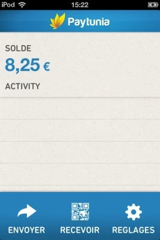

*Interface (mu gifaransa) ya porogaramu Paytunia muri Munyonyo 2012 (inkomoko: [eeNews Europe](https://www.eenewseurope.com/en/bitcoin-enabled-euro-payment-solution-operates-as-a-mobile-e-wallet/))*

### Ayandi mashirwa mu ngiro ya porogaramu

Ico kiringo kandi cari kibereye ugusubira kwandika porotokole ya Bitcoin. Porogaramu nyamukuru, ico gihe yitwa gusa "Bitcoin", ni ishirwa mu ngiro ryuzuye kubera ko risaba kubika uruhererekane rwose rw'[ama block](https://planb.academy/resources/glossary/block) no gukwiragiza ibikorwa vyo gucuruza bishasha n'ama block mashasha. Ariko ni ryo ryonyene ririho, ku buryo umuhora wose wishimikiza iryo ryonyene kugira ngo ukore. Ni ho hava icipfuzo co gutegura ayandi mashirwa mu ngiro ya Bitcoin.

Satoshi Nakamoto ahanini ntiyashaka ko porotokole isubira kwandikwa, kugira ngo imikorere y'ugucukura ntihungabane. Mu [butumwa](https://bitcointalk.org/index.php?topic=195.msg1611#msg1611) yashize kuri forum muri Ruheshi 2010, yanditse ati:

> Sinibaza ko irindi shirwa mu ngiro rya kabiri rya Bitcoin rihuza n'irisanzwe ryoba ari iciyumviro ciza. Ahanini, ukuntu vyubatse kwishimikiza
ku kuba [ama node](https://planb.academy/resources/glossary/node) yose aronka ibisubizo bisa neza na neza, ku buryo ishirwa mu ngiro rya kabiri ryoba ari akaga ku muhora. Uruhusha rwa MIT rurahuza n'izindi mpusha zose be n'ugukoreshwa mu vy'ubudandaji, ni co gituma ata gikenewe co kuyisubira kwandika ufatiye ku vy'amategeko.

Ariko rero, ayo majambo ntiyerekeye amashirwa mu ngiro atuzuye, agenewe gusoma Blockchain no gufasha abakoresha. Ni co gituma, igihe umuhinguzi Mike Hearn amubwira umugambi wiwe w'ishirwa mu ngiro muri Java muri Ntwarante 2011, atarwanije ukwo gusubira kwandika porotokole, [abona](https://plan99.net/~mike/satoshi-emails/thread4.html) ko "igice kinini c'ukugorana kwayo gishobora gukurwaho mu gihe habaye ugusubira kwandika gutunganye kurimwo gusa ibisabwa vyerekeye client".

Ishirwa mu ngiro rya porogaramu rya Mike Hearn ni BitCoinJ. Ni ugushira mu ngiro igenzura ryorohejwe ry'ukuriha (SPV) nk'uko ridondorwa muri [White paper](https://planb.academy/resources/glossary/white-paper), rituma ahanini haba ugukorana n'ama client yoroshe, na canecane ayo kuri telefone zikoresha sisiteme y'imikorere ya Android. Mike yahinguye uwo mugambi [kuva](https://plan99.net/~mike/satoshi-emails/thread3.html) mu mpera z'umwaka wa 2010, [asohora](https://bitcointalk.org/index.php?topic=4236.msg61438#msg61438) verisiyo yawo ya mbere ku wa 7 Ntwarante 2011. Kubera ko akora ari enjeniyeri kuri Google, kode itegerezwa kwitirirwa iryo shirahamwe mpuzamakungu, ariko uruhusha (Apache 2) ruridegemvya.

Ugusubira kwandika porotokole ya Bitcoin ntikwagarukiye aho. Muri Mukakaro 2011, Satoshi amaze kugenda, abagize Bitcoin Consultancy, Amir Taaki na Patrick Strateman, [baratanguje](https://bitcointalk.org/index.php?topic=30646.msg384791#msg384791) Libbitcoin, ikaba ari ishirwa mu ngiro muri C++ rirondera ubushobozi bwo kwagurwa, scalabilité n'ubushobozi bwo gutunganywa uko umuntu ashaka biri ku rugero rwo hejuru rushoboka. Intumbero yabo ni iyo "gusubira kwandika bitcoin, kuyigira iyishobora gucomekwako ibintu vyinshi cane, yoroshe cane gukoresha no guhindagura ku nzego zose, kandi ishobora gutunganywa cane uko umuntu ashaka". Kode yasohowe hakoreshejwe uruhusha rwidegemvya rwa copyleft (AGPL), rutegeka abasubira gukoresha iyo porogaramu gusohora igikorwa cabo bakoresheje urwo ruhusha nyene.

*Logo ya Libbitcoin muri Nyakanga 2013 (inkomoko: [ububiko](https://web.archive.org/web/20130913065137/http://libbitcoin.dyne.org/) bwa Libbitcoin.dyne.org)*

Muri Gitugutu, iyo porogaramu [yarashoboye](https://bitcointalk.org/index.php?topic=30646.msg553961#msg553961) gukora igenzura ryuzuye rya Blockchain. Amir Taaki kandi yaranditse "Zen ya Libbitcoin", itunganijwe ku karorero kamwe na Zen ya Python, ikaba ari urutonde rw'ingingo ngenderwako zigira ico zikoze ku kuntu ururimi rwo kwandika porogaramu Python rutegurwa. Yahavuye asohora kandi [itangazo ry'intumbero](https://libbitcoin.dyne.org/libbitcoin-manifesto.pdf) (*The Libbitcoin Manifesto*) muri Nyakanga 2013.

### Ama Wallet yoroshe

Ikibazo c'amashirwa mu ngiro yuzuye ni uko asaba uburyo bwinshi kandi ntiyorohera abantu benshi kuyakoresha. Vyongeye, ntashobora gukoreshwa kuri telefone ngendanwa. Ni co gituma abakoresha bashasha n'abayikoresha rimwe na rimwe bahitamwo inzira yoroshe: porogaramu z'ububitsi. Muri Munyonyo 2010, umunywanyi wa forum (Kiba) yarashizeho [impembo](https://bitcointalk.org/index.php?topic=1812.msg22319#msg22319) ihurikiweko n'abantu benshi yo guhingura client ya Bitcoin kuri telefone ngendanwa. Ku wa 29 Mukakaro 2011, iyugarwa rya MyBitcoin ryaremeje ko hakenewe umuti wo hagati na hagati. Ivyo ni vyo vyihutishije ihingurwa ry'ama Wallet yoroshe (canke *lightweight wallets*).

Iciyumviro ca mbere ni ugukoresha node nka seriveri iri kure, umukoresha yizigira bimwe vyuzuye. Muri Ruhuhuma 2011, Amir Taaki [yaratanguje](https://bitcointalk.org/index.php?topic=3451.msg48538#msg48538) client ya porogaramu yitwa Spesmilo, ituma umuntu acungera Wallet ku cuma ciwe mu kwihuza na node isanzweho. Ni client mu ntango yakorera kuri Linux, ariko yaciye ishirwa ningoga kuri Windows. Iryo zina ryerekeza kuri spesmilo, igipimo c'amahera mpuzamakungu ca kera, casabwe n'umuhinga mu mibare w'Umusuwisi René de Saussure (mwene wabo na Ferdinand, umuhinga mu vy'indimi) mu 1907, mu rwego rw'umugambi wa esperanto.

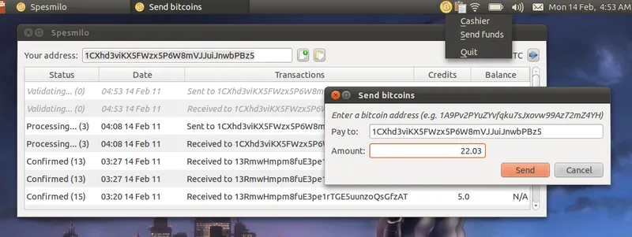

*Interface ya Spesmilo muri Ruhuhuma 2011 (inkomoko: [Bitcoin Wiki](https://en.bitcoin.it/w/index.php?title=Spesmilo&oldid=8271))*

Amir ubwiwe [ni](https://bitcointalk.org/index.php?topic=1568.msg19443#msg19443) umuntu avuga esperanto, kandi yahinduye iyo porogaramu muri esperanto kuva ku musi wa mbere. Umuhinguzi Luke-Jr yaciye amwiyungako, amufasha kubungabunga iyo porogaramu. Uwo [yarongeye](https://gitlab.com/bitcoin/spesmilo/-/commit/b889211e98111b243de2b11fe88caf91d069b2a5) muri iyo porogaramu uburyo bw'[uguharura kwa tonal](https://en.bitcoin.it/wiki/Tonal_Bitcoin), bukaba ari uburyo bwa hexadécimal bwasabwe na John W. Nystrom mu kinjana ca XIX, aho igipimo "bitcoin" kingana n'ama satoshi 65 536. Ariko umugambi Spesmilo warahebwe muri Munyonyo 2011, hashirwa imbere umugambi urushirije gukomera (werekanwa hepfo): Electrum.

*Andreas Schildbach mu nama re:publica i Berlin muri Rusama 2016 (inkomoko: Holger Bleich kuri [Twitter](https://twitter.com/_robinhob/status/727167827132727300))*

Ikindi ciyumviro, corohereza abantu kuruta, ni ugukoresha igenzura ryorohejwe ry'ukuriha (SPV), rituma umuntu agenzura ko ibikorwa vyo gucuruza biri muri Blockchain atarinze kuvoma amakuru yose. Ku wa 11 Ntwarante 2011, haciye imisi mikeyi BitCoinJ isohowe, umuhinguzi w'i Berlin yitwa Andreas Schildbach, azwi kw'izina rya Goonie kuri forum, [yarashize ahabona](https://bitcointalk.org/index.php?topic=4384.msg64142#msg64142) akarorero ka mbere k'igerageza ka Wallet igenewe telefone zikoresha Android, ishingiye kw'ishirwa mu ngiro rya Mike Hearn. Iyo Wallet, yiswe mu buryo bworoshe *Bitcoin Wallet for Android*, yaciye iba akarorero ka mbere gakora ka Wallet yoroshe kuri telefone ngendanwa.

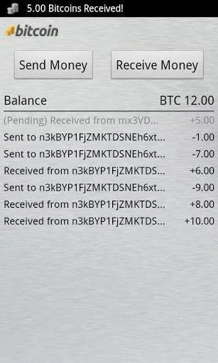

*Interface ya Bitcoin Wallet for Android muri Mukakaro 2011 (inkomoko: Brandon Iles ku bwa [Wired](https://web.archive.org/web/20110710020745/https://www.wired.com/gadgetlab/2011/07/bitcoin-android-app/))*

Iyindi Wallet ishingiye kuri BitCoinJ, iboneka ku nyabwonko, ni MultiBit, [yahinguwe](https://bitcointalk.org/index.php?topic=43616.msg520542#msg520542) muri Nyakanga 2011 n'umuhinguzi w'Umwongereza Jim Burton. Umwihariko wayo ni uko itanga uburyo bwo gucungera amakonti menshi muri interface yayo.

### Ama Wallet ya deterministic

Akigoro ko kuryohora ikoreshwa rya Bitcoin katumye kandi haduka ama Wallet ya deterministic (canke *deterministic wallets*). Ayo ni ama Wallet akoresha derivation y'imfunguruzo: aho kugira ngo imfunguruzo z'ibanga zikorwe rumwe rumwe mu buryo bwa random nk'uko bigirwa muri porogaramu nyamukuru, zikomorwa mu buryo bwa deterministic ku makuru amwe (yitwa seed) hakoreshejwe functions za cryptographie. Kumenya ayo makuru bituma umukoresha ashobora kugarukana amahera yiwe yose, ivyo bikaba vyorosha cane backup ya Wallet. Ntibiba bigikenewe kubika dosiye `wallet.dat` incuro n'izindi!

Ama Wallet ya deterministic ahanini ava ku vyiyumviro vy'umuhinguzi w'Umunyamerika Gregory Maxwell. Uwo mugabo, ashigikira [porogaramu zidegemvya](https://planb.academy/resources/glossary/foss), ico gihe yari [umuterankunga](https://commons.wikimedia.org/wiki/User:Gmaxwell) wa Wikipedia kuva mu 2004, kandi akorera fondasiyo Xiph.org, aho agira uruhara mw'ihingurwa rya codec y'amajwi Opus. Muri Rusama 2011, yaratanguye kwinjira muri Bitcoin, [aragerageza](https://bitcointalk.org/index.php?topic=7171.msg119591#msg119591) n'ugucukura. Yarandika kandi vyinshi, aca aba ningoga umuntu akora cane kuri forum no ku murongo wa IRC \#bitcoin-dev, aho akoresha izina ry'irihimbano Gmaxwell.

*Gregory Maxwell mu 2006 (inkomoko: [Wikimedia](https://commons.wikimedia.org/wiki/File:Gmaxwell-boat.jpg))*

Gregory Maxwell afise ivyiyumviro vyinshi ku buryo bwo kuryohora ikoreshwa rya Bitcoin, kandi derivation y'imfunguruzo ni kimwe muri vyo. Si we wa mbere yagize ico ciyumviro (Casascius [yaratanze](https://bitcointalk.org/index.php?topic=6897.msg100975#msg100975) iciyumviro gisa n'ico muri Ndamukiza), ariko ni we wa mbere yagitunganije mu buryo butomoye. Ku wa 18 Ruheshi, inyuma y'[ibiganiro](https://buildingbitcoin.org/bitcoin-dev/log-2011-06-08.html#l-1089) vyabereye kuri IRC, yaranditse insiguro yaco kuri forum. [Yanditse](https://bitcointalk.org/index.php?topic=19137.msg239768#msg239768) ati:

> Bitcoin ikwiye vy'ukuri kwemera ikoreshwa ry'ama Wallet ya deterministic, ikongera ikarisaba nk'uburyo busanzwe. Umutekano w'inyongera utangwa n'ama Wallet y'ubu afise imfunguruzo zikorwa imbere y'igihe ni muto ugereranije, ufatiye ku kuntu abantu benshi bakoresha bitcoin. Kandi umuzigo w'amahera atakara kubera ama backup atuzuye, be n'umukazo wiyongereye wo kugumana Wallet imwe gusa ikora, ni munini cane.

Yiyumvira ubwoko bubiri bwa derivation. Ubwa mbere (ubwoko bwa 1) buroroshe, kandi bukora imfunguruzo z'ibanga buhereye kuri seed ubwayo. Ubwa kabiri (ubwoko bwa 2) buragoye kuruta, ariko butuma amaderesi akomorwa ku [rufunguzo rwa bose](https://planb.academy/resources/glossary/public-key) nyamukuru ruvuye kuri seed, hatarinze gushikirwa iyo seed nyene. Ivyo bituma haboneka porogaramu itunganya ivy'ukuriha ishobora gukora Address nshasha kuri buri gikorwa co gucuruza, imfunguruzo z'ibanga zitarinze kuja ahabona.

Mu nyuma, muri Ruhuhuma 2012, ubwo buryo bwaragizwe standard biciye kw'[isohoka](https://en.bitcoin.it/w/index.php?title=BIP_0032&oldid=26198) rya [BIP](https://planb.academy/resources/glossary/bip) 32. Iyo BIP idondora imiterere rusangi y'"ama Wallet ya deterministic afise inzego" (*Hierarchical Deterministic Wallets*, HD Wallets), aho derivation ikoreshwa ku rutonde kugira ngo imfunguruzo n'amaderesi bikomorwe kuri seed. Yagiye buhoro buhoro yemerwa n'ama Wallet menshi uko imyaka yagiye irarengana.

https://planb.academy/courses/46b0ced2-9028-4a61-8fbc-3b005ee8d70f

### BitcoinSpinner, Electrum na Armory

Ayandi ma Wallet ya porogaramu yaradutse mu mwaka wa 2011. Mu ci, umuhinguzi wo muri Danemarike yitwa Jan Møller yarateguye interface muri Java yitwa BCCAPI (bisigura *BitCoin Client API*). Iyo interface [yatangajwe](https://bitcointalk.org/index.php?topic=36892.msg453652#msg453652) ku wa 23 Myandagaro. Ni interface ya porogaramu ituma client ikorera kuri telefone ya Android yihuza na seriveri. Ku ruhande rwa client, ishira mu ngiro ugukora imfunguruzo z'ibanga mu buryo bwa deterministic, bigatuma bidakenerwa gukora ama backup ubudahengeshanya.

Iyo interface yarakoreshejwe haciye amezi makeyi kugira ngo hashirweho Wallet yoroshe yitwa BitcoinSpinner, iboneka kuri Google Play. Iyo Wallet [yatangajwe](https://bitcointalk.org/index.php?topic=52674.msg628527#msg628527) na Jan ku wa 23 Munyonyo. Ku mugaragaro icungerwa n'ishirahamwe ryo muri Danemarike Miracle A/S, Jan [yinjiyemwo](https://bitcointalk.org/index.php?topic=53353.msg672264#msg672264) mu mpera za Kigarama.

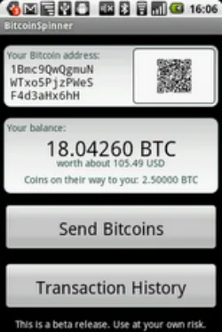

*Interface ya BitcoinSpinner muri Ruheshi 2012 (inkomoko: [Bitcoin Magazine](https://web.archive.org/web/20120922131335/http://bitcoinmagazine.net/bitcoin-wallet-options/))*

Ariko rero, BCCAPI [ifise](https://bitcointalk.org/index.php?topic=46493.msg571018#msg571018) utunenge dukeyi, dutuma idashimwa na bose. Ku ruhande rumwe, kode y'ibikorwa remezo vya porogaramu vya seriveri, bishingiye kuri BitCoinJ, ntiri ahabona, ivyo bikabuza ko hashirwaho ayandi maseriveri. Ku rundi ruhande, sisiteme irabika ibikorwa vyo gucuruza bifitaniye isano n'amaderesi acungerwa na Wallet kugira ngo itange igiteranyo c'amahera iyo Wallet ifise, ivyo bikagabanya bandwidth ikoreshwa ariko bigatera ikibazo ku vyerekeye ubuzima bwite.

Utwo tunenge twabangamira canecane Umufaransa Thomas Voegtlin, ico gihe yari umushakashatsi mu vy'ubuhinga bw'inyabwonko kandi akoresha izina ry'irihimbano ThomasV kuri forum. Yarashaka gutanga intererano, kandi [yarondera](https://bitcointalk.org/index.php?topic=46493.msg569756#msg569756) gushiraho "amaseriveri umuntu adakeneye kuguma yiziritseko". Ku wa 20 Gitugutu, yaciye [afata ingingo](https://bitcointalk.org/index.php?topic=46493.msg585227#msg585227) yo "gukora ivyo ahereye ku busa muri python".

Icavuyemwo ni Electrum, [yasohotse](https://bitcointalk.org/index.php?topic=50936.msg607510#msg607510) ku wa 5 Munyonyo. Izina ryayo ryerekeza kuri électrum, uruvange rwa kamere rw'inzahabu n'ifeza, rwakoreshejwe canecane mu gucura ibiceri vya mbere vy'amahera muri Lidiya no mu Bugiriki.

*Thomas Voegtlin mu 2006 (inkomoko: [ububiko](https://web.archive.org/web/20060516200739/http://www.loria.fr/%7Evoegtlin/) bw'urupapuro rwiwe bwite rwo kuri interineti)*

Iyo client yihuza n'umuhora w'amaseriveri adasanzwe kugira ngo ironke ibikorwa vyo gucuruza. Ayo maseriveri akorana na porogaramu (bitcoind), akongera agashira ku rutonde ibikorwa vyo gucuruza vyose abikesheje kode ya block explorer ABE. Muri iyo Wallet, seed iza mu buryo bw'urukurikirane rw'ibimenyetso vya hexadécimal. Kuva ku wa 10 Munyonyo, [yerekanwa](https://bitcointalk.org/index.php?topic=51397.msg612674#msg612674) kandi mu buryo bw'ijambo rya Mnemonic rigizwe n'amajambo 12. Ijambo ryose ritorwa mu rutonde rwashinzwe imbere y'igihe, ivyo bigatuma hashobora kwerekanwa ama bits y'amakuru. Ubwo bwoko bw'ijambo rya Mnemonic bwahavuye bugirwa standard na BIP 39, [yateguwe ubwa mbere](https://github.com/trezor/python-mnemonic/blob/217999150812f7d356169661e4ac0b2e09fecd1d/BIP_0039.txt) mu 2013.

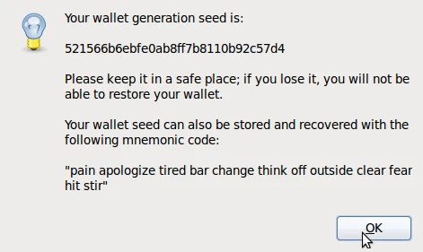

*Seed n'ijambo rya Mnemonic vya Electrum mu 2012 (inkomoko: [ububiko](https://web.archive.org/web/20120826021721/http://electrum-desktop.com:80/seed.html) bw'urubuga rwa Electrum)*

Ku wa 16 Kigarama, Electrum [yarashizemwo](https://bitcointalk.org/index.php?topic=50936.msg652435#msg652435) derivation y'ubwoko bwa 2, kugira ngo amaderesi ashobore gukorwa hatarinze gushikirwa seed. Muri Gitugutu 2012, Thomas Voegtlin [yahavuye yongera](https://bitcointalk.org/index.php?topic=50936.msg1302941#msg1302941) kandi igenzura ryorohejwe ry'ukuriha muri Electrum, ivyo bikaba vyatumye iba imwe mu ma Wallet yoroshe meza kuruta ayandi mw'isi ya Bitcoin.

Wallet igira gatatu iteye imbere [yasohotse](https://bitcointalk.org/index.php?topic=56424.msg671650#msg671650) mu ntango z'umwaka wa 2012: ni Armory. Iyo porogaramu yahinguwe kuva muri Mukakaro 2011 na enjeniyeri w'Umunyamerika Alan Reiner, yiyita Etotheipi kuri forum (bikaba vyerekeza ku buringanire bw'imibare bwa Euler). [Mu ntango](https://github.com/etotheipi/BitcoinArmory/blob/d68259dcf4116473d82458770e5ad73b95238797/README) yari ifise ishusho y'isomero rya porogaramu muri Python ryitwa PyBtcEngine, imbere y'uko iba client yuzuye muri Munyonyo.

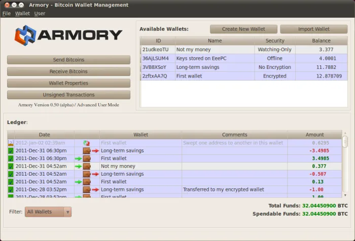

*Interface ya Wallet Armory muri Nzero 2012 (inkomoko: [ububiko](https://web.archive.org/web/20120225130943/http://bitcoinarmory.com/) bw'urubuga rwa Armory)*

Ku wa 3 Nzero 2012, Armory yerekanwa ko ari "client ya Bitcoin iteye imbere kuruta izindi zose kw'isoko": [irimwo](https://web.archive.org/web/20120113212542/http://bitcoinarmory.com/index.php/start-page/sample-page/features) ubushobozi bwinshi, nka interface y'amakonti menshi, imiterere ya deterministic ifise backup yo ku rupapuro, itorwa ry'ibiceri canke ukwinjiza amaderesi. Ariko canecane, [iratanga](https://web.archive.org/web/20120115015741/http://bitcoinarmory.com/index.php/using-offline-wallets-in-armory) uburyo bwo gucungera amahera hatariho interineti, ivyo bikaba bizwi kw'izina ry'ububiko bukanye (budondorwa hepfo). Muri Ruhuhuma–Ntwarante, Alan Reiner [yarakoze](https://web.archive.org/web/20120515220140/https://bitcointalk.org/index.php?topic=64449.0) ikoranywa ry'intererano z'abantu benshi ryaronse arenga 4 000 $. Uko amezi yagiye arakurikirana, Armory yahavuye iba ngenderwako mu vy'umutekano.

### Ama Wallet yo kuri interineti

Haradutse ubwoko bwa Wallet buvanze: Wallet yo kuri interineti, canke *web wallet*, ikaba ari ugushikira amahera biciye muri mucukumbuzi mu kwihuza na serivisi ibika ikopi y'imfunguruzo z'ibanga ikingiwe na encryption.

Kuva muri Ntwarante 2011, Stefan Thomas (justmoon), Umudagi yakoze videwo "*What is Bitcoin?*" akaba n'uwucungera WeUseCoins, yakora kw'isomero rya Javascript (muri Node.js) rituma haba ugukorana na porotokole ya Bitcoin. Iryo somero, ryitwa BitcoinJS, [ryasohotse](https://bitcointalk.org/index.php?topic=7357.msg108003#msg108003) ku wa 5 Rusama. Rituma abahinguzi b'imbuga za interineti bashobora gushiraho ama client akorera muri mucukumbuzi y'umukoresha.

*Iyerekanwa ry'isomero BitcoinJS rikozwe na Stefan Thomas (wa WeUseCoins) na Eric Brigham (wa Trucoin)*

Umuhinguzi wa mbere yakoresheje iryo somero ni umunywanyi wa forum yiyita DogIsland, [yerekanye](https://bitcointalk.org/index.php?topic=36169.msg445796#msg445796) muri Myandagaro iciyumviro ca Wallet yo kuri interineti yitwa StrongCoin. Interface yayo ituma umukoresha yugurura konti, akongera akinjira akoresheje izina rimuranga n'ijambobanga. Yatomoye ko imfunguruzo z'ibanga zikingirwa na encryption ya AES imbere y'uko zirungikwa kuri seriveri, ku buryo umukoresha wenyene ari we ashobora gushikira amahera. Iyo serivisi [yuguruye](https://twitter.com/strongcoin/status/122263762035146753) ku mugaragaro ku wa 7 Gitugutu, ariko [ifise akanenge](https://web.archive.org/web/20111113070337/http://www.thebitcointrader.com/2011/11/bitcoins-killer-app-is-here.html) ko gutoza amafaranga angana na 1 % (ashobora gushika kuri 1 BTC) ku mubare wose urungitswe.

Isomero BitcoinJS kandi [ryakoreshejwe](https://web.archive.org/web/20180611012256/https://github.com/zootreeves/blockchain.info) n'uwitwa Benjamin Reeves, umuhinguzi akiri muto w'Umwongereza aba i York, azwi kw'izina ry'irihimbano Piuk kuri forum. Ni umuntu akunda cane kuba wenyene, akaba kandi umuntu akora ubudahengeshanya. Muri Myandagaro, [yarateguye](https://bitcointalk.org/index.php?topic=40264.msg500726#msg500726) block explorer "irimwo ama block y'imfuvyi" kandi "igereranya urugero nyakuri rwa BTC zarungitswe", akaba yayishize ku rubuga rwiwe bwite. Ico gihe yaciye ihiganwa na Bitcoin Block Explorer (BBE) ya Theymos, be na [ABE](https://bitcointalk.org/index.php?topic=22785.msg286515#msg286515), ubundi buryo bwa open source bugenewe gushirwa ku maseriveri y'abakoresha ubwabo. Muri Gitugutu, urwo rubuga [rwararonse](https://bitcointalk.org/index.php?topic=40264.msg576916#msg576916) izina ryarwo bwite rya domaine: Blockchain.info. Rwaciye ruba ningoga block explorer ikundwa kuruta izindi n'abagize umuryango.

*Ben Reeves mu biro vya Y Combinator i San Francisco muri Ndamukiza 2012 (inkomoko: [Imgur](https://imgur.com/U5iUy))*

Ku wa 1 Kigarama, Ben Reeves [yarongeye](http://bitcointalk.org/index.php?topic=40264.msg636996#msg636996) kuri urwo rubuga ubushobozi bwa Wallet. Ubwo bushobozi, bwiswe mu buryo bworoshe "My Wallet", busa na StrongCoin: umukoresha ashikira Wallet yiwe akoresheje izina rimuranga n'ijambobanga; imfunguruzo ziwe z'ibanga zikingirwa na encryption zikabikwa kuri seriveri. Ariko ho nta komisiyo itozwa. Vyongeye, iyo serivisi yungukira ku kuntu block explorer itomora ibintu, mu kwerekana amakuru y'ido n'ido y'ibikorwa vyo gucuruza vyakozwe.

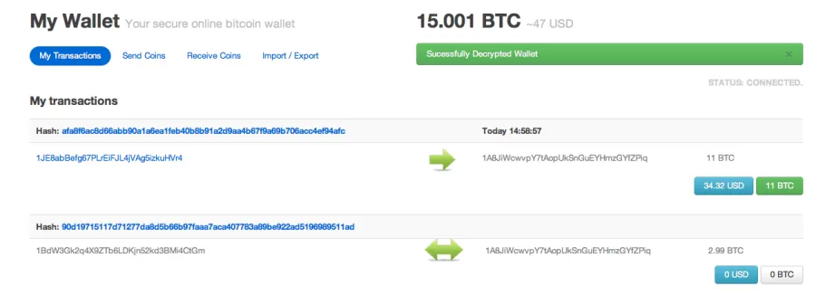

*Interface ya My Wallet muri Kigarama 2011 (inkomoko: [Bitcointalk](https://web.archive.org/web/20120519160806/https://bitcointalk.org/index.php?topic=40264.140))*

Ukuntu iyo Wallet yoroshe gukoresha kwatumye ikundwa cane. Iyo serivisi yaciye ikwegera ningoga abakoresha ibihumbi, ishika ku makonti [5 000](https://bitcointalk.org/index.php?topic=40264.msg790252#msg790252) yuguruwe muri Ntwarante 2012. Urugero rw'ama bitcoins yimurwa ku musi kuri Blockchain, ruharura ama bitcoins yimuwe n'ibikorwa vyo gucuruza birungitswe bivuye kuri Blockchain.info (My Wallet na API) kandi rukarenza urugero rw'amahera yarungitswe koko, rwagiye rurongerekana buhoro buhoro. Mu ntango za Rusama, rwaraduze cane kubera ibikorwa vyazanywe n'urukino rw'ama dés rwo kuri interineti SatoshiDICE, rurenga ama bitcoins 18 000, ni ukuvuga 90 000 $ ico gihe! Muri Mukakaro, igiteranyo c'amahera yimuwe na Blockchain.info [cagereranijwe](https://web.archive.org/web/20120720035456/https://blockchain.info/wallet/) ko ari amadolari imiliyoni 13,6.

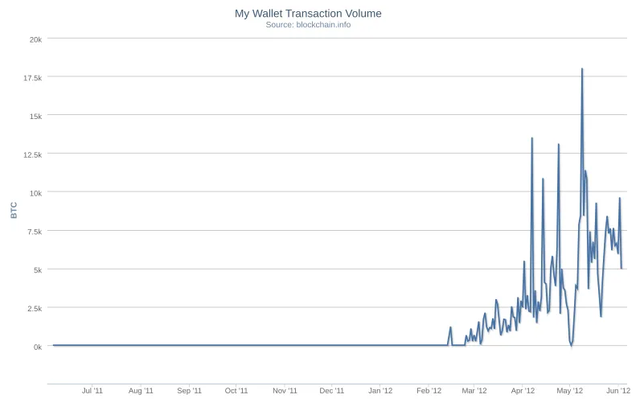

*Urugero rwa buri musi rw'ibikorwa vyo gucuruza birungitswe na Blockchain.info (inkomoko: [ububiko](https://web.archive.org/web/20120604084256/http://blockchain.info/charts/my-wallet-transaction-volume))*

### Ububiko bukanye n'ama Paper Wallet

Umwaka wa 2011 kandi waranzwe n'ukwaduka kw'ama Paper Wallet, akaba ari ugushira mu ngiro iciyumviro c'ububiko bukanye, canke *cold storage*. Gutunga bitcoin ni ukubika gusa amakuru ahantu adashobora gushikirwa n'ibiyabangamira, vyaba ivyago vyo mu buzima (ugutakaza) canke amatsiko y'abandi bantu (ukwibwa). Ayo makuru – ari rwo rufunguzo rw'ibanga – ashobora [gukorwa](https://bitcointalk.org/index.php?topic=1610.msg19131#msg19131) n'ivyuma bitigera vyihuza na Internet. Ivyo ni vyo vyitwa, [kuva mu 2011](https://en.bitcoin.it/w/index.php?title=Cold_storage&oldid=16769), ububiko bukanye.

Ububiko bukanye bushobora gukorwa mu kubika imfunguruzo z'ibanga ku gikoresho ca backup c'ubuhinga bwa none, nk'akuma ka USB. Ariko uburyo bworoshe cane kuruta ni Paper Wallet, ikaba ari urupapuro gusa rwanditsweko urufunguzo rw'ibanga na Address ya bose. Urwo rufunguzo rushobora gukorwa na Wallet ya porogaramu iyo ari yo yose, mu gihe icuma irimwo kiguma kitihuje na interineti.

Paper Wallet ishobora kandi gukorwa hakoreshejwe igikoresho cabigenewe. Ubwo bwoko bw'ibikoresho bwatanguye kuboneka kuva mu ci ryo mu 2011. Igihambaye muri vyo ni BitAddress, yahinguwe n'uwitwa Pointbiz, [yatangujwe](https://web.archive.org/web/20111102021042/https://bitcointalk.org/index.php?topic=43496.0) muri Nyakanga. Ni igikoresho canditswe muri Javascript gikorera muri mucukumbuzi. Interface yaco isaba umukoresha gukora entropy kugira ngo ugukora ibitigiri vya pseudo-random kurushirize kuba kwiza. Urufunguzo rw'ibanga na Address bivuyemwo bishobora guca bicapurwa kugira ngo bibikwe mu mutekano wuzuye. Birumvikana ko gishobora (kandi ni vyo bisabwa!) gukoreshwa hatariho ukwihuza na Internet, mu kubika urupapuro rwa HTML.

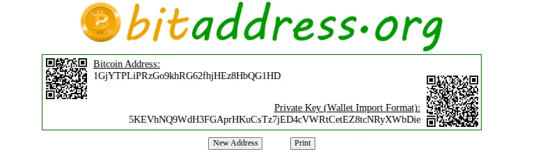

*Paper Wallet yakozwe na BitAddress muri Nyakanga 2011 (inkomoko: [ifoto ya ecran](https://web.archive.org/web/20120519160806/https://bitcointalk.org/index.php?topic=40264.140) ya BitAddress.org)*

Ikindi gikoresho cadutse ico gihe ni VanityGen, [cahinguwe](https://web.archive.org/web/20111104120932/https://bitcointalk.org/index.php?topic=25804.0) muri Mukakaro n'umunywanyi wa forum yiyita Samr7. Ni porogaramu ituma umuntu akora Address yihariye (*vanity address*), itangurwa n'ibimenyetso vyatowe, mu kugerageza imfunguruzo z'ibanga nyinshi cane. Ivyo birafasha mu kumenya amaderesi abantu bakirirako intererano. Nk'akarorero, Address ya Pointbiz yakirirako intererano z'ukubungabunga BitAddress, `1NiNja1bUmhSoTXozBRBEtR8LeF9TGbZBN`, irimwo ijambo "ninja".

Ubwa nyuma, uburyo bukora neza kuruta ubundi bwo kwikingira ukwibwa ni ubwa "Wallet yo mu mutwe", bukaba ari ugufata ku mutwe passphrase itanga uburyo bwo gushikira ama bitcoins abitswe kuri Address ihuye na yo. Nk'akarorero, iyo passphrase ishobora gucishwa muri SHA-256 kugira ngo haboneke urufunguzo rw'ibanga rutuma amahera akoreshwa. Ubwo buryo [bwasabwe](https://bitcointalk.org/index.php?topic=35082.msg436289#msg436289) na Casascius muri Myandagaro 2011, [bushirwa imbere](https://www.forbes.com/sites/jonmatonis/2012/03/12/brainwallet-the-ultimate-in-mobile-money/) muri Forbes na Jon Matonis muri Ntwarante 2012. Ariko rero nta mutekano na mba bufise iyo entropy idakwiye. Kandi birumvikana ko buhungabanywa n'intege nke z'ubwenge bw'umuntu bwo kwibuka; ni ukwerekana mu ngiro ububasha bwa Bitcoin kuruta kuba uburyo bwo kuyikoresha buramba.

### Ama bitcoins afadika

Ubundi buryo bw'ububiko bukanye ni ukubika ama bitcoins mu buryo bufadika, bikaba bigirwa mu gushira imfunguruzo z'ibanga canke imikono mu bintu vyabigenewe. Ico ciyumviro cadutse kuva mu ci ryo mu 2010, igihe Gavin Andresen [yasaba](https://bitcointalk.org/index.php?topic=737.msg7990#msg7990) "gucapura ama bitcoins" kugira ngo abantu bashobore kuyahanahana imbonankubone, ariko cashizwe mu ngiro mu 2011 gusa.

Ibintu vya mbere vy'ubwo bwoko ni Bitbills, [zatangujwe](https://bitcointalk.org/index.php?topic=7724.msg112655#msg112655) na Doug Feigelson (azwi kw'izina rya Llama) muri Rusama 2011, zikaba ari amakarata ya plastike yanditsweko QR codes zerekana Address n'urufunguzo rw'ibanga, kimwe ukwaco. Urufunguzo rw'ibanga rupfutswe n'agapapuro kamatira, ku buryo rudashobora gusomwa hatabonetse ibimenyetso vyerekana ko rwakozweko. Iyo karata iriko ama hologramme kugira ngo ntiyiganwe. Nk'uko uwazihinguye abivuga, Bitbills ni "ishusho ya mbere ifadika y'ama bitcoins". [Ni](https://web.archive.org/web/20110511215306/http://bitbills.com/) uburyo bwiza bwo "guha uwundi ama bitcoins imbonankubone, neza na neza nk'uko bigenda ku mahera y'intoke!".

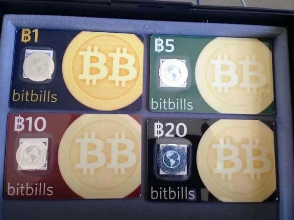

*Bitbills zashizwe mu camunara na Charlie Lee muri Ndamukiza 2013 (inkomoko: Inversor Inteligente kuri [Substack](https://inversorinteligente.substack.com/p/casascius-monedas-fisicas-de-bitcoin))*

Imashini ya mbere itanga ama bitcoins (canke *Bitcoin ATM*), [yateguwe](https://bitcointalk.org/index.php?topic=5122.msg461848#msg461848) n'umudandaza Todd Bethell, irimwo ubushobozi butuma amahera arungikwa kw'ikarata ya Bitbills icapuwe ku bw'ico gikorwa nyene. [Yageragejwe](https://web.archive.org/web/20110827115138/http://bitcoinatm.com/) ubwa mbere ku mugaragaro i San Diego muri Kaliforniya ku wa 17 Myandagaro 2013. Videwo yo kuyerekana yasohowe muri Nyakanga:

Bitbills zarakunzwe ku rugero kanaka, ariko Doug Feigelson yaragorwa no gukwiza abazisaba. Muri Rusama 2012, ihingurwa rya Bitbills [ryarahagaritswe](https://web.archive.org/web/20120508074832/http://bitbills.com/order) burundu. Ariko hari uwo bihiganwa: ama bitcoins afadika ahingurwa na Mike Caldwell, azwi kw'izina rya Casascius.

Mike Caldwell ni umuhinguzi w'Umunyamerika w'imyaka 33, aba mu nkengero za Salt Lake City muri Utah, akaba arongoye ishirahamwe rituma icungerwa ry'amashirahamwe ryikoresha, ryitwa [Swipeclock](https://www.linkedin.com/company/swipeclock/). Izina ryiwe ry'irihimbano, Casascius, ni uburyo bw'ikilatini bwa CASAS, indome zitangura amajambo y'umugani *call a spade a spade* (mu kirundi bikaba bisigura "kwita ikintu izina ryaco"). Ni rationaliste, atangazwa cane na [cryptographie](https://planb.academy/resources/glossary/cryptography), kandi akwegerwa n'uruhande rw'ubuhinga rwa Bitcoin. Yaragerageje ugucukura mu gihe kinaka.

*Mike Caldwell, azwi kw'izina rya Casascius, mu 2013 (inkomoko: [IMDb](https://www.imdb.com/fr/name/nm5669287/))*

Casascius yitwararika canecane ibikwa ry'ama bitcoins, n'ama Wallet rero. Yarateguye [agakoresho](https://bitcointalk.org/index.php?topic=25141.msg312005#msg312005) gatuma umuntu ahindura urufunguzo rw'ibanga mwo Address ya Bitcoin, agakora imfunguruzo zihariye, akongera agakora seed ya derivation. Ariko canecane, nk'uko [abisigura](https://bitcointalk.org/index.php?topic=2657.msg36011#msg36011), yihatira "guhingura bitcoin ifadika itwaye vy'ukuri BTC". Ni muri ubwo buryo [yagurisha](https://bitcointalk.org/index.php?topic=21878.msg275000#msg275000) ama Paper Wallet kuva muri Ruheshi ku rubuga rwiwe bwite.

Ku wa 19 Myandagaro, Casascius [yaramenyesheje](https://bitcointalk.org/index.php?topic=38048.msg467209#msg467209) ku mugaragaro umugambi wiwe wo guhingura "ama bitcoins afadika nyakuri". Ku wa 6 Nyakanga, yaratanguye kuyacura. Ku wa 6 Nyakanga, [yaratangaje](https://bitcointalk.org/index.php?topic=41892.msg509883#msg509883) ko atanguye kugurisha "ama bitcoins afadika ya Casascius", yahavuye amenyekana cane kw'izina rya "Casascius coins". Urufunguzo rw'ibanga rupfutswe na hologramme yihariye, ku buryo umuntu adashobora kururonka atononye ico giceri. Ibimenyetso 8 vya mbere vya Address ya bose ya Bitcoin biraboneka inyuma, kandi bicapurwa imbere y'igihe kuri hologramme n'uwuhingura. Igitangaje ni uko ibiceri vya mbere birimwo ikosa ry'imyandikire: Casascius yanditswe ngo Casacius.

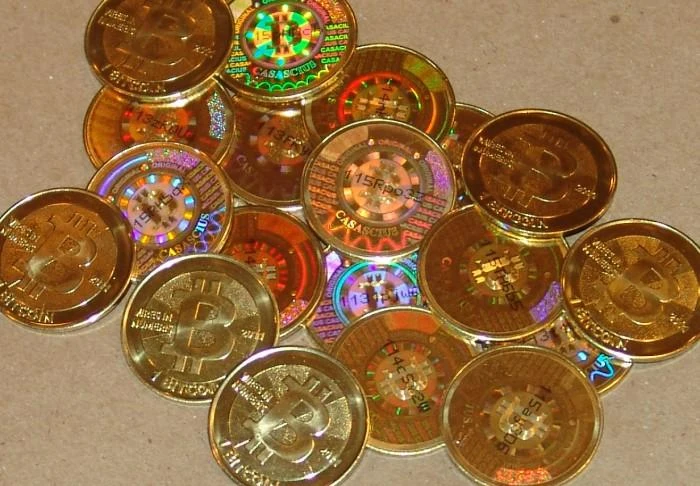

*Ama bitcoins ya mbere ya Casascius mu 2011 (inkomoko: [casascius.com](https://www.casascius.com/casasciusphysicalbitcoins.jpg))*

Mu ntango yaboneka ari ibiceri vya 1 n'ivya 25 BTC, ariko ama bitcoins ya Casascius yaciye ahingurwa ningoga mu biceri vy'utundi duciro no mu bipande, gushika kuri 1000 BTC! Ayo ma bitcoins afadika [agurishwa](https://web.archive.org/web/20111107191637/https://www.casascius.com/) ku rubuga rwiwe bwite rwa Casascius, ariko [kandi](https://web.archive.org/web/20111028171555/http://www.memorydealers.com/bieq.html) no kuri MemoryDealers (iduka ryo kuri interineti rya Roger Ver) kuva muri Gitugutu. Yahavuye [aboneka](https://odysee.com/@adamkokesh:2/moment-in-monetary-history-bitcoin-by:9) kandi mu mashini itanga ibintu muri PorcFest yo mu mwaka wakurikiye, muri Ruheshi 2012.

Gutyo, afise intumbero yo kwigisha, kandi atuma hakwegerwa abantu b'ubundi bwoko, nk'abakunzi b'ivy'ibiceri vya kera. Mu 2013, Mike Caldwell ubwiwe [yahavuye asigura](https://bitcointalk.org/index.php?topic=41892.msg3727984#msg3727984) ati:

> Intumbero yanje, mu gutanguza Casascius Coins, yari iyo kuzikoresha nk'igikoresho co kwigisha kugira ngo mfashe abantu bose kwibonera igiceri c'amahera kitagira umubiri biciye ku kintu gifadika gikora.

Ama bitcoins ya Casascius yarakunzwe bimwe bidasanzwe mu myaka ibiri yamaze atangwa. Nk'uko [Uberbills](https://casascius.uberbills.com/) ibivuga, harahinguwe ibiceri n'ibipande 27 910, bibitsweko igiteranyo ca 98 284 BTC.

### Serivisi za mbere zo kuvanga ibiceri

Ubwa nyuma, muri ico kiringo ni ho abantu batanguye kwibaza ibibazo ku vyerekeye ubuzima bwite kuri Bitcoin. Kubera ko mu ntango Bitcoin yerekanwa ko ari "iy'ukutamenyekana", abantu benshi biyumvira ko ata co bafise batinya. Ariko igitabu c'ibarurwa ni ica bose, ku buryo bishoboka gukurikirana amahera no kuyahuza n'uwo ari we, ivyo bikaba vyatumye ico ciyumviro gisubira gusuzumwa.

Kubera ukumenyekana kwa Silk Road be n'ukwemerwa na WikiLeaks mu ci ryo mu 2011, ikibazo c'ukutamenyekana [caribajijwe](https://bitcointalk.org/index.php?topic=175.msg57305#msg57305) [kurushiriza](https://web.archive.org/web/20110610205500/http://bitcoinweekly.com/articles/the-battle-is-on-silk-road-vs-government-and-bitcoin-anonymity). Ku wa 24 Mukakaro, Martin Harrigan na Fergal Reid, abashakashatsi babiri bo muri Irilande bo kuri University College y'i Dublin, [barasohoye imbere y'igihe](https://web.archive.org/web/20110725131444/https://anonymity-in-bitcoin.blogspot.com/2011/07/bitcoin-is-not-anonymous.html) icigwa cerekana ko Bitcoin idakingira ukutamenyekana nk'uko abantu benshi bavyiyumvira. Kugira ibikorwa vy'ibanga ntivyagizwe ibidashoboka; biragoye gusa kubishikako kuruta uko umuntu avyiyumvira akibibona.

Kugira ngo ico kibazo gitorerwe umuti, kugira ngo inkomoko y'amahera ihishwe, umuti ni ukuvanga ibiceri (*coin mixing*), bituma inzira amahera yaciyemwo izimangana. Ubwo bwoko bw'ukuvanga bushirwaho na serivisi zo kuvanga zifise ubutegetsi bwo hagati, zitwa *mixers* canke *tumblers*. Zitatu muri zo ziratandukanye n'izindi, kandi vyagaragaye ko atari uburiganya.

Iya mbere ni BitLaundry ("imesero ry'ama bitcoins"). Iyo serivisi [yatangujwe](https://bitcointalk.org/index.php?topic=963.msg11823#msg11823) muri Nyakanga 2010 na Peter Vessenes, umudandaza w'Umunyamerika afise urupapuro rw'umutsindo muri cryptographie, yamenye ko Bitcoin iriho mu gihe ca slashdotting. Iyo serivisi yo kuvanga [iha](https://maltemoeser.de/paper/money-laundering.pdf#page=5) umukoresha Address ikoreshwa rimwe gusa, harungikwako amahera ategerezwa kugirwa ayatamenyekana. Ama bitcoins aca asubizwa ari ibiceri vyinshi ([UTXO](https://planb.academy/resources/glossary/utxo)), mu gikorwa co gucuruza gifise ama input menshi kirimwo ama bitcoins y'abandi bakoresha, bigatuma ukuvanga gushika koko. Amafaranga atozwa ashika hafi 2,5 % vy'umubare w'amahera avugwa. Muri Rusama 2011, abonye ibibazo vyo mu mategeko bishobora kuva kuri ico gikorwa, Peter Vessenes [yaciye aha](https://bitcointalk.org/index.php?topic=963.msg122955#msg122955) iyo serivisi Mike Gogulski, impirimbanyi ifise umwihariko wo kuba mu vy'intwaro ata bwenegihugu afise, kubera ko yaheze ubwenegihugu bwiwe bwa Leta Zunze Ubumwe za Amerika atagira ubundi.

Serivisi ya kabiri yo kuvanga ni Bitcoin Fog ("igipfungu c'ama bitcoins"), [yahinguwe](https://web.archive.org/web/20121102102447/https://bitcointalk.org/index.php?topic=50037.0) muri Gitugutu 2011 na Roman Sterlingov, umugabo w'Umurusiya akaba n'Umunyasuwede w'imyaka 23. Mu buryo butandukanye na BitLaundry, iyo serivisi itegeka umukoresha kugira amahera abitse kuri konti yiwe yo muri yo, hanyuma akayabikura kugira ngo bigore kuyakurikirana, biciye mu kuyavanga n'ama bitcoins y'abandi bakoresha. Ukubikura kugirwa mu buryo buteba, mu ntambwe nyinshi kandi kuja ku maderesi atandukanye, mu kiringo kiri hagati y'amasaha 6 na 96. Amafaranga atozwa ari hagati ya 1 na 3 %.

Iya gatatu ni iy'ubwoko budasanzwe, kuko ari serivisi yo kuvanga yashizwe muri Wallet ya Blockchain.info ya Ben Reeves. Iyo serivisi [yashizwe mu ngiro](https://bitcointalk.org/index.php?topic=40264.msg1015499#msg1015499) muri Mukakaro 2012 mu buryo bw'ubushobozi bwitwa "Send Anonymously". Komisiyo itozwa ni 1,5 %.

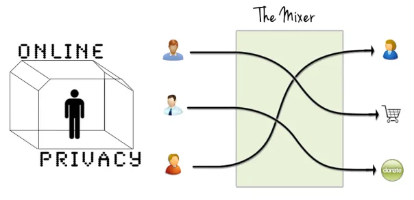

*Ishusho yerekana ubushobozi "Send Anonymously" bwa Wallet ya Blockchain.info (inkomoko: [ububiko](https://web.archive.org/web/20120708011906/https://blockchain.info/wallet/send-anonymously))*

Ukugwira kwa serivisi zo kuvanga zifise ubutegetsi bwo hagati kwatumye hihuta ukuzirikana ku kuvanga ibiceri kutagira ubutegetsi bwo hagati, kwatanguye kuva mu ci ryo mu 2011 biciye ku [ciyumviro](https://bitcointalk.org/index.php?topic=12751.msg315793#msg315793) catanzwe na Hashcoin. Iyo nzira yahavuye ishikana kw'[itunganywa mu buryo butomoye](https://bitcointalk.org/index.php?topic=279249.msg2983902#msg2983902) rya [CoinJoin](https://planb.academy/resources/glossary/coinjoin) rikozwe na Gregory Maxwell mu 2013. Ariko iyo ni iyindi nkuru itandukanye rwose...

### Ikiringo c'iterambere ku ma Wallet

Ikiringo 2011–2012 cabaye ciza cane kw'ihingurwa ry'uburyo butandukanye butuma Bitcoin ikoreshwa. Uretse porogaramu z'ububitsi, haradutse ama Wallet ya porogaramu nka *Bitcoin Wallet for Android* na Electrum, ama Wallet yo kuri interineti nka Blockchain.info, ibikoresho bikora ama Paper Wallet nka BitAddress, be n'ama bitcoins afadika nka Bitbills na Casascius Coins. Serivisi nyinshi zo kuvanga zarateguwe kugira ngo abakoresha baronke ubuzima bwite bwisumbuye.

Vyongeye, ico kiringo caranzwe n'ihingurwa ry'ama Wallet ya deterministic, ashingiye kuri derivation y'imfunguruzo ihereye ku makuru amwe gusa yitwa seed. Ubwo buryo bwararyohowe bwongera bugirwa standard muri BIP 32 mu ntango z'umwaka wa 2012, kugira ngo muri iyo derivation hongerwemwo inzego. Ariko ivyo ntivyagarukiye aho, kuko mu nyuma hasohowe ibindi vyiyumviro. BIP 39, yasohowe muri Nyakanga 2013, yaragize standard ikoreshwa ry'ijambo rya Mnemonic, mu murongo umwe n'ivyo Electrum yakora. BIP 43 na 44, zateguwe ubwa mbere muri Ndamukiza 2014, zaragize standard imiterere y'ama Wallet abika amafaranga ya crypto menshi n'amakonti menshi. Ivyo vyiyumviro vyatanzwe na Marek Palatinus (Slush) na Pavol Rusnak (Stick), bariko bakora kw'ihingurwa rya Hardware Wallet ya mbere, Bitcoin Trezor.

Ariko rero, ama Wallet si yo yonyene yateye imbere ku buryo buboneka; ni ko vyagenze no ku makoperative y'ugucukura. Nkako, ayo yaragwiriye mu mwaka wa 2011, mu gihe ingorane y'ugucukura yariko iriyongera, bituma ubwo buryo bwo gucukura bukwiragira hose. Mu kigabane gikurikira, tuzokwibanda kuri uwo muce nyamukuru w'iki gice c'amateka ya Bitcoin.

## Ukwaguka kw'amakoperative y'ugucukura
<chapterId>7bd97db9-1c72-53f1-800f-6cee80f57908</chapterId>

Ikiringo ca Far West yo muri Amerika kirangwa n'ukwirukira inzahabu, ni ukuvuga ukwimuka gukomeye kw'abantu barondera amahirwe bizigira gutunga, kwakurikiye ukuvumburwa kw'ahantu hari inzahabu mu kuzimu muri Kaliforniya mu 1848; kandi biboneka ko Bitcoin yagize ikintu gisa n'ico hagati ya 2010 na 2013. Kuva mu ntango Bitcoin yagereranijwe n'ico cuma c'agaciro: ugukura ama bitcoins mashasha kwitwa ugucukura, kandi ibikoresho vya porogaramu n'ivy'ivyuma vyitwa abacukuzi, iryo zina rikaba ryaragutse rishika no ku bajejwe kwongera ama block kuri Blockchain. Ni ibisanzwe rero ko igikorwa c'ugucukura co mu ntango cagize ikintu kimeze nk'"ukwirukira inzahabu y'ubuhinga bwa none", mu gukwegera abantu bagikunda cane, kubera inyungu y'amahera barondera, bakaba bafashije kugira ngo kirushirize gukora neza uko igihe cagiye kirarengana.

Mu gatasi ko mu 2010, ukuza kwa mbere kw'abantu benshi kwatumye ugucukura hakoreshejwe processeur y'amashusho (GPU) gukwiragira hose, kukaba kwazana inyungu nyinshi cane kuruta ugucukura hakoreshejwe processeur nyamukuru (CPU). Ariko iryo terambere ry'ubuhinga ryatumye [ingorane](https://planb.academy/resources/glossary/difficulty) y'umuhora iduga gushika ku rugero abacukuzi batoyi batari bagishobora kwizigira kuronka block mu gihe kibereye. Ivyo ni vyo vyatumye hashingwa imigwi y'abacukuzi, nka BitcoinCZ Mining, koperative ya Slush. Ivyo ntivyagarukiye aho: igiciro kimaze kuduga mu 2011, abacukuzi barabandanije kuza ari benshi, maze ugucukura mu makoperative guca kuba ibisanzwe ningoga.

Muri iki kigabane, tuziga ukwaduka kw'amakoperative atandukanye y'ugucukura, akenshi yari afise uburyo bw'imikorere butandukanye. Tuzovuga ingene ukwo kwaguka kwatumye ububasha bwo guharura bw'umuhora bukoranirizwa hamwe ku rugero kanaka, ivyo bikaba vyatumye hategurwa porotokole itagira ubutegetsi bwo hagati P2Pool, yatuma umuntu akora ama bitcoins atarinze kwishimikiza umurongozi ata guca ku ruhande. Ubwa nyuma tuzovuga porotokole y'ugucukura Stratum, yasubiriye uburyo bwo gukora bwa kera butari buteye imbere bwariho kuva mu 2010.

### Ukwiyongera kwa Hashrate

Kubera ugukwiragira hose kw'ugucukura hakoreshejwe processeur y'amashusho be n'ukuduga kudasanzwe kw'igiciro c'ivunjisha kwabaye hagati ya 2010 na 2011, Hashrate y'umuhora yaraduze ku muvuduko ugenda uriyongera cane. Gutyo, yarigwije incuro 1 000 mu gihe kitashika umwaka. Mu gihe yari gigahash 10 gusa ku segonda (GH/s) muri Nyakanga 2010, yarashitse kuri 100 GH/s muri Kigarama, hanyuma kuri 1 TH/s muri Rusama 2011, irenga 10 TH/s muri Ruheshi. Yarashitse ku rugero rwo hejuru rwa 15,8 TH/s imbere y'uko isubira kumanuka giturumbuka, bivuye ku guturika kw'ifuro rinini ryo mu 2011. Imaze gushika ku rugero rwo hasi rwa 7 GH/s muri Kigarama, yaratekanye hagati ya 10 na 15 GH/s mu mezi atandatu ya mbere ya 2012.

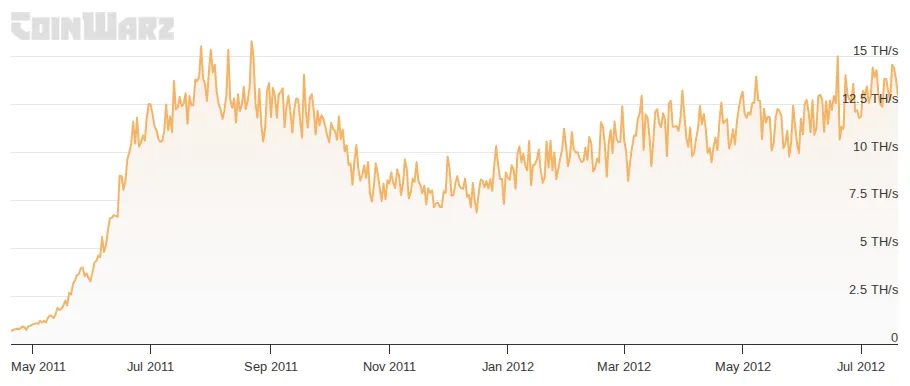

Hashrate yose y'umuhora wa Bitcoin hagati ya Ndamukiza 2011 na Mukakaro 2012 (inkomoko: [CoinWarz](https://www.coinwarz.com/mining/bitcoin/hashrate-chart))

Ukwo kwiyongera kw'ububasha bwo guharura bw'umuhora kwatumye "ugucukura umuntu ari wenyene" (*solo mining*) kutaba kugishoboka na gato, kubera ko variance iba ari nini cane ku bikoresho vyinshi. Ni co gituma abacukuzi benshi bategerezwa kwishira hamwe mu makoperative y'ugucukura, canke *mining pools*, kugira ngo inyungu zabo zireke guhindagurika cane. Bakotesha ububasha bwabo bwo gukora hash umurongozi, na we akaba ari we ajejwe guhitamwo ibiranga ama block n'ibikorwa vyo gucuruza bishirwamwo.

Muri ivyo bihe ni ho, muri Kigarama 2010, Marek Palatinus (azwi cane kw'izina rya Slush) [yatanguza](https://bitcointalk.org/index.php?topic=1976.msg30520#msg30520) BitcoinCZ Mining, serivisi y'"ugucukura kw'ubufatanye" yaronse 3,5 % vya Hashrate y'umuhora mu misi mikeyi. Iyo ntsinzi ntiyabuze abayigana, kandi umwaka wa 2011 waranzwe n'uko ugucukura mu migwi kwabaye ibisanzwe, ivyo bikaba vyagaragariye mw'iyugururwa ry'amakoperative [menshi cane](https://en.bitcoin.it/w/index.php?title=Comparison_of_mining_pools&oldid=21595) ahiganwa.

### Amakoperative y'ugucukura n'uburyo bwayo bwo guhemba

Amakoperative y'ugucukura yuguruye imiryango mu 2011 yakoresha [uburyo bwo guhemba](https://arxiv.org/abs/1112.4980) butandukanye. Iharurwa ryama rishingiye ku "migabane" itangwa n'abayagize, ni ukuvuga ama Proof of Work atuzuye yaharuwe kuri block kanaka. Icuma cose gicukura gikorera muri koperative citwa "umukozi", canke *worker*.

Mu ntango, koperative ya Slush yakoresha uburyo bworoshe bwa proportional: abayikoresha baronka agashimwe kuri block yose icukuwe, hakurikijwe imigabane baronse kuva kuri block iheruka. Kuri ako gashimwe itozako komisiyo ya 2 %, ni ukuvuga 1 BTC kuri block. Ariko ubwo buryo bufise akanenge gatoyi, kubera ko abacukuzi [bashobora](https://bitcointalk.org/index.php?topic=3165.msg44357#msg44357) "kuriganya" (bakaronka ama bitcoins nka 28 % y'inyongera) mu kwikura kuri koperative bamaze gutanga imigabane kanaka mu ruziga rumwe, maze ububasha bwabo bwo guharura bakabukoresha ku giti cabo canke bakabwerekeza ku yindi koperative (ivyo bikaba [bizwi](https://bitcointalk.org/index.php?topic=26866.msg337932#msg337932) kw'izina rya *pool hopping*). Ni co gituma, ku wa 4 Ruhuhuma 2011, Slush [yashizeho](https://bitcointalk.org/index.php?topic=1976.msg50002#msg50002) uburyo bw'amanota "burwanya uburiganya" buha uburemere bwinshi imigabane ya vuba y'uruziga kuruta imigabane ya kera.

Koperative ya mbere ihiganwa yadutse mu 2011 ni BitPenny, ifise umwihariko wo gukoresha uburyo bw'agashimwe butandukanye kandi bworoshe: *Pay Per Share* (PPS), canke ukuriha ku mugabane mu kirundi. Ni uguhemba abakozi ubwo nyene ku mugabane wose batanze, hakurikijwe urugero rw'ingorane yawo, hakoreshejwe amahera koperative ifise. Mu buryo butandukanye n'uburyo bwa proportional, umurongozi ni we yikorera variance yose, ivyo bikaba birimwo akaga kuri we kandi bigatuma komisiyo ziba nini kuruta. Koperative BitPenny [yatangujwe](https://bitcointalk.org/index.php?topic=3266.msg45809#msg45809) ku wa 8 Ruhuhuma, ariko yategerejwe kwugara ku wa 2 Ndamukiza, inyuma y'ibihombo bikomeye cane. Ariko rero [yarasubiye gutanguzwa](https://bitcointalk.org/index.php?topic=36371.msg447984#msg447984) muri Myandagaro, ikoresha ubundi buryo bugoye kuruta, bukaba ari ubwoko bwa PPS (*Capped Pay Per Share with Recent Backpay* canke CPPSRB).

Ku wa 27 Ruhuhuma, koperative nshasha yitwa Deepbit [yaruguruwe](https://web.archive.org/web/20111127072845/https://bitcointalk.org/index.php?topic=3889.0) n'Umurusiya yiyita Tycho. Ni koperative ikorera mu Buraya, iha abakiriya bayo uburyo bwo guhitamwo guhembwa hakurikijwe uburyo bwa proportional canke [hakurikijwe](https://bitcointalk.org/index.php?topic=3889.msg55799#msg55799) uburyo bwa PPS. Amafaranga atozwa ni 3 % ku bwa mbere na 10 % ku bwa kabiri.

Mu nyuma, amakoperative mirongo itari mike yaruguruwe muri uwo mwaka. Muri yo harimwo BTC Guild, koperative ikorera muri Leta Zunze Ubumwe za Amerika [yashinzwe](https://web.archive.org/web/20111127113730/https://bitcointalk.org/index.php?topic=7760.0) muri Rusama 2011. Icungerwa n'umucukuzi wo muri Kaliforniya yiyita Eleuthria (ihindurwa ry'ijambo ry'ikigiriki ἐλευθερία, eleuthería, risigura "umwidegemvyo"), kandi ikoresha uburyo bwa PPS butavanze. Amakoperative DeepBit na BTC Guild yaciye aba ningoga abahiganwa bakomeye na BitcoinCZ.

Ariko rero, uburyo bwa proportional na PPS si bwo bwonyene bwakoreshejwe. Uretse amanota ya Slush, abacukuzi barateguye uburyo bwo kuriha bugoye kuruta, nka PPLNS, uburyo bwa kigeyometrike canke SMPPS, bufise intumbero yo gukosora utunenge tw'uburyo bworoshe. Ubwo buryo bwageragejwe n'imigwi itandukanye y'abacukuzi irondera kwitandukanya n'amashirahamwe asanzwe azwi.

Ku wa 15 Ruheshi, umushasha akoresha izina ry'irihimbano Wuked [yaratanguje](https://bitcointalk.org/index.php?topic=17944.msg227913#msg227913) koperative yitwa Mineco.in. Mu ntango Wuked yakoresha ukuriha kwa proportional (nka Deepbit), ariko [ntiyatevye](https://en.bitcoin.it/w/index.php?title=Comparison_of_mining_pools&oldid=12816) kuzana agashasha mu gutegura uburyo [buzwi](https://bitcointalk.org/index.php?topic=39832.msg486012#msg486012) kw'izina rya *Pay Per Last N Shares* (PPLNS), canke ukuriha hakurikijwe imigabane N iheruka mu kirundi. Ni uguha agashimwe abakozi kuri block yose icukuwe, hakurikijwe imigabane yabo mu migabane N iheruka gutangwa kuri koperative. Ni ubwoko rero bw'uburyo bwa proportional, aho ikiringo c'isuzuma atari uruziga rw'ihingurwa ry'ama block, ahubwo ari idirisha ry'imigabane N ridafatiye ku ruziga.

No muri Ruheshi nyene (ku wa 13), uwitwa Josh Zerlan (azwi kw'izina rya Inaba) yaruguruye koperative EclipseMC, ishimirwa kuba yaragerageje ibishasha mu [gushiramwo](https://bitcointalk.org/index.php?topic=16385.msg364399#msg364399) uburyo bwa kigeyometrike kuva hagati muri Mukakaro. Ubwo buryo bwari [bwadondowe](https://bitcointalk.org/index.php?topic=4787.msg69890#msg69890) amezi makeyi imbere n'umuhinga mu mibare w'Umunyisirayeli Meni Rosenfeld. Ingingo ngenderwako ni ugukoresha amanota (kugira ngo abayigize bagumemwo) no gutuma agashimwe ku mugabane kagabanuka mu buryo bwa kigeyometrike. Muri Nyakanga, EclipseMC [yaremeye](https://bitcointalk.org/index.php?topic=16385.msg528287#msg528287) "uburyo bwa kigeyometrike bubiri", bwateguwe n'ubu nyene na Meni Rosenfeld, [bukaba ari](https://bitcointalk.org/index.php?topic=39497.msg481864#msg481864) uburyo buvanze hagati y'uburyo bwa PPLNS n'uburyo bwa kigeyometrike. Ubwo buryo bugoye bwahavuye kandi [bwemerwa](https://bitcointalk.org/index.php?topic=14085.msg667220#msg667220) muri Kigarama na Ozcoin, serivisi y'ugucukura mu migwi yo muri Ositaraliya [yatangujwe](https://bitcointalk.org/index.php?topic=14085.msg193967#msg193967) ku wa 9 Ruheshi n'uwitwa Graeme Tee.

Ayandi makoperative yarashoboye kwironkera ikibanza. Twovuga umugwi w'abacukuzi wo muri Amerika BitMinter, [watangujwe](https://bitcointalk.org/index.php?topic=22432.msg281686#msg281686) muri Ruheshi, ufise umwihariko wo kugira porogaramu yawo bwite y'ugucukura. Twovuga kandi koperative y'Abarusiya 50BTC.com, [yashinzwe](https://bitcointalk.org/index.php?topic=54673.msg651025#msg651025) muri Kigarama, yahavuye itanga igikoresho co gukurikirana ibikorwa vy'abacukuzi citwa Mining Explorer.

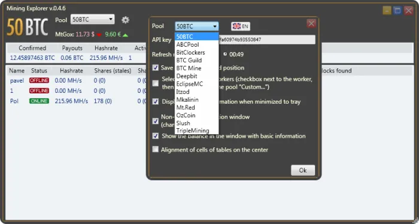

*Igikoresho Mining Explorer muri Rusama 2012 (inkomoko: [ububiko](https://web.archive.org/web/20120609002559/http://miningexplorer.org/) bwa Miningexplorer.org)*

Menya kandi ko ukwaduka kw'ayandi mafaranga ya crypto (tuzokwiga mu kigabane kizoza) na kwo nyene kwatumye hashingwa amakoperative yihariye kuva mu mpeshi yo mu 2011. Gutyo haravutse amakoperative ya Namecoin, nka Bitparking, [yuguruwe](https://bitcointalk.org/index.php?topic=8775.msg127063#msg127063) na DoubleC muri Rusama 2011, canke NMCBit, [yashinzwe](https://bitcointalk.org/index.php?topic=33612.msg419958#msg419958) n'uwitwa Davinci Jeremie (azwi kw'izina rya DavinciJ15) muri Myandagaro. Ukwongerwa kw'ugucukura gufatanijwe kuri Namecoin kwatumye, uko igihe cagiye kirarengana, amakoperative yose ya Bitcoin ashikira aho yongera ugucukura iryo faranga rya crypto mu vyo atanga.

### Eligius, koperative ya Luke-Jr

Koperative y'ugucukura idasanzwe ni Eligius, yuguruwe n'umuhinguzi Luke-Jr muri Ndamukiza 2011. Luke-Jr (canke Luke Dashjr, [bivugwa](https://www.youtube.com/watch?v=JJF5Gnro1GU) ngo "dasheur") ni umuntu adasanzwe mu mateka ya Bitcoin. Ni Umugatolika w'i Roma w'umunyamwete akaba [sédévacantiste](https://dashjr.org/catholic/sedevacantist.php), arubatse kandi ni se w'umuryango munini: yari afise abana babiri mu 2007, kandi yahavuye yongerako abandi batatu gushika mu 2017. Ni umwanditsi wa porogaramu mu vya porogaramu zidegemvya, akaba yarahinguye sisiteme yiwe bwite y'imikorere, yitwa [Utopios](https://web.archive.org/web/20041013023456/http://utopios.org/) kandi ishingiye kuri distribution Gentoo.

Luke [yamenye](https://www.youtube.com/watch?v=3sXei0Iwf4Q) ko Bitcoin iriho ku wa 31 Kigarama 2010 kuri IRC. Muri Nzero 2011, yarashizeho serivisi yo gucumbikira imbuga za interineti, [Lightfoot Hosting](https://bitcointalk.org/index.php?topic=30.msg36268#msg36268), yemera bitcoin. Yaranatanze intererano kuri client ya porogaramu Spesmilo, nk'uko twabivuze mu kigabane c'imbere.

*Avatar yakoreshejwe na Luke-Jr kuva mu 2013 (inkomoko: [Gravatar](https://secure.gravatar.com/avatar/30aa55ee8573680ee4bbb556dae3160c?s=400))*

Ku wa 27 Ndamukiza, Luke [yarashinze](https://bitcointalk.org/index.php?topic=6667.msg97375#msg97375) koperative y'ugucukura yitwa Eligius, yerekana ko ari "koperative nshasha y'igerageza". Iryo zina ni izina ry'ikilatini rya mweranda Éloi, umusenyeri wa Noyon mu kinjana ca VII akaba n'umushikiranganji w'imari w'umwami w'Abafaranki Dagobert Ier. Nkako, porogaramu yo ku ruhande rwa seriveri yitwa [Eloipool](https://web.archive.org/web/20120701151930/http://gitorious.org/bitcoin/eloipool). Mweranda Éloi afatwa, mu bindi, nk'umweranda mukingizi w'abacukuzi.

Mu ntango Luke yakoresha uburyo bw'ukuriha bwa proportional. Ariko amaganya yiwe yerekeye *pool hopping* yatumye [ashira mu ngiro](https://bitcointalk.org/index.php?topic=6667.msg213885#msg213885) uburyo bwiwe bwite buvanze ku wa 13 Ruheshi: uburyo bwa *Maximum Pay Per Share* (MPPS). Ubwo buryo [ni](https://web.archive.org/web/20110615073316/http://eligius.st/wiki/index.php/Maximum_PPS) ukuraba amahera ajanye n'imigabane yaronswe, hiyongeyeko igiharuro kijanye n'uburyo bwa proportional gikora nk'ikigega c'ingoboka, kugira ngo haboneke uburyo busa n'ukuriha ku mugabane ariko butarimwo akaga kajanye na kwo kuri koperative. Kubera ko ubwo buryo bwari bufise utunenge, Luke [yarategerejwe](https://bitcointalk.org/index.php?topic=6667.msg259589#msg259589) gusubira mu gihe gito ku buryo bwa proportional, hanyuma ategura uburyo busa na bwo [bushingiye](https://web.archive.org/web/20110627025520/http://eligius.st/wiki/index.php/Shared_Maximum_PPS) ku kigega c'ingoboka gisangiwe: *Shared Maximum Pay Per Share* (SMPPS). Intumbero ni iyo kutigera hatangwa ibirenze ivyo koperative ifise koko. Inyuma y'[ibazwa ry'ivyiyumviro](https://bitcointalk.org/index.php?topic=21999.msg276565#msg276565) ryerekanye ko bishigikiwe, Eligius [yarashizemwo](https://bitcointalk.org/index.php?topic=6667.msg290347#msg290347) ubwo buryo bushasha ku wa 27 Ruheshi.

Eligius kandi yazanye agashasha biciye ku mugenzo w'"ugushira umukono kuri coinbase", ukaba ari ukwandika izina rya koperative (ng'aha `Eligius`) mu kibanza ca input c'[igikorwa co gucuruza c'agashimwe](https://planb.academy/resources/glossary/coinbase-transaction) ca block yacukuwe. Uwo mugenzo, utuma imikorere y'amakoperative irushiriza kuja ahabona, watanguye ku musi w'uguhindukira ku buryo bwa MPPS, mw'ijoro ryo ku wa 13 rishira ku wa 14 Ruheshi, kuri block [130 635](https://mempool.space/block/0000000000000a067d94ff753eec72830f1205ad3a4c216a08a80c832e551a52). Ni icandiko ca kabiri cashizwemwo muri ubwo buryo, inyuma y'amajambo y'ikirangirire yo muri *Times* yashizwe na Satoshi Nakamoto muri [Genesis block](https://planb.academy/resources/glossary/genesis-block) muri Nzero 2009.

Kuva ku wa 5 Myandagaro, Luke-Jr yakoresheje ico kibanza kidasanzwe kugira ngo [yongere](https://ourbigbook.com/cirosantilli/cool-data-embedded-in-the-bitcoin-blockchain/prayer-wars) ubutumwa bw'ivy'idini mu ma block akorwa na koperative. Bihuye n'ukwemera kwa gatolika kw'uwo murongozi kwumiye ku migenzo ya kera, harimwo amasengesho mu kilatini: Ibisingizo vy'Imana, *Ndakuramutsa Mariya*, *Salve Regina*, *Dawe wa twese*, isengesho ry'umutima, n'ibindi. Ariko harimwo kandi ivyandiko mu congereza: Ibikorwa vy'ukwigaya, vy'ukwemera, vy'ukwizigira n'ivy'urukundo, Confiteor, isengesho rya Malayika Murinzi, ukuzirikana kw'ishapule y'Umutima Mweranda wa Yezu, ibice vyo mu Njili, be n'ukwibuka aberanda (nk'ukwa Agustino w'i Hipone ku wa 28 Myandagaro).

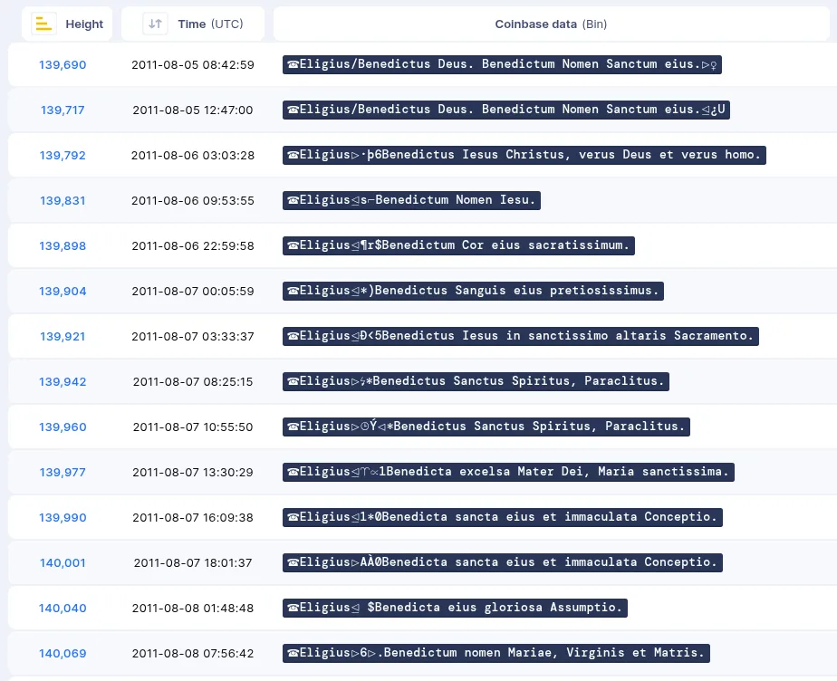

*Ibisingizo vy'Imana biri mu ma block yacukuwe na Eligius muri Myandagaro 2011 (inkomoko: [Blockchair](https://blockchair.com/))*

Haciye indwi zibiri, ayo masengesho yarabonywe n'umwe mu bagize umuryango, aca yandika ubutumwa mu [gikorwa co gucuruza](https://mempool.space/tx/9740e7d646f5278603c04706a366716e5e87212c57395e0d24761c0ae784b2c6) gisanzwe. Yagiriza Luke kuba "uwonona abana", akemeza ko "Imana itabaho", akongera akamutegeka guhagarika "kwanduza blockchain n'ibitagira umutwe vyiwe". Ico gikorwa co gucuruza [carakwiragijwe](https://buildingbitcoin.org/bitcoin-dev/log-2011-08-18.html#l-598) uwo musi nyene na Mark Karpelès, bica bivyura ikiganiro [kuri IRC](https://buildingbitcoin.org/bitcoin-dev/log-2011-08-18.html#l-851) no [kuri forum](https://bitcointalk.org/index.php?topic=38007.msg466841#msg466841) ku vyerekeye ivyo vyandiko bishirwamwo. Graeme Tee, umurongozi wa Ozcoin, yaraneguye cane uwo mugenzo, na canecane ko abagize Eligius batari babizi. Yabajije Luke nimba atibaza ko "gushiramwo amasengesho bishobora gutuma hari abantu bazinukwa", abona ko "btc ari iy'amadini menshi", na we uwo sédévacantiste amwishura ata guca ku ruhande ko "abagatolika batemera umwidegemvyo w'idini".

Ariko rero, Luke yararavye ico ciyumviro, aha abacukuzi uburyo bwo [gusaba](https://web.archive.org/web/20111001015612/http://eligius.st/wiki/index.php/FAQ#What_messages_are_included_in_payout_coinbases.3F) gushiramwo ubutumwa bwabo bwite, mu gihe yoba avyemeye. Gutyo harongewemwo ivyandiko vyinshi vy'urwenya, harimwo canecane [rickroll](https://mempool.space/block/00000000000005b71bc4c0cf24a6f00e04980c627e9409266983bd37acbe14d3). Luke yaretse uwo mugenzo mu ntango za Nyakanga.

### Ugukoranirizwa hamwe kw'igikorwa c'ugucukura

Ukwishira hamwe mu makoperative, kwarushirije gukomera mu mwaka wa 2011, kwaciye kuvyura ningoga ikibazo c'ugukoranirizwa hamwe. Nkako, iyubakwa ry'ama block rishingwa umurongozi, akaba ari we ajejwe guhitamwo ibipimo no gutora ibikorwa vyo gucuruza vyemezwa, ivyo bikaba bishobora kudahuza n'ivyo abayagize bipfuza. Vyongeye, amakoperative manini kuruta ayandi aratoneshwa, amatoyi akahahombera, kubera ko variance y'ugucukura ikora no ku migwi y'abacukuzi, itegerezwa kuba ari minini bikwiye kugira ngo ntishikirwe n'ingaruka zayo. Ugukoranirizwa hamwe kw'ugucukura kuva kuri ivyo birumvikana ko guhagarika umutima abagize umuryango, babona ko ari akaga ku mikorere myiza ya Bitcoin.

Ibikorwa biri ahabona vy'amakoperative ya bose (nk'akarorero Deepbit [itangaza](https://web.archive.org/web/20110602135526/http://deepbit.net/stats) buri musi ama block yaronse) bituma bishoboka kugereranya urugero rwa Hashrate yayo ugereranije n'ububasha bwose bw'umuhora. Ivyo ni vyo bituma hakorwa ibicapo vy'uruziga rugabuwemwo ibice vyerekana ingene amakoperative agabuye, nk'uko bigirwa nk'akarorero na [Bitcoin Watch](https://web.archive.org/web/20110401115146/http://www.bitcoinwatch.com/) (ico gihe [yacungerwa](https://bitcointalk.org/index.php?topic=5016.msg73505#msg73505) na Nils Schneider) canke block explorer [Blockchain.info](https://web.archive.org/web/20111018232813/http://blockchain.info/pools). Gutyo birashoboka kumenya neza ko ububasha bwo guharura budakoranirijwe hamwe muri koperative imwe gusa.

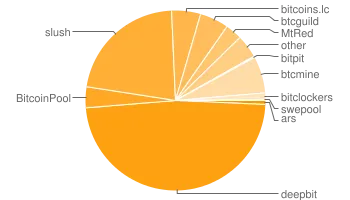

*Ingene Hashrate ya Bitcoin yari igabuye ku wa 6 Mukakaro 2011 (inkomoko: [ububiko](https://web.archive.org/web/20110706215910/http://www.bitcoinwatch.com/) bwa Bitcoin Watch)*

Naho ari ukwo, ivyo ni vyo vyabaye mu ntango za Mukakaro, igihe urugero rwa Hashrate yapimwe ya Deepbit, koperative ya Tycho, rwegereza 50 % (mu gihe gito). Ukwo kuganza kwatumye hari abantu kuri forum bagira ico bavuze, [kuri bo](https://bitcointalk.org/index.php?topic=26630.msg333929#msg333929) "umutekano wa Bitcoin ukaba ugeramiwe hafi rwose". Ariko ayo majambo ararenze urugero gatoyi: abakoresha bashira mu gaciro kuruta abandi, bashavuye, baribukije [ko](https://bitcointalk.org/index.php?topic=26630.msg333929#msg333929) umurongozi ata nyungu n'imwe y'ubutunzi afise mu gutera umuhora, ko ingaruka z'ico gitero zoba ari nke, kandi [ko](https://bitcointalk.org/index.php?topic=26630.msg334029#msg334029) abayigize bafise umwidegemvyo wo guhindura serivisi igihe cose, kubera ko "umurongozi wa koperative adategeka ibikoresho vy'ubuhinga bw'inyabwonko vy'abanywanyi bayo". Hari rero ikibazo c'ugukoranirizwa hamwe, ariko ntigikomeye nk'uko kiboneka.

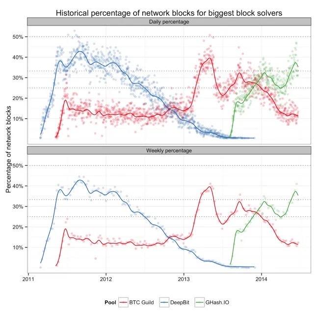

*Ibice kw'ijana vy'ihingurwa ry'ama block, bipimwe ku musi no ku ndwi, hagati ya 2011 na 2014 (inkomoko: OrganOfCorti ku bwa blog [Neighbourhood Pool Watch](https://organofcorti.blogspot.com/2014/06/166-fifty-percent-club.html))*

Ukuganza kwa Deepbit kwashitse ku rugero rwo hejuru mu ci, urugero rw'ububasha bwo guharura rwapimwe [rushika](https://organofcorti.blogspot.com/2014/06/166-fifty-percent-club.html) kuri 52,86 % ku wa 5 Myandagaro, kandi kwaragumyeho mu gihe cose casigaye c'umwaka. Ivyo ni vyo vyatumye ugushira umukono ku gikorwa co gucuruza c'agashimwe, kwatangujwe na Eligius muri Ruheshi, gukwiragira kuva muri Munyonyo. Gutyo, amakoperative BitMinter, BTC Guild na EclipseMC yaremeye uwo mugenzo muri Munyonyo, yifatanywa n'imigwi mito kuruta nka NMCBit canke Ozcoin. Koperative ya Slush [yatanguye](https://mempool.space/block/000000000000032fb1005bc5de7ae276d2a91481619b7c4beb53e1ed63f71501) kubigira muri Nzero, mu gushira umukono `/slush/` ku ma block yayo. Ugushira umukono kuri coinbase [kwahavuye kugirwa na benshi](https://organofcorti.blogspot.com/2013/11/162-short-post-on-mapping-historical.html) muri Nyakanga 2012. Ariko Deepbit [yaranse](https://bitcointalk.org/index.php?topic=118245.msg1270292#msg1270292) kuvyemera.

### P2Pool, koperative itagira ubutegetsi bwo hagati

Uburyo bumwe bwo kurwanya ugukoranirizwa hamwe kuva ku gukwiragira hose kw'ugucukura mu makoperative ni serivisi itagira ubutegetsi bwo hagati P2Pool. Iyo serivisi [yahinguwe](https://bitcointalk.org/index.php?topic=61131.msg231927#msg231927) ku wa 17 Ruheshi 2011 na Forrest Voight, umuhinguzi akiri muto wo muri Florida w'imyaka 18, akoresha izina ry'irihimbano ForrestV kandi akunda cane kuba kuri IRC [kuva muri Ntwarante](https://buildingbitcoin.org/bitcoin-dev/log-2011-03-09.html). Yerekana P2Pool nka "koperative itagira ubutegetsi bwo hagati, inanira ibitero vyo kubuza serivisi gukora kandi ikingiwe *pool hopping*".

*Forrest Voight nko mu 2011 (inkomoko: [ububiko](https://web.archive.org/web/20110816144339/https://forre.st/) bw'urubuga rwiwe bwite)*

Ubwo buryo [bushingiye](https://im.forre.st/pb/85341005.txt) ku "ruhererekane rw'imigabane", canke *sharechain*, rubungabungwa n'abacukuzi barugiramwo uruhara bihuje mu buryo bwa [peer-to-peer](https://planb.academy/resources/glossary/peertopeer-p2p), nk'uko bimeze kuri Blockchain ya Bitcoin. Umugabane wose urimwo hash y'umugabane uwubanjirije, ivyo bikaba bifatanya imigabane hagati yayo bikongera bikemeza ko vyose hamwe bitahinduwe. Ingorane (mu ntango ikaba iri hasi incuro 600 kuruta ingorane y'umuhora nyamukuru) ihindurwa ubudahengeshanya kugira ngo hagume hari umwanya wa mwayeni w'amasegonda 5. Uburyo bwo guhemba ni ukuriha hakurikijwe imigabane N iheruka (PPLNS), kugirirwa mu gikorwa co gucuruza c'agashimwe ubwaco, igihe cose block ibonetse.

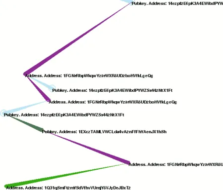

*Ishusho yerekana sharechain (inkomoko: Gregory Maxwell ku bwa [Bitcoin Wiki](https://en.bitcoin.it/wiki/File:P2pool_chain.png))*

Ku wa 19 Mukakaro 2011, inyuma y'igerageza ryakorewe ku muhora w'igerageza, P2Pool [yarashizwe](https://bitcointalk.org/index.php?topic=61131.msg379115#msg379115) ku muhora nyamukuru wa Bitcoin. Iyo koperative itagira ubutegetsi bwo hagati [yararonse](https://bitcointalk.org/index.php?topic=61131.msg476766#msg476766) block yayo ya mbere ku wa 23 Myandagaro, inyuma y'amavugururwa menshi n'ukwezi kurenga kw'ugukora hash! Ayandi ma block yarakurikiye, ariko ibikorwa vyayo vyagumye ari bito cane mu mezi menshi.

Ku wa 24 Myandagaro, Forrest [yarasavye](https://bitcointalk.org/index.php?topic=39088.msg478130#msg478130) ko hongerwa ihamagara rya RPC kuri porotokole y'itumatumanako ya Bitcoin, afise intumbero yo kworosha P2Pool. Ni itegeko `getmemorypool` (GMP), rituma node ironka ama hash y'ibikorwa vyo gucuruza vy'iyindi node, kugira ngo yubake igikorwa cayo bwite co gucuruza c'agashimwe. [Ryashizwe](https://bitcointalk.org/index.php?topic=52480.msg626275#msg626275) muri porogaramu nyamukuru muri verisiyo 0.5, yasohotse muri Munyonyo.

Kuva muri Kigarama, iyo sisiteme yararyohowe, ikwegera amaso y'umuryango w'abahinga, na canecane aya [Mike Hearn](https://bitcointalk.org/index.php?topic=61131.msg641090#msg641090), aya [Gregory Maxwell](https://bitcointalk.org/index.php?topic=18313.msg712952#msg712952) n'aya [Charlie Lee](https://bitcointalk.org/index.php?topic=18313.msg712976#msg712976). Vyongeye, [haratanzwe](https://bitcointalk.org/index.php?topic=57027.msg679955#msg679955) intererano kugira ngo abacukuzi baremeshwe guca muri iyo koperative. Kubera ukwo kwitwararikwa gushasha, Hashrate icungerwa n'iyo koperative yaciye [iduga](https://organofcorti.blogspot.com/2012/11/52-p2pool-achieving-expectations.html) amaherezo: yavuye kuri gigahash nkeyi ku segonda mu ntango za 2012, ishika kuri 100 GH/s muri Ruhuhuma no kuri 350 GH/s mu mpera za Ntwarante. Ico gihe iyo sisiteme yari ifise 3 % vy'ububasha bwose bwo guharura bw'umuhora! Ariko rero, P2Pool yaragowe no kwironkera ikibanza kinini kuruta, kubera ko imikorere yayo muri kamere yayo igoye kuruta iy'ayandi makoperative.

### Porotokole y'ugucukura Stratum

Ugukwiragira hose kw'ugucukura mu makoperative kwatumye kandi hategurwa amaporotokole mashasha y'itumatumanako. Mu 2011, amakoperative yishimikiza itegeko rya kera ritari riteye imbere `getwork`, be na *long polling*, [ubuhinga](https://bitcointalk.org/index.php?topic=3889.msg63957#msg63957) buva mu kwandika porogaramu z'imihora butuma (mu bindi) imigabane itagikora igabanuka, mu kumenyesha ningoga abacukuzi ama block mashasha. Ariko iyo mikorere itwara bandwidth nyinshi bimwe bidasanzwe, haba ku ruhande rwa seriveri canke urwa client, ku buryo ibintu vyaciye biba ibidashobora kwihanganirwa uko igitigiri c'ukwihuza cagenda kiraduga cane.

Gutyo, umwaka wa 2012 wahariwe gushinga standard y'itumatumanako ku bw'ugucukura mu makoperative. Standard ya mbere yadutse ni ihamagara rya RPC `getblocktemplate` (GBT), igikorwa caryo nyamukuru kikaba ari ugusubiza uwugizemwo uruhara imiterere ya block. Ni ukuryohora `getmemorypool`, [kwasabwe](https://en.bitcoin.it/w/index.php?title=BIP_0022&oldid=24328) na Luke-Jr ku wa 28 Ruhuhuma 2012. Itegeko GBT ridondorwa muri BIP [22](https://github.com/bitcoin/bips/blob/master/bip-0022.mediawiki) na [23](https://github.com/bitcoin/bips/blob/master/bip-0023.mediawiki). Ubwo buryo [bwakoreshejwe](https://github.com/bitcoin/bitcoin/pull/936#issuecomment-5804140) kuva muri Rusama n'amakoperative Eligius na EclipseMC muri porogaramu zayo bwite za seriveri. [Bwashizwe](https://github.com/bitcoin/bitcoin/pull/936/files) muri kode ya porogaramu nyamukuru ya Bitcoin muri Myandagaro, kandi [buri](https://bitcointalk.org/index.php?topic=110243.msg1199467#msg1199467) muri verisiyo 0.7 yasohotse muri Nyakanga.

Ariko rero, iyindi standard yaradutse muri ico gihe nyene. Eleuthria (BTC Guild) na Slush (BitcoinCZ) bariko bakora ku buryo bwabo bwite, babusohora umwe ku wa [10](https://bitcointalk.org/index.php?topic=108441.msg1178526#msg1178526) uwundi ku wa [11](https://bitcointalk.org/index.php?topic=108533.msg1180029#msg1180029) Nyakanga 2012. Ariko kubera ko iciyumviro ca Slush cari gitunganye kuruta, Eleuthria yarakuyeho iciwe.

Standard yasabwe na Slush ni porotokole y'ugucukura Stratum (canke StratumMP). Izina ryayo [risigura](https://bitcointalk.org/index.php?topic=55842.msg667768#msg667768) "urwego" mu kilatini, kandi ryari risanzwe rikoreshwa mu kuvuga [porogaramu ya seriveri](https://bitcointalk.org/index.php?topic=55842.msg664197#msg664197) ya BitcoinCZ. Stratum [ituma](https://web.archive.org/web/20120921014023/http://mining.bitcoin.cz/stratum-mining) ama client yoroshe y'abagizemwo uruhara yihuza na node ya koperative, akongera agahanahana amakuru na yo neza. Iyo porotokole ifatira ahanini kuri porotokole yahinguwe ku bwa Electrum.

Iryo sohorwa ryatumye bamwe mu bahinguzi b'umuryango bagira ico bavuze, nka [Luke-Jr](https://bitcointalk.org/index.php?topic=108854.msg1183283#msg1183283) na [Gregory Maxwell](https://bitcointalk.org/index.php?topic=108854.msg1183301#msg1183301). Stratum canecane yagirizwa kuba "yarahinguwe mu mwiherero", no guhiganwa na standard imaze amezi iganirwako ku mugaragaro kandi yamaze gutangura gushirwaho, ari yo GMP/GBT. Marek Palatinus [yishuye](https://bitcointalk.org/index.php?topic=108854.msg1183400#msg1183400) yandika ko ubwo buryo bwompi bufise ivyiza vyabwo n'ibibi vyabwo, bumwe bukaba bworoshe kandi butagoye kuruta ubundi: abona ko "itandukaniro riri hagati ya Stratum na GMP risa n'iriri hagati ya client Electrum na client ya Satoshi".

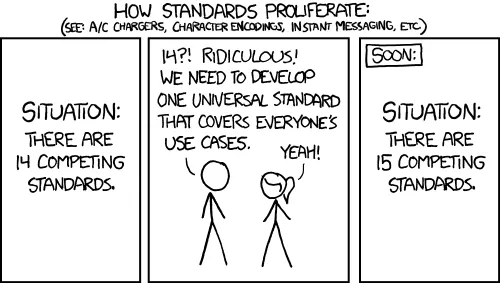

"Ingene ama standard agwira": igicapo c'urwenya cakwiragijwe na Luke-Jr mu kwishura kw'ihingurwa rya standard nshasha Stratum (inkomoko: [XKCD](https://xkcd.com/927/))

Uko amezi yagiye arakurikirana, Stratum yarigaragaje nka porotokole ikoreshwa n'amakoperative menshi, duhereye kuri BitcoinCZ na BTC Guild. Hashrate ikoresha Stratum yari [24 %](https://web.archive.org/web/20121022072300/https://mining.bitcoin.cz/stats/) muri Gitugutu, [45 %](https://web.archive.org/web/20121125081858/https://mining.bitcoin.cz/stats/) muri Munyonyo, ishika kuri [74 %](https://web.archive.org/web/20121225110316/https://mining.bitcoin.cz/stats/) muri Kigarama! Function `getwork` yagiye [irahebwa](https://bitcointalk.org/index.php?topic=1976.msg1524107#msg1524107) buhoro buhoro mu mwaka wa 2013.

### Ugucukura hakoreshejwe FPGA na ASIC

Gutyo rero, itunganywa ry'ugucukura ryarahindutse cane mu myaka ya 2011 na 2012, riba ikintu c'amakoperative aho kuba ic'abacukuzi bakora ari bonyene. Harabonetse ukugwira nyakuri kw'imigwi y'abacukuzi, ikaba yari itandukanye cane haba ku vyiyumviro vyayo canke ku buryo bwayo bwo guhemba (proportional, PPS, n'ibindi.) Ariko iryo hinduka ryatumye igikorwa c'ugucukura gikoranirizwa hamwe, ivyo bikaba vyararemesheje ihingurwa ry'uburyo bwa koperative itagira ubutegetsi bwo hagati P2Pool muri Mukakaro 2011. Itumatumanako mu makoperative na ryo nyene ryararyohowe, bisozerwa n'ukwaduka kwa porotokole yoroshe Stratum muri Nyakanga 2012.

Birumvikana ko ihinduka ry'ugucukura ritari ryerekeye gusa itunganywa ry'abakora hash; ryabaye kandi iry'ibikoresho ubwavyo. Naho ukuva kuri processeur nyamukuru (CPU) uja kuri processeur y'amashusho (GPU) kwari kumaze kuba ihinduka rikomeye, kwariko gusa kurategura ukwaduka kwa circuits intégrés zihariye, canke ASIC, zahavuye zituma ububasha bwo guharura bw'umuhora butera iyindi ntambwe nini cane.

Iryo hinduka rya nyuma, ryari [ryaravuzwe](https://www.metzdowd.com/pipermail/cryptography/2008-November/014815.html) kuva kera na Satoshi Nakamoto, ryagiye riratezwa imbere buhoro buhoro bivuye kuri circuits logiques zishobora kwandikwamwo porogaramu (FPGA), zatuma ibikoresho bitunganywa neza mu buryo bwa virtual ku bwa [function ya hash](https://planb.academy/resources/glossary/hash-function) ya Bitcoin. Algorithme ya mbere yuguruye ya FPGA [yasohowe](https://bitcointalk.org/index.php?topic=9047.msg130885#msg130885) muri Rusama 2011, kandi ama ASIC yarashize mu ngiro ukwo gutunganywa neza kwa FPGA ku ma puces ubwayo. Igurishwa rya mbere ry'imbere y'igihe rya ASIC, ryakozwe n'ishirahamwe ryo muri Leta Zunze Ubumwe za Amerika Butterfly Labs, [ryabaye](https://web.archive.org/web/20120619090952/http://news.yahoo.com/butterfly-labs-announces-next-generation-asic-lineup-054626776.html) muri Ruheshi 2012. Ubwa nyuma, ASIC ya mbere ikora, Avalon ASIC, [yarahawe](https://bitcointalk.org/index.php?topic=137534.msg1465887#msg1465887) abantu bose muri Nzero 2013.

Ariko rero, iyo nkuru irakwiye kuvugwa ido n'ido kuruta, ivyo bikazogirwa mu cigwa cacu gikurikira cerekeye iterambere rya Bitcoin. Ubu reka dusubire mu mpera z'umwaka wa 2011, kugira ngo turabe impari zikomeye zaranze ihingurwa rya porotokole muri ico gihe: urugamba rwa Pay to Script Hash.

## Urugamba rwa Pay to Script Hash
<chapterId>6f6fba00-f9a5-59c7-b780-602127b85fd6</chapterId>

Satoshi Nakamoto amaze kugenda, ihingurwa rya porogaramu ryaciye ryitwararikwa n'umuryango, wategerejwe gukorera hamwe uhagarikiwe na Gavin Andresen. Canecane, hari ikibazo co kuryohora ubushobozi bwa Bitcoin bwo kwandikwamwo porogaramu, kubera ko bwari bwagabanijwe mu gihe gito n'ishirwaho ry'amategeko ya relais ku muhora.

Mu rushana rwo mu 2011–2012, harabaye impari zikomeye ku vyerekeye ishirwa mu ngiro ry'umukono w'impande nyinshi muri Bitcoin. Izo mpari zari zerekeye, mu bindi, icitegererezo citwa "Pay to [Script](https://planb.academy/resources/glossary/script) Hash", canke P2SH. Pete Rizzo na Aaron van Wirdum [bahavuye bita](https://bitcoinmagazine.com/technical/the-battle-for-p2sh-the-untold-story-of-the-first-bitcoin-war) ayo matati "urugamba rwa P2SH". Yari yo matati ya mbere akomeye ku vyerekeye ihinduka rya porotokole, akaba ari yo ya mbere yavyuye ikibazo c'imitegekere.

Muri iki kigabane, tuzosuzuma ico kiringo kidasanzwe co mu mateka y'ubuhinga ya Bitcoin. Tuzobanza kuvuga ihingurwa rya porogaramu n'iciyumviro c'umukono w'impande nyinshi. Hanyuma tuzokwiga ivyiyumviro bitandukanye vyo gushira mu ngiro ubwo buhinga, duhereye kuri OP\_EVAL na P2SH. Ubwa nyuma tuzokwigana ingene Pay to Script Hash yatangujwe naho habaye intambamyi nyinshi.

### Ihingurwa rya Bitcoin-Qt

Inyuma y'isohoka rya verisiyo 0.4 ya porogaramu ku wa 23 Nyakanga, ryerekana ko Gavin Andresen yatoye ikivi nk'umubungabunzi mukuru, ihingurwa ry'ishirwa mu ngiro nyamukuru rya Bitcoin ryarabandanije. Canecane, haradutse interface nshasha y'amashusho y'iyo porogaramu: ni Bitcoin-Qt, [yahinguwe](https://bitcointalk.org/index.php?topic=15276.msg203205#msg203205) na Wladimir van der Laan kuva muri Ruheshi. Ishingiye kuri framework y'amashusho Qt, isubirira isomero wxWindows ryakoreshwa na Satoshi mu ntango. Iyo interface [yashizwe](https://bitcointalk.org/index.php?topic=45742.msg545547#msg545547) mw'ishami nyamukuru rya kode ku wa 26 Nyakanga, [iba](https://bitcointalk.org/index.php?topic=52480.msg626275#msg626275) ishusho yemewe ya porogaramu muri verisiyo 0.5 yasohotse ku wa 21 Munyonyo. Nkako, kuva ico gihe iyo porogaramu yitwa Bitcoin-Qt/bitcoind, canke mbere Bitcoin-Qt gusa (bitcoind ikaba ari daemon).

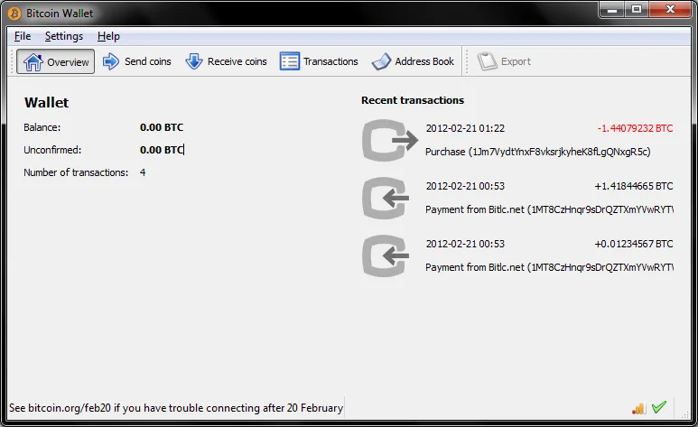

*Ifoto ya ecran ya Bitcoin-Qt 0.5.2 muri Ruhuhuma 2012 (inkomoko: [JimNelin](https://commons.wikimedia.org/wiki/File:Screenshot_of_Bitcoin-qt-0.5.2.png) ku bwa Wikimedia)*

Gavin yari akiri umurongozi w'umugambi, ariko afashwa n'abantu benshi. Muri Gitugutu 2011, abahinguzi "bemewe" ba Bitcoin (ni ukuvuga [abari](https://web.archive.org/web/20111022025640/http://www.bitcoin.org/) kuri Bitcoin.org) ni Gavin Andresen, Pieter Wuille, Nils Schneider, Jeff Garzik na Wladimir van der Laan. Abo banditsi ba porogaramu bafatwa ko baserukira Bitcoin mu vy'ubuhinga, kandi umuntu ashobora kubandikira biciye kuri email. Ni ababungabunzi, [bafise](https://bitcointalk.org/index.php?topic=1774750.msg17700787#msg17700787) uburenganzira bwo kwandika mu bubiko bwa kode kuri GitHub. Gregory Maxwell [yifatanije](https://web.archive.org/web/20120223113428/http://www.bitcoin.org/) na bo muri Ruhuhuma 2012, Nils Schneider na we ahagarika gutanga intererano muri Rusama y'uwo mwaka nyene. Umugwi w'abahinguzi wagizwe gutyo [wagumyeho](https://bitcointalk.org/index.php?topic=1774750.msg17700787#msg17700787) gushika mu 2014.

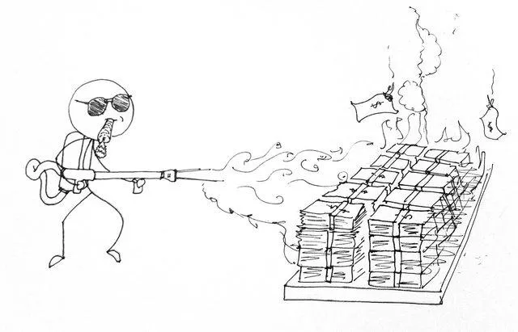

*"The Gavinator": igicapo ca Gavin Andresen ariko araturira inoti, cakozwe na Shazow muri Ndamukiza 2011 (inkomoko: [ububiko](https://web.archive.org/web/20140426185712/https://bitcointalk.org/index.php?topic=5770.80) bwa BitcoinTalk)*

Muri ico gihe nyene, uburyo bw'ivyiyumviro vyo guteza imbere Bitcoin, [bwashinzwe](https://gnusha.org/pi/bitcoindev/1316392315.46221.YahooMailNeo@web121014.mail.ne1.yahoo.com/) na Amir Taaki muri Nyakanga 2011, bwaratanguye kwama ivyamwa. Gutyo, BIP za mbere zanditswe mu mpera z'umwaka. Ni ko biri nk'akarorero kuri BIP 10, [yasohowe](https://gist.github.com/etotheipi/1321518) ku wa 28 Gitugutu na Alan Reiner, umuhinguzi wa Wallet Armory.

Ku wa 9 Nzero 2012, uwitwa David Perry, azwi kw'izina ry'irihimbano Enmaku kuri forum, [yarasohoye](https://web.archive.org/web/20120830214308/http://codinginmysleep.com/bitcoin-development-history-visually/) ishusho yerekana ingene ihingurwa rya porogaramu ryagiye riratera imbere, yakozwe hakoreshejwe igikoresho citwa Gource. Iyo shusho yerekana intererano z'abahinguzi kuri porogaramu: itangurira ku bikorwa vya Satoshi Nakamoto na Martti Malmi, igakurikiza ikibanza kigenda kirakura cafashwe na Gavin Andresen kuva muri Mukakaro 2010, ikongera ikerekana ingene kode yagiye irarushiriza kugorana, bigashikana kw'iyongerekana rikomeye ry'ihingurwa kuva muri Ndamukiza 2011.

*Ishusho yerekana intererano kuri porogaramu ya Bitcoin hagati ya Myandagaro 2009 na Nyakanga 2012*

### Ubushobozi bwa Bitcoin bwo kwandikwamwo porogaramu

Bitcoin irimwo sisiteme y'imbere yo kwandika porogaramu. Nk'uko [twabivuze](https://planb.academy/fr/courses/a51c7ceb-e079-4ac3-bf69-6700b985a082/cartes-graphiques-pizzas-et-bitcoins-gratuits-9cd228a4-58d3-46a3-9935-06098bafc954) mu cigwa cerekeye iremwa rya Bitcoin, Satoshi Nakamoto yashizeho iyo sisiteme kuva mu ntango, abona ko imiterere yayo "yari yanditswe mw'ibuye mu gihe cose izomara iriho". Gutyo, muri Ruheshi 2010 [yanditse](https://bitcointalk.org/index.php?topic=0195.msg1611#msg1611) ati:

> Iyi miterere irashigikira ubwoko bwinshi butandukanye bw'ibikorwa vyo gucuruza bishoboka nateguye haraciye imyaka. Ibikorwa vyo gucuruza vya escrow, amasezerano afise ingwati, ugutatura amatati kugizwe n'uwa gatatu, umukono w'impande nyinshi, n'ibindi. Bitcoin niyaronka intsinzi ikomeye, ivyo ni ibintu bizokenerwa gusuzumwa muri kazoza, ariko vyari bikenewe gutegurwa kuva mu ntango kugira ngo bimenyekane neza ko bizoshoboka mu nyuma.

Ivyo bishoboka vyinshi bitandukanye vyarashimishije cane abantu batari bake, na canecane Mike Hearn. Uwo [yarabiganiriyeko](https://plan99.net/~mike/satoshi-emails/thread4.html) na Satoshi mu makete yabo bwite mu 2011. Mu ci, Mike [yarashize imbere](https://en.bitcoin.it/w/index.php?title=Contract&oldid=16063) "amasezerano agabanganijwe" kuri wiki ya Bitcoin, aho atanga uturorero twinshi nk'ukurwanya spam, escrow, amasezerano y'ingwati, ama oracle yo hanze canke uguhanahana kwa atomic. Yarongeyeko kandi irangiro ry'inyandiko ngenderwako ya Nick Szabo yerekeye *smart contracts* yo mu 1997.

### Umukono w'impande nyinshi

Umukono w'impande nyinshi, canke Multisig, ni uburyo bwo gusaba imikono myinshi kugira ngo amahera akoreshwe. Ni wo buye ry'imfuruka ry'ishirwaho ry'amasezerano ahuza abantu benshi. Ubwo buhinga bwogira akamaro mu gukingira amahera, ico gihe kikaba ari ikibazo gihambaye cane kubera ukugwira kw'ibitero vy'ubusuma. Bwoshobora kandi gukoreshwa mu masezerano ya escrow, yotuma uguhanahana mu vy'ubutunzi kurushiriza kugira umutekano ku wugurisha. Nkako, ayo masezerano arasabwa n'abakoresha, nk'uko vyemezwa n'ukubaho kwa serivisi ya escrow ya Gavin Andresen, [ClearCoin](https://clearcoin.blogspot.com/2011/06/ill-be-closing-clearcoin-to-new.html), hagati ya Kigarama 2010 n'ici ryo mu 2011.

Ururimi rwa Script rwa Bitcoin rurimwo opcode, `OP_CHECKMULTISIG`, ituma hasabwa imikono M mu bagizemwo uruhara N kugira ngo amahera yemererwe gukoreshwa, M ≤ N. Imfunguruzo za bose z'abashobora gushira umukono zandikwa muri Script yo gufunga ya output y'igikorwa co gucuruza. Umugwi uwo ari wo wose w'imikono M urashobora gufungura igiceri kirimwo iyo Script.

Ikintu gishimishije: ishirwa mu ngiro rya `OP_CHECKMULTISIG` ririmwo bug. Iyo bug [yavumbuwe](https://github.com/bitcoin/bitcoin/pull/319#issuecomment-1472505) ku wa 30 Ruheshi n'uwitwa Bobby Groff (azwi kw'izina rya Groffer), yarondera gushira uburyo bwa escrow muri porogaramu. Yanditse ko iyo operator "ikura ikintu kimwe kirenze kuri pile", bikaba rero bikenewe "kwongerako agaciro k'ikinyoma kugira ngo ico kibazo kizungurukwe". Ariko rero, iyo bug ntishobora gukosorwa hatabanje guhindurwa porotokole no gukorwa fork ya Blockchain. Ni co gituma amaherezo yagumye muri kode.

Ku wa 23 Myandagaro 2011, haciye imisi mikeyi inama y'i New York ibaye, Gavin Andresen [yaratanguje](https://gnusha.org/pi/bitcoindev/CABsx9T1uw43JuvhEmJP0KCyojsDi1r7v6BaLBHz7wWazduE5iw@mail.gmail.com/) ikiganiro ku vyerekeye umukono w'impande nyinshi kuri forum BitcoinTalk no ku rutonde `bitcoin-development`. Yipfuza ko ibikorwa vyo gucuruza birimwo abashira umukono benshi bigirwa standard, kuri we bikaba ari yo "nzira yihuta kuruta izindi yo kuronka ama Wallet ya bitcoin atekanye cane kandi agoye cane gutakaza". Kuva muri Kigarama 2010, ivyitegererezo bibiri gusa [ni vyo](https://bitcointalk.org/index.php?topic=2129.msg27744#msg27744) bifatwa nka standard: P2PK na P2PKH. Iciyumviro ni ukwongerako icitegererezo ca Multisig mbisi, aho igitigiri c'abagizemwo uruhara gishobora gushika kuri 3 ntarengwa.

Gavin yipfuza ko imfunguruzo za bose zijanye na vyo ari zo zikoreshwa nka Address (nk'uko biri kuri P2PKH). Ariko uko vyogenda kwose, ayo maderesi ntiyoshigikirwa n'ama client. Gutyo, kubera ko n'ubundi hotegerezwa gusohorwa client idahuza n'izisanzwe, yasavye "gukora ibintu neza kuva mu ntango, mu gushira mu ngiro canke mu gutanguza ama opcode kugira ngo amaderesi mashasha ya bitcoin ashobore kuba magufi, no mu gutegekanya ugucikamwo kubiri kwa Blockchain" kwoba haciye amezi makeyi. Kubera ko yumva ko vyihutirwa, ashigikiye ko haba igikorwa cihuta, agasigura ko "amaganya yiwe akomeye kuruta ayandi" ari uko abantu bohimbarwa no guharira, maze haciye amezi atandatu "hakaba hataraboneka ubwumvikane".

Inyuma y'ubutumwa bwa Gavin, Casascius [yarasavye](https://bitcointalk.org/index.php?topic=38954.msg476689#msg476689) ko operator OP\_CHECKSIG (iyikoreshwa mu kugenzura imikono isanzwe) ihindurwa kugira ngo yitwararike ama Script ya Multisig. Ico gihe amaderesi ashobora kuba hash ya Script, hanyuma Script yose igatangwa igihe amahera akoreshwa, nk'uko urufunguzo rwa bose rutangwa igihe hakoreshwa output ya P2PKH. [Yahavuye asubira gutunganya](https://bitcointalk.org/index.php?topic=45211.msg538756#msg538756) ico ciyumviro haciye ukwezi. Ku wa 1 Gitugutu, uwitwa Jim Babcock, umuhinguzi wa porogaramu akaba na rationaliste, [yaratanze](https://bitcointalk.org/index.php?topic=46429.msg553217#msg553217) iciyumviro gisa n'ico. Insiguro yabo yaravyuriye iciyumviro Nicolas van Saberhagen w'amayobera, azwi kw'izina rya ByteCoin, aca [ategura](https://bitcointalk.org/index.php?topic=46538.msg553689#msg553689) opcode nshasha yitwa `OP_EVAL` mw'ijoro ryo ku wa 1 rishira ku wa 2 Gitugutu. Gavin Andresen [yaratanze](https://bitcointalk.org/index.php?topic=45211.msg553668#msg553668) iciyumviro kingana n'ico ku rugero kanaka (gifise ama operator `BEGIN_DIGEST` na `END_DIGEST`) muri ico gihe nyene. Ariko rero, `OP_EVAL` ni yo yatsinze muri ukwo kugwira kw'ivyiyumviro.

### OP_EVAL: kurangura Script muri Script

Operator `OP_EVAL` ituma Script irangurirwa imbere mu yindi Script. Irangurwa mu mpera za Script yo gufunga kugira ngo isuzume ko Script yatanzwe yemewe, hash yayo ikagereranywa na hash yatanzwe. Ivyo bituma hashobora kurangurwa Script iyo ari yo yose.

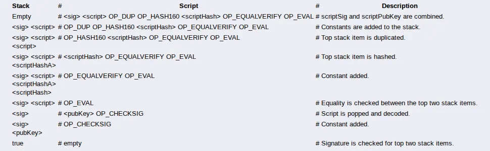

*Imikorere y'ubuhinga ya operator `OP_EVAL` (inkomoko: ByteCoin kuri [BitcoinTalk](https://bitcointalk.org/index.php?topic=46538.msg553689#msg553689))*

Ni ukwongera rero ibwirizwa mu rurimi rwa Script, ivyo bikaba bisaba ihindurwa rya porotokole, n'ugutandukana kw'umuhora rero mu gihe bose batovugurura, bigashikana ku gucikamwo kubiri kwa Blockchain gushobora kuba. Ariko rero, ku musi wa 2 Gitugutu, Gavin yaratoye uburyo bwo kwirinda ibintu nk'ivyo, [yandika](https://buildingbitcoin.org/bitcoin-dev/log-2011-10-02.html#l-852) kuri IRC ati:

> Kumbure ndiko ndasoma nabi kode, ariko niyumvira ko OP\_EVAL itotuma Blockchain icikamwo kubiri!

Iciyumviro ciwe gishingiye ku mwihariko w'ururimi rw'imbere rwo kwandika porogaramu rwa Bitcoin: ama operator `OP_NOP` yongewemwo na Satoshi mu ci ryo mu 2010, akaba ari amabwirizwa atagira ico akora adatuma Script arimwo iba itemewe. Ayo atuma hakorwa amahinduka ya porotokole "ahuza n'ivya kera" ku ma verisiyo ya kera ya porogaramu, kandi agatuma Blockchain imwe gusa ari yo irokoka, mu gihe ububasha bwo guharura buyakurikiza ari bwo bwinshi. Ayo mahinduka yahavuye yitwa [soft forks](https://planb.academy/resources/glossary/soft-fork). Gutyo birashoboka guhindura `OP_NOP1` mwo `OP_EVAL`, no gutunganya ibintu kugira ngo iryo hinduka rikurikizwe n'amakoperative y'ugucukura.

Abandi bagize umuryango w'abahinga baciye bemeza ningoga ico Gavin yatoye. Canecane, Gregory Maxwell [yasiguye](https://buildingbitcoin.org/bitcoin-dev/log-2011-10-02.html#l-1426) ko "iciyumviro ca Gavin c'uko EVAL ishobora gukorwa hatabaye ugucikamwo kubiri camutangaje cane".

Haciye indwi zibiri, ku wa 19 Gitugutu, Gavin Andresen [yaranditse](https://bitcointalk.org/index.php?topic=46538.msg583615#msg583615) ivyiyumviro bitatu vyo guteza imbere Bitcoin, vyaciye bishirwa ningoga kuri wiki Bitcoin.it:

- [BIP 11](https://en.bitcoin.it/w/index.php?title=BIP_0011&oldid=18340), idondora ivyitegererezo vya Script vya Multisig mbisi;
- [BIP 12](https://en.bitcoin.it/w/index.php?title=BIP_0012&oldid=18348), idondora ibwirizwa OP\_EVAL n'icitegererezo ca Script kijanye na ryo;
- [BIP 13](https://en.bitcoin.it/w/index.php?title=BIP_0013&oldid=18495), idondora ingene amaderesi ya OP\_EVAL atunganywa, "ituma hashigikirwa ibikorwa vyo gucuruza bigoye ku rugero urwo ari rwo rwose".

Itanguzwa rya BIP 12 ritegekanijwe ku wa 1 Ruhuhuma 2012, mu gihe 50 % vy'abacukuzi boba batanze ikimenyetso c'uko bayishigikiye mu gushira urukurikirane rw'ibimenyetso `OP_EVAL` mu ma block bahingura imbere yo ku wa 15 Nzero. Urwo rugero nirutashikwako, ico gihe ishirwaho ryayo rizokwimurirwa ku yindi tariki yo mu nyuma. Intumbero y'ivyo ni ukwemeza ko ivugururwa rigenda neza, hatabonetse ishami rihiganwa.

### Utunenge twa OP_EVAL

Ariko rero, operator `OP_EVAL` ifise utunenge. Utwo twerekanywe ahanini na Russell O'Connor, umushakashatsi mu vy'ubuhinga bw'inyabwonko w'Umunyakanada akorera kuri kaminuza Radboud y'i Nimègue mu Buholandi.

Ku ruhande rumwe, akanenge kibonekeza ni recursion. Sisiteme ya Script ya Bitcoin yateguwe kugira ngo ntikore loop kandi ihagarare neza (si Turing-complete). Ishirwa mu ngiro ritarimwo ubwitonzi rituma recursion ishoboka, rigatuma porogaramu ibandanya gukora gushika aho imashini itagishobora gukurikira (akarorero katanzwe na Gavin ni `<OP_DUP OP_EVAL> OP_DUP OP_EVAL`). Birakenewe rero kwongerako akarimbi ku burebure bwa recursion.

Ariko rero, akaga ko kugira bug kagumaho. Ku wa 27 Kigarama 2011, Russell O'Connor [yarasuzumye](https://github.com/bitcoin/bitcoin/issues/729#issue-2660989) kode, ayisangamwo icuho ca recursion. Ku vyo yamenyesheje yongeyeko iri jambo rikurikira:

>  Iyi OP\_EVAL ni ihinduka rihambaye cane biboneka ko ritasuzumwe bikwiye. Nakeneye gusa iminota 70 y'ubushakashatsi kugira ngo ntore iyi bug. Ntimuriteguye kuyishira mu ngiro. ... Mutegerezwa guhagarika ivyo muriko murakora, mugafata umwanya wo gutahura Bitcoin vy'ukuri. 

Ku rundi ruhande, naho recursion yokosorwa, OP\_EVAL ituma bidashoboka gusesangura Script imbere y'uko irangurwa. Gutyo, ntibishoboka guharura ama operator y'umukono (atwara uburyo bwinshi) imbere yo kurangura Script ubwayo.

Russell O'Connor yarashize ahabona ukubura kw'uburyo bwo gusesangura guterwa na `OP_EVAL`. Ku wa 29 Kigarama, [yanditse](https://gnusha.org/pi/bitcoindev/alpine.LRH.2.00.1112290111310.22327@theorem.ca/) ko "ku ciyumviro ca OP\_EVAL, nta buryo na bumwe buriho bwo gusesangura Script mu buryo bwa static (nk'akarorero kugira ngo haharurwe incuro OP\_CHECKSIG canke OP\_MULTICHECKSIG zikoreshwa, canke hagirwe irindi sesangura) hatabanje kurangurwa Script".

Ku rutonde `bitcoin-development`, [yarasavye](https://gnusha.org/pi/bitcoindev/alpine.LRH.2.00.1112291143220.22327@theorem.ca/) Gavin kwigiza inyuma itariki y'itanguzwa "amezi abiri", atomora ko "OP\_EVAL itarategurwa bikwiye gusa". Muri uwo murongo nyene, Alan Reiner [yaribukije](https://gnusha.org/pi/bitcoindev/CALf2ePzoC85=16h63ngn-KaEHDSYFqAOkW7UWqB_Jgd2F_pkTQ@mail.gmail.com/) abahinguzi ko bariko bakinisha "ikintu gifise agaciro k'amadolari arenga imiliyoni 20", yerekeza ku gaciro k'ama bitcoins yose hamwe, kandi ko "atari porogaramu yonyene ihatswe".

Gutyo hafashwe ingingo yo kwiga ibindi vyiyumviro imbere yo gufata ingingo iyo ari yo yose. Kimwe ni opcode `OP_CODEHASH`, [yateguwe](https://gnusha.org/pi/bitcoindev/alpine.LRH.2.00.1112290111310.22327@theorem.ca/) na Russell O'Connor ubwiwe, isaba ko haremwa pile yihariye ya virtual machine kugira ngo Script ibungabungwe. Ikindi ni ibwirizwa `OP_CHECKEDEVAL`, [ryateguwe](https://gnusha.org/pi/bitcoindev/20111229190838.GA29609@ulyssis.org/) na Pieter Wuille.

### Pay to Script Hash

Ingingo ngenderwako iri inyuma ya `OP_EVAL` ni ukuriha hash ya Script, hanyuma iyo Script igatangwa igihe amahera afungurwa. Ku wa 2 Nzero 2012, Gavin Andresen [yaragize iciyumviro](https://buildingbitcoin.org/bitcoin-dev/log-2012-01-02.html#l-760) co gusubira gufata iyo ngingo ngenderwako, uretse ko virtual machine yomenya ishusho ya Script. Amir Taaki yagize ico abivuzeko yandika ko "ico ciyumviro ari hack" ariko ko "agikunda" . Gavin [yise](https://gnusha.org/pi/bitcoindev/CABsx9T3gNNmPen=WtCpG8RCChSwpJ73r7WU2Kz_fP31wAQ+jQg@mail.gmail.com/) iciyumviro ciwe "pay to script hash", izina [ryiganywe](https://buildingbitcoin.org/bitcoin-dev/log-2011-12-17.html#l-715) ku citegererezo *Pay to Public Key Hash* (P2PKH), kikaba ari ishusho ya standard ya Script.

Bukeye, ku wa 3 Nzero isaha 21 UTC, inama [yaratunganijwe](https://bitcointalk.org/index.php?topic=56376.msg670964#msg670964) ku murongo wa IRC \#bitcoin-dev na Amir Taaki, kugira ngo abahinguzi bumvikane. Abenshi cane bari bashigikiye Pay to Script Hash, [harimwo na](https://gnusha.org/pi/bitcoindev/alpine.LRH.2.00.1201021134030.21247@theorem.ca/) Russell O'Connor. Gavin [yahavuye adondora](https://bitcointalk.org/index.php?topic=56969.msg679219#msg679219) ico ciyumviro nk'"ubundi buryo bworoshe kuruta, butekanye kuruta ariko budafise ububasha bungana, bwo gukora amaderesi ya bitcoin ku bw'ibikorwa vyo gucuruza vya Multisig n'ibikorwa vyo gucuruza bigoye kuruta vyo muri kazoza".

Gavin Andresen yaranditse integuro ya BIP ku mugoroba, [ishirwa kuri interineti](https://en.bitcoin.it/w/index.php?title=BIP_0016&oldid=21680) bukeye, ihabwa inomero 16. Muri iyo nyandiko, aremera ko "kumenya ishusho "idasanzwe" ya Script no gukora iyemezwa ry'inyongera igihe ibonetse, ari bibi", ariko agasigura ko "ubundi buryo buriho bwaba ari bubi kuruta, canke bugoye kuruta gushira mu ngiro, kandi / canke bwagura ububasha bw'ururimi rw'imvugo mu buryo buteye akaga". Yarahinduye kandi uburyo bw'itangwa ry'ikimenyetso kugira ngo bwikore: mu ndwi ya nyuma ya Nzero, 55 % vy'ububasha bwo guharura nivyatanga ikimenyetso ca Pay to Script Hash (mu gushira urukurikirane rw'ibimenyetso `/P2SH/` mu ma block ahingurwa), ico gihe ivugururwa rizotanguzwa ku wa 15 Ruhuhuma mu gicugu. Gavin yaciye [akora](https://github.com/bitcoin/bitcoin/pull/748) isabwa ry'ihindurwa rya kode ya porogaramu mu bubiko bwa GitHub, aryemera ubwiwe ku wa 13 Nzero nk'umubungabunzi mukuru. Ririmwo itangwa ry'ikimenyetso ca P2SH nk'uburyo busanzwe.

Gavin ashaka kwihuta, kwihuta cane, ivyo bikaba bidashobora kubura gutera ubushamirane. Gutyo, naho [avuga](https://bitcointalk.org/index.php?topic=56969.msg679219#msg679219) "ubwumvikane" kuri Pay to Script Hash, abahinguzi bose ntibavyemeranyako, kandi umuryango muri rusangi ntiwagishijwe inama. Haciye rero haba abamurwanya.

### Ingene Luke-Jr yavyakiriye

Ukwo kurwanya kwarongowe n'umuhinguzi Luke-Jr. Mu nama yo kuri IRC ku wa 3 Nzero 2012, uwo [yararwanije](https://en.bitcoin.it/wiki/User:Genjix/Meetings/3_Jan_2012) P2SH, abona ko "OP\_EVAL yari nziza cane kuruta iki kintu giteye ishishi". Ku wa 13, [yaruguruye](https://web.archive.org/web/20130307042411/https://bitcointalk.org/index.php?topic=58579.0) ikiganiro kuri BitcoinTalk, aho ahamagarira abantu kugira ico bakoze mu kurwanya BIP 16. Abona ko P2SH ari "mbi cane kuruta" `OP_EVAL` kubera ko "ahanini isubirira sisiteme ya Script Bitcoin yubakiyeko ikayisubiriza icitegererezo kimwe gusa kidasanzwe". Vyongeye, yerekana ko "Gavin ahatira abakoresha verisiyo ya nyuma ya kode ya Bitcoin bose gutorera BIP 16", aca [akora](https://github.com/bitcoin/bitcoin/pull/755) *pull request* kugira ngo iryo tangwa ry'ikimenyetso ribe iry'ugushaka, ikaba yaremewe. Ubwa nyuma yasavye ko haba itora ry'umuryango, kuri forum nyene, ritsindwa na P2SH ku majwi menshi cane.

Iyo nyifato yarashavuje cane Gavin Andresen, [yishura](https://bitcointalk.org/index.php?topic=58579.msg689812#msg689812) muri ico kiganiro nyene ati:

> Luke, uriko uragerageza cane ukwihangana kwanje. Ngira nitandukanye na kode mu misi mikeyi kugira ngo nturure imbere y'uko nkora ikintu c'ubujuju, kuko ntanguye gutakaza ukwihangana.

Uwundi munywanyi wa forum, umucukuzi w'Umudagi akoresha izina ry'irihimbano Nachtwind, [yanditse](https://bitcointalk.org/index.php?topic=58579.msg690009#msg690009) ko Luke yerekana "ukudatekana mu mutwe" kunaka biciye ku vyo avuga. Uwo mucukuzi ntiyitaho open source; aremera ko akunda "ukuntu bitcoin yacungerewe gushika ubu", kandi ko yizigira Gavin kuruta Luke "kugira ngo ahitemwo neza". [Inyishu](https://bitcointalk.org/index.php?topic=58579.msg690042#msg690042) ya Luke irakaze:

> Nimba ushaka ifaranga ry'umwami, ni kuki utokoresha idolari rya Fed? Gavin si intungane, kandi aka ni akarorero gusa. Birababaje kubona ubona ko gukangurira abantu ikibazo ari "ukudatekana mu mutwe".

Kuva ku wa 12 Nzero, Luke [yarateguye](https://bitcointalk.org/index.php?topic=56969.msg687795#msg687795) opcode yiwe bwite nk'ubundi buryo busubirira P2SH, mu ntango yitwa `OP_CODEHASHCHECK` (CHC), hanyuma ihabwa izina `OP_CHECKHASHVERIFY` (CHV). Ku wa 18 Nzero, [yaranditse](https://en.bitcoin.it/w/index.php?title=BIP_0017&oldid=22435) BIP 17, idondora iryo bwirizwa rishasha. Ni ukurangura Script yatanzwe igihe c'ugufungura, gukora hash yayo, no kugereranya ikivuyemwo na hash ihuye na Address. Ariko rero, iciyumviro ciwe [ntikiraba](https://bitcointalk.org/index.php?topic=60433.msg703923#msg703923) ibigoye vya virtual machine.

### Impari mu bahinguzi

Ivyo vyiyumviro bitandukanye vyaravyuye impari mu bahinguzi. Amir Taaki, [avuga](https://github.com/bitcoin/bitcoin/issues/729#issuecomment-3325652) ko "muri kamere yiwe akomeye ku bisanzwe ku vyerekeye porotokole, akaba ashigikira iterambere ku vyerekeye amashirwa mu ngiro", yarerekanye ukwiyubara kudasanzwe ku vyerekeye iyemerwa rya P2SH. Ashigikiye ko ingingo zifatwa n'abantu benshi kuruta. Ku wa 28 Nzero, [yanditse](https://buildingbitcoin.org/bitcoin-dev/log-2012-01-28.html) kuri IRC ko ahitamwo ko "abantu bagira ijambo kuri ivyo, naho vyogora akazi k'abahinguzi bikabahatira gusigura ingingo bafata".

Ku wa 29 Nzero, Amir [yarasohoye](https://web.archive.org/web/20120131212150/http://bitcoinmedia.com/the-truth-behind-bip-16-and-17/) inyandiko ndende kuri Bitcoin Media, yitwa "Ukuri kuri BIP 16 na 17", aho avuga mu ncamake uko ibintu vyifashe n'ivyiyumviro bitandukanye. [Yavuze](https://bitcointalk.org/index.php?topic=61705.msg719790#msg719790) iri jambo rikurikira:

> Ico ntinya ni uko umusi umwe Bitcoin yokwononekara. Bahinguzi: nimufate iri suzuma ry'inyongera nk'akaryo ko kwubaka umuco w'ugukorera ahabona.

Ariko rero, ukwo si ko Gavin Andresen avyibaza, we yahisemwo guheraheza izo mpari ashigikira BIP 16, na P2SH rero. Abona ko ibiganiro vyabaye bikwiye, kandi ntashaka ko abahinguzi babandanya guharira ku tuntu dutoduto, nka "[ibara ry'ikibanza co kubikamwo amakinga](https://en.wikipedia.org/wiki/Law_of_triviality)". Ku wa 30 Nzero, [yaravuze](https://buildingbitcoin.org/bitcoin-dev/log-2012-01-30.html#l-1766) kuri IRC ko atagishaka "guta umwanya wiwe kuri BIP 17".

Luke-Jr [yarakoze](https://buildingbitcoin.org/bitcoin-dev/log-2012-01-30.html#l-2147) urupapuro kuri wiki ya Bitcoin rwegeranya ivyo abahinguzi bahagazeko, inyuma y'iciyumviro c'uwitwa Userjj. Ukwanka CHV kwa Gavin ntikugira agahengwe, kandi kuratandukanye n'ukw'abandi bahinga bayemera canke babona ko iruta ubusa.

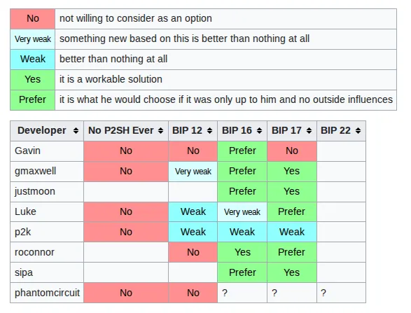

*Ivyo abahinguzi biyumvira ku vyiyumviro bitandukanye, ku wa 2 Ruhuhuma 2012 (inkomoko: [Bitcoin.it](https://en.bitcoin.it/w/index.php?title=P2SH_Votes&oldid=23259))*

Ku wa 1 Ruhuhuma 2012, Casascius yarasubiye kwatsa umuriro mu [gutanga](https://bitcointalk.org/index.php?topic=62181.msg725161#msg725161) BIP (yahawe inomero 22 mu buryo butabereye) isubira gufata iciyumviro ciwe co guhindura opcode `OP_CHECKSIG`. Gavin yaciye ubwo nyene [amusaba](https://bitcointalk.org/index.php?topic=62181.msg725876#msg725876) guhagarika, atomora ko BIP 16 "ishigikiwe n'abantu benshi cane" kandi ko "ari yo izoba umuti". Yongerako ati:

>  Uriko usaba ihinduka ridahuza n'ivya kera, bikaba vyosigura ugucikamwo kubiri gukomeye kwa blockchain. **Bose** baremeranya ko ico ari iciyumviro kibi. Umuvurungano n'akaga k'ibitero vy'ubusuma vyoba mu gihe igice kinini c'abakoresha bitcoin cosanga kiri kuri Blockchain yitandukanije ni vyinshi cane; ivyo vyose ntubiraba mu ciyumviro cawe. 

Haciye imisi mikeyi, Gavin [yahavuye asigura](https://bitcointalk.org/index.php?topic=62181.msg729444#msg729444) (yerekeza ku kiganiro *Qui veut gagner des millions ?*) ati:

> Narakoresheje uguhamagara umugenzi n'iciyumviro c'abarorerezi; nahisemwo BIP 16, kandi iryo ni ryo jambo ryanje rya nyuma.

### Itangwa ry'ikimenyetso ry'abacukuzi

Ikindi kibazo cerekeye itanguzwa ry'ivugururwa rikozwe n'amakoperative y'ugucukura. Kugira ngo iryo hinduka rihuze n'ivya kera, birakenewe ko igice kinini ca Hashrate kirikurikiza. Ariko uko impera za Nzero zagenda ziregereza, ivyizigiro vyo gutanguza P2SH vyagenda biragabanuka.

Ico gihe, ububasha bwo guharura bugabuwe mu makoperative y'ugucukura [nka mirongo itanu](https://en.bitcoin.it/w/index.php?title=Comparison_of_mining_pools&oldid=21595), ariko atatu muri yo aratandukanye n'ayandi: DeepBit, BTC Guild na BitcoinCZ Mining (koperative ya Slush). Canecane, DeepBit iguma ari yo koperative iganza: mu ntango z'umwaka wa 2012, yo yonyene ifise nka 30 % vy'ububasha bwo guharura bw'umuhora. Ayo yandi abiri na yo ari hafi ya 10–15 %.

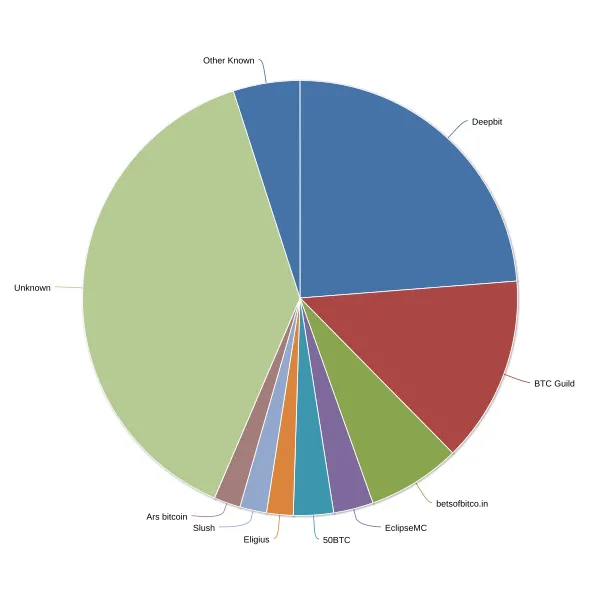

*Urugero rw'ama block yacukuwe n'amakoperative y'ugucukura ku musi wa 19 Kigarama 2011 (inkomoko: [Blockchain.info](https://web.archive.org/web/20111219124912/http://blockchain.info/pools))*

Ku wa 25 Nzero, mu gihe isuzuma ry'itangwa ry'ikimenyetso ritanguye, amakoperative matoyi makeyi [yaravuze ko ashigikiye](https://web.archive.org/web/20120125091902/http://blockchain.info/P2SH) P2SH. Eligius, koperative ya Luke-Jr, yatoye iyirwanya. Ariko rero, biboneka ko umurongozi wa Deepbit, Tycho, yanka gushira P2SH muri koperative yiwe, nk'uko [abisigura](https://buildingbitcoin.org/bitcoin-dev/log-2012-01-23.html#l-851) kuri IRC. Mu kuvyishura, Gavin [yaranditse](https://bitcointalk.org/index.php?topic=61125.msg712822#msg712822) ubutumwa burebure kuri forum, aho asigura uko ibintu vyifashe "mu majambo yoroshe", akavuga canecane ati:

> Muri iki gihe, biboneka ko umuntu / koperative imwe (Tycho / deepbit) ifise ububasha bwo gukora hash bukwiye kugira ngo yanke ihinduka iryo ari ryo ryose. Niyumvira ko Tycho yakunda iciyumviro ca mbere ca OP\_EVAL kandi yategekanya kugishigikira, ariko ntashigikiye BIP 16 canke BIP 17 (ariko ho ashigikiye BIP 11, igice ca Multisig nka standard y'ibikorwa vyo gucuruza), ni co gituma, kiretse ahinduye iciyumviro canke habaye ukuva kw'abantu benshi cane muri koperative yiwe, amaderesi magufi ya bitcoin ya Multisig azotegerezwa kurindira.

Tycho yishuye [yandika](https://bitcointalk.org/index.php?topic=61125.msg714209#msg714209) ko atari vyo, ko adashobora kubuza ivugururwa akoresheje 32 % vy'ububasha bwo guharura afise. [Asigura](https://bitcointalk.org/index.php?topic=61125.msg714231#msg714231) inyifato yiwe atanga imvo zitatu: ko ata "bwumvikane buriho hagati y'abahinguzi canke hagati y'abacukuzi" ku buryo bwo gushira mu ngiro ukuriha ama Script; ko umuti wasabwe "wateranijwe" gatoyi; kandi ko atipfuza "kuba we wenyene afata ingingo kuri ico kibazo".

Gavin yarabandanije gushigikira ko amakoperative yemera P2SH. Ariko, ku wa 30 Nzero, yarategerejwe kwemera ko itanguzwa ritazoba ubwo nyene. Ico gihe yaciye [yigiza inyuma](https://bitcointalk.org/index.php?topic=61922.msg722508#msg722508) itangwa ry'ikimenyetso arishira ku ndwi ya nyuma ya Ruhuhuma, n'uguhindukira gushobora kuba agushira ku wa 15 Ntwarante.

Urwo ruhara rw'abacukuzi mw'itanguzwa ry'ivugururwa rwaravyuye iciyumviro kidasanzwe: c'uko abacukuzi ari bo barongora ihinduka rya porotokole babikesheje ububasha bwabo bwo guharura. Ico ciyumviro [gishigikiwe](https://web.archive.org/web/20120203023138/http://bitcoinmedia.com/cathartic-progress/) na Amir Taaki. Kuri we, ugufata ingingo "kudondorwa nk'amatora", kandi "igice cose c'ububasha bw'ugucukura *ni* ijwi", bihuye n'ingingo ngenderwako ya "processeur imwe, ijwi rimwe" yavuzwe na Satoshi muri White paper.

Iyo nsobanuro yarahakanywe cane na Gregory Maxwell, yayamaganye [kuri IRC](https://buildingbitcoin.org/bitcoin-dev/log-2012-01-28.html#l-1038), hanyuma [kuri forum](https://bitcointalk.org/index.php?topic=61922.msg723476#msg723476). Yanditse ati:

> Sisiteme ya Bitcoin _SI_ iyigengwa n'itora ry'abenshi. Si n'ubwinshi bw'ububasha bwo gukora hash, si n'ubwinshi bw'abantu, si n'ubwinshi bw'amahera. Nk'akarorero, vyogenda gute hamwe abacukuzi b'ubu benshi bikwiye — canke mbere 100 % — bofata ingingo y'uko imfashanyo itegerezwa kuba 50 BTC ibihe vyose? **NTA NA KIMWE**. Abacukuzi bohindura iryo tegeko muri porogaramu yabo boca gusa bareka kubaho mu maso y'umuhora wa bitcoin.

### BIP 30: ikosorwa ry'ibikorwa vyo gucuruza bisubiwemwo

Mu mpera za Ruhuhuma, ibintu vyasa n'ibikizitiwe. Itangwa ry'ikimenyetso ry'abacukuzi bashigikiye P2SH ryari rikiri irya bake, [ryegereza](https://web.archive.org/web/20120307015754/http://blockchain.info/P2SH) 40 %. Gavin Andresen yarategerejwe [kwigiza inyuma](https://gnusha.org/pi/bitcoindev/CABsx9T3748C0LiZETf=dRN5z0-izN=wh6vhuUSB+crXCXcuyAQ@mail.gmail.com/) ubugira kabiri amatariki y'isuzuma n'ay'itanguzwa, indwi zibiri, kugira ngo uguhindukira kube ku wa 1 Ndamukiza. Ubu ho bisa n'aho ari ko bizogenda: nk'uko Gavin abivuga, Tycho afise intumbero yo gushigikira ivugururwa amaze gushiramwo no kugerageza amahinduka.

Ariko hategerezwa kubanza gutorerwa umuti ikibazo cihutirwa kuruta: nk'uko Luke-Jr [yahavuye avyandika](https://gnusha.org/pi/bitcoindev/201203061429.16460.luke@dashjr.org/) ku wa 6 Ntwarante, "igihambaye ni ukubanza gushiraho BIP 30". Ishirwaho rya P2SH ryaciye rero rihagarikwa n'ivugururwa ryihutirwa: BIP 30.

Ico kibazo ni ic'"ibikorwa vyo gucuruza bisubiwemwo" biri kuri Blockchain: ibikorwa vyo gucuruza vy'agashimwe bifise ikiranga kimwe kandi biri mu ma block atandukanye. Ama block ane yacukuwe muri Munyonyo 2010 arimwo ibikorwa vyo gucuruza nk'ivyo: igikorwa co gucuruza gifise ikiranga `d5d27987d2a3dfc724e359870c6644b40e497bdc0589a033220fe15429d88599` kiri icarimwe mu ma block [91 812](https://mempool.space/block/00000000000af0aed4792b1acee3d966af36cf5def14935db8de83d6f9306f2f) na [91 842](https://mempool.space/block/00000000000a4d0a398161ffc163c503763b1f4360639393e0e4c8e300e0caec); n'igikorwa co gucuruza gifise ikiranga `e3bf3d07d4b0375638d5f1db5255fe07ba2c4cb067cd81b84ee974b6585fb468` kiri icarimwe muri block [91 722](https://mempool.space/block/00000000000271a2dc26e7667f8419f2e15416dc6955e5a6c6cdf3f2574dd08e) no muri block [91 880](https://mempool.space/block/00000000000743f190a18c5577a3c2d2a1f610ae9601ac046a38084ccb7cd721). Ico kibazo cari carabonetse, ariko cari caratorewe umuti n'abacukuzi ubwabo. Muri rusangi, ugutorera umuti ico kibazo ntikwasa n'ukwihutirwa, kuko bitiyumvirwa ko coshobora guhungabanya bimwe bikomeye imikorere ya Bitcoin.

Ariko rero, ku wa 4 Ruhuhuma 2012, Russell O'Connor [yaravumbuye](https://buildingbitcoin.org/bitcoin-dev/log-2012-02-04.html) icuho gituma bishoboka gukuraho burundu ibikorwa vyo gucuruza vyose biva ku gikorwa co gucuruza c'agashimwe gisubiwemwo, biciye ku gusubira gutunganywa kwa Blockchain, [adondora](https://r6.ca/blog/20120206T005236Z.html) ico gitero mu nyandiko yo kuri blog yiwe bukeye. Kugira ngo ico kibazo gikosorwe, ku wa 28 Ruhuhuma, Pieter Wuille [yaranditse](https://en.bitcoin.it/w/index.php?title=BIP_0030&oldid=24321) BIP kuri ivyo, BIP 30, ibuza ama block yo muri kazoza "kubamwo igikorwa co gucuruza gifise ikiranga gihuye n'ic'igikorwa co gucuruza c'imbere kitarakoreshwa cose muri Blockchain imwe". Iryo tegeko [ryongewe](https://github.com/bitcoin/bitcoin/commit/a206b0ea12eb4606b93323268fc81a4f1f952531) muri kode ku wa 3 Ntwarante. Iryo hinduka rya porotokole [ryashizwe](https://bitcointalk.org/index.php?topic=68895.msg803183#msg803183) muri verisiyo 0.5.3 ya porogaramu, ritangura gukora ku wa 15 Ntwarante mu gicugu. [Riri](https://gnusha.org/pi/bitcoindev/CABsx9T3B0hMfS5kL+RaKwRq5MO0Bfs2EJRrzS6pfNsk+DPjx3w@mail.gmail.com/) kandi muri verisiyo y'imbere y'igihe ya Bitcoin-Qt 0.6, yitezwe gutanguza P2SH.

### Itanguzwa rya Pay to Script Hash

Inyuma y'akaruhuko katewe n'ishirwa mu ngiro rya BIP 30 (ryasavye abacukuzi akigoro kanini), itangwa ry'ikimenyetso ca P2SH ryarasubiye kuvugwa. Ku wa 10 Ntwarante, Tycho yarakoze amagerageza ya mbere kugira ngo ashireho itangwa ry'ikimenyetso muri Deepbit. Ku wa 15 Ntwarante, [yaravuze](https://bitcointalk.org/index.php?topic=3889.msg803685#msg803685) ko "yagerageje guteba P2SH uko bishoboka kwose", ariko ko "ubu bitakigira ikintu kinini bivamwo". Kubera ivyo, yarahevye urugamba, ashira iryo hinduka muri koperative yiwe.

Haciye indwi imwe, ku wa 21 Ntwarante, itangwa ry'ikimenyetso ca P2SH ryararenze 70 %! Gavin Andresen [yanditse](https://bitcointalk.org/index.php?topic=71226.msg812897#msg812897) kuri forum ati:

>  Nipfuza kumenyesha ko BIP16 yaronse ugushigikirwa n'abacukuzi benshi gukenewe kugira ngo hirindwe fork ishobora kuba iy'ibihe vyose, kandi ko izotanguzwa ku wa 1 Ndamukiza nk'uko vyari vyategekanijwe. ... Kubera ivyo, nimba uri umurongozi wa koperative, umucukuzi akora ari wenyene canke umucukuzi aciye kuri p2pool, utegerezwa kuvugurura Bitcoin-Qt/bitcoind yawe imbere yo ku wa 1 Ndamukiza. Niwakoresha verisiyo ya bitcoind y'imbere ya verisiyo y'umukandida 3 ya 0.6 inyuma y'iyo tariki, urashobora gusesagura ububasha bwawe bwo gukora hash mu gucukura ama block atemewe, kuko ama verisiyo y'imbere azokwemera mu ma mempool yayo ikoreshwa ritemewe ry'ibikorwa vyo gucuruza vya BIP16, akabishira mu ma block afatwa nk'atemewe n'abenshi. 

Izindi verisiyo zibiri z'imbere y'igihe zasohowe mu misi yakurikiye, verisiyo 0.6 yemewe na yo [isohoka](https://bitcointalk.org/index.php?topic=74737.msg827484#msg827484) ku wa 30 Ntwarante. Yongerako icitegererezo ca standard ca Multisig mbisi (BIP 11), igashiraho amaderesi magufi ya P2SH (BIP 13), ikongera igashira mu ngiro P2SH ubwayo (BIP 16). Ivugururwa ryabaye ku wa 1 Ndamukiza mu gicugu, hatabaye ikibazo gikomeye. Nk'uko vyari vyitezwe, nta gucikamwo kubiri kwa Blockchain kwabaye.

### Amatati ya mbere akomeye

Urugamba rwa Pay to Script Hash rwabaye amatati ya mbere akomeye mu mateka ya Bitcoin. Rwavuye ku kwaguka kw'umuryango w'abahinga ba Bitcoin, kwatuma haba abahinguzi bakwiye kugira ngo baharire. Gavin Andresen, naho yari afise uburyo bwo gukora bushingiye cane ku bwumvikane kuruta Satoshi, yarangije aheraheza ikibazo mu gushira imbere icitegererezo P2SH kuruta ibindi vyiyumviro. Yari yo ngingo ya mbere ikomeye y'umuryango yerekeye porotokole.

Urwo "rugamba" rwarerekanye ko ihingurwa rya Bitcoin ritari uruzi rurerure rutekanye, kubera kamere yayo yuguruye kandi yidegemvya be n'ivyari bihatswe. Rwavyura ikibazo c'imitegekere ya Bitcoin, kandi rwaraburira amatati akaze kuruta: intambara y'ubunini bw'ama block, yabaye hagati ya 2015 na 2017.

Vyongeye, impari ku vyerekeye ihinduka rya porotokole ntizari zo ngaruka yonyene ya kamere yuguruye kandi yidegemvya ya Bitcoin. Iyo kamere yatuma kandi hashirwa mu ngiro ama verisiyo ya Bitcoin atandukanye na yo ku rugero runaka, mu gusubira gufata kode canke iciyumviro cayo, akaba yaciye yitwa ningoga "ayandi mafaranga ya crypto". Ayo yandi mafaranga ya crypto, yagize uruhara mu buryo bwayo mu kwubaka Bitcoin, ni yo azovugwa mu kigabane gikurikira.

# Ukurenza urugero mw'ikoreshwa
<partId>78390511-d8aa-5cfd-8587-af328aa1e204</partId>

## Iseruka ry'ayandi mafaranga ya crypto
<chapterId>514a854c-9316-547a-aece-adad371af369</chapterId>

Ikiringo c'iyubakwa rya Bitcoin, hagati ya 2011 na 2012, cahuriranye n'umukuba wa mbere w'ihingurwa ry'ayandi mafaranga ya crypto, watanguye igihe Namecoin yatanguzwa muri Ndamukiza 2011, ubandanya umwaka wose. Nkako, ivyo Satoshi Nakamoto yavumbuye vyaruguruye inzira ku dushasha tw'uburyo bwose, twaba utwiza canke utubi, twagiye mu ngiro biciye mu migambi yagendana na Bitcoin, itatevye kwitwa *altcoins*. Nk'uko Sunny King, uwahinguye PPCoin, [yavyanditse](https://web.archive.org/web/20130722051950/https://github.com/ppcoin/ppcoin/wiki/History-of-cryptocurrency) muri Ntwarante 2013:

> Ikiringo ca Internet carahavuye kivyara ikintu gishasha kizwi kw'izina ry'*ifaranga rya crypto*. Satoshi Nakamoto yaramurikiye isi yose igikorwa ciwe c'agatangaza, *Bitcoin*, mu 2009, gica kiba intango y'ikiringo gishasha mu kahise k'ivy'amahera k'ikiremwa muntu. Intambwe nyamukuru Bitcoin yateye ni ukuzana igitabu c'ibarura ca bose *kidahurikiye hamwe*. Imvugo *ifaranga rya crypto* rero isobanura umugwi mushasha w'amafaranga adafatika afise urugero rwo hejuru rw'*ukudahurikira hamwe* (ivyo bita kandi *peer-to-peer* mu mvugo ya Internet), akaba rero ananira cane abagerageza kuyahagarika.

Uwo mwete udasanzwe waragiriye akamaro igeragezwa. Ugucunga amazina ya domain mu buryo budahurikiye hamwe kwarashobotse biciye kuri Namecoin. Haradutse uburyo bushasha butandukanye: ubucukuzi bufatanijwe hamwe na Namecoin, ukunanira GPU hamwe na Tenebrix na Litecoin, na Proof of stake hamwe na PPCoin. Mugabo iryo terambere ryuguruye ryaratumye kandi abantu bafise imigambi mibi bashobora kwigana Bitcoin maze bakaronka inyungu biciye kuri premine y'igipimo cabo gishasha c'ibiharuro, ivyo na vyo ntivyabuze gutuma ikibano ca Bitcoin kivyiyamiriza. Muri iki kigabane, tugiye kudondora iyo mice itandukanye ijanye n'iseruka ry'ayandi mafaranga ya crypto.

### Amazina ya domain adahurikiye hamwe biciye kuri BitDNS na Namecoin

Mu mpera z'umwaka wa 2010, haradutse iciyumviro co gufata kode ya Bitcoin kugira hatanguzwe izindi sisitemu. Nkako, Testnet, yatanguye muri Gitugutu, [ni](https://bitcointalk.org/index.php?topic=1647.msg20643#msg20643), dukoresheje amajambo ya Gavin Andresen, "Blockchain itandukanye, yatunganijwe ku buryo izo Blockchain zibiri zitigera zitiranywa", ivyo bikaba vyerekana ko gutanguza iyindi Blockchain "bitagoye mu vy'ubuhinga" kandi ko "ata ngorane n'imwe bizotera "bitcoin nyakuri"".

Icatumye hahingurwa irindi faranga rya crypto rya mbere ni ikibazo c'amazina ya domain, ikibazo cari gihambaye cane ku bantu bari hafi ya Bitcoin ico gihe. Nkako, sisitemu y'amazina ya domain, ni ukuvuga inyuguti zikurikirana zoroshe gufata mu mutwe nka `apple.com` canke `bitcoin.org`, ihurikiye hamwe mu minwe ya ICANN, ari yo *Internet Corporation for Assigned Names and Numbers*, ishirahamwe ridaharanira inyungu rigengwa n'amategeko ya Kaliforniya. Ku bw'ivyo, ayo mazina [akunda](https://web.archive.org/web/20110617160904/http://btlj.org/2011/02/23/four-rounds-of-ice-domain-name-seizures-and-related-controversies-and-opposition/) gufatirwa n'abategetsi, ivyo bikaba ari ingorane ku baharanira umwidegemvyo, [barondera](https://web.archive.org/web/20101213122350/http://dot-p2p.org/index.php?title=Main_Page) uburyo butoroshe gukumirwa.

Ariko kubishira mu ngiro vyari bigoye, kandi iseruka rya Bitcoin ni ryo ryonyene ryatumye haba intambwe. Mpandeshatu ya Zooko, [yasiguwe](https://web.archive.org/web/20011020191610/http://zooko.com/distnames.html) mu 2001 n'umu cypherpunk Bryce "Zooko" Wilcox, ivuga ko ikiranga kidashobora kugira ibirenze bibiri muri izi kamere zikurikira: umutekano (izina ritegerezwa kuba rihuye n'ikintu kimwe gusa); ukudahurikira hamwe (ntihategerezwa gukenerwa abategetsi bahurikiye hamwe kugira hamenyekane izina rihuye n'ikintu ikihe); ukwumvikana ku muntu (izina ry'ibintu ritegerezwa gushobora kugira insiguro kandi rigashobora gufatwa mu mutwe). Mugabo hamwe n'uburyo bwa Bitcoin, iyo trilemme ntiyari igifise ishingiro: vyaciye bishoboka kuyitorera umuti, "guhindura mpandeshatu ya Zooko mpandenye" dukoresheje [imvugo](http://www.aaronsw.com/weblog/squarezooko) ya Aaron Swartz.

Ku wa 14 Munyonyo 2010, umukoresha wa Bitcoin yiyita Appamatto yaratanze iciyumviro co gukoresha uburyo bwa Bitcoin kugira hashirweho sisitemu y'amazina ya domain idahurikiye hamwe. Iciyumviro ciwe yacise "BitDNS". Kuri channel ya IRC \#bitcoin-dev, [yanditse](https://web.archive.org/web/20101118020511/http://veritas.maximilianeum.ch/bitcoin/irc/logs/2010/11/14#l1150) ati:

> Naronse iciyumviro ca sisitemu ya DNS imeze nka bitcoin. Muri make, block yose ihinguwe ituma hashobora gushingwa izina rishasha, kandi ibikorwa vyo gucuruza bikaba ari ugufatanya amazina n'amaderesi IP.

Haciye amasaha makeyi, [yaranditse](https://bitcointalk.org/index.php?topic=1790.msg22019#msg22019) insobanuro yimbitse kuruta kuri forum ya Bitcoin, aho yavuze ko "bisa n'ibishoboka guhingura clone ya bitcoin (bitDNS) itanga umuti ku bijanye n'ugutanga hamwe n'ukwimura amazina mu buryo busabagiye, ata butegetsi bukenewe".

Ico kiganiro carakwegereye abantu benshi kuri forum, harimwo Gavin Andresen na Hal Finney, gushika n'aho Satoshi Nakamoto ubwiwe yakigiyemwo incuro nyinshi. Yari ashimishijwe cane n'iciyumviro co gukoresha Blockchain yindi yihariye. Ku wa 10 Kigarama, [yanditse](https://bitcointalk.org/index.php?topic=1790.msg28917#msg28917) ati:

>  Gukoranya sisitemu zose za quorum zishingiye kuri Proof of work muri database imwe ntibishobora gukura uko bikwiye. Bitcoin na BitDNS birashobora gukoreshwa bitandukanye. ... Imihora ikeneye kugira akazoza gatandukanye. Abakoresha BitDNS boshobora kwihanganira cane ko hongerwako ubushobozi bwo gutunganya amakuru menshi cane, kuko hokenerwa abandikisha amazina ya domain bake, mu gihe abakoresha Bitcoin boshobora kurushiriza gukomera ku kugabanya ubunini bwa Blockchain, kugira ngo kuyishikira bigume vyoroshe ku bakoresha benshi no ku bikoresho bitoyi. 

Haciye ukwezi, mu ntango z'umwaka wa 2011, iciyumviro gisa n'ico [caratanzwe](http://www.aaronsw.com/weblog/squarezooko) na Aaron Swartz, umuhinga mu vya mudasobwa akaba na hacktivist w'umunyamerika, azwi (mu bindi) kuba ari mu bashinze Reddit mu 2005. Uyo yatunganije iciyumviro ciwe ukwiwe, abikuye ku vyo umugenzi wiwe Dan Kaminsky yari yavuze. Iciyumviro ciwe [caravuzwe](https://bitcointalk.org/index.php?topic=1790.msg35755#msg35755) kuri forum ya Bitcoin ico gihe. Mu nyuma [yaragerageje](https://web.archive.org/web/20110521214956/https://squaretriangle.jottit.com/faq) gushira mu ngiro iciyumviro ciwe muri sisitemu yitwa "Squaretriangle", yatazirwa "Nakanames" mu guha icubahiro uwahinguye Bitcoin.

Hagati aho, mu kibano ca Bitcoin harakozwe akigoro ko gushira mu ngiro BitDNS. Ku wa 4 Kigarama, Kiba [yarashizeho](https://bitcointalk.org/index.php?topic=2072.msg26742#msg26742) uburyo bw'agashimwe ku wa mbere azobishira mu ngiro: abanywanyi ba forum nka cumi baravyitavye, kandi amahera yasezeranywe yari 3 500 BTC (hatanzwe 442 BTC gusa). Haratanzwe ivyiyumviro vyinshi, harimwo uburyo bwa [DomainChain](https://bitcointalk.org/index.php?topic=1790.msg27787#msg27787) bwa Ribuck n'[iciyumviro](https://web.archive.org/web/20101219214135/https://privwiki.dreamhosters.com/wiki/Bitcoin_DNS_System_Proposal) ca Theymos na Nanotube, vyompi bikaba vyungukira kuri Blockchain ya Bitcoin.

Ako kigoro kahavuye gashikana kw'ihingurwa rya sisitemu ikora neza itandukanye na Bitcoin: Namecoin. Iyo Blockchain [yatangujwe](https://bitcointalk.org/index.php?topic=6017.msg88356#msg88356) ku wa 19 Ndamukiza 2011 n'uwitwa Vincent Durham, akoresha izina ry'iritazirano Vinced kuri forum. Porogaramu yayo ni iya Bitcoin yahinduwe. Namecoin rero irasa cane na mukuru wayo: ibiceri vyitwa namecoins bisohorwa n'abacukuzi kuri block yose, nko mu minota 10 yose ugereranije, vyimurwa n'ibikorwa vyo gucuruza bishirwa muri block, isohorwa ry'ifaranga rigabanywamwo kabiri uko imyaka 4 itashe, n'ibindi. Amazina ya domain, [azokoresha](https://bitcointalk.org/index.php?topic=6851.msg126500#msg126500) extension `.bit`, ni token zidasanzwe zidashobora kuvangwa hagati yazo (Vitalik Buterin [azozita](https://ethereum.org/whitepaper/) "amatungo adasubirizwa ayandi" mu 2014), kandi zimurwa hamwe n'ibiceri kugira zifatanywe na Address. Guhingura amazina no kuyasubiramwo bikorwa biciye ku bwoko budasanzwe bw'igikorwa co gucuruza. Domain zirangira haciye block 12 000, ni ukuvuga nk'imisi 83.

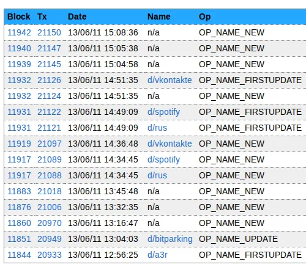

*Amazina yabitswe kuri Namecoin ku wa 13 Ruheshi 2011 (inkomoko: [ifoto ya ecran](https://web.archive.org/web/20110613130957/http://explorer.dot-bit.org/) ya Explorer.dot-bit.org)*

Namecoin yabaye akaryo ko gushiraho ubucukuzi bufatanijwe, canke *merged mining*, ari bwo [buryo](https://web.archive.org/web/20110723091126/http://dot-bit.org/Merged_Mining) bwo gusubira gukoresha akazi kakozwe kuri "Blockchain nyamukuru" (ni ukuvuga iya Bitcoin) mu kwemeza Blockchain "zifasha" ntoyi kuruta. Ubwo buryo [bwatanzwe](https://bitcointalk.org/index.php?topic=1790.msg28696#msg28696) mu kiganiro kuri BitDNS na Satoshi ubwiwe. Uwahinguye Bitcoin yashimika ico gihe ku vy'uko ubwo bwoko bw'ubucukuzi "bwotorera umuti ingorane y'imihora myinshi, umwe ukaba ari akaga ku wundi igihe inguvu z'ibiharuro zihari zihurikiye kuri umwe muri yo" kandi ko bwotuma gutanguza imihora mitoyi biba "ivyoroshe kuruta". Ubucukuzi bufatanijwe [bwatanguye](https://web.archive.org/web/20110925063651/http://dot-bit.org/forum/viewtopic.php?f=5&t=217) kwinjizwa muri kode ya Namecoin muri Mukakaro, butangura gukora ku muhora ku wa 8 Gitugutu, ku burebure bwa block 19 200.

### Umukuba wa mbere w'abigana

Mugabo Namecoin si yo sisitemu yonyene yihariye yatanguye muri uwo mwaka. Nkako, ifuro rinini ry'ibiciro ryo mu 2011 ryaravyaye [umukuba wa mbere](https://web.archive.org/web/20130722051950/https://github.com/ppcoin/ppcoin/wiki/History-of-cryptocurrency) w'ihingurwa ry'ayandi mafaranga ya crypto.

Imwe muri iyo migambi yari iy'igeragezwa gusa, nka kurya kwa bitcoin za Testnet, kandi yashobora gusubizwa ku ntango umwanya uwo ari wo wose. Ni ko vyari bimeze nk'akarorero kuri "[BeerTokens](https://web.archive.org/web/20110703101435/http://exchange.beertokens.info/)" canke "[Weeds](https://web.archive.org/web/20110505081347/http://exchange.surething.biz/)", zahinguwe hakoreshejwe porogaramu [MultiCoin](https://bitcointalk.org/index.php?topic=24209.msg300830#msg300830) ya Scott Carlson. Mugabo iyindi yagaragaye ko ari iy'abarondera akaryo gusa, abayihinguye bashaka kwungukira ku muhimbaro abantu bari bafitiye Bitcoin, canecane biciye ku co bita premine.

Imwe muri izo *altcoins* z'abarondera akaryo ni Groupcoin / Devcoin, [yatunganijwe](https://bitcointalk.org/index.php?topic=24813.msg308142#msg308142) n'umuntu akoresha izina ry'iritazirano Unthinkingbit, [itanguzwa](https://explorer.devcoin.org/explorer/block/0000000062558fec003bcbf29e915cddfc34fa257dc87573f28e4520d1c7c11e) ku wa 22 Mukakaro. Uburyo bwayo [bugizwe](https://bitcointalk.org/index.php?topic=24813.msg422068#msg422068) no kugabura 90 % vy'ibiceri bishasha bihinguwe ku bahinguzi ba porogaramu bakora mu vya porogaramu zisanzuye; 10 % bisigaye bikagenerwa abacukuzi b'iyo sisitemu. Naho yerekanwa nk'"ifaranga rigendera imico myiza", ni umugisha ku bahinguzi baronka ivyo biceri, batorwa n'umukuru w'umugambi.

Uwundi mugambi w'ifaranga rya crypto ry'abarondera akaryo ni Ixcoin, kopi ya Bitcoin itandukanye na mukuru wayo ku muvuduko wihuta kuruta w'ihingurwa ry'ifaranga. Ixcoin [yatangujwe](https://bitcointalk.org/index.php?topic=36218.msg446303#msg446303) ku wa 10 Myandagaro n'umuntu azwi kw'izina rya Thomas Nasakioto. Ni ko karorero ka mbere ka "premine": mu mezi atatu yari yaheze, uwayishinze yaracukuye mu mpisho block 6 055 za mbere z'iyo Blockchain, ahingura ixcoins zirenga 580 000 imbere y'uko itanguzwa. Naho [yasezeraniye](https://bitcointalk.org/index.php?topic=36220.msg446305#msg446305) agashimwe abadandaza ba mbere bokoresheje iryo faranga ryiwe rishasha rya crypto, yarigumaniye igice kinini c'ibiceri vyacukuwe muri premine. Abantu kuri forum, nka [Gavin Andresen](https://bitcointalk.org/index.php?topic=36218.msg451681#msg451681), barahavuye [bibaza](https://bitcointalk.org/index.php?topic=36218.msg446352#msg446352), kandi bafise ishingiro, "uwufise izo ixcoins 580 000 uwo ari we".

Ivyo [vyatumye](https://bitcointalk.org/index.php?topic=36425.msg448463#msg448463) hahingurwa I0coin, fork ya Ixcoin "ifise block 0 zahinguwe imbere y'igihe", umuhora wayo [utanguzwa](https://bitcointalk.org/index.php?topic=36425.msg460733#msg460733) ku wa 16 Myandagaro. I0coin ifise igihe ca block c'iminota 5 aho kuba 10. [Yaronse](https://bitcointalk.org/index.php?topic=36425.msg461312#msg461312) inguvu z'ibiharuro za 1 TH/s kuva ku musi wa mbere, umwe wese ashaka kuronka ibiceri imbere y'uko vyongerekana agaciro.

Ifaranga rya gatatu rya crypto, dushira mu mugwi w'ay'abarondera akaryo, ni SolidCoin. [Ryatangujwe](https://bitcointalk.org/index.php?topic=38453.msg471183#msg471183) ku mugaragaro ku wa 21 Myandagaro 2011 n'umuntu akoresha amazina y'amatazirano CoinHunter na RealSolid, [yashimishijwe](https://bitcointalk.org/index.php?topic=15672.msg381911#msg381911) na Bitcoin kubera "ubushobozi bwayo bwo kumuronsa amahera biciye kuri speculation", kubera ko yoroshe kugurisha, no kubera ukutamenyekana kwayo. SolidCoin itandukanye na Bitcoin ku gihe ca block gito kuruta (iminota 3 aho kuba 10), ku mafaranga y'ugucuruza adahinduka ku gikorwa cose co gucuruza, no kuri algorithm y'ihindurwa yahinduwe, yorohereza igabanuka ry'ingorane y'ubucukuzi kuruta iyongerekana ryayo. Muri Gitugutu, inyuma y'igitero ca spam ku muhora (sisitemu ntiyari ifise uburyo bubereye bw'amafaranga y'ugucuruza), harasohotse verisiyo 2.0 ya SolidCoin. [Yahinduye](https://web.archive.org/web/20111015164358/http://solidcoin.info/solidcoin-most-secure-currency.php) protocol ku buryo "node zizewe" (zifise igitigiri kinaka ca SLC nk'ingwati) zigira uruhara mu bwumvikane, nk'uburyo bwo gukingira ibitero vya 51 %.

Muri rusangi, SolidCoin yerekanwa nk'umuhiganwa wa Bitcoin, itandukanye n'ayandi mafaranga ya crypto abayahinguye babona ko yuzuzanya na yo. Uwashinze SolidCoin yaranegura uburyo bwa Nakamoto, canecane mu kwiyamiriza "ukwegeranywa kwa Bitcoins mu minwe y'abatanguye imbere y'abandi bishira hejuru, badafise inyungu canke icipfuzo na kimwe co gufasha abantu "basanzwe" gukoresha Bitcoins". Mu nkuru ivuga imbere y'igihe "ugusenyuka kwa Bitcoin", [yagiriza](https://web.archive.org/web/20110925064226/https://solidcoin.info/solidcoin-ready-for-bitcoin-collapse.php) Bitcoin ko idatera imbere mu vy'ubuhinga bivuye ku "kwinjira kwa Leta" gushoboka, maze akerekana SolidCoin nk'ifaranga rya crypto ry'udushasha.

Muri Nyakanga, irindi faranga rya crypto ry'abarondera akaryo [ryatangujwe](https://bitcointalk.org/index.php?topic=42417.msg516279#msg516279) n'umunywanyi wa forum yiyita Lolcust: ni GeistGeld (izina ryayo risobanura "ifaranga ry'impwemu" mu kidagi). Yerekanwa nk'ifaranga ry'igeragezwa, kuko ihingurwa rya block ryihuta cane (igihe ca block ni amasegonda 15), bikaba bishoboka ko rivyara block z'imfuvyi nyinshi. Ariko uwayihinguye yari [yibikiye](https://bitcointalk.org/index.php?topic=42417.msg524007#msg524007) ibiceri birenga imiliyoni 7.

Kubera iryo gwirirana, haraseruse serivisi nyinshi zo kuvunja na bitcoin. Hari *Bitparking Namecoin Exchange* [yatangujwe](https://bitcointalk.org/index.php?topic=11530.msg162730#msg162730) na Doublec muri Ruheshi. Moonco.in [yatanguje](https://bitcointalk.org/index.php?topic=31768.msg399398#msg399398) serivisi yayo yo kuvunja hagati ya namecoin na bitcoin muri Mukakaro. Serivisi yitwa Solidcoin24, yagenewe kuvunja hagati ya solidcoin n'ayandi mafaranga ya crypto (BTC, NMC), [yuguruwe](https://bitcointalk.org/index.php?topic=40471.msg493032#msg493032) mu mpera z'ukwezi kwa Myandagaro. Ubwa nyuma, urubuga rw'ivunjisha rw'Uburusiya BTC-e, rwuguruwe muri Myandagaro, [rwaciye rwitunira](https://web.archive.org/web/20111017024937/https://bitcointalk.org/index.php?topic=40889.0) ningoga ku rudandazwa rw'ayandi mafaranga ya crypto, rugenda rwinjiza ay'ingenzi uko asohoka.

Kuri forum, kubera ko ibiganiro vyerekeye *altcoins* vyari vyagwiriye, harashinzwe muri Nyakanga igice gitoyi citwa "Ayandi mafaranga". Urubuga rwa internet, Allchains.info, na rwo nyene [rwaruguruwe](https://bitcointalk.org/index.php?topic=41546.msg505943#msg505943) kugira rwegeranye ibiciro vy'ivunjisha, ingorane hamwe na Hashrate vya Blockchain zitandukanye.

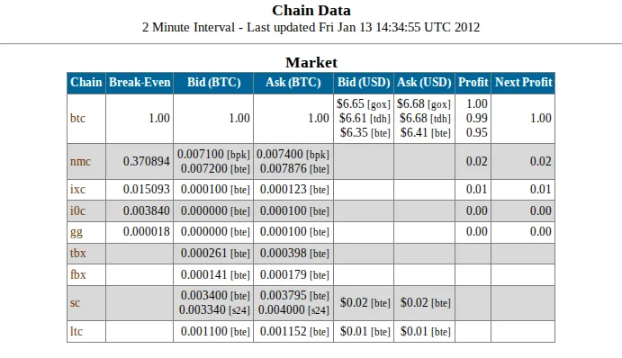

*Ibiciro vy'ivunjisha hagati y'ayandi mafaranga ya crypto atandukanye muri Nzero 2012 (inkomoko: [ifoto ya ecran](https://web.archive.org/web/20120113143526/http://allchains.info/) ya Allchains.info)*

### Tenebrix: ukunanira GPU

Gushika mu gatasi ko mu 2011, ayandi mafaranga ya crypto yose yakoresha ikorwa rya hash rya Bitcoin, ari ryo [SHA-256](https://planb.academy/resources/glossary/sha256) incuro zibiri, mu bucukuzi. Ivyo vyungura abacukuzi basanzwe bashinze imizi kuri Blockchain ya BTC, kuko basanzwe bafise ibikoresho vyo guhingura ibiceri vyinshi. Abashasha ntibaronka akaryo ko gucukura ayo mafaranga mashasha ya crypto bakoresheje CPU zabo, ivyo bikaba vyunyura ingorane ya variance yari isanzweho.

Ku wa 26 Nyakanga 2011, Lolcust [yaratanguje](https://bitcointalk.org/index.php?topic=45667.msg544675#msg544675) Tenebrix, yerekana nk'"ifaranga rya crypto ribereye CPU kandi rirwanya GPU". Yafashijwe n'umucukuzi w'umudagi ArtForz, [yasubirije](https://bitcointalk.org/index.php?topic=46063.msg549768#msg549768) SHA-256 Scrypt, ikorwa rya derivation y'imfunguruzo [ryahinguwe](https://web.archive.org/web/20090928073214/http://www.tarsnap.com/scrypt.html) ubwa mbere mu 2009 n'umuhinga mu vya mudasobwa w'umunyakanada Colin Percival, ku bwa serivisi ya backup yo kuri internet Tarsnap. Kubera ko risaba memory nyinshi, rituma ubushobozi bwa GPU mu bucukuzi bugabanuka cane, kugira ngo CPU zishobore gukoreshwa zikazana inyungu. Iryo faranga rya crypto ryitwa Tenebrix kuko "ari ifaranga rya crypto risagamba mu gatutu k'ikigo cose gikomeye c'ubucukuzi bwa GPU, rikungukira mu mahoro kuri cycles za CPU zidakoreshwa z'ibikoresho vyavyo vy'ubucukuzi".

Nka GeistGeld, Tenebrix ikoresha verisiyo yahinduwe ya porogaramu MultiCoin. Isohorwa ry'ibiceri (Lolcust yise "brix") ntirihinduka, bisigura ko igitigiri cose kitagira akarimbi. N'aha nyene, ibiceri birenga imiliyoni 7 "vyaracukuwe muri premine" na Lolcust, ivyo bikaba bingana (turavye umuvuduko w'isohorwa wa brix 5 ku munota) n'imyaka 2 n'igice y'umwimbu w'ubucukuzi. Ni co gituma uwitwa Michael McLees, haciye imisi mikeyi, [yafashe ingingo](https://bitcointalk.org/index.php?topic=46342.msg552146#msg552146) yo guhingura Fairbrix, kopi ya Tenebrix idafise premine nini (ibiceri 3 775 gusa). Inyuma y'ingorane zimwezimwe zo mu vy'ubuhinga, Fairbrix [yatangujwe](https://bitcointalk.org/index.php?topic=46528.msg554186#msg554186) ku wa 2 Gitugutu n'umuhinguzi wa porogaramu yitwa Charlie Lee.

### Litecoin, icuzuzo ca Bitcoin

Charlie Lee [ni](https://web.archive.org/web/20130831040759/http://www.wired.com/wiredenterprise/2013/08/litecoin/) umuhinguzi wa porogaramu w'umunyamerika akomoka mu Bushinwa, yavukiye muri Côte d'Ivoire mu 1977, yimukira muri Leta Zunze Ubumwe za Amerika ari kumwe n'umuryango wiwe afise imyaka 13. Yari umunyeshure w'umwete, aronka master mu vya mudasobwa kuri MIT. Mu 2011, yaba muri Silicon Valley, akora nk'umuhinguzi wa porogaramu kuri Google, canecane kuri ChromeOS. Kubera ko atizera Federal Reserve, yarakunda cane ubutare bw'agaciro.

*Charlie Lee muri Ntwarante 2013 (inkomoko: [ububiko](https://web.archive.org/web/20130331071808/http://www.bitcoin2013.com/bitcoin-2013-panelists.html) bwa Bitcoin2013.com)*

Charlie yamenye ko Bitcoin ibaho muri Ruheshi 2011 mu [gusoma](https://twitter.com/satoshilite/status/1020131826369585152) inkuru yerekeye Silk Road. Bidatevye, yaravuganye na Mike Hearn (na we nyene akorera Google, ari i Zurich), amujijura ko Bitcoin ikomeye. Yaritavye inama ya Bruce Wagner i New York muri Myandagaro. Vyongeye, yarashimishwa n'ayandi mafaranga ya crypto, ni ko kwisanga atanguje Fairbrix ku wa 2 Gitugutu.

Ariko uwo mugambi ntiwamushimishije. Fairbrix ishingiye kuri client MultiCoin, kandi yari ifise bugs nyinshi. Charlie rero yafashe ingingo yo gutanguza irindi faranga rishasha rya crypto, akoporoye kode y'inkomoko ya Bitcoin. [Yaryise](https://bitcointalk.org/index.php?topic=47417.msg564414#msg564414) Litecoin, aryerekana nka "verisiyo yorohejwe ya Bitcoin". Yipfuza kurigira "ifaranga ribera ifeza ico Bitcoin ibereye inzahabu".

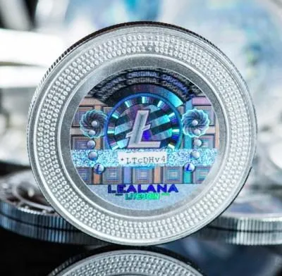

*Litecoin ifatika yitwa "iya Lealana" yagurishijwe mu 2013 (inkomoko: [Wired](https://web.archive.org/web/20130831040759/http://www.wired.com/wiredenterprise/2013/08/litecoin/))*

Litecoin ikoresha algorithm ya [Proof of work](https://planb.academy/resources/glossary/proof-of-work) Scrypt, cokimwe na Tenebrix. Igihe ca block ni iminota 2 n'amasegonda 30, ni ukuvuga incuro zine munsi y'ica Bitcoin, ivyo bigatuma akarimbi k'isohorwa kaba ibiceri imiliyoni 84 (aho kuba 21), kandi ihindurwa ry'ingorane rikaba uko imisi 3 n'igice itashe (aho kuba indwi 2). Halving ziba uko block 840 000 ziheze, ni ukuvuga nk'uko imyaka 4 itashe.

Iyo Blockchain [yatanguye](https://litecoinspace.org/block/dec173dda2735ff11376b68bdfda804cede230c1fa6f1a11765cddfd8edf4398) ku wa 13 Gitugutu nka 3h z'igitondo. Ariko itanguzwa ntiryagenze nk'uko vyari vyitezwe: block zirenga 10 000 zaracukuwe mu masaha ari munsi ya 24 (aho kuba imisi 12,5), ivyo bikaba bingana na litecoins 500 000, ni ukuvuga 0,6 % vy'igitigiri cose cari categekanijwe. Ikibazo cari uko ingorane y'ubucukuzi yari hasi cane kandi algorithm y'ihindurwa ikaba ifise aho igarukira: ingorane ishobora kugwizwa (canke kugabanywa) na 4 gusa. Ikindi, block ya genesis yanditsweko itariki ya 9 Gitugutu, ivyo bigatuma ihindurwa rya mbere mu vy'ukuri riba iryo kugabanya. Tenebrix yari ifise ako gahaze nyene (block 6 048 zaracukuwe mu misi 2 aho kuba 21), ariko ko katorewe umuti ningoga kandi ingaruka ntizabaye nini nk'izo kuri Litecoin. Charlie yasubiye gukoresha ico gipimo nyene gusa.

Ubwo bucukuzi bwihuta bumaze kumenyekana, umunywanyi wa forum akoresha izina ry'iritazirano Localhost [yaragirije](https://bitcointalk.org/index.php?topic=47417.msg574959#msg574959) Charlie ko [atamwumvirije](https://bitcointalk.org/index.php?topic=47417.msg570772#msg570772) igihe yamuburira kuri ico kibazo. Uwo muhinguzi wa porogaramu [yarisiguye](https://bitcointalk.org/index.php?topic=47417.msg574976#msg574976) mu kwandika ko ico kintu kitazoshobora gusubira kuba. Yongeye gusigura ko "gutangurira ku rugero rw'ingorane ruri hasi bituma abantu bagira umuhimbaro n'ugushimishwa n'iryo faranga" kandi ko "hakenewe ikibano n'intahe kugira hatanguzwe ifaranga riroranirwa".

Naho habaye iryo kosa, Litecoin yararoraniwe. Hamwe na Namecoin, ni rimwe mu mafaranga make ya crypto atataye agaciro kose mu vy'ubutunzi mu mezi yakurikiye ihingurwa ryayo, kandi rizoja ku kibanza ca kabiri ku [rutonde](https://coinmarketcap.com/historical/20130526/) rw'amafaranga ya crypto muri Rusama 2013. Mu mpera z'ici ryo mu 2012, igiciro caryo [cari](https://web.archive.org/web/20120831211413/http://www.ltc-charts.com/) 0,038 $, mu gihe igiciro ca namecoin, naho ari nke incuro zine kuruta, [cari](https://web.archive.org/web/20120901055814/http://allchains.info/) 0,019 $. Ariko litecoin yagumye ari igikuri mu vy'ubutunzi iruhande ya bitcoin: agaciro kayo kose (igiciro kigwijwe n'igitigiri c'ibiceri biriko birakoreshwa) kari amadolari 380 000, mu gihe aka mukuru wayo kegera amadolari imiliyoni 100.

### Ukwiyamirizwa kwa mbere

Biragaragara ko bishoboka kuronka amahera mu kwigana Bitcoin no mu kwungukira kw'iduga ry'agaciro k'ibiceri. Kuva muri Munyonyo 2010, n'imbere y'uko iciyumviro ca BitDNS kiboneka, ivyo vyari bimaze kuvugwa kuri forum. Ribuck, umunywanyi wa forum yari akora cane ico gihe, [yaranditse](https://bitcointalk.org/index.php?topic=1647.msg20646#msg20646) ijambo ryagiriza kopi za Bitcoin zo muri kazoza, aboneraho no guhimba ijambo "[shitcoin](https://planb.academy/resources/glossary/shitcoin)":

> Bitcoin niyaduga vy'ukuri, turashobora kwitega ko haseruka ivyiganano vyinshi bigenewe gutuma abantu batunga ningoga: gitcoin, nitcoin, witcoin, titcoin, shitcoin... Bimwe muri vyo ntibizobura gukwegera abakoresha n'imihango nk'iyi: "Ni kuki mwokoresha bitcoin, aho mushobora guhingura bitcoins 50 gusa uko amezi makeyi aheze? Nimukoreshe ahubwo shitcoin, muzoronka shitcoins 51 uko iminota 2 iheze". Birumvikana ko ivyo vyiganano bitagira ico bimaze bizozimangana ningoga nka kurya kw'"amafaranga ya Internet" yo mu myaka ya 1990, nka flooz na beenz, mugabo abantu benshi bazohendwa mu nzira.

Gavin Andresen [yaremeje](https://bitcointalk.org/index.php?topic=1647.msg20650#msg20650) ico canditswe. Yishuye ko ikibano kiri mu "kiringo ca Far West c'ifaranga rya open-source" kandi ko yiteze "ko abantu bazohendwa n'uruhendo, n'ivyiganano, na piramide za ponzi, n'amafuro y'ibiciro". Yongeyeko ko "atiyumvira ko hari ikintu kinini coshobora gukorwa" ku bijanye n'ivyo bikorwa bitarimwo ubunyakuri, "atari ukuburira abantu ngo babe maso ku mahera yabo".

Ukwo kwiyamiriza kwaremejwe n'umukuba wa mbere w'ayandi mafaranga ya crypto, yagwiriye mu mezi makeyi. Ivyo vyatumye abantu benshi bakora muri Bitcoin bagira ico bavuze. Muri Myandagaro 2011, Thomas Voegtlin, umuhinguzi wa Electrum, [yarasiguye](https://bitcointalk.org/index.php?topic=37592.msg463263#msg463263) ko nyinshi muri clone za Bitcoin ata co zimaze, kuko zisangiye na yo igice kimwe c'isoko, kandi ko zitungukira ku nyungu ziva ku bunini bw'umuhora wayo. [Yaratahuye](https://bitcointalk.org/index.php?topic=38453.msg471316#msg471316) neza ko "izo Blockchain zindi zitanguzwa n'abantu bashaka kuronka amahera ningoga imbere y'uko agaciro kazo gashika kuri zeru". Muri ubwo buryo nyene, mu ntango za Nyakanga, Gavin [yaratangaje](https://bitcointalk.org/index.php?topic=42465.msg516789#msg516789) kuri forum imburi irimwo amakenga, aho aremesha abantu kwibaza ibibazo bibereye imbere yo kwinjira muri ayo mafaranga ya crypto.

Inyuma y'umukuba wa mbere w'ihingurwa ry'ayandi mafaranga ya crypto, [haradutse](https://buildingbitcoin.org/bitcoin-dev/log-2011-04-05.html#l-2226) imvugo yerekana ukurambirwa: "*yet another cryptocurrency*", umuntu yohindura mu kirundi ngo "irindi faranga rya crypto ryiyongereyeko". Imvugo *yet another* yari isanzwe ikwiragiye mu bakora ivya porogaramu zisanzuye, kandi iyo ikoreshejwe mu buryo bwo gukengera, ikoreshwa mu kudondora "ikintu gisanzwe kiriho ku bwinshi burenze urugero", [nk'uko bivugwa](http://catb.org/jargon/html/Y/Yet-Another.html) n'umuharanizi wa porogaramu zisanzuye Eric S. Raymond. Ni muri ubwo buryo imvugo zisa n'iyo zakoreshejwe kuri [Namecoin](https://bitcointalk.org/index.php?topic=6017.msg89440#msg89440) muri Ndamukiza 2011, kuri [Tenebrix](https://bitcointalk.org/index.php?topic=45667.msg545150#msg545150) muri Nyakanga, canke kuri [Liquidcoin](https://buildingbitcoin.org/bitcoin-dev/log-2012-01-23.html#l-1429) muri Nzero 2012. Coiledcoin, *altcoin* itandukanye na Bitcoin kuko ikoresha `OP_EVAL`, [yarasubiye gukoresha](https://bitcointalk.org/index.php?topic=56675.msg675166#msg675166) iryo jambo mu rwenya igihe yatanguzwa ku wa 5 Nzero 2012. Ifaranga rya crypto ryitwa YACoin ("yet another coin") rizoshika n'aho [ritanguzwa](https://bitcointalk.org/index.php?topic=206577.msg2161742#msg2161742) muri Rusama 2013.

Umwe mu bantu barwanya cane ayandi mafaranga ya crypto bishoboka ko ari Luke-Jr. Nkako, uyo ararwanya cane ivyo vyiganano, rimwe na rimwe mu buryo burenze urugero nk'ubw'indwara. [Abona](https://web.archive.org/web/20120115215038/http://bitcoinmedia.com/luke-dashjr-throws-book-at-solidcoin) ko ayandi mafaranga ya crypto yose atari "uruhendo" kandi ko "Namecoin, canecane, yahinguwe ku ntumbero yemewe", mugabo ko "izo sisitemu, mu ntango, ari nka sisitemu za piramide za *pump and dump*" gushika zironse ikoreshwa ritandukanye n'irya Bitcoin.

Ivyo avuga yarabishize mu ngiro. Muri Munyonyo 2011, [yarahinduye](https://en.bitcoin.it/w/index.php?title=Litecoin&oldid=18952) urupapuro rwa Litecoin rwari ruherutse kwongerwa kuri wiki ya Bitcoin, kugira yandike ko "Litecoin ari uruhendo". Ku wa 6 Nzero 2012, [yaragize](https://bitcointalk.org/index.php?topic=56675.msg676981#msg676981) igitero co gukumira kuri Coiledcoin (cahavuye kiyihitana) akoresheje pool yiwe y'ubucukuzi, Eligius, atabimenyesheje abayigize. Mu [butumwa bwiwe bw'insobanuro](https://bitcointalk.org/index.php?topic=56830.msg678004#msg678004), yaratomoye ko ata munywanyi n'umwe wa pool yahombejwe, kuko Blockchain ya Coiledcoin yacukurwa ifatanijwe n'iya Bitcoin. Yisiguye ku vyo yakoze mu kwandika ko yiyemeje "gutera intege ecosystem ya Bitcoin no kuyikingira" kandi ko "sisitemu za piramide zishingiye ku makopi ya porogaramu ya Bitcoin zihava zitesha agaciro Bitcoin zikanonona izina ryayo". Ubwa nyuma, ku wa 9 Nzero 2012, [yarashikirije](https://web.archive.org/web/20120115205346/http://solidcointalk.org/topic/510-bitcoin-developers-attempt-to-kill-open-source-project-sends-dmca-to-linode-and-github/) Linode (yakira urubuga rwa internet) na GitHub (yakira kode) itangazo ryo gukuraho rya DMCA kuri SolidCoin, kubera ugukoresha mu buryo butemewe kode yiwe iri muri porogaramu ya Bitcoin.

### PPCoin, canke igishuko ca Proof of stake

Kuva mu rushana rwo mu 2012, ibintu vyaratekanye. Naho biri ukwo, haracabonetse ayandi mafaranga ya crypto makeyi yateye imbere muri uwo mwaka, nka [Timekoin](https://bitcointalk.org/index.php?topic=88467.msg974001#msg974001) ya Michael Brown, [Qubic](https://bitcointalk.org/index.php?topic=112676.msg1218867#msg1218867) ya Come-From-Beyond canke [Freicoin](https://bitcointalk.org/index.php?topic=133020.msg1416459#msg1416459) ya Jorge Timón. Mugabo ifaranga rya crypto rihambaye kuruta ayandi ryavutse ico gihe ni PPCoin (bisigura "peer-to-peer coin"), ryazanye agashasha mu gushira mu ngiro uburyo bwa Proof of stake.

Proof of stake ni ubundi buryo busubirira Proof of work, bugizwe no gusubiriza inguvu z'umuyagankuba zikoreshwa ugutunga ibiceri, mu kumenya amahirwe yo guhingura block. [Yadondowe](https://www.links.org/files/decentralised-currencies.pdf) ubwa mbere muri Mukakaro 2011 n'umuhinguzi wa porogaramu akaba n'umuharanizi w'umwongereza Ben Laurie, izina ryayo na ryo [rihimbwa](https://bitcointalk.org/index.php?topic=27787.msg349645#msg349645) n'uwitwa QuantumMechanic kuri forum ya Bitcoin.

PPCoin yatunganijwe n'umugwi w'abantu barongowe n'umuhinguzi wa porogaramu [akoresha](https://talk.peercoin.net/t/transcript-of-sunny-king-interview-with-vitalik-buterin-from-bitcoinmagazine/463) "izina ry'ubwanditsi" Sunny King, [yamenye](https://bitcointalk.org/index.php?topic=15672.msg1076876#msg1076876) ko Bitcoin ibaho mu 2010, ayinjiramwo kuva kw'ifuro rinini ry'ibiciro ryo mu 2011. Muri Gitugutu 2011, abagize uwo mugwi bararonse iciyumviro co gufata iciyumviro c'"imyaka y'ibiceri" (*coin age*) kugira bashireho sisitemu ya Proof of stake ivanze: block zimwezimwe za Blockchain zizocukurwa biciye ku cemezo c'ukuzigama, ni ukuvuga ko uko UTXO umuntu atunze izoba ishaje, ni ko izoba ifise ijambo rinini muri ico gikorwa. Muri [White paper](https://web.archive.org/web/20121021014644/http://www.ppcoin.org/static/ppcoin-paper.pdf), badondora umuti wabo nk'"uzigama inguvu mu gihe kirekire".

Umugambi wabo bawushize mu ngiro muri Myandagaro 2012: iryo faranga rishasha rya crypto [ryatangajwe](https://bitcointalk.org/index.php?topic=99735.msg1091012#msg1091012) ku wa 10 Myandagaro, [ritanguzwa](https://bitcointalk.org/index.php?topic=101820.msg1113938#msg1113938) ku wa 19. Politike y'ifaranga yaryo ni nziza bihagije: nta premine ihari, urugero rw'ihingurwa ry'ifaranga biciye kuri Proof of stake ntirurenga 1 % ku mwaka, kandi urugero rw'ihingurwa ry'ifaranga biciye kuri Proof of work ruvana n'ingorane y'umuhora (ku buryo rugabanuka bigaragara haciye amezi makeyi).

PPCoin izororanirwa ku rugero runaka, kandi izoja ku kibanza ca kane ku rutonde rw'amafaranga ya crypto muri Rusama 2013. Ariko sisitemu yayo y'ubwumvikane iguma ari uburyo buvanze: kugira haboneke sisitemu ya Proof of stake itavanze, bizosaba kurindira urubuga [NXT](https://bitcointalk.org/index.php?topic=303898.msg3253022#msg3253022), rwatangujwe muri Munyonyo 2013. PPCoin [izogenda](https://bitcointalk.org/index.php?topic=114994.msg3713127#msg3713127) ihindurirwa izina buhorobuhoro yitwe Peercoin mu mpera z'umwaka wa 2013.

### Imigenderanire ihindagurika na Bitcoin

Gutyo, umwaka wa 2011 waranzwe n'iseruka ry'ayandi mafaranga ya crypto, yabaye ikibanza kimbuka c'igeragezwa catumye hageragezwa ibintu bitandukanye, haba ku bijanye n'akamaro, ubucukuzi canke algorithm y'ubwumvikane ubwayo. Ariko ingingo y'ukwugurura yaciye ikoreshwa nabi ningoga kugira hatanguzwe sisitemu zifise intumbero yo guhemba abazishinze, canecane biciye kuri premine, ivyo na vyo ntivyabuze gukangura indongozi z'ikibano.

Uwo mukuba wa mbere w'ayandi mafaranga ya crypto warashizeho imishinge y'ivyabaye mu nyuma, mu 2013 n'inyuma yaho. Waratumye umugambi Ripple usubirwamwo, uronka igiceri cawo bwite co ku buhinga bwa none. Waruguruye inzira ku muhari washaka kuryohora Bitcoin, witwa "Bitcoin 2.0", uzoshikana kw'ihingurwa rya Ethereum mu 2014–2015. Ubwa nyuma, waratumye haboneka intango z'umuhari wo kwiyamiriza, uzogenda ukura uko imyaka irengana, ukazokwitwa "Bitcoin maximalism" muri Munyonyo 2014.

Iseruka ry'ayandi mafaranga ya crypto ya mbere rero ryaranzwe n'ukurenza urugero hamwe n'umwina, bihuye neza n'ikiringo ca Far West c'ivy'amahera. Mugabo si ko kurenza urugero konyene kwashobotse kubera ikoreshwa ryisanzuye rya Bitcoin. Amezi atandatu ya mbere y'umwaka wa 2012, canecane, yabereyemwo ibikorwa vyinshi bikunze kubonwa ko bitabereye canke vyatangajwe ko bitemewe n'amategeko, nk'urudandazwa rw'ibiyayuramutwe hamwe na Silk Road (igice cayo c'isoko cari gishitse ku rugero rwo hejuru ico gihe), inkino z'amahera hamwe na SatoshiDICE, n'ubusuma hamwe n'ibitero vy'aba hackers kuri Bitcoinica. Ibigabane bitatu bikurikira bizokwihweza ukwo kurenza urugero, hamwe n'ibikorwa vy'ubudandaji "bibereye" kuruta vyateye imbere muri ico gihe nyene.

## Ubudandaji, ubwemewe n'ubutemewe
<chapterId>7e41ce76-c69f-5ef0-9a7c-c6bdf34a87cc</chapterId>

Inyuma y'aho ifuro rinini ry'ibiciro ryo mu 2011 rituritse n'igiciro kigatekana, igice ca mbere c'umwaka wa 2012 cabaye igituje bihagije ku bijanye na speculation. Ariko cabaye ngirakamaro ku bikorwa nyakuri vy'ubutunzi, kuko ikibano c'ico gihe cagerageza guteza imbere ikoreshwa rya Bitcoin nk'uburyo bwo kwishura, ari yo ntumbero itomoye ya White paper.

Uguhanahana ibintu na serivisi kuri bitcoins, ni ukuvuga ico bakunda kwita *ubudandaji*, bishobora gukorwa mu buryo bwemewe n'amategeko nka hose, ariko kandi no mu buryo butemewe bwo mu mpisho. Muri ico kiringo, iyo mice yompi yarabonetse itera imbere. Ku ruhande rumwe, urudandazwa rw'ibintu bitemewe rwarongerekanye kubera ibikorwa bisagamvye vya Silk Road, isoko ryatazirwa "Amazon y'ibiyayuramutwe", ico gihe ryari rifise igice kinini c'ibikorwa vyo gucuruza vyakorwa kuri Blockchain ya Bitcoin. Ku rundi ruhande, harakozwe akigoro gakomeye ko gushira imbere ubudandaji bwemerwa na benshi kuruta, canecane biciye kw'iterambere rya serivisi itunganya ukwishura BitPay.

Muri iki kigabane, tuzobanza kudondora iterambere rya Silk Road mu vy'ubutunzi no mu vy'imico mu ntango z'umwaka wa 2012, ryaranzwe n'iseruka ry'ishusho ya Dread Pirate Roberts mu butumwa bwa Ross Ulbricht. Ubwa kabiri, tuzobona ingene ukuvunja mu mahera yo mu ntoke kwakuze nk'igikorwa gifatanye na Silk Road, kubera abahuza nka BitInstant na LocalBitcoins. Ubwa gatatu, tuzokwihweza ubudandaji busanzwe, iseruka rya BitPay hamwe n'ugukoresha Bitcoin mu ngiro muri PorcFest 2012.

### Icerekezo kiri inyuma ya Silk Road

Inyuma y'ukuroranirwa kwayo kwa mbere kwo mu ci ryo mu 2011, isoko Silk Road ryaratanguye kuzana inyungu, rirabandanya gukura. Ikibano caryo carakuze, canecane kubera forum ishikirwa biciye kuri Tor, ituma abagurisha bamenyekanisha ivyo bagurisha, bagasangira ivyo baciyemwo, kandi bagahanurana. Ross na we yarashobora kuhavugira yisanzuye, akahasigurira icerekezo c'urwo rubuga co mu gihe kirekire. Mu gihe Silk Road yasa n'iyiri mu nzira nziza, ubutumwa bwa Ross bwagenda burushiriza kuba ubw'amajambo akomeye, maze icari mu ntango umugwi w'abakora ivy'ubutunzi gihinduka umuhari nyakuri.

Mu ntango z'umwaka wa 2012, amahera ya serivisi yakurikiza urugero rudahinduka rwa 6,23 %, ikintu cari ngirakamaro mu gutanguza serivisi, mugabo cungura ibigurishwa bitoyi kigahombesha ibikorwa vyo gucuruza binini kuruta. Ni yo mpamvu Ross yafashe ingingo yo guhindura uburyo bwa komisiyo, ashiraho urugero rugenda rugabanuka, kuva kuri 15 % ku bigurishwa bitoyi kuruta ibindi gushika kuri 3,7 % ku bihambaye kuruta. Yabitangaje kuri forum ku wa 9 Nzero 2012 mu butumwa [bufise umutwe](https://antilop.cc/sr/users/dpr/threads/20120109-0301-State_of_the_Road_Address.html) uvuga ngo "ijambo ku kuntu Inzira yifashe" (*State of the Road address*), bwibutsa amajambo y'icubahiro ashikirizwa ku gihe kidahinduka n'abakuru b'igihugu ca Leta Zunze Ubumwe za Amerika. Yasiguye ingingo yiwe mu gusangira icerekezo ciwe; yasiguye canecane ko Silk Road "igenewe gucika inguvu izotegerezwa kwitwararikwa, ishoboye guhangara ubutegetsi buriho no guha amaherezo abantu akaryo ko guhitamwo umwidegemvyo aho guhitamwo agacinyizo".

Iyo ngingo yariyamirijwe n'abantu bamwebamwe, kandi umuyobozi wa Silk Road yagirijwe canecane kugaragaza umwina. Mugabo iryo hinduka ntiryari rigisubirwako. Nk'uko Ross [yavyanditse](https://antilop.cc/sr/users/dpr/messages/20120110-0201-536-Re_State_of_the_Road_Address.txt) bukeye bwaho muri ico kiganiro nyene:

> Mwabishaka mutabishaka, ni jewe kapiteni w'ubu bwato. Muri ngaha ku gushaka kwanyu, kandi nimba mudakunda amategeko y'urukino, canke mutizera kapiteni wanyu, murashobora kuva mu bwato. Abasigaye nibamenye ko twebwe, muri Silk Road, tuzobandanya gukora ibishoboka vyose kugira iri soko rikore neza kandi mu mutekano. Murakoze kandi ku ntahe yanyu!

Ikigereranyo ca kapiteni caranezereje abanywanyi ba forum ya Silk Road, baca bihutira kugisubiramwo mu butumwa bwabo mu buryo bwiza no mu buryo bubi, ku buryo Ross yagikoresheje kugira yiremere ishusho idasanzwe. Haciye ukwezi, yaciye afata ingingo yo guhindura izina ryiwe riboneka kuri forum no mu butumwa bwiwe bwemewe. Gushika ico gihe, Ross yimenyekanisha akoresheje izina ry'iritazirano "Silk Road". Izina ryiwe rishasha, ryahishuwe ku wa 5 Ruhuhuma, ni Dread Pirate Roberts (akenshi rigufishwa ngo DPR). Ryibutsa isenema *The Princess Bride*, urwenya rwasohotse mu 1987 rwigana mu rwenya imigani yo mu bihe vyo hagati, aho Roberts yerekanwa nk'umunyazi wo mw'ibahari w'inkazi. Ico iyo senema [ihishura](https://www.youtube.com/watch?v=aHZGqBVBCRw) ni uko izina "Dread Pirate Roberts" ari icubahiro gusa, kandi ko umunyazi w'ubu yarazwe ico cubahiro n'umugabo yari yamufashe, na we akaba yari yakirazwe n'uwamubanjirije, gutyo gutyo, iryo zina rikaba ryitezweko "gutera ubwoba bukenewe" abansi biwe.

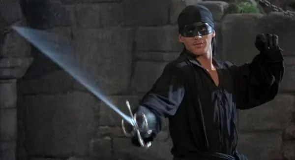

*Ishusho ya Dread Pirate Roberts muri [The Princess Bride](https://www.imdb.com/title/tt0093779/)*

Ingingo ya Ross yakurikiye iciyumviro c'umwe mu bo bakorana ba hafi cane, Roger Thomas Clark yiyita Variety Jones, umunyakanada aba mu Bwongereza agurisha imbuto nyinshi z'urumogi kuri urwo rubuga (akaba kandi arunywa cane). Uyo yegereye Ross muri Munyonyo, aca aba ningoga umuhanuzi wiwe mu vy'umutekano; Ross [azoshika](https://antilop.cc/sr/exhibits/253456476-Silk-Road-exhibits-GX-240B.pdf) n'aho amwita "mentor" mu gitabu ciwe bwite c'ivyo yandika. Gukoresha izina ry'iritazirano nk'iryo birorohereza uguhererekana hagati y'abantu babiri canke bigatuma ibimenyetso vyerekana umuyobozi uwo ari we bizimangana. Ubwo buhinga kandi [buzokoreshwa](https://www.forbes.com/sites/andygreenberg/2013/08/14/an-interview-with-a-digital-drug-lord-the-silk-roads-dread-pirate-roberts-qa/) mu kiganiro hagati ya DPR na Andy Greenberg muri Myandagaro 2013, aho Variety Jones azovuga ko yasubiriye Ross.

Ihindurwa ry'izina ryaremeje ikibanza ca Ross nk'indongozi mu muhari Silk Road yari yacitse. Kuva aho, yarashize ahabona neza ingene abona isi mu [butumwa burebure](https://www.forbes.com/sites/andygreenberg/2013/04/29/collected-quotations-of-the-dread-pirate-roberts-founder-of-the-drug-site-silk-road-and-radical-libertarian/?sh=2a35d6091b0c) yashira kuri forum, ku biganiro bitandukanye nk'intambara yo kurwanya ibiyayuramutwe, Federal Reserve canke umushahara mutoyi ntarengwa. [Azoshika](https://antilop.cc/sr/users/dpr/threads/20120814-2208-_DPR_s_Book_Club.html) n'aho atunganya "umugwi w'abasomyi wa DPR", aho azohanura ibitabu vyamuhaye ivyiyumviro.

Ingingo ya mbere Ross yafashe nka DPR ni iyo kubuza igurishwa ry'inkoho kuri Silk Road, kuko zatera amakenga abagurisha bamwebamwe kuri Silk Road, no [gushinga](https://antilop.cc/sr/users/dpr/threads/20120226-0702-A_brand_new_annonymous_market.html) urubuga rwihariye rugenewe ubwo bwoko bw'ibidandazwa. Urwo rubuga ruvukana na yo, rwiswe *The Armory* ([rutitiranywa](https://bitcointalk.org/index.php?topic=64449.msg774427#msg774427) na Wallet ya Alan Reiner), rwuguruye ku wa 26 Ruhuhuma 2012. Ariko iryo geragezwa ntiryamaze igihe, kuko [rwugaye](https://bitcointalk.org/index.php?topic=66587.msg1079466#msg1079466) muri Myandagaro kubera ko ata bikorwa bihagije vyari bihari.

### Itera imbere ritagira urwamo rya Amazon y'ibiyayuramutwe

Ariko ibikorwa ku rubuga nyamukuru vyari bisagamvye, bitandukanye n'ivyo abagize ikibano ca Bitcoin biyumvira, nka Vitalik Buterin, muri Mukakaro 2012, [yavuze](https://bitcoinmagazine.com/culture/the-silk-road-report) yihenda ko Silk Road "iri kure cane yo kuba moteri y'ubutunzi bwa Bitcoin". Nk'uko bivugwa mu cegeranyo ca Nicolas Christin, umushakashatsi kuri kaminuza Carnegie-Mellon y'i Pittsburgh, [kizosohoka](https://arxiv.org/pdf/1207.7139) muri Myandagaro, urwo rubuga rwariko rurakura mu buryo budasanzwe. Hagati ya Ntwarante na Mukakaro, igitigiri c'abagurisha carikubye nka kabiri, kiva kuri 300 gishika ku barenga 550, kandi hafi 97,8 % vy'abakiriya basiga iciyumviro ciza ku bikorwa vyabo vyo gucuruza.

Ingano y'ibigurishwa ku musi na yo nyene yarikubye kabiri, iva kuri 8 000 BTC muri Ntwarante ishika kuri 15 000 BTC muri Rusama, imbere yo gusa n'iyisubira inyuma kuri 11 000 BTC muri Mukakaro. Ivyo bisigurwa n'uko igiciro ca bitcoin, cari camaze amezi gihagaze hafi ya 5 $, casubiye gutangura kuduga kuva mu ci, kirenga 8 $ muri Mukakaro. Ingano yo ku kwezi rero ihwanye n'amahera yadandajwe atari bwigere ashikwako angana n'amadolari imiliyoni 1,9. Tugereranije, ingano y'ivunjisha kuri Mt. Gox yashika hafi kuri bitcoins 60 000 muri ico gihe nyene.

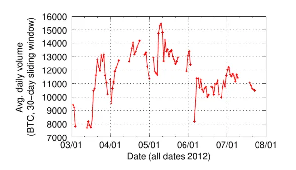

*Ihinduka ry'ingano yo ku musi ya Silk Road (muri BTC) hagati ya Ntwarante na Mukakaro 2012 (inkomoko: [Nicolas Christin](https://arxiv.org/pdf/1207.7139))*

Ku bw'ivyo, komisiyo umunyazi Roberts yafata zari nini cane. Zari 3 000 $ ku musi muri Ntwarante, zishika ku zirenga 6 000 $ ku musi muri Mukakaro. Mu kiringo capimwe, zari ku mpuzandengo y'amadolari 143 000, ivyo bikaba bihwanye n'inyungu yo ku mwaka y'amadolari imiliyoni 1,7.

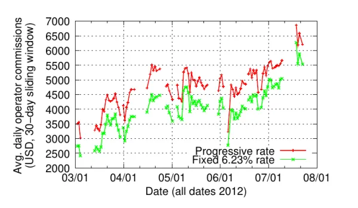

*Ihinduka rya komisiyo zo ku musi zavuye kuri Silk Road (mu madolari) hagati ya Ntwarante na Mukakaro 2012 (inkomoko: [Nicolas Christin](https://arxiv.org/pdf/1207.7139))*

Ivyo vyose bituma Silk Road ifise ikibanza nyamukuru mu bikorwa vy'ubutunzi bikorwa n'iryo faranga rya crypto. Ubushakashatsi bwakozwe *a posteriori* [buzokwerekana](https://www.chainalysis.com/blog/silk-road-doj-seizure-november-2020/) ko igice c'ibikorwa vyayo ugereranije n'ibikorwa vyose vya Blockchain ya Bitcoin cagenda gihindagurika hagati ya 10 na 20 % umwaka wose wa 2012. Ico gice carashitse ku rugero rwo hejuru muri Ruhuhuma, hanyuma n'ikindi gihe muri Nyakanga 2012, imbere yo kumanuka ningoga munsi ya 5 %, bigirira akamaro ibindi bikorwa nk'inkino z'amahera, ubudandaji busanzwe na speculation.

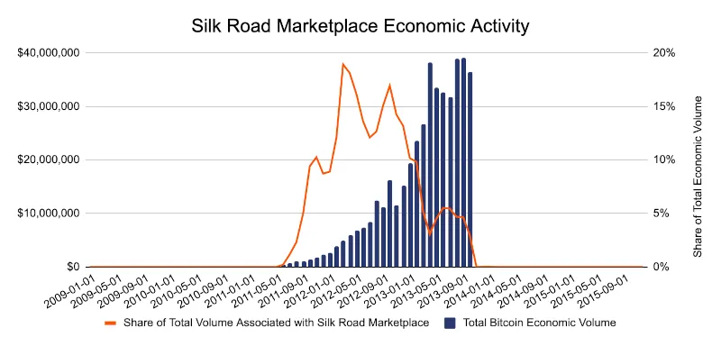

*Ihinduka ry'ibikorwa vy'ubutunzi vya Silk Road mu gihe yamaze, hagati ya Nzero 2011 na Gitugutu 2013 (inkomoko: [Chainalysis](https://www.chainalysis.com/blog/silk-road-doj-seizure-november-2020/))*

Ubushakashatsi bwa Nicolas Christin bwaragize ingaruka nziza ku gitigiri c'abagendera Amazon y'ibiyayuramutwe. Mu ntango za Munyonyo 2012, Ross [yavuze](https://antilop.cc/sr/users/dpr/threads/20121102-0011-explosive_growth.html) rero ivy'"ugukura guturika". Yanditse ko Silk Road iri "mu karere katazwi ku bijanye n'igitigiri c'abakoresha" bayishikira. Ross rero yarashobora gusubiza igice kinini c'inyungu ziwe mu mugambi wiwe: yarahaye akazi abakozi benshi kugira bateze imbere urubuga. Vyongeye, igiciro c'ivunjisha ca bitcoin cagenda kiraduga buhorobuhoro, ivyo bikongereza ububasha bwo kugura bw'abayitunze, bikanongereza abagendera Silk Road.

Ubwa nyuma, ukuroranirwa kwa Silk Road kwarakwegereye abahiganwa. Uretse Black Market Reloaded (yuguruwe kuva muri Ruheshi 2011), hazoboneka [isinzi](https://gwern.net/dnm-survival) ry'izindi mbuga zuguruka mu 2013, harimwo Sheep Marketplace muri Ruhuhuma na Atlantis muri Ntwarante 2013. Ikibabaje ni uko nyinshi muri zo zizohava zigaragara ko ari uruhendo rwo guhungana amahera y'abakiriya, kuko abazirongoye bari bafise icerekezo kitagendera imico myiza nk'ica libertarian Ross Ulbricht.

### Ukubitsa amahera yo mu ntoke biciye kuri BitInstant

Ikindi gikorwa cagumye gikura umwaka wose wa 2012 ni ukuvunja hagati ya bitcoin n'amahera afatika yo mu ntoke, akunze kwitwa *cash*. Ico gikorwa gituma umuntu agura canke agurisha bitcoin mw'ibanga ryuzuye, adasize ikimenyetso c'ukurungika amahera biciye kuri banki. Hariho imvo nyinshi zo gukora ubwo bwoko bw'igikorwa co gucuruza, mugabo iy'ingenzi biragaragara ko ifatanye n'ibikorwa vyo kuri Silk Road. Abaguzi barashobora kuronka bitcoin kugira baronke ibiyayuramutwe; abagurisha barashobora kugurisha bitcoins zabo ku mahera yo mu ntoke kugira barihe ababazanira ibidandazwa no kugira baronke ikibatunga. Ivyo ni ko bimeze ku gikorwa ico ari co cose gisa n'ikitemewe.

Imwe muri serivisi nini za mbere zatanze uburyo bwo kubitsa amahera yo mu ntoke ni ishirahamwe BitInstant, riyoborwa na Charlie Shrem na Gareth Nelson, [ryongeyeko](https://bitcointalk.org/index.php?topic=55308.msg657631#msg657631) ubwo buryo bwo kwishura ku wa 21 Kigarama 2011. Abenegihugu ba Leta Zunze Ubumwe za Amerika barashobora kubitsa inoti mu bibanza birenga 10 000 vy'amabanki azwi (Chase, CitiBank, Bank of America, Wells Fargo) kugira bashirirwe amadolari ku rubuga rw'ivunjisha bihitiyemwo haciye iminota mirongo mikeyi. Ibindi bibanza bizokwongerwako mu nyuma, canecane ivy'amaduka manini Walmart na 7-Eleven. Mu ntango, amahera ya serivisi yari 5 %.

Iyo serivisi yaronse abayikunda kuva igitanguzwa: mu misi itanu, arenga 30 000 $ [yararungitswe](https://bitcointalk.org/index.php?topic=56392.msg671272#msg671272) muri ubwo buryo. Yakwegereye canecane uwitwa Robert Faiella, umukozi w'amatiyo y'amazi wo muri Florida ari mu myaka mirongo itanu, [yimenyekanisha](https://antilop.cc/sr/vendors/16af931d32.htm) ku zina ry'iritazirano BTCKing. Muri Kigarama, [yaruguruye](https://www.justice.gov/sites/default/files/usao-sdny/legacy/2015/03/25/Faiella%2C%20Robert%20M.%20and%20Charlie%20Shrem%20Complaint.pdf#page=10) serivisi yo gusubira kugurisha bitcoins yakirirwa kuri Silk Road, ikoresha serivisi yo kubitsa amahera yo mu ntoke ya BitInstant. Yaha abaguzi bitcoins ubwo nyene, agafata amahera y'inyongera ku kazi kiwe.

*Robert M. Faiella, yiyita BTCKing, muri Nyakanga 2014 (inkomoko: Craig Ruttle ku bwa [CBC](https://www.cbc.ca/news/science/robert-faiella-sentenced-to-4-years-for-enabling-silk-road-transactions-1.2921103))*

BitInstant n'umuhuza wayo (TrustCash) baciye babona ningoga ibikorwa vya BTCKing, kuko abakiriya biwe bakora amakosa menshi igihe babitsa. Canecane, ukubitsa kumwe kwararenze akarimbi ka 1 000 $ kashinzwe n'iryo shirahamwe, ivyo bituma konti yiwe ya mbere yugarwa. Amaze gutahura ivyo BTCKing yakora, kandi azi ko "amuzanira abakiriya benshi", Charlie Shrem yaravuganye na we ubwiwe, kugira amuhanure kubitsa akoresheje iyindi Address ya email. Mugabo ukwo kwumvikana ntikwashimishije Gareth Nelson, uwo bafatanije gushinga iryo shirahamwe, yabona nabi ico gikorwa. Mu kiganiro yagiranye na we muri Nzero 2012, Charlie [yasiguye](https://www.justice.gov/sites/default/files/usao-sdny/legacy/2015/03/25/Faiella%2C%20Robert%20M.%20and%20Charlie%20Shrem%20Complaint.pdf#page=17) ihitamwo ryiwe muri ubu buryo:

> Nta tegeko na rimwe yarenze, kandi silk road ubwayo ntibujijwe n'amategeko. Kandi nta mategeko dufise abuza abasubira kugurisha. Turaronka inyungu nyinshi kubera we.

Ibikorwa vya BTCKing vyari umugisha kuri BitInstant, gushika n'aho Charlie amugabanirije komisiyo haciye amezi makeyi. Muri Myandagaro na Nyakanga 2012, amahera BTCKing yadandaza yashika kuri 40 000 $ ku ndwi. Ishirahamwe BitInstant rero ryari rifatanye cane na Silk Road, cokimwe n'imbuga zose z'ivunjisha zo muri ico gihe, harimwo na Mt. Gox izwi cane.

*Ururirimbo rwemewe rwa BitInstant rwaririmbwe na ZhouTonged muri Ndamukiza 2012*

### LocalBitcoins n'ukuvunja mu mahera yo mu ntoke

Ukubitsa amahera yo mu ntoke si bwo buryo bwonyene bwo kuvunja hagati y'amadolari na bitcoins; hariho kandi serivisi zo kuvunja hagati y'umuntu n'uwundi. Izo zituma canecane abantu bashobora kuvugana kugira bavunje bari kumwe imbonankubone. Zaseruse kuva mu 2011 hamwe n'imbuga nka [Bitcoin.local](https://bitcointalk.org/index.php?topic=3795.msg53889#msg53889) (Tradebitcoin.com) canke [BTC NEAR ME](https://bitcointalk.org/index.php?topic=7107.msg104204#msg104204). Mugabo iy'ingenzi muri zo ni LocalBitcoins, yashinzwe muri Ruheshi 2012 n'umuntu yitwa Jeremias Kangas.

Jeremias Kangas ni umuhinguzi wa porogaramu akaba na hacker wo muri Finlande yegereza imyaka mirongo itatu. Ayobora ishirahamwe [Kangas Bros. Innovations Oy](https://web.archive.org/web/20101030185646/http://kangasbros.fi/) ari kumwe na murumunawe, Nikolaus, bakaba basohora biciye kuri ryo application zitari nke za iPhone n'iza Web. [Yumvise](https://bensonsamuel.wordpress.com/2013/01/01/universal-bitcoin-exchange/) ivya Bitcoin mu mpera z'umwaka wa 2010 biciye kuri Hacker News, aca atangazwa ubwo nyene n'uburyo bwa Nakamoto, [azodondora](https://web.archive.org/web/20120517205800/http://blog.kangasbros.fi/?p=85) nk'"agashasha k'agatangaza kandi katemerwa" kandi nk'"iciyumviro gihindura ibintu". Mu 2011, inyuma y'urugendo mu Buhindi, yaratanguye gukora kuri Bitcoin igihe cose, ahingura porogaramu nyinshi nka implementation ya porogaramu [django-bitcoin](https://bitcointalk.org/index.php?topic=30448.msg382233#msg382233) canke application ibika amahera y'abandi [Easywallet.org](https://bitcointalk.org/index.php?topic=75665.msg838319#msg838319). [Yaratunganije](https://bitcointalk.org/index.php?topic=87553.msg1035076#msg1035076) kandi serivisi itunganya ukwishura kuri internet Acceptbit ari kumwe na Stefan Thomas mu gihe ca hackathon, umuti wungukira ku bushobozi bw'urufunguzo rwa bose nyamukuru rwa Electrum kugira hahingurwe amaderesi mashasha bidasavye gushikira urufunguzo rw'ibanga rujanye na rwo.

*Jeremias Kangas nko mu 2012 (inkomoko: [Blogger](https://www.blogger.com/profile/12265387388248206585))*

Ku wa 22 Rusama, [yaravuze](https://bitcointalk.org/index.php?topic=82968.msg914432#msg914432) kuri forum ya Bitcoin ko "imbuga zo kuvunja mu mahera yo mu ntoke zisanzwe ziriho" mugabo ko "ata co zimaze", kandi ko "iyo uburyo bw'ubudandaji atari bwiza, umuntu yisanga afise imbuga z'umwanda". Ni co gituma yafashe ingingo yo guhingura urubuga rwiwe bwite rwo guhuza abantu, afashijwe na mwene wabo. Urwo rubuga, rwiswe LocalBitcoins, [rwatangujwe](https://bitcointalk.org/index.php?topic=86012.msg946497#msg946497) ku wa 7 Ruheshi. Ruherekejwe n'[inyobozo](https://web.archive.org/web/20120616084213/https://localbitcoins.com/cash_exchange_howto) isigura ingene umuntu aba umuvunjayi mu mahera yo mu ntoke.

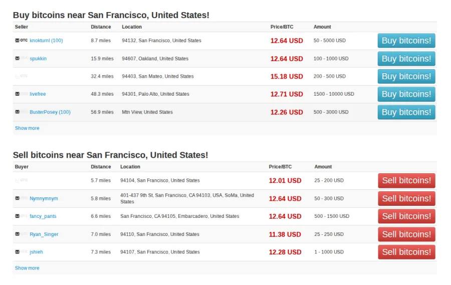

*Interface ya LocalBitcoins muri Nyakanga 2012 (inkomoko: [ububiko](https://web.archive.org/web/20120919184133/https://localbitcoins.com/) bwa LocalBitcoins.com)*

Mu ci, abo bavukanyi babiri [barinjije](https://bitcointalk.org/index.php?topic=94793.msg1048453#msg1048453) mu rubuga uburyo bwo kubitsa ku wa gatatu yizewe: bitcoins zibikwa n'urubuga, kandi zishobora [kurekurwa biciye kuri SMS](https://web.archive.org/web/20120817100941/http://localbitcoins.blogspot.fi/2012/08/sms-escrow-buy-and-sell-bitcoins-with.html) kugira zihabwe umuguzi igihe umugurisha yemeje ko yaronse amahera yo mu ntoke. Baratuma kandi abagurisha bashobora [gufatanya profil yabo](https://web.archive.org/web/20120817125105/http://localbitcoins.blogspot.fi/2012/08/now-you-can-connect-your-bitcoin-otc.html) na konti kuri \#bitcoin-otc, channel ya IRC y'uguhanahana hagati y'abantu ubwabo yuguruwe mu 2010. Uko igihe kirengana, abantu bazokoresha kandi urwo rubuga mu guhanahana biciye ku kurungika amahera kuri banki.

LocalBitcoins yarakwegereye ikibano, Jeremias akaba yitaba inama nyinshi, harimwo Assembly Summer 2012 hamwe n'inama kuri Bitcoin i London. Muri Nyakanga, [hari](https://web.archive.org/web/20120920110200/https://localbitcoins.com/statistics) abavunjayi mu bihugu 74 bitandukanye no mu bisagara birenga 300. Ku wa 14 Ruheshi 2013, haciye umwaka ishinzwe, urwo rubuga [ruzoba rufise](https://bitcoinmagazine.com/culture/jeremias-kangas-bitcoin-cannot-be-shut-down-1371225649) abakoresha nka 44 000, kandi ingano y'ivunjisha ku musi izoshika ku bihumbi mirongo vy'amadolari!

### Ikura ry'ubudandaji

Nimba urudandazwa kuri Silk Road n'ukuvunja mu mahera yo mu ntoke bisagamba, ni ko bimeze no ku budandaji busanzwe. Mu 2012, abadandaza amajana [barashizwe ku rutonde](https://web.archive.org/web/20120724114927/https://en.bitcoin.it/wiki/Trade) kuri wiki ya Bitcoin. Naho hariho amaduka amwamwe afatika (akenshi ni utubare n'amaresitora mu bisagara binini, nka [Room77](https://www.youtube.com/watch?v=rzKdW-au110) izwi cane i Berlin), ibigurwa kuri bitcoins vyinshi bikorerwa kuri Internet.

Gutyo, haraboneka amaduka manini yo kuri internet asagamba muri uwo mwaka. Ni ko bimeze kuri Coinabul, serivisi yo kugurisha inzahabu n'ifeza muri Leta Zunze Ubumwe za Amerika, yuguruwe muri Gitugutu 2011 na Jay Shore na Jon Holmquist. Mu mezi makeyi, urwo rubuga rwarakwegereye abakiriya benshi, [rurenga](https://bitcoinmagazine.com/business/coinabul-celebrates-six-months-of-gold-1335646624) bitcoins 6 000 z'ingano yo ku kwezi muri Ndamukiza 2012 (30 000 $ ico gihe), [rushikana](https://bitcoinmagazine.com/business/coinabul-celebrates-one-year-in-business-1350442160) ingano yose hamwe ya bitcoins 120 000 muri Gitugutu. Turashobora kandi kuvuga Bitmit.net, [yatazirwa](https://www.coindesk.com/markets/2013/10/28/bitmit-is-still-the-ebay-of-bitcoin-despite-setbacks) "eBay ya bitcoin", isoko rituma abantu ku giti cabo bashira ibintu kw'isoko canke bakabigurisha mw'ipiganwa ry'ibiciro, [ryatangujwe](https://bitcointalk.org/index.php?topic=41592.msg506512#msg506512) muri Nyakanga 2011 n'umudagi yiyita Tosaki.

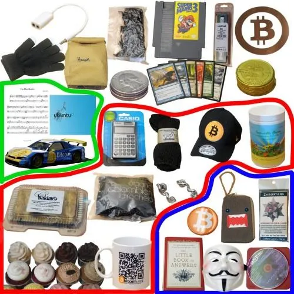

*Ibintu vyaguzwe kuri bitcoins n'umugwi w'abashakashatsi bakoze ubushakashatsi "A Fistful of Bitcoin", bwasohotse imbere y'igihe muri Myandagaro 2013 (inkomoko: [Sarah Meiklejohn](https://cseweb.ucsd.edu/~smeiklejohn/files/imc13.pdf))*

Iryo terambere ry'ubudandaji rituma bikenerwa ko uburyo bwo kwishura bushirwa ku rugero rumwe, kugira ngo Wallet zose zishobore gukorana hagati yazo. Gukoresha smartphone no gusoma QR code hakoreshejwe kamera yayo bituma umuntu yishura ata ngorane. Ariko birakenewe kwumvikana ku makuru ategerezwa gushirwa muri QR code: ni co gituma haboneka scheme ya URI itera imbere, ituma ugusaba kwishurwa gushirwa mu buryo butomoye. Dukurikije iyo scheme, ugusaba kuzoba nk'akarorero kumeze gutya: `bitcoin:175tWpb8K1S7NmH4Zx6rewF9WQrcZv245W?amount=20.3&label=Luke-Jr`, gutyo kukaba kurimwo Address y'uwurungikirwa (175tWp...), amahera yo kwishura (bitcoins 20,3) hamwe n'insobanuro y'igikorwa co gucuruza (Luke-Jr).

Ugukoresha ubwo bwoko bwa scheme [kwasabwe](https://bitcointalk.org/index.php?topic=55.msg377#msg377) kuva muri Ruhuhuma 2010, [kwemezwa](https://bitcointalk.org/index.php?topic=55.msg481#msg481) na Satoshi Nakamoto ubwiwe. Scheme rusangi [yatanguye gutegurwa](https://en.bitcoin.it/w/index.php?title=BIP_0020&oldid=1649) na Nils Schneider muri Nzero 2011, [yuzuzwa](https://en.bitcoin.it/w/index.php?title=BIP_0020&oldid=1820) na Luke-Jr, bivamwo BIP 20.

Muri Nzero 2012, ivyo bikorwa vya kera [vyasubiwemwo](https://en.bitcoin.it/w/index.php?title=BIP_0021&oldid=23000) na Matt Corallo kugira bironke ishusho ya nyuma muri BIP 21. Iyo standard ya nyuma yemewe n'ikibano muri uwo mwaka, [canecane](https://bitcointalk.org/index.php?topic=88969.msg981026#msg981026) na BitPay muri Ruheshi. Yahavuye [yandikwa](https://www.iana.org/assignments/uri-schemes/prov/bitcoin) kuri Internet Assigned Numbers Authority (IANA) muri Nyakanga 2012, na Dave Thaler, ico gihe yakora nk'umuhinga atunganya imyubakire ya porogaramu kuri Microsoft Research.

Ubwa nyuma, ikura ry'ubudandaji risaba ko hahingurwa ibikoresho bituma umuntu yakira bitcoin mu buryo bworoshe kandi butomoye. Gutyo, serivisi zigenewe abadandaza zaravutse kuva mu 2011, nka [BitWillet](https://www.reddit.com/r/Bitcoin/comments/ibfxf/my_weekend_project_accept_bitcoin_on_your_website/) na [Bitcoin.com](https://bitcointalk.org/index.php?topic=37883.msg465207#msg465207) (yahinguwe n'urubuga rw'ivunjisha Tradehill). Mugabo serivisi nyamukuru yaseruse muri ico kiringo ni serivisi itunganya ukwishura BitPay.

### BitPay, serivisi ya mbere itunganya ukwishura

BitPay ni yo serivisi ya mbere itunganya ukwishura muri bitcoins ibereye iryo zina. Yatunganijwe mu ci ryo mu 2011 na Stephen Pair na Tony Gallippi, abagenzi babiri b'abanyamerika begereza imyaka mirongo ine. Abo bagabo babiri bari bahuye imyaka nka mirongo ibiri imbere yaho kw'Ishure rikuru ry'ubuhinga rya Georgia, aho baronkeye impapuro z'umutsindo mu 1994.

BitPay ni yo serivisi ya mbere itunganya ukwishura ibereye iryo zina mu kwakira bitcoin, yashinzwe mu ci ryo mu 2011 na Stephen Pair na Tony Gallippi, abagenzi babiri b'abanyamerika begereza imyaka mirongo ine. Bahuriye kw'Ishure rikuru ry'ubuhinga rya Georgia, aho baronkeye impapuro z'umutsindo mu 1994.

Stephen Pair, canke [Steve](https://bitcointalk.org/index.php?action=profile;u=4399) kuri forum, yakoreye IBM nk'umuhinga mu vya porogaramu akaba n'umukuru w'ihingurwa ryazo. Kubera ko akunda cane cryptographie, yarashimishijwe n'uburyo eCash bwa David Chaum mu myaka ya 90, hanyuma na Linden Dollars na Ripple. Yaragize umuhimbaro kuri bitcoins mu ntango z'umwaka wa 2011, kandi [yaracukuye](https://bitcointalk.org/index.php?topic=4209.msg60980#msg60980) zimwe akoresheje amakarata yiwe ya graphique, imbere yo kubona ko kuzigura vyobaye vyamuzaniye inyungu kuruta.

Tony Gallippi, yiyita [Tonygal](https://bitcointalk.org/index.php?action=profile;u=16035), we yakoze mu vy'ukugurisha no muri marketing mu bisata vya robotique n'ivy'amahera. Mu 2011, [yasohora](https://bitcointalk.org/index.php?topic=44076.msg526713#msg526713) ikinyamakuru co kuri internet c'amashusho y'abagore bakwegera citwa STARE Magazine. Stephen yamuyagiye ivya Bitcoin muri Ruhuhuma, na we [arondera](https://bitcointalk.org/index.php?topic=10636.msg152388#msg152388) kwakira iryo faranga rya crypto mw'ishirahamwe ryiwe muri Rusama.

Bari kumwe, baratunganije serivisi itunganya ukwishura yitwa BitPay, mu ntango bandika ngo Bit-Pay. Stephen yitwararika uruhande rw'ubuhinga, Tony na we urw'ubudandaji. [Barageragereje](https://bitcointalk.org/index.php?topic=25375.msg315757#msg315757) iyo porogaramu mu ntango za Mukakaro 2011, bayikoresha mu kugurisha STARE Magazine.

*Umugwi wa BitPay kuri CES y'i Las Vegas muri Nzero 2012, kuva ibubamfu uja iburyo: Stephanie, Tony Gallippi, Stephen Pair, Alison Skipper (inkomoko: [ububiko](https://web.archive.org/web/20120513020703/https://bit-pay.com/aboutUs.html) bw'urubuga rwa BitPay)*

Ingingo ngenderwako ya BitPay ni uguha abadandaza uburyo bwo kwakira ukwishurwa muri bitcoins no kuzihindura ubwo nyene mu madolari, kugira ngo bashobore kwikingira ihindagurika ry'ibiciro. Uburyo bwayo bw'ubudandaji rero buhushanye n'ubwa BitInstant: BitPay iraha abakiriya bayo amadolari imbere y'igihe ku kiguzi ca komisiyo (amahera yo gutunganya ni 1 % yose hamwe), ikaba ari yo yitwararika kugurisha bitcoins mu nyuma. Intumbero y'abayishinze ni [ukworohereza](https://bitcointalk.org/index.php?topic=25665.msg319196#msg319196) ikoreshwa rya Bitcoin nk'uburyo bwo kwishura kugira [barwanye](https://bitcointalk.org/index.php?topic=36729.msg454397#msg454397) oligopole y'imihora Visa na Mastercard. Inyungu zayo, [zashizwe ku rutonde](https://web.archive.org/web/20120210233724/https://bit-pay.com/) mu ntango za 2012 ku rubuga rw'iryo shirahamwe, ni izi: "NTA NGORANE yo gusubizwa inyuma kw'ukwishura canke yo kwibwa ibikuranga. NTA BIGORANYE bijanye n'ingingo y'umutekano PCI. NTA MBIBE: nimwakire ukwishurwa kuva mu gihugu ICO ARI CO COSE." Vitalik Buterin [abona](https://web.archive.org/web/20120104013914/http://bitcoinweekly.com/articles/bitcoin-for-merchants-part-ii) ko BitPay ari "kamwe mu dushasha duhambaye kuruta utundi ku mashirahamwe akoresha Bitcoin".

*Ugusaba kwishurwa biciye kuri BitPay muri Mukakaro 2011 (inkomoko: [Bitcoin Show](https://www.youtube.com/watch?v=UZAnM4FjTOg) kuri Youtube)*

Stephen Pair na Tony Gallippi [baratanguje](https://bitcointalk.org/index.php?topic=32467.msg405469#msg405469) serivisi yabo muri verisiyo beta mu mpera z'ukwezi kwa Mukakaro 2011, batangura kuyamamaza mu buryo bukomeye bihagije! [Baraciye](https://www.youtube.com/watch?v=UZAnM4FjTOg) muri *Bitcoin Show* ya Bruce Wagner ku wa 27 Mukakaro, kandi [baragiye](https://bitcointalk.org/index.php?topic=32791.msg409542#msg409542) mu nama y'i New York mu mpera z'ukwezi kwa Myandagaro. Kuva muri Nyakanga, barakoze amavidewo yo kwamamaza, [iya mbere](https://web.archive.org/web/20140314092556/https://www.youtube.com/watch?v=YZ-pqo0cLcE) muri yo ikaba yigana itangazo ryamamaza rya PayPal (irimwo abagore bakwegera). Tony Gallippi yaratanze [ikiganiro](https://web.archive.org/web/20140522091140/https://www.youtube.com/watch?v=cTX5yY0DozQ) ku kwemerwa kwa Bitcoin mu nama y'i Prague muri Munyonyo. Ubwa nyuma, muri Kigarama, [baratanguje](https://bitcointalk.org/index.php?topic=53680.msg639819#msg639819) umugambi witwa LoveBitcoin.org, ugizwe no "kwamamaza *akamaro* ka Bitcoins nk'ubundi buryo busubirira PayPal, amakarata yo kwishura, Western Union n'ukurungika amahera biciye kuri banki".

Muri Nzero 2012, [baritavye](https://bitcointalk.org/index.php?topic=56706.msg675586#msg675586) *Consumer Electronics Show* i Las Vegas, imurikabikorwa rihambaye kuruta ayandi ryihebeye udushasha tw'ubuhinga mu bikoresho vya electronique bigenewe abantu bose, kandi bahafise ikibanza bari kumwe na Roger Ver. Baratanguje kandi ibidandazwa bishasha, nk'[ikarata yo kubitsa](https://bitcointalk.org/index.php?topic=57303.msg682576#msg682576) "ituma uwo ari we wese *yakira* bitcoins adakeneye Wallet canke ubumenyi budasanzwe kuri ivyo", amahera yakiriwe agaca ahindurwa ubwo nyene mu madolari na BitPay; canke [Limocoin](https://bitcointalk.org/index.php?topic=63370.msg741514#msg741514), "sisitemu yo kwishura muri bitcoins yagenewe abashoferi n'amashirahamwe ya limousine na taxi".

Umwaka wose wa 2012, serivisi yabo yaragutse. Yarakwiragiye mu makungu, muri [Amerika ya Ruguru](https://bitcointalk.org/index.php?topic=69425.msg809043#msg809043) no mu [Buraya](https://bitcointalk.org/index.php?topic=76562.msg849944#msg849944). Igitigiri c'abadandaza biyandikishije ku rubuga [cavuye](https://web.archive.org/web/20120928213117/http://www.economist.com/node/21563752) kuri 100 muri Ntwarante gishika ku barenga 1 000 muri Nyakanga. Ingano y'ibikorwa vyo gucuruza ku kwezi [yarasimvye](https://bitcoinmagazine.com/business/bitpay-exceeds-1000-merchants-accepting-bitcoin-1347393248) iva kuri 10 000 $ muri Ntwarante ishika kuri 550 000 $ muri Nyakanga, hamwe n'urugero rwo hejuru rwo ku musi rwa 250 000 $ ku wa 24 Ruheshi kubera igurishwa ry'imbere y'igihe rya ASIC za Butterfly Labs.

Ukuroranirwa kwa BitPay [kwaratumye](https://www.forbes.com/sites/jonmatonis/2013/01/07/largest-bitcoin-payment-processor-raises-510000-angel-round/) haboneka abayigana, haseruka serivisi zitunganya ukwishura WalletBit, Paysius na AcceptBit. Mugabo izohiganwa canecane na serivisi Coinbase, yatangujwe muri uwo mwaka n'uwitwa Brian Armstrong, tuzovuga mu cigwa gikurikira.

### PorcFest 2012

Ikintu gihambaye mu kwemerwa kwa Bitcoin mu budandaji ni *Porcupine Freedom Festival* yo mu 2012, yabaye kuva ku wa 18 gushika ku wa 24 Ruheshi, nk'uko bisanzwe kuri ca kibanza nyene c'inkambi kiri mu buraruko bwa Leta ya New Hampshire. Uwo mwaka, abayitavye barashobora kwishura ibibanza vyabo muri bitcoins. Iyo festival [yarakoranije](https://zerogov.com/2012/06/26/porcfest-2012-after-action-review/) abantu bashika 1 000.

Abaserukira ishirahamwe BitInstant [bari bahari](https://web.archive.org/web/20120701024814/http://blog.bitinstant.com/blog/2012/6/27/porcfest-2012-bitinstant-and-the-bernanke-bitcoin-exchange.html) kugira bashire Bitcoin imbere. Ni bane: Roger Ver (ari kumwe kandi n'umukunzi wiwe w'umuyapani, Ayaka), Erik Voorhees, Charlie Shrem na Ira Miller. Bafise ibanga ryo gusigurira abandi Bitcoin, kandi baratunganije canecane ikiganiro c'abahinga kuri ico kintu cakwegereye abantu barenga 80. Ku ruhande rw'ibimenyeshamakuru, [Roger](https://www.youtube.com/watch?v=nDmAm5wbasU) na [Erik](https://www.youtube.com/watch?v=FfRdPVcyR6s) barishuye ibibazo vy'ibimenyeshamakuru bikeyi vyigenga vyari bihari, kandi baraciye, mu bindi, mu kiganiro c'iradiyo Free Talk Live.

Mugabo canecane, abagize BitInstant bari bafise ikibanza citwa "*Bernanke's Bitcoin Exchange*", aho bavunja n'idolari kandi bakigisha abafise amatsiko ingene Bitcoin ikoreshwa. Bereka abantu ingene bakwakira bakanakoresha bitcoin bitagoranye biciye kuri BitcoinSpinner, Blockchain.info canke Instawallet. Muri iyo ndwi, baragurishije bitcoins z'agaciro ka 2 500 $, n'amadolari amajana makeyi muri Casascius Coins, zishimisha abakunda kwegeranya ibiceri.

*Ikibanza ca BitInstant kuri PorcFest ku wa 21 Ruheshi 2012 (inkomoko: Charlie Shrem kuri [Twitter](https://twitter.com/CharlieShrem/status/215824423616385025))*

Ikibanza cabo kiri mu gice c'iyo nkambi [citwa](https://web.archive.org/web/20120606043337/http://happyporcupine.info/agoravalley/) *Agora Valley*, akarere kagenewe ubudandaji karimwo ibibanza nka mirongo ine vyanditswe ku rutonde. Abagurisha batanga ibintu vy'ubwoko bwose: ibifungurwa, ibinyobwa, ibitabu, impuzu, imbugita, inkofero, n'ibindi bintu vyinshi. Nk'uko vyagenze mu ncuro za kera, abadandaza bakunze kwemera ibiceri vy'ifeza n'ivy'umuringa nk'uburyo bwo kwishura, hamwe n'amadolari (canke "inoti za Federal Reserve" nk'uko bazita). Mugabo uwo mwaka, abarenga ica kabiri cabo bemera na bitcoin. Babifashijwemwo na BitInstant, iryo janisha [ryaraduze](https://bitcointalk.org/index.php?topic=89714.msg987575#msg987575) rishika kuri 80 % mu mpera z'ico kirori.

*Urugendo muri videwo muri Agora Valley kuri PorcFest 2012, rwakozwe na Johnson Rice*

Canecane, uwitwa George Mandrik, libertarian akomoka mu Bugiriki, [yagurisha](https://twitter.com/Mandrik/status/1488885417151807489) gyros (sandwich z'ikigiriki zisa na döner kebab) na baklavas (ibiryoshe vya gakondo vyo mu Buseruko), hamwe na pancakes paléo zitetswe mu mavuta ya coco. Yaragurishije vyinshi kubera ikarata yo kubitsa ya BitPay, ivyo [bikwegera](https://bitcointalk.org/index.php?topic=89714.msg987946#msg987946) Tony Gallippi. Kubera ukwo kwitanga, Mandrik azohabwa akazi mu nyuma na BitInstant kugira ayobore serivisi y'abakiriya.

Ukwinjizwa kwa bitcoin muri PorcFest kwararoraniwe cane. Josh Harvey (yiyita Ben-Abuya kuri forum) [avuga](https://bitcointalk.org/index.php?topic=89714.msg987575#msg987575) ko PorcFest ya 2012 ari "ikirori kinini kuruta ibindi vyose cerekeye Bitcoin kigeze gutunganywa". Yanditse ko yiyumvira ko ari "igeragezwa rinini kuruta ayandi ry'ikoreshwa rya bitcoin hagati y'abantu ubwabo gushika uyu musi". Charlie Shrem [yaragize ico abivuzeko](https://bitcointalk.org/index.php?topic=89714.msg987603#msg987603) mu kwandika ko yari weekend nziza kuruta izindi mu buzima bwiwe.

Inyuma y'ico kirori, imigenderanire hagati ya Bitcoin n'aba libertarian izocika iy'ubumwe bukomeye. Gutyo, BitPay [izotera inkunga](https://bitcointalk.org/index.php?topic=100459.msg1096865#msg1096865) Paul Festival, festival y'umuziki yatunganijwe muri Florida muri Myandagaro (imisi mikeyi imbere ya *Republican National Convention*), mu guha icubahiro Ron Paul. Umwaka ukurikira, PorcFest [izorushiriza](https://bitcoinmagazine.com/industry-events/bitcoin-at-porcfest-part-1-a-social-experiment-1371713328) kwihebera Bitcoin.

### Ukuja ku budandaji busanzwe

Naho ibikorwa vy'ubutunzi vyiganjemwo cane urudandazwa rw'ibiyayuramutwe kuri Silk Road n'ibikorwa vy'ivunjisha bijanye na rwo, vyagiye biratandukana buhorobuhoro, bishiramwo abadandaza basanzwe bagenda bongerekana. Mu mpera z'umwaka wa 2012, iyo ngendo yaragaragaye neza igihe WordPress, serivisi nini kuruta izindi kw'isi yakira imbuga za internet, [yatangura kwemera](https://bitcoinmagazine.com/culture/wordpress-accepts-bitcoin-1353043485) ukwishurwa muri bitcoins biciye kuri BitPay. Bitcoin yaciye ironka ubwo nyene icubahiro mu maso y'abantu.

Ico kintu rero caruguruye inzira ku kwemerwa kwagutse kuruta, ivyo canecane bituma igitigiri c'abadandaza ba BitPay [cikuba kabiri](https://www.forbes.com/sites/jonmatonis/2013/01/07/largest-bitcoin-payment-processor-raises-510000-angel-round/) mu mezi makeyi. Muri Ntwarante 2013, ingano y'ivyahanahanywe biciye kuri iyo serivisi itunganya ukwishura yarashitse n'aho [irengera](https://bitcoinmagazine.com/technical/bitpay-processes-5-million-in-march-eclipses-silk-road-1364929315) iya Silk Road, canecane kubera ibikorwa vya Bitcoin Store, iduka ryo kuri internet rya Roger Ver [ryuguruwe](https://bitcointalk.org/index.php?topic=122190.msg1314366#msg1314366) muri Munyonyo 2012, n'ivya Avalon Labs, ishirahamwe rihingura ASIC ryatangujwe n'uwitwa Yifu Guo.

Naho habaye iryo hinduka rya buhorobuhoro, ico kiringo kiguma gifatanye na Far West, kandi kirangwa n'ukuroranirwa gukomeye kw'inkino z'amahera mu mafaranga ya crypto hamwe n'ibigeragezo vya mbere vy'abagore bakora akazi k'ivy'igitsina hamwe na Bitcoin. Ikigabane kigufi gikurikira cihweza urwo ruhara rw'"ifaranga ry'ingeso mbi" Bitcoin yafashe kuva ico gihe.

## Ifaranga ry'ingeso mbi: inkino z'amahera n'akazi k'ivy'igitsina
<chapterId>4355fe11-f6d7-5b8b-bbf0-838af9de25b2</chapterId>

Bitcoin ni ifaranga ridasaba uruhusha. Ni co gisigura igituma ritabuze gukoreshwa mu bikorwa bibonwa nk'ingeso mbi, bikunze kwiyamirizwa mu vy'imico, mbere bikabuzwa n'amategeko. Birumvikana ko hari ukunywa ibiyayuramutwe kwatejwe n'isoko Silk Road, tumaze kuvuga cane muri iki cigwa. Mugabo si co gikorwa conyene c'ubwo bwoko: inkino z'amahera n'akazi k'ivy'igitsina na vyo nyene vyaragize ubufatanye bunaka na Bitcoin.

Iki kigabane kigizwe n'ibice bitatu. Mu ca mbere, tuzovuga ivya poker muri bitcoins, yateye imbere vy'ukuri kuva mu rushana rwo mu 2011. Ica kabiri kizokwihweza urukino rw'amadé SatoshiDICE, rwaroraniwe bimwe bidasanzwe kuva rugisohoka muri Ndamukiza 2012. Mu ca gatatu, tuzokwihweza akarorero ka mbere ka pornographie ihemberwa muri Bitcoin, subreddit r/GirlsGoneBitcoin.

### Poker muri bitcoins

Kimwe mu bisata vyateye imbere mu butunzi bwa Bitcoin hagati ya 2011 na 2012 ni inkino z'amahera zo kuri internet, canecane poker. Nkako, umwaka wa 2011 waranzwe n'umuhari wo guhasha poker yo kuri internet, ivyo bikaba vyaragize uruhara mu gushira ahabona Bitcoin nk'ifaranga risubirira ayandi.

Ku wa 15 Ndamukiza harabaye ikintu abakinyi ba poker bazokwita "ku wa gatanu w'umwiza": imbuga za PokerStars, Full Tilt Poker na Absolute Poker (imbuga zitatu nyamukuru muri Leta Zunze Ubumwe za Amerika) zarugawe na FBI. Izo mbuga zagirizwa kuba zaraciye ku ruhande *Unlawful Internet Gambling Enforcement Act*, yabuza amabanki kwemeza ukurungika amahera aja ku mbuga z'inkino z'amahera zo kuri internet. Kugira zibishikeko, izo mbuga zitatu [zigira](https://web.archive.org/web/20110419230512/http://www.justice.gov/usao/nys/pressreleases/April11/scheinbergetalindictmentpr.pdf) abadandaza bagurisha abakinyi "ibidandazwa nk'imitako y'agaciro n'imipira ya golf", kugira ntizikekwe n'amabanki yazo. Ukwugarwa kwabaye ku wa 15 Ndamukiza kwabaye icago ku bakina poker, basubiye inyuma imyaka myinshi ku bijanye n'ibikorwa vyo kuri internet.

Bitcoin irabereye neza cane. Inkino z'amahera ni kimwe mu bishoboka Satoshi yari yiyumviriye, igihe yashira muri verisiyo 0.1 ya kode ya porogaramu functions z'application ya poker yoshobora kuza (nk'uko twabibonye mu [kigabane ca 4](https://planb.academy/courses/a51c7ceb-e079-4ac3-bf69-6700b985a082/3d141918-e9c2-46e8-8c03-2bb4eb9b2150) c'icigwa kw'ihingurwa rya Bitcoin). Bitcoin ituma ico kibazo [gitorerwa umuti](https://web.archive.org/web/20110429052748/http://bitcoinweekly.com/articles/bitcoin-poker) "mu kugabanya ingorane zo gusubizwa inyuma kw'ukwishura no mu kugabanya ubushobozi bwa Leta bwo kubuza ukwishura".

Urubuga rwa poker yo kuri internet muri bitcoins rwari rusanzwe ruriho: ni Betco.in, [yatangujwe](https://bitcointalk.org/index.php?topic=840.msg9795#msg9795) muri Myandagaro 2010 na Pavel Karoukin, umuhinguzi wa porogaramu wo muri Belarus yaba ico gihe muri Leta Zunze Ubumwe za Amerika, akoresha izina ry'iritazirano Hippich. Interface yayo iroroshe cane, mugabo irakora.

*Ifoto ya ecran ya client ya Betco.in mu 2011 (inkomoko: [Hippich](https://www.youtube.com/watch?v=N6SjCgOY61E) kuri Youtube)*

Mu 2011, kubera "ku wa gatanu w'umwiza", imbuga zaragwiriye: Moonco.in [yuguruye](https://bitcointalk.org/index.php?topic=23002.msg289530#msg289530) muri Ruheshi (mugabo ica ihinduka ningoga urubuga rwo gutega, hanyuma iterwa n'aba hackers muri Nyakanga), BTC on Tilt na yo [itangura](https://web.archive.org/web/20110722145251/http://btcontilt.com/nice-start) muri Mukakaro.

Urubuga ruzwi kuruta izindi [rwuguruye imiryango](https://web.archive.org/web/20111128155416/https://bitcointalk.org/index.php?topic=40077.0) mu mpera z'ukwezi kwa Myandagaro: ni Seals with Clubs. Rwatangujwe n'umuhinguzi wa porogaramu atazwi izina, FreeMoney, yamenye Bitcoin mu gihe ca slashdotting yo muri Mukakaro 2010.

*Ifoto ya ecran ya client ya Seals with Clubs mu 2013 (inkomoko: [ThePokerBank.com](https://www.thepokerbank.com/rooms/sealswithclubs/))*

Urwo rubuga rwaronse canecane intahe y'umukinyi w'umwuga Bryan Micon, yamenye Bitcoin muri Ruheshi, [akavuga](https://bitcointalk.org/index.php?topic=11941.msg167263#msg167263) ko "yatwawe rwose na bitcoins". Uyo [yaraherekeje](https://bitcointalk.org/index.php?topic=40077.msg704795#msg704795) iterambere rya Seals with Clubs kuva muri Nzero 2012. Muri Ntwarante, [yararushize imbere](https://web.archive.org/web/20120308103542/https://www.youtube.com/watch?v=QXNb9h12AE8) kuri channel yiwe ya Youtube. Abakinyi basanzwe bazomenya ko urwo rubuga rubaho, kuko [ruzovugwa](https://forumserver.twoplustwo.com/28/discussion-poker-sites/seals-clubs-closed-see-new-swcpoker-thread-1248197/) muri Nyakanga 2012 kuri forum ya TwoPlusTwo, imwe muri forum zikundwa kuruta izindi ku biganiro vyerekeye poker.

Uretse poker, inkino z'amahera hamwe na Bitcoin na zo nyene zarateye imbere cane muri rusangi mu 2011. Casino zo kuri internet zaragwiriye, gushika n'aho biba ngombwa ko igice gitoyi ca forum cihebeye ico gisata [cugururwa](https://bitcointalk.org/index.php?topic=39621.msg483368#msg483368) kuri Bitcointalk muri Myandagaro. Urupapuro rwo kuzegeranya (Betwithbtc.com) [rwashinzwe](https://bitcointalk.org/index.php?topic=45566.msg543768#msg543768) na trader GoWest muri Nyakanga. Uretse poker, hari blackjack, roulette, imashini z'inkino z'amahera, loterie, ugutega ku nkino ngororamubiri n'izindi nkino zidasanzwe.

### SatoshiDICE, urukino rw'amadé rutabera vy'ukuri

Mugabo izo nkino zose zishingiye ku rubuga ruhurikiye hamwe, kandi ntizishobora kugenzurwa. Ni muri ivyo iciyumviro c'ubwoko bushasha citandukanije mu 2012: urukino rw'amadé umukoresha ashobora kugenzura ko rutabera. Ni SatoshiDICE, rwatunganijwe muri Ndamukiza n'uwitwa Fireduck.

Fireduck, izina ryiwe nyakuri rikaba Joseph Gleason, ni umuhinguzi wa porogaramu w'umunyamerika [w'imyaka 30](http://fireduck.com/index-single.html). Yashimishijwe na Bitcoin mu ci ryo mu 2011, kuva aho atangura kugendera igice gitoyi ca Bitcoin kuri Reddit (r/Bitcoin). Vyongeye, yaritanze mu guhingura ibikoresho bikeyi vya porogaramu: [yaranditse](https://www.reddit.com/r/Bitcoin/comments/im5h6/using_bitcoin_for_crypto_timestamping_hashes_not/) igikoresho co kwemeza itariki n'isaha, [arashiraho](https://www.reddit.com/r/Namecoin/comments/iw8cd/unable_to_download_blocks/) node ya Namecoin, kandi [aratanguza](https://www.reddit.com/r/Bitcoin/comments/j6ahv/buy_bitcoins_via_google_checkout/) serivisi yoroshe cane yo kuvunja ikorana na sisitemu yo kwishura kuri internet itaramvye Google Checkout.

*Joseph Gleason, yiyita Fireduck, muri Ruhuhuma 2014 (inkomoko: Fireduck1209k kuri [Twitter](https://twitter.com/Fireduck1209k))*

Mu 2012, Fireduck yararonse uburyo bwo gutuma ugutega amahera gushobora kugenzurwa mu buryo budahurikiye hamwe. Ku wa 9 Ndamukiza, yaratanguje casino yo kuri internet, yakirirwa ku rubuga rwiwe bwite, 1209k.com. Kuri r/Bitcoin, [yayerekanye](https://www.reddit.com/r/Bitcoin/comments/s1dn3/my_verifiable_bitcoin_casino/) nka "casino ya bitcoins ishobora kugenzurwa". Urwo rubuga rushingiye ku maderesi adahinduka, imwe yose itanga amahirwe yashinzwe imbere y'igihe yo kugwiza ayo umukinyi yateze n'igitigiri kizwi. Umukoresha arungika amahera kuri Address, maze, iyo ubupfindo bumugendeye neza, akakira agashimwe kajanye na yo kuri Address yiwe bwite. Nk'akarorero, Address `194udqXac9hGs5RvevjHR5L3EJaGXDzahe` itanga amahirwe ya rimwe kuri kabiri yo kwikuba kabiri ayo yateze, hakuwemwo amahera ya casino ari hagati ya 1 na 3 %.

Urwo rukino rumeze nk'urukino rw'amadé. Ubupfindo bukorwa ku gikorwa cose co gucuruza, kandi inyishu iba iri hagati ya 0 na 65 536. Ico "gitigiri c'amahirwe" [kironkwa](https://web.archive.org/web/20120507154620/http://satoshidice.com/secrets.php) mu gutora bytes zibiri za mbere za hash (iharurwa na HMAC-SHA-512) y'amakuru y'ibanga hamwe n'ikiranga c'igikorwa co gucuruza cinjira. Iyo ico gitigiri kiri munsi rwose y'igitigiri ntarengwa gifatanye na Address (32 768 kuri Address igwiza na kabiri ayo yateze), ubupfindo buba butsinze, maze uwo muntu akakira amahera yategekanijwe. Iyo kiri hejuru, yakira agace gatoyi k'ayo mahera, kugira hemezwe ko sisitemu yakoze. Ugutega kumwe kwose rero kuvyara ibikorwa bibiri vyo gucuruza vyongerwa kuri Blockchain.

*Ugutega kumwekumwe kwakozwe ku wa 18 Ndamukiza 2012 (inkomoko: [ububiko](https://web.archive.org/web/20120419202740/http://1209k.com/bitcasino) bwa 1209k.com)*

Ubwo buryo buragaragara, kandi butuma abakoresha bashobora kugenzura ko casino itibye. Kubera ivyo, hash z'amabanga y'umusi zitangazwa kuri Blockchain (nk'akarorero, amabanga y'umusi wo ku wa 18 Ndamukiza [abitswe](https://mempool.space/tx/428bcc630b00fe431623b4e1fb0f726493dc0a2ead86ace9f65cd51bc8092459) mu gikorwa co gucuruza `428bcc630b00fe431623b4e1fb0f726493dc0a2ead86ace9f65cd51bc8092459`). Amabanga ahishurwa mu misi ikurikira, ivyo bigatuma abateze bashobora kwiharurira ubwabo. Ni muri ivyo iyo sisitemu "itabera vy'ukuri".

Imikorere yarwo iroroshe (Wallet irahagije kugira umuntu akine), ica iba ubwo nyene (ku mahera matoyi atezwe), kandi iragenzurwa bitagoranye. Izo kamere zatumye urwo rukino rukwegera abakinyi benshi kuva rugitangura. Mu misi 10, iyo casino yo kuri internet [yaratunganije](https://web.archive.org/web/20120419202743/http://1209k.com/bitcasino/report.php) ugutega kw'agaciro ka BTC hafi 5 000, ico gihe vyangana n'arenga 24 000 $. Mugabo ukwo kuroranirwa kw'ikirengarenga kwarateye ubwoba Fireduck, yatinya ingaruka z'amategeko, aca rero arondera kugurisha urwo rubuga ku muntu yokwemera kwikorera ingorane zo mu mategeko, kandi yoshobora kumuha umushahara wo ku kwezi kugira akore ku ruhande rw'ubuhinga. Mw'itangazo ryasohotse kuri subreddit ya Bitcoin ku wa 17 Ndamukiza, [yanditse](https://www.reddit.com/r/Bitcoin/comments/segz0/anyone_want_to_run_my_bitcoin_casino/) ko "ayoboye casino ya bitcoins kuva hararenze gatoyi indwi imwe", ko iyo casino "yinjije 146 BTC kw'ishoramari ryo mu ntango rya BTC nka 45", kandi ko arondera uwoyitwara.

Ako karyo kaciye gafatwa hafi ubwo nyene na Erik Voorhees, kuko ari libertarian nyakuri, ata ngorane afise yo guhangara amategeko. Inyuma y'ibiganiro na Fireduck mu vyiyumviro vyanditswe munsi no mu mwiherero, yaraguze ico ciyumviro [kuri](https://www.forbes.com/sites/michaeldelcastillo/2019/01/03/bitcoins-last-gunslinger/) bitcoins 40, ni ukuvuga nka 200 $ igihe c'iryo hanahana. Bukeye bwaho, urwo rubuga [rwariko rurakora](https://www.reddit.com/r/Bitcoin/comments/segz0/comment/c4dwi5q/) ku rubuga rushasha: Satoshidice.com. Ku wa 24 Ndamukiza, inyuma yo gusubiramwo gatoyi ishusho yarwo, Erik [yaratangaje](https://bitcointalk.org/index.php?topic=77870.msg865877#msg865877) itanguzwa ry'urwo rubuga kuri forum ya Bitcoin.

*Logo ya SatoshiDICE (inkomoko: [ifoto ya ecran](https://web.archive.org/web/20120804125615/http://satoshidice.com/) ya Satoshidice.com)*

Mu mezi yakurikiye, SatoshiDICE yararoraniwe bimwe bidasanzwe. Abantu baratwarwa n'urwo rukino, na canecane ko rworoshe kandi ruca ruba ubwo nyene. Kubera ko ugutega kwose (gutsinze canke gutsinzwe) kuvamwo ibikorwa bibiri vyo gucuruza, ibikorwa kuri Blockchain ya Bitcoin vyaciye vyongerekana bimwe biturika. Igitigiri c'ibikorwa vyo gucuruza ku musi, cari hafi ya 7 000 gushika ico gihe, [caraduze](https://bitinfocharts.com/comparison/bitcoin-transactions.html#alltime) ningoga, kirenga (gatoyi) urugero rwo hejuru rwari rwarashitsweko rw'ibikorwa vyo gucuruza 13 900 kuva ku wa 4 Rusama. Erik Voorhees ubwiwe [yaravyishimiye](https://bitcointalk.org/index.php?topic=79285.msg881416#msg881416) kuri forum. Ku wa 19 Rusama, ico gitigiri carenze 35 000; ku wa 14 Ruheshi, cashitse ku bikorwa vyo gucuruza 61 782 ku musi, ari rwo ruzoba urugero rwo hejuru rw'umwaka wa 2012!

Iryo yongerekana ryatumye ikibano c'abahinga kigira ico kivuze, kuko catewe amakenga n'iryo sinzi ry'ibikorwa vyo gucuruza ryaje giturumbuka. Ni ko vyagenze kuri Matt Corallo, [yanditse](https://bitcointalk.org/index.php?topic=87444.msg961132#msg961132) ku wa 13 Ruheshi kuri forum ati:

> Mu masaha 24 aheze, igitigiri c'ibikorwa vyo gucuruza bifatanye na satoshidice carongerekanye cane, ivyo bituma igitigiri c'ibikorwa vyo gucuruza birindiriye gishika (ubu) nko ku 9 000. Spam ya satoshidice yari isanzwe ifise ijanisha rinini ry'ibikorwa vyo gucuruza biriko birakorwa, mugabo ubu, birarenze urugero rwose. Mbega igihe carashitse co gutangura guha ikibanza gitoyi ibikorwa vyo gucuruza bikoresha amaderesi akoreshwa cane?

Umuhinguzi wa porogaramu Luke-Jr [avuga](https://bitcointalk.org/index.php?topic=23768.msg968819#msg968819) ivy'"ugukoresha nabi Blockchain kwa SatoshiDice".

Ukwo kuroranirwa kwa SatoshiDICE kwarakwegereye n'abahiganwa. Ubwo buryo bwariganywe buranaryohorwa na casino nyinshi zo kuri internet, na zo nyene zishira imbere ko "zitabera vy'ukuri". Imwe muri zo ni Bitzino, [yatangujwe](https://www.reddit.com/r/Bitcoin/comments/usa0j/i_coded_up_my_very_own_bitcoin_casino_in_order_to/) ku wa 8 Ruheshi n'uwitwa Larry Taad, itanga inkino zitandukanye umuntu akina ari wenyene nka blackjack, roulette canke video poker.

Naho abantu bayihagurukiye, SatoshiDICE yarabandanije inzira yayo. Uko amezi arengana, [izoba ifise](https://web.archive.org/web/20130823202809/http://lsvp.com/2013/08/23/at-least-half-of-all-bitcoin-transactions-are-for-online-gambling/) hafi ica kabiri c'ibikorwa vyo gucuruza bikorwa kuri Blockchain, ku ngano y'ubutunzi ya nka 5 %.

Ni vyo vyatumye Erik Voorhees aja kure kuruta. Kuva ku wa 24 Myandagaro, [yaragize](https://web.archive.org/web/20121024050433/https://bitcointalk.org/index.php?topic=101902.0) IPO itari iy'umugaragaro kw'isoko ry'imigabane ryo kuri internet rya Mircea Popescu, MPEx. Gutyo, yarasohoye imigabane imiliyoni 100 (ifise ikimenyetso c'isoko S.DICE), agurisha imiliyoni 10 muri yo kugira aronke bitcoins 34 500, ni ukuvuga 371 910 $ igihe c'igurishwa. Iyo migabane itanga uburenganzira bwo kuronka dividendes ziva mu nyungu z'urubuga. Iyo migabane [izoserukirwa](https://bitcointalk.org/index.php?topic=102181.msg1119046#msg1119046) kandi kuri GLBSE. Kubera abashoramari biwe, urubuga [rwarasubiwemwo rwose](https://bitcointalk.org/index.php?topic=77870.msg1250779#msg1250779) muri Gitugutu, kandi application za Android na PC [zirashirwa ahabona](https://bitcointalk.org/index.php?topic=124093.msg1333063#msg1333063) muri Munyonyo. Muri Ruhuhuma 2013, Erik azogurisha iyindi migabane imiliyoni 3 kuri bitcoins 6 100, ni ukuvuga nka 337 827 $ igihe c'igurishwa.

Inyungu z'inkino zo kuri internet [zizoba](https://web.archive.org/web/20130125023019/https://www.forbes.com/sites/jonmatonis/2013/01/22/bitcoin-casinos-release-2012-earnings/) nini cane. Mu mezi umunani, SatoshiDICE izokwunguka bitcoins 33 310, ivyo bikazoshika (kubera iduga ry'igiciro) ku barenga 500 000 $. Muri Nzero 2013, iryo shirahamwe rizoharurwa ko rifise Market cap y'amadolari ashika imiliyoni 9. Muri ubwo buryo nyene, BitZino izoronka inyungu ya bitcoins nka 10 000. Inyungu ya Seals with Clubs yo izogereranywa kuri bitcoins 600 ku kwezi ku mpuzandengo.

### Akazi k'ivy'igitsina

Inkino z'amahera si co gikorwa conyene cungukira kuri Bitcoin; hari kandi n'ico bita akazi k'ivy'igitsina. Ivyo birimwo ibikorwa bisaba uguhura kw'imibiri (ubumaraya mu nsiguro yabwo nyayo), ariko kandi n'ugukangura inambu y'igitsina mu buryo butari ubwo guhura, nka striptease, ibiganiro vy'igitsina kuri telefone canke pornographie. Kuva mu myaka ya 2000, haradutse ikintu gishasha: ica camgirls zikoresha ugutanga amashusho ubwo nyene kuri Internet kugira ziganire ubwo nyene n'abakiriya bazo, bashobora kuzimenyesha ivyo bipfuza.

Ikoreshwa rya Bitcoin rirabereye akazi k'ivy'igitsina. Mu gisata gishingiye cane ku mahera yo mu ntoke, Bitcoin [isa n'iyiri](https://web.archive.org/web/20131217032819/http://internationalsocialistnetwork.org/index.php/ideas-and-arguments/301-mistress-magpie-a-left-defence-of-bitcoin) uburyo bufise umutekano kuruta. Kuri internet, uretse ko Bitcoin ituma amahera arungikwa aho ubumaraya bubujijwe, irakingira kandi, kubera ukutamenyekana kwayo ku rugero runaka, gutyozwa n'ikibano. Satoshi yari yaravyumvise neza cane. Mu 2009, [yaravuze](https://www.metzdowd.com/pipermail/cryptography/2009-January/015014.html) ikoreshwa rya "micropayments ku mbuga z'abakuze", hanyuma mu 2010, [yandika](https://bitcointalk.org/index.php?topic=671.msg13844#msg13844) ko "Bitcoin yoba ngirakamaro ku bantu badafise ikarata ya crédit canke badashaka gukoresha izo bafise, haba kubera ko badashaka ko uwo bubakanye abona ivyo bakoresheje kuri fagitire, haba kubera ko badashaka guha inomero yabo "abahinga ba porno", canke kubera ko batinya ukwishuzwa kwisubiramwo".

Birumvikana rero ko iryo koreshwa ryaseruse muri ico kiringo, naho ryari rikiri mu ntango. Muri Nzero 2012, nk'akarorero, Tony Gallippi [yaratanguje](https://web.archive.org/web/20120128135530/https://bitcointalk.org/index.php?topic=57260.0) serivisi yitwa PimpCoin, ituma umuntu ashobora kwitunganiriza ikarata yo kubitsa kugira yakire bitcoin nk'umugore akora akazi k'ivy'igitsina.

Ku wa 26 Ntwarante 2012, igice gitoyi kuri Reddit citwa r/GirlsGoneBitcoin [caruguruwe](https://bitcointalk.org/index.php?topic=73666.msg816065#msg816065) na Julian Tosh, yitwa "Tuxavant", umuharanizi wa Linux n'uw'ubuzima bwite aba i Las Vegas. Yafatiye ku gice gitoyi c'abakuze r/GoneWild, aho abakoresha b'abagore bashira amafoto yabo bambaye ubusa. Akamaro ka r/GirlsGoneBitcoin ni uko abakobwa bashobora kwongera Address ku mafoto yabo kugira bakire udushimwe muri bitcoins. Umukoresha umwe yimenyekanisha ku zina ry'iritazirano LadyBytes yarakoze [inyigisho](https://www.dailymotion.com/video/xpsy75) (NSFW) kugira yerekane ingene bashobora gukoresha Bitcoin bitagoranye.

*LadyBytes muri Ntwarante 2012 (inkomoko: [Imgur](https://web.archive.org/web/20120401012310/http://imgur.com/a/JDVRZ))*

Iyo subreddit izobandanya inzira yayo, kandi [izoba ifise](https://subredditstats.com/r/girlsgonebitcoin) abanywanyi bashika 2 000 mu mpera z'umwaka.

### Ifaranga ry'ingeso mbi, ifaranga ry'ivyaha

Gutyo, Bitcoin yabaye ifaranga ry'ingeso mbi. Uretse urudandazwa rw'ibiyayuramutwe, yaciye imenyekana ningoga mu gushigikira inkino z'amahera, hamwe na pornographie. Canecane, ukuroranirwa kwa SatoshiDICE kwatumye igitigiri c'ibikorwa vyo gucuruza bikorwa kuri Blockchain congerekana bimwe biturika, vyerekana ubushobozi bwa Bitcoin bwo kwakira ubwo bwoko bw'ibikorwa.

Mugabo ubwo bwoko bushasha bw'ifaranga ntibwari bubereye ingeso mbi gusa: bwari kandi ifaranga ribereye rwose ivyaha vyo kuri Internet. Mu 2012 harabaye ibitero bitari bike vy'aba hackers n'ubusuma bwa bitcoins. Tuzobibona mu kigabane gikurikira, gisozera icigwa cacu kuri Far West y'ivy'amahera.

## Ifaranga ry'ivyaha: ibitero vy'aba hackers n'uruhendo
<chapterId>bd76cd10-1887-5f41-974a-2d419cf67b08</chapterId>

Kubera ko idashobora gukumirwa kandi ko itamenyekana ku rugero runaka, Bitcoin irabereye neza ibikorwa vy'inkozi z'ikibi. Uwo muce urashobora kubonwa nk'uwubabaje, mugabo ntushobora gutandukanywa n'icipfuzo c'ukwigenga n'umwidegemvyo iryo faranga rya crypto rishigikiye. Ni co gituma Bitcoin yaciye ifatanywa ningoga n'amabi ateye isoni yavuzwe cane mu binyamakuru rusangi.

Canecane, Bitcoin irabereye ubukozi bw'ikibi bwo kuri internet, bwiganje kuri Internet, bukaba bwari bubuze gushika ico gihe ifaranga ryoba icarimwe iryo ku buhinga bwa none kandi ridashobora gufatirwa. Kuva mu mwaka wa 2011, harabaye ubusuma n'uruhendo bitari bike biciye kuri iryo faranga rya crypto. Muri Rusama 2012, ivyo bintu bibabaje vyari vyaragwiriye cane ku buryo "urutonde rw'ubusuma, ibitero vy'aba hackers, uruhendo n'ibihombo nyamukuru bifatanye na Bitcoin" [rwashizwe kuri internet](https://bitcointalk.org/index.php?topic=83794.msg923918#msg923918) kuri forum. Urwo rutonde, ruguma rusubirwamwo, ruzocika runini cane uko imyaka irengana, ku buryo [ikiganiro ca kabiri](https://bitcointalk.org/index.php?topic=576337.msg6289796#msg6289796) kizotegerezwa kwugururwa mu 2014 kugira hegeranywe ivyabaye vyose.

Muri iki kigabane ca nyuma cerekeye Far West y'ivy'amahera, tugiye kudondora ibintu bihambaye vyabaye mu gice ca mbere c'umwaka wa 2012. Birumvikana ko tuzovuga ibitero bitatu vy'aba hackers kuri Bitcoinica, vyahavuye bituma itemba bigahombesha abakoresha bayo. Tuzokwigana ingene uruhendo rwo ku wa 20 Ndamukiza rwakozwe na Tony76 kuri Silk Road rwagenze. Tuzokwiga ikura n'isenyuka rya piramide ya mbere ya Ponzi, Bitcoin Savings & Trust. Kandi tuzokwihweza ibitero vy'aba hackers kuri BTC-e na Bitfloor, vyabaye mu ci ryo mu 2012.

Tuzosozera iki kigabane n'insozero rusangi y'iki cigwa, twizigiye ko cabaye ic'inyigisho. Mugabo imbere y'ivyo, nimuze turabe ivyabaye!

### Ibitero vy'aba hackers kuri Linode no kuri Betco.in

Ubukozi bw'ikibi bwo kuri internet bufatanye na Bitcoin bwateye imbere kuva iryo faranga rya crypto rimenyekanye mu 2011. Canecane, ici ryo mu 2011 ryarashushe cane, hamwe n'ukwandura kwa mudasobwa ya Allinvain (kwavuyemwo igihombo ca 25 000 BTC, ni ukuvuga 500 000 $), igitero c'aba hackers kuri Mt. Gox n'ingaruka zaco (birimwo n'imiburiburi 6019 BTC, ni ukuvuga 105 000 $), n'ubusuma bwa MyBitcoin (bwa 78 740 BTC, ni ukuvuga 1 000 000 $). Turashobora kandi kuvuga ubucukuzi bwa bitcoins bukorwa n'imashini zombies, [bwaseruse](https://cryptome.org/2012/05/fbi-bitcoin.pdf) ubwa mbere muri ico kiringo: ico gikorwa [nticazana inyungu nyinshi](https://web.archive.org/web/20110618210349/http://www.symantec.com/connect/blogs/bitcoin-botnet-mining), mugabo carerekana imbere y'igihe ransomware Cryptolocker yo mu 2013.

Mu 2012, "ubukozi bw'ikibi bwa crypto" bwarafashe iyindi ntera rwose, kandi ubusuma bw'uburyo bwose bwarakurikiranye. Ikintu ca mbere cabaye ni igitero c'aba hackers kuri serivisi yakira imbuga Linode, cabaye ku wa 1 Ntwarante. Uwo musi, hacker [yarashikiriye](https://web.archive.org/web/20120302143922/http://status.linode.com/2012/03/manager-security-incident.html) portail ya serivisi y'abakiriya y'iryo shirahamwe, afata ubugenzuzi bwa konti umunani, zose zifitaniye isano na Bitcoin. Mu gushikira Wallet ikoreshwa imisi yose yakirirwa kuri server za Linode, yarashoboye gutwara bitcoins z'abakiriya bavyerekewe.

Muri abo bakiriya harimwo urubuga rwa trading Bitcoinica, ruyoborwa n'umusore w'umushinwa Zhou Tong. [Rwatakaje](https://bitcointalk.org/index.php?topic=66979.msg778578#msg778578) bitcoins 43 554, ni ukuvuga amadolari arenga 210 000. Ariko iryo shirahamwe ryagumye rishoboye kwishura amadeni yaryo kubera amahera y'abashoramari.

Uwo hacker [yarafashe kandi](https://bitcointalk.org/index.php?topic=66916.msg777575#msg777575) bitcoins 3 094 za BitcoinCZ Mining, pool y'ubucukuzi ya Slush. Izo bitcoins, ico gihe zangana n'arenga 15 000 $, zari kuri Wallet ishushe ya pool kugira zihabwe abanywanyi bayo. Slush ubwiwe yararishe ico gihombo.

Ubwa nyuma, uwa gatatu vyashikiye ni *Bitcoin faucet* ya Gavin Andresen. Iyo serivisi [yatakaje](https://gavintech.blogspot.com/2012/03/bitcoin-faucet-hacked.html) 5 BTC gusa (nka 25 $), mugabo ico kintu kizotuma Gavin ashaka kuryohora umutekano wayo, ivyo bikazomushikana ku [kuyugara](https://web.archive.org/web/20121005191343/https://freebitcoins.appspot.com/) "kugira isanurwe" muri uwo mwaka. Iyo robine ya bitcoins ntizokwigera isubira kwugurura.

Haciye ukwezi, hari hatahiwe urubuga rwa poker yo kuri internet Betco.in, ruyoborwa na Pavel Karoukin kuva mu 2010, guterwa n'aba hackers. Ku wa 11 Ndamukiza, amahera yose yari abitswe kuri server no kuri mudasobwa bwite ya Pavel [yaranyunyujwe](https://bitcointalk.org/index.php?topic=68066.msg848855#msg848855): bitcoins 3 171 zose hamwe, ni ukuvuga amadolari ashika 16 000. Ku bw'ivyo, [yarahatiwe](https://bitcointalk.org/index.php?topic=82100.msg904821#msg904821) kwugara imiryango y'iyo serivisi no kuyishira kw'isoko, amaze gusubiza abakoresha amahera yabo uko ashoboye kwose.

### Uruhendo rwa Tony76

Kubera ibikorwa vyayo biteye amakenga, isoko Silk Road na ryo nyene ntirikingiwe ibintu bibabaje. Ku wa 20 Ndamukiza 2012, uruhendo runini, ruzokwitwa mu nyuma "uruhendo rukomeye rwa 420", [rwarakozwe](https://eileenormsby.com/2012/05/30/the-great-420-scam/) n'umugurisha akoresha izina ry'iritazirano Tony76. Ni umugurisha w'umunyakanada, yiyandikishije kuri urwo rubuga kuva muri Nzero 2012, akaba arungika kenshi MDMA, cocaïne na héroïne muri Kanada no muri Leta Zunze Ubumwe za Amerika. Ico gihe, [yari amaze kugurisha](https://www.forbes.com/sites/runasandvik/2013/11/22/alleged-dread-pirate-roberts-murder-target-led-massive-bitcoin-scam-on-silk-road/) incuro zirenga 500, kandi ikiganiro ciwe c'ivyiyumviro vy'abaguzi kuri forum ya Silk Road cari kirenze ubutumwa 1 000.

Iryo zina ryiza ritagira agasembwa ni ryo ryatumye ashobora gukora uruhendo rwiwe. Nkako, uburyo bw'izina ryiza bw'urwo rubuga ntibutunganye rwose: bitcoins zirashobora kubitswa ku wa gatatu yizewe, mugabo ivyo bifata umwanya kandi bigashira umugurisha mu kaga k'ihindagurika ry'igiciro c'ivunjisha. Ni co gituma abagurisha bizewe bakunze gusaba abakoresha guhitamwo ukurangiza imbere y'igihe. Tony76 yama asaba ko ubwo buryo bukoreshwa.

Itariki ya 20 Ndamukiza ni itariki idasanzwe ku banywa urumogi muri Amerika ya Ruguru. Gutyo, kuri Silk Road, igabanuka ry'ibiciro ryinshi ryarashizwe ku rubuga. Ku wa 17 Ndamukiza, Tony76 [yaratangaje](https://antilop.cc/sr/users/tony76/messages/20120417-0804-26-Tony76_MASSIVE_4_20_SALE_When_i_say_massive_I_mean_massive.txt) ko azovyitaba, imvo yiwe ikaba ari uko ibiciro vyose vy'agatangaza vyatanzwe n'abandi bagurisha vyamuteye ishaka ryo kwinjira kandi "vyakanguye impwemu yiwe y'uguhiganwa". Yaratangaje kandi ko yuguruye ubwa mbere ibisabwa ku baguzi bo mu makungu. Mu mugoroba ubanziriza uwo musi w'akaga, yaratanze rero ibidandazwa vy'uburyo bwose ku biciro vyagabanijwe: urumogi, MDMA, LSD, kétamine, cocaïne, héroïne.

Izina ryiwe ryiza ryatumye ibisabwa bikurikirana. Umusi wose wo ku wa 20 Ndamukiza n'inyuma yaho, yarabandanije kuganira n'abakiriya, mugabo yaciye azimangana rwose kuri forum ku wa 25. Haciye indwi, abakoresha baratanguye kugira amakenga. Baciye batahura ningoga ko bahenzwe.

[Bigereranywa](https://web.archive.org/web/20150321011113/http://www.dailydot.com/crime/tony76-420-sale-silk-road/) ko Tony76 yaronse hagati y'amadolari 100 000 na 250 000 muri ubwo buryo, ku mahera aharurwa mu bihumbi mirongo vya bitcoins. Ico kintu ni bwo busuma bunini kuruta ubundi mu kahise ka Silk Road, tutavuze ugufatirwa n'inzego z'Abanyamerika kuzoba muri Gitugutu 2013.

### Ugutemba kwa Bitcoinica

Umwaka wa 2012 waranzwe kandi n'uguhomba kw'urubuga rwa margin trading Bitcoinica, kwabaye inyuma y'ibindi bitero bibiri vy'aba hackers.

Nk'uko twabisiguye mu kigabane ca kera, Bitcoinica yararoraniwe cane kuva igitanguzwa muri Nyakanga 2011. Iyoborwa na Zhou Tong, izina ryiwe nyakuri rikaba Ryan Zhou, ico gihe yari afise imyaka 17 gusa. Muri Munyonyo, ikigega c'ishoramari c'Abanyamerika [caramuhaye iciyumviro](https://bitcointalk.org/index.php?topic=81581.msg897948#msg897948) co kugura urwo rubuga "ku giciro ciza" no kumuriha umushahara mwiza: ni Wendon Group, iserukirwa n'uwitwa Tihan Seale, kandi [ifatanye](https://bitcointalk.org/index.php?topic=196150.msg2038900#msg2038900) na incubator CoinLab ya Peter Vessenes. Zhou Tong yaravyemeye "kubera amakenga ajanye n'amategeko": yari akiri umwana mu maso y'amategeko, akaba rero atashobora gushinga ishirahamwe kugira akore ibikorwa vyiwe akurikije amategeko. Uguhererekana kwabaye muri Nzero 2012.

Zhou Tong yarabandanije kuyobora urwo rubuga gushika mu rushana. Muri Ntwarante-Ndamukiza, ishirahamwe Bitcoinica LP ryarashinzwe muri Nouvelle-Zélande, [ryandikwa](https://web.archive.org/web/20120505125011/https://www.bitcoinica.com/posts/registered-financial-services-provider) nk'iritanga serivisi z'amahera kuri Financial Markets Authority. Ku wa 24 Ndamukiza, kubera imishikirano ya Tihan Seale, Zhou Tong [yifatanijwe](https://bitcointalk.org/index.php?topic=77958.msg867160#msg867160) n'abagize Bitcoin Consultancy (Amir Taaki, Patrick Strateman na Donald Norman), ico gihe bari basanzwe bayobora imigambi myinshi, harimwo urubuga rw'ivunjisha Intersango. Barashinze ishirahamwe ryihariye kuri ivyo, ryitwa Bitcoinica Consultancy Ltd. Gutyo, naho hatakaye bitcoins 43 000 mu gitero c'aba hackers kuri Linode (igihombo carishwe n'ikigega c'ishoramari), Bitcoinica yasa n'iyiri mu nzira nziza.

Ariko ibintu ntivyagenze nk'uko vyari vyitezwe, kuko igitero ca kabiri c'aba hackers [cabaye](https://bitcoinica.blogspot.com/2012/05/bitcoinica-security-breach.html) haciye igihe gito. Ku wa 11 Rusama 2012, hacker yarashikiriye server ya email ya Bitcoinica (yakirirwa na Rackspace), akoresha uburyo bw'ijambobanga ryibagiwe kugira yinjire ku rubuga akoresheje imwe muri konti z'abayobozi. Yarashoboye [gukuramwo](https://bitcointalk.org/index.php?topic=81045.0) bitcoins 18 574, ni ukuvuga hafi 92 000 $. Vyongeye, yarafashe database y'abakoresha, arayikoporora hanyuma ayifuta kuri server. [Nta backup](https://bitcointalk.org/index.php?topic=81045.msg921159#msg921159) y'iyo database yari ihari, ku buryo ico kintu cabaye icago. Ibikorwa vy'urwo rubuga vyarahagaritswe mw'isaha yakurikiye.

Ku wa 13 Rusama, Zhou Tong [yaratangaje](https://bitcointalk.org/index.php?topic=81581.msg897948#msg897948) ubutumwa burebure kuri forum ya Bitcoin, aho amenyesha ko "avuye muri Bitcoin". Yasiguye ko ingingo yiwe "ata ho ihuriye n'igitero c'aba hackers kuri Bitcoinica", kandi ko ishingiye ku kuba akazi kiwe ata nsiguro kamuzanira. Abona ko atashoboye "guhingura agaciro ku kibano", kuko abona ko "speculation ari urukino rw'igiteranyo ca zeru". Ashaka "guhingura ibintu bituma abantu bazigama umwanya n'amahera kandi bikabakingira kumeneka umutwe", kandi Bitcoin "ntiyishura ivyo akeneye vy'ukuri". Ico gihe yari yimukiye muri Ositaraliya kugira abandanye amashure yiwe, kandi yipfuza kubandanya gushinga imigambi, canecane n'umugambi witwa [NameTerrific](https://bitcointalk.org/index.php?topic=82566.msg910076#msg910076). Ariko aguma akunda Bitcoin, kandi yemeza ko abitse igiceri ca Casascius ca bitcoins 1 000. Azogaruka mu 2013 mu gufatanya gushinga CoinJar, urubuga rw'ivunjisha rwo muri Ositaraliya.

*Ryan Zhou, yitwa "Zhou Tong", mu 2012 (inkomoko: [ububiko](https://web.archive.org/web/20120617170206/http://coinabul.tumblr.com/post/24022841613/10qs-zhou-tong-bitcoinica) bwa blog ya Coinabul)*

Ugutunganya ayo makuba kwashinzwe rwose Bitcoin Consultancy. Mu nkuru ya blog yasohotse ku wa 15 Rusama, [yaramenyesheje](https://bitcoinica.blogspot.com/2012/05/bitcoinica-hack-post-mortem.html) ko "izogumiza Bitcoinica hanze ya internet gushika urubuga rushasha rushoboye guhingurwa no kugeragezwa kuva kuri zeru, rushizwemwo ingendo nziza kuruta izindi mu vy'umutekano", mu kiringo giharurwa "mu mezi". Ariko bategerezwa guha abakoresha uburyo bwo gusubirana bitcoins zabo, ico kikaba ari igikorwa kigoye (tutavuze vyinshi) igihe ata database ihari! Gutyo, harashizweho uburyo bwo gusaba gusubizwa igice c'amahera: umugambi ni ukuriha 50 % vy'amahera abaheraniwe, hanyuma ikindi gice gisigaye kigatangwa mu nyuma, kugira ingaruka z'ikosa zigabanuke. Uwuheraniwe wese ategerezwa [gutanga](https://bitcointalk.org/index.php?topic=84042.msg1001751#msg1001751) amakuru akenewe nka kopi za email zarungitswe na Bitcoinica, kode za Mt. Gox zakoreshejwe, ibiranga ibikorwa vyo gucuruza vyo kubitsa n'ivyo kubikura, kopi y'ikarata karangamuntu yiwe, n'ibindi.

Ico gikorwa kiragenda buhoro. Ukwishura kwa mbere [kwabaye](https://web.archive.org/web/20120720064802/https://bitcoinica.com/) ku wa 13 Ruheshi, [kwerekeye](https://bitcointalk.org/index.php?topic=84042.msg970495#msg970495) abakiriya bari munsi ya 1 %. Mu ntango za Mukakaro, 27 % vy'amahera vyari vyamaze [gutangwa](https://bitcointalk.org/index.php?topic=84042.msg1001019#msg1001019) (54 % turavye ko ari ugusubiza igice). Hagati muri Mukakaro, iryo janisha [ryashitse](https://bitcointalk.org/index.php?topic=93074.msg1027282#msg1027282) kuri 38 % (76 % basubijwe 50 %).

Ariko harabaye ikindi kintu kitari citezwe. Ku wa 7 Mukakaro, Amir Taaki, [atumvikana](https://bitcointalk.org/index.php?topic=196150.msg2038900#msg2038900) n'ubuyobozi bwa Bitcoinica, [yarashize ahabona](https://www.reddit.com/r/Bitcoin/comments/w6xen/bitcoinica_press_release/) kode y'inkomoko yose y'urwo rubuga. Iyo kode y'inkomoko irimwo urufunguzo rwa API, rwahavuye rugaragara ko ari na ryo jambobanga ryugurura ububiko bw'amajambobanga LastPass bwa Bitcoinica, burimwo amwe mu majambobanga yayo, canecane irya konti yayo kuri Mt. Gox. Ku wa 13 Mukakaro, hacker yarakoresheje iyo ntege nke, [arashobora](https://bitcointalk.org/index.php?topic=93074.msg1027282#msg1027282) gukura bitcoins 40 000 na 40 000 LR-USD kuri Mt. Gox (akarimbi ko hejuru), ivyo bikaba bingana n'amadolari ashika 350 000! Ivyo bituma amahera yose urwo rubuga rwatakaje (mu madolari) arenga 650 000 $.

*Ibitero vy'aba hackers kuri Bitcoinica mu ncamake ya Jeremias Kangas muri Assembly Summer 2014 (inkomoko: ifoto ya ecran ya [AssemblyTV](https://www.youtube.com/watch?v=CgcK3xZpjdI))*

Amir Taaki yaratomoye ko amahera yibwe muri ico gitero ca nyuma angana na kimwe ca gatatu c'amahera asigaye gusubizwa, bisigura ko urwo rubuga rwahomvye. Ivyo vyarateye ubwoba abakoresha bari barindiriye gusubizwa amahera yabo, harimwo Roger Ver ([yari abitse](https://bitcointalk.org/index.php?topic=93110.msg1027941#msg1027941) bitcoins 25 000 kuri urwo rubuga) canke trader w'umufaransa Émilien Dutang ([yari afiseko](https://bitcointalk.org/index.php?topic=93074.msg1027322#msg1027322) izirenga gatoyi 5 000). Zhou Tong, yungukiye cane kw'igurishwa ryiwe ryo muri Nzero, [yaragaragaje](https://bitcointalk.org/index.php?topic=93100.msg1027825#msg1027825) ubuntu, asezerana gufasha mu gusubiza amahera ku rugero rwa 5 000 BTC. Haciye imisi ibiri, kubera iyo ngabire ya Zhou Tong n'intererano z'ubwitange z'ikibano, abaheraniwe bari babisavye (harimwo Roger na Émilien) barasubijwe 6,24 %.

Ku wa 26 Mukakaro, harabaye irindi hinduka: Zhou Tong [yarakekwa](https://bitcointalk.org/index.php?topic=95738.msg1054890#msg1054890) kuba ari we yakoze igitero ca gatatu c'aba hackers, akekwa na Roberto Gutierrez (umuyobozi mukuru w'urubuga AurumXchange), Charlie Shrem (BitInstant) na Mark Karpelès (Mt. Gox). Vyagaragaye ko konti ya Zhou Tong yakoreshejwe na hacker mu kugurisha kode za Mt. Gox kuri AurumXChange, ivyo bikaba bifatanya uwo mushinwa n'ubwo busuma ubwo nyene. Zhou Tong yarahakanye ko hari uruhara abifisemwo, ahubwo [yagiriza](https://bitcointalk.org/index.php?topic=95795.msg1055627#msg1055627) uwo bahoze bakorana, uwitwa Chen Jianhai, ngo yoba yarashikiriye konti yiwe.

Amaherezo, ico gitero ca nyuma c'aba hackers ni co cahitanye urwo rubuga rwa margin trading. Iseswa rya Bitcoinica [rizotangazwa](https://bitcointalk.org/index.php?topic=97272.msg1071263#msg1071263) ku wa 1 Myandagaro 2012 na Tihan Seale, [rishirwe](https://bitcointalk.org/index.php?topic=121474.msg1309937#msg1309937) mu ngiro muri Gitugutu. Uwuyisubirira yizewe na we azoseruka muri uko kwezi kwa Gitugutu, hashinzwe Bitfinex.

### Piramide ya mbere ya Ponzi: Bitcoin Savings & Trust

Bitcoin ituma kandi amayeri ya kera asubira gushirwa mu ngiro, canecane uruhendo rushingiye ku nyota y'inyungu. Piramide za Ponzi, zishingiye ku mahera azanwa n'abashasha binjira kugira harihwe abasaba inyungu zabo, ziri muri ayo mayeri.

Mu kiringo ca Internet, sisitemu za piramide zikunze gufata ishusho ya porogaramu z'ishoramari zitanga inyungu nyinshi (*high-yield investment programs* canke HYIP), zisezerana ingero z'inyungu ziri hejuru mu buryo budasanzwe mu biringo bigufi, kugira ziremeshe abakiriya bazo kubitsa amahera ningoga. Zarasagamvye canecane mu bibano vy'ayandi mafaranga nka e-gold na Liberty Reserve. Mu 2011–2012, imwe muri sisitemu nini kuruta izindi z'ubwo bwoko [ni](https://www.themoscowtimes.com/2012/06/17/mavrodi-closes-mmm-2011-a15491) piramide MMM-2011 yayoborwa n'Umurusiya Sergueï Mavrodi.

Birumvikana ko ikibano ca Bitcoin kidakingiwe ubwo bwoko bw'uruhendo, kandi porogaramu zitanga inyungu nyinshi zagiye ziragwira uko amezi arengana. Nk'akarorero, hari urubuga rwo muri Brezile [Bitcoin Rain](https://bitcointalk.org/index.php?topic=178336.msg11470642#msg11470642), rwuguruye muri Gitugutu 2011, rusezerana inyungu ya 12 % *ku kwezi*, ni ukuvuga 290 % ku mwaka. Mugabo ihambaye kuruta izindi muri zo ni Bitcoin Savings & Trust.

Ico kigega catangujwe na Trendon Shavers, umugabo wo muri Texas w'imyaka 29, serugo. Uyo yiyita PirateAt40 kuri forum ya Bitcoin no kuri IRC, yibutsa ururirimbo "*A Pirate Looks At Forty*" (Umunyazi wo mw'ibahari ku myaka mirongo ine) rwa Jimmy Buffett rwasohotse mu 1974, aho umudandaza w'ibiyayuramutwe wo muri kino gihe yidoga ko yavutse acerewe cane ku buryo atashoboye kuba umunyazi wo mw'ibahari wo mu bihe vya kera.

*Trendon Shavers asohoka muri sentare ya federasiyo y'i Manhattan muri Munyonyo 2014 (inkomoko: Brendan McDermid ku bwa [Reuters](https://www.reuters.com/article/world/us/texan-gets-one-and-a-half-years-in-prison-for-running-bitcoin-ponzi-scheme-idUSKCN1012W7/))*

Mu mpera z'umwaka wa 2011, Trendon yakora cane kuri channel y'ivunjisha hagati y'abantu ubwabo \#bitcoin-otc, aho yaronse [izina ryiza](https://web.archive.org/web/20111031165817/http://bitcoin-otc.com/viewratingdetail.php?nick=pirateat40). Yagurisha bitcoin ku giciro c'ivunjisha kiri hejuru y'ico kuri Mt. Gox; kandi, kubera ko abazisaba bari benshi, yaratanguye gufata ingurane ku bantu bizewe. Ku wa 3 Munyonyo 2011, [yaratangaje](https://bitcointalk.org/index.php?topic=50822.msg607752#msg607752) kuri forum ko "ariko ararondera abatanga ingurane" kugira ashobore gukora igikorwa co gusubira kugurisha aho aba ([biciye](https://gwern.net/doc/bitcoin/pirateat40/secvs.pirateat401.pdf) kuri serivisi zo kuvunja mu mahera yo mu ntoke no kuri Craiglist). Yatanga uburyo bubiri bwo kugurana amahera. Bumwe muri ubwo buryo, bwitwa "ukubika", buzohindurirwa izina bwitwe "ukuzigama", bugizwe no kureka amahera yawe abitswe ku rugero rw'inyungu rushobora kurungikwa kuri Address yihariye canke rugasubira gushorwa. Urugero rw'inyungu rwasezeranywe ni 1 % *ku musi*, ivyo bikaba bisigura ko ayo umuntu yatanguriyeko yikuba incuro 37 mu mwaka umwe!

Trendon avuga ko "yahinguye porogaramu yiwe bwite yo gucunga yitunganirije kugira akurikirane ukubitsa, ukubikura n'ukwishura inyungu". Mu ntango, yacunga ishoramari ry'abakiriya biciye ku butumwa bw'ibanga kuri forum, imbere yo [gushiraho](https://bitcointalk.org/index.php?topic=50822.msg649434#msg649434) interface kuri Address Btclending.com haciye ukwezi n'igice. Muri ico gihe nyene, Trendon [yaruguruye](https://bitcointalk.org/index.php?topic=55819.msg664029#msg664029) serivisi ya cloud mining, yitwa GPUMAX, ituma abakoresha bashobora kugurana no gufata ingurane y'inguvu z'ubucukuzi.

Mu ntango z'umwaka wa 2012, umugambi w'ishoramari [wari](https://web.archive.org/web/20120326140927/https://bitcointalk.org/index.php?topic=50822.msg605957#msg605957) wamaze kworoshwa, utanga inyungu zishurwa indwi ku yindi. Ingero z'inyungu ziraduga bivanye n'amahera yashowe, kugira haremeshwe ukubitsa kunini: 100 BTC zizana 4,2 % *ku ndwi*, mu gihe 1 000 BTC (n'izirenga) zizana 7 %. Ukwiyandikisha [guca](https://bitcointalk.org/index.php?topic=50822.msg736031#msg736031) ubu gusa ku kuzanwa n'uwundi munywanyi (ivyo bigatuma abanywanyi basanzweho baronka vyinshi kuruta). Amahera matoyi ntarengwa ya 100 BTC (nka 570 $) [yarashinzwe](https://bitcointalk.org/index.php?topic=50822.msg738835#msg738835) kugira ntibibe bigikenewe gucunga abatanga ingurane batoyi. Iyo ntambamyi nshasha ku kwinjira yatumye haseruka abahuza, [canecane](https://bitcointalk.org/index.php?topic=76594.msg850275#msg850275) biciye kw'[isohorwa](https://bitcointalk.org/index.php?topic=91252.msg1063296#msg1063296) ry'impapuro z'amadeni (zitwa "Pirate passthroughts" canke PPT) kuri GLBSE.

Muri Nzero, izina ry'ico kigega [ryacitse](https://bitcointalk.org/index.php?topic=50822.msg678316#msg678316) First Pirate Savings & Trust, ryibutsa amazina y'amabanki amwamwe yo muri Amerika. Muri Ndamukiza, iyo serivisi yarasubiye guhindura izina, [icika](https://bitcointalk.org/index.php?topic=50822.msg844657#msg844657) Bitcoin Savings & Trust (BTCS&T). Interface yararyohowe, kandi yakirirwa kuri Address BTCST.com.

*Logo itemewe ku mugaragaro ya Bitcoin Savings & Trust yatunganijwe na JohnBigheart (inkomoko: [ububiko](https://web.archive.org/web/20140429144117/https://bitcointalk.org/index.php?topic=76689.0) bwa Bitcointalk.org)*

Trendon [asigura](https://web.archive.org/web/20120326140927/https://bitcointalk.org/index.php?topic=50822.msg605957#msg605957) ko ivyo yinjiza biva ku nkomoko zitatu z'inyungu. Iya mbere ni ugusubira kugurisha bitcoins aho aba, kuko igiciro c'ivunjisha kiri hejuru ku masoko yo hagati y'abantu ubwabo kuruta kuri Mt. Gox. Iya kabiri ni "Arbitrage y'isoko" hagati y'imbuga zitandukanye z'ivunjisha, (mu vy'ukuri) isa ahubwo na speculation n'uguhindagura ibiciro ku mayeri. Inkomoko ya gatatu y'inyungu ni ukugurana bitcoins abantu Trendon avugana na bo. Iyo ya nyuma yaciye iba ningoga igikorwa nyamukuru ca sisitemu yiwe.

Ukuroranirwa kwa Bitcoin Savings & Trust kwari ukudasanzwe. Ku rugero rwayo rwo hejuru, igitigiri cose ca bitcoins zicungwa n'ico kigega [kizoshika](https://bitcointalk.org/index.php?topic=101339.msg1111794#msg1111794) kuri bitcoins zirenga 500 000, ni ukuvuga nka 5 % vya bitcoins imiliyoni 9,7 ziriko zirakoreshwa!

Birumvikana ko imikorere ya BTCS&T itagaragara neza yatumye abantu bakekeranya. Kuva muri Munyonyo, inyishu ya mbere kw'itangazo kuri forum yari iy'uwitwa ElectricMucus, [yavuze](https://bitcointalk.org/index.php?topic=50822.msg605977#msg605977) ko ivyo Trendon atanga "bisa n'uruhendo rusanzwe rwa HYIP". Uko amezi arengana, kubera ukuroranirwa kwa BTCS&T, ibirego vyagiye biragwira, biva ku banywanyi b'ikibano bazwi, harimwo [Matthew N. Wright](https://bitcointalk.org/index.php?topic=50822.msg681014#msg681014), [Mircea Popescu](https://bitcointalk.org/index.php?topic=50822.msg855012#msg855012) na [Vitalik Buterin](https://bitcoinmagazine.com/business/ponzi-schemes-the-danger-of-high-interest-savings-funds-1338461999). Umukoresha umwe wa forum (Vandroiy) yarashitse n'aho [ategera](https://bitcointalk.org/index.php?topic=91661.msg1013589#msg1013589) 5 000 BTC na Trendon ko BTCS&T izonanirwa kwishura imbere ya Gitugutu 2013.

Iherezo ryashitse mu ci. Muri Ruheshi, igiciro ca bitcoin cavuye kuri 5 $ gishika kuri 6,5 $, iduga ryashize igitsure kuri Trendon, kuko amadeni yiwe aharurwa muri bitcoins. Mu ntango za Mukakaro, kubera ukutamenya ikizoba, [yaratangaje](https://bitcointalk.org/index.php?topic=50822.msg1004091#msg1004091) ko agabanya urugero rw'inyungu rukaja kuri 3,9 % ku mahera yose, kandi ko yuguruye ukwiyandikisha kuri bose, ivyo bikaba vyatanguye gukurikizwa ku wa 14 Myandagaro. Ikibabaje ni uko iryo gabanuka ryatumye igitigiri c'ukubikura kw'abakiriya kwongerekana, kuko bumva ko hari ikitagenda neza.

Ku wa 17 Myandagaro 2012, Trendon yarafashe amaherezo [ingingo](https://bitcointalk.org/index.php?topic=50822.msg605957#msg605957) yo kwugara BTCS&T. Yarasubije amahera abo bakorana ba hafi cane, mugabo abantu benshi barahomvye. Ingaruka z'ukwo kwugara zarumvikanye, canecane kw'isoko. Igiciro kuri Mt. Gox caciye gikoroka ubwo nyene bimwe biteye ubwoba, kigabanywamwo kabiri mu masaha 48: cavuye kuri 15,4 $ ku wa 17 (isonga ry'ico gihe), gica akanya gato munsi ya 8 $ ku wa 19. Mu misi yakurikiye, caratekanye hafi ya 10 $ imbere yo gusubira kuduga ku rugero rwemewe.

*Ihinduka ry'igiciro ca BTC kuri Mt. Gox hagati yo ku wa 12 no ku wa 22 Myandagaro (inkomoko: Bitcoin Charts biciye kuri [Forbes](https://www.forbes.com/sites/timothylee/2013/04/11/an-illustrated-history-of-bitcoin-crashes/))*

Ibihombo ni binini cane. Nk'uko bivugwa mw'[isesengura ryakozwe mu nyuma](https://gwern.net/doc/bitcoin/pirateat40/gov.uscourts.txed.146063.4.5.pdf) rya Daphne Downes, umutohoji wa SEC, bishika kuri bitcoins nka 263 000, ni ukuvuga amadolari imiliyoni 1,8 igihe zashorwa muri BTCS&T.

Trendon azovuga ko atari we abibazwa: umwe mu "bakiriya biwe bakomeye kuruta abandi" [ngo yoba](https://pastebin.com/DVNsx7xz) yarafashe ingingo yo "kumugora", mu [kumwiba](https://gwern.net/doc/bitcoin/pirateat40/secvs.pirateat401.pdf#page=64) bitcoins 202 000 mu ngurane itagira ingwati. Ariko ibikorwa vya [Address](https://bitcointalk.org/index.php?topic=94675.msg1047007#msg1047007) y'ico kigega ntibizotuma ayo makuru yemezwa.

### Ibitero vy'aba hackers kuri BTC-e no kuri BitFloor

Ubwa nyuma, urukurikirane rw'ibitero vy'aba hackers vyo mu 2012 rwarabandanije mu ci. Gutyo, harabaye ubusuma bubiri: ubwa BTC-e muri Mukakaro n'ubwa BitFloor mu ntango za Nyakanga. Ivyo bintu bibiri vyatumye ukutizera umutekano w'imbuga z'ivunjisha kwunyuka.

Igitero c'aba hackers kuri BTC-e [cabaye](https://web.archive.org/web/20120731215829/https://btc-e.com/news/81) mw'ijoro ryo ku wa 30 rishira ku wa 31 Mukakaro, nko mu gicugu. Urufunguzo rwa API rufatanye na konti ya Liberty Reserve ya BTC-e rwaratahuwe, ivyo bituma hacker ashobora gukora ukubitsa kw'ikinyoma, akoresha kugira aronke bitcoins, namecoins na litecoins, bituma igiciro cavyo kiduga birenze urugero. Yarashoboye gukura ibingana na bitcoins 4 500, ico gihe vyangana n'arenga 42 000 $. Ariko ibihombo vyararishwe n'urwo rubuga. Ihanahana ryose ryakozwe inyuma y'igitero ryarafuswe, ibikorwa [birasubira gutangura](https://web.archive.org/web/20121119010409/https://btc-e.com/news/82) nka 15h.

Igitero c'aba hackers kuri Bitfloor cabaye muri Nyakanga carahambaye kuruta. BitFloor ni urubuga rw'ivunjisha rw'Abanyamerika ruri i New-York. [Rwatangujwe](https://bitcointalk.org/index.php?topic=47109.msg578260#msg578260) muri Gitugutu 2011 n'umusore w'imyaka 25 yitwa Roman Shtylman, afashijwe n'umugenzi wiwe. Urwo rubuga rwarashoboye gukwegera abakoresha ningoga mu [guhemba](https://bitcointalk.org/index.php?topic=51078.msg608833#msg608833) abatanga liquidité (*makers*) biciye ku "magabanirizo" ashirwa kuri konti igihe ihanahana rikozwe. Muri Rusama 2012, BitFloor yaratanguye kandi [kwemera](https://bitcointalk.org/index.php?topic=81915.msg902211#msg902211) ukubitsa amahera yo mu ntoke, uburyo bukwegera cane nk'uko twabisiguye.

*Roman Shtylman muri Ruhuhuma 2012 (inkomoko: [Bitcoin Show](https://www.youtube.com/watch?v=F7SsavHX6tc) kuri Youtube)*

Mu mpera z'ici ryo mu 2012, BitFloor yari urubuga ruriko ruraduga: [ni](https://web.archive.org/web/20120902173725/https://bitcoincharts.com/markets/) rwo rubuga rwa kane ku bijanye n'ingano y'ivunjisha n'idolari, inyuma ya BTC-e, Bitstamp, na canecane Mt. Gox. Muri Myandagaro, umunywanyi wa Bitcointalk [yaravuze imbere y'igihe](https://bitcointalk.org/index.php?topic=93655.msg1073739#msg1073739) ko amaherezo Bitfloor "izofata ikibanza ca kabiri", yongerako ko "imbuga z'ivunjisha ziri ku kibanza ca kabiri zifise akahise kabi cane".

Ntiyari azi ko avuze ukuri gushika aho. Mw'ijoro ryo ku wa 3 rishira ku wa 4 Nyakanga 2012, hacker [yarashikiriye](https://bitcointalk.org/index.php?topic=105818.msg1159510#msg1159510) zimwe muri server za Bitfloor, afata backup itari encrypted y'imfunguruzo za Wallet. Igice kinini cane ca bitcoins z'urwo rubuga carakuwemwo: BTC zirenga gatoyi 24 000, ni ukuvuga nka 250 000 $ ico gihe. Ku bw'ivyo, ibikorwa vy'ivunjisha vyarahagaritswe.

Ku wa 21 Nyakanga, Bitfloor yarasubiye kwugurura imiryango. Roman Shtylman [yarabitangaje](https://web.archive.org/web/20141014070427/https://plus.google.com/109620439233076225324/posts/bLJRDHApjSP) kuri blog Google+ y'urwo rubuga, aho atomora ko yiyemeje "gutuma Bitfloor iguma ikora, ikomeye kandi isagamba ku neza ya ecosystem ya Bitcoin". Ariko amahera ya bitcoins abakiriya bari bafise kuri konti ntiyasubijwe. Umugambi ni ugusubiza amahera hakoreshejwe inyungu ziva mu mahera y'ivunjisha.

Uko amezi arengana, Bitfloor izosubira kuronka inguvu, kandi [izoshobora](https://bitcoinmagazine.com/markets/bitfloor-shuts-down-1366351632) gusubiza abaheraniwe 2,7 % vya bitcoins. Ariko urwo rubuga ruzohava rwugara burundu muri Ndamukiza 2013, inyuma y'aho konti yarwo yo muri banki yo muri Amerika yugawe. Igitero c'aba hackers carwo rero kizoba cabaye bumwe mu busuma nyamukuru bw'umwaka wa 2012, hamwe n'ibintu vyabaye kuri Bitcoinica n'isenyuka rya Bitcoin Savings & Trust.

### Ugusubira inyuma kwa Far West

Ico umuntu yovuga cose, Bitcoin rero yarabaye vy'ukuri ifaranga ry'ivyaha mu kiringo co hagati ya 2011 na 2012, ikoreshwa canecane mu busuma bw'uburyo bwose. Ivyo vyagaragaye kuva mu ci ryo mu 2011 hamwe na trojan ya Allinvain, igitero c'aba hackers kuri Mt. Gox, ubusuma bwa MyBitcoin n'igihombo ca Bitomat. Mu 2012, ibintu vyibonekeje vyabaye igitero c'aba hackers kuri Linode, uruhendo rwa Tony76 kuri Silk Road, ibitero vy'aba hackers kuri Bitcoinica, isenyuka rya Bitcoin Savings & Trust n'igitero c'aba hackers kuri Bitfloor. Mu myaka yakurikiye, imbuga zararyohoye umutekano wazo, n'ukutizera kurarushiriza gukomera, mugabo ivyo ntivyabujije ibitero vy'aba hackers n'uruhendo kugwira.

Ubusuma si co gikorwa conyene c'ikibi cabaye. Turashobora kandi kuvuga [ugukangishwa](https://bitcoinmagazine.com/culture/mitt-romney-blackmailed-for-bitcoins-1346924114) kwakorewe umukandida w'aba Républicains mu matora y'umukuru w'igihugu, Mitt Romney, kwakozwe muri Nyakanga 2012 na Michael Brown (yiyita Knightmb). Uyo yasaba kuronka amadolari imiliyoni 1 muri bitcoins, bitagenze ukwo agakangisha gusohora zimwe mu nyandiko z'amakori z'uwo munyapolitike.

Ibimenyeshamakuru vyakunze gushira imbere ayo mabi ateye isoni, bishoboka ko ari kubera impengamiro yavyo ya kamere yo gukunda inkuru mbi n'ukwumvikana kwavyo na sisitemu isanzwe y'ivy'amahera. Vyari bikenewe kwerekana Bitcoin mu buryo butangaje, nka kurya Hollywood, mu masenema ya western, yerekanye Far West nk'akarere k'abantu batagira ukwemera canke itegeko, biba, bahenda, bica, kandi ukuri kwari kuri kure cane y'ivyo (nk'akarorero, ubusuma bwo ku nguvu bw'amabanki muri Far West [bwari imbonekarimwe](https://fee.org/articles/the-non-existent-frontier-bank-robbery/)). Imigenderanire myinshi mu kibano c'aba bitcoiners yari ibikorwa vy'ubwitange; ibitero vy'aba hackers, ubusuma n'urundi ruhendo vyaguma ari ibintu bike kandi bidahoraho, naho ingaruka zavyo ku butunzi bwa Bitcoin rimwe na rimwe zabaye izisambura.

Iyo shusho mbi cane ya Bitcoin yaratumye abanyagihugu muri rusangi bayihunga, kandi, mu nkurikizi, yararemesheje ukwinjira kwa Leta. Ibikorwa bitemewe n'ivy'inkozi z'ikibi vyarakanguye ugushimishwa kw'inzego za Leta, canecane ukwa FBI. Mu [cegeranyo c'imbere mu rwego](https://cryptome.org/2012/05/fbi-bitcoin.pdf) c'ico Biro casohotse mu mpisho muri Rusama 2012, umuntu yashobora gusoma ibi bikurikira:

> Bishoboka ko Bitcoin izobandanya gukwegera inkozi z'ikibi zo kuri internet zibona ko ari uburyo bwo kurungika canke kwiba amahera, hamwe n'uburyo bwo guha ingabire amashirahamwe atemewe. Bitcoin niyatekana ikarushiriza gukundwa, izocika igikoresho kirushiriza kugira akamaro ku bikorwa bitandukanye bitemewe n'amategeko, no hanze ya cyberespace.

Irumbu ry'amavubi Satoshi Nakamoto yatinya muri Kigarama 2010 ryariko rirashika, rizanye ihasha rya Leta n'ibijanye na ryo. Nkako, mu myaka yokurikiye, abantu benshi bo muri ecosystem bari bagiye gufatwa n'abategetsi. Amategeko agenga imbuga z'ivunjisha, yari akiri mu ntango mu 2012, yari agiye gushinga imizi igihe kirekire. Igenzura ry'ivy'amahera ryari rigiye gutera imbere hamwe n'ikwiragira ry'ukumenya umukiriya n'iseruka ry'isesengura rya Blockchain.

Kugira izo ngorane zitorerwe umuti, vyari bikenewe gukora akigoro mu vy'ukumenyesha. Vyari bikenewe ko ikibano ca Bitcoin gisubiza izina ryaco icubahiro. Vyari bikenewe gutahuza abantu ko idakoreshwa n'inkozi z'ikibi *gusa*, ko bitcoin idakoreshwa mu kweza amahera mabi no mu gutera inkunga iterabwoba vyonyene. Imvugo yategerezwa gusubirwamwo, kugira ntikwegere amaso kandi yemerwe mu maso y'abanyagihugu muri rusangi. Abategetsi bategerezwa kwegerwa biciye kuri lobbying, kugira hirindwe ukubuzwa kwuzuye. Ivyo vyose vyavuyemwo ishingwa rya Bitcoin Foundation ku wa 27 Nyakanga 2012, itariki ntangamarara mu kahise ka Bitcoin.

Mu mpera z'umwaka wa 2012, Far West y'ivy'amahera yari imaze gutangura gusubira inyuma. Igice c'ubudandaji busanzwe carashitse ku c'urudandazwa rw'ibiyayuramutwe muri Ntwarante 2013, igihe ingano ya BitPay yarenga iya Silk Road. Mugabo canecane, speculation yarongerekanye cane, bituma igiciro c'ivunjisha kiduga bimwe bitangaje: naho cari cagumye hagati ya 5 na 15 $ umwaka wose wa 2012, igiciro ca bitcoin caraduze nk'umwampi kuva muri Nzero 2013, kirenga isonga rya kera rya 32 $ muri Ruhuhuma, gishika kuri 266 $ muri Ndamukiza, gishika ku rugero rwo hejuru rwa 1 240 $ mu mpera z'umwaka.

Iryo duga ryaherekeje iseruka ry'uburyo bushasha bwo kubona bitcoin, na canecane ko *Halving* ya mbere yari iherutse kuba: aho kubonwa nk'ifaranga ryo guhanahana ryorohereza ibikorwa bitemewe, yagiye ibonwa buhorobuhoro nk'uburyo bw'ishoramari, nk'inzahabu yo ku buhinga bwa none ibikwa mu bubiko bukomeye. Birumvikana ko iryo hinduka ry'imvugo ryazanye ugushamirana kwaryo.

Iyongerekana rya speculation ryaragiriye kandi akamaro Mt. Gox, yakuze cane, iratunga bivanye n'ivyo. Ariko urwo rubuga nyamukuru rw'ivunjisha rw'isoko rwayoborwa mu buryo bw'abatari abahinga, kandi ntirwari rwiteguriye na gato kwakira abarusaba bangana gutyo. Ku bw'ivyo rero, rwari rugiye kugira iherezo ribabaje...

---

Icigwa kw'iyubakwa rya Bitcoin hagati y'urushana rwo mu 2011 n'ici ryo mu 2012 kirangiriye ngaha. Ikiringo gikurikira c'akahise k'iryo faranga rya crypto, ari co c'iduga ridashobora guhagarikwa rya Bitcoin, kizokwihwezwa mu cigwa gikurikira, Imana ibishatse.

# Ugusozera

<partId>85b5b21d-2754-41ad-9e25-21350488cfd3</partId>

## Amasuzuma n'Ibipimo

<chapterId>52d64403-1669-4852-ae4f-17ecfe1dc315</chapterId>
<isCourseReview>true</isCourseReview>

## Ikibazo canyuma

<chapterId>080fb5af-dfff-4600-95cb-61455831080f</chapterId>
<isCourseExam>true</isCourseExam>

## Ugusozera

<chapterId>cd50980c-0c9e-43e5-97ec-4db79388335b</chapterId>
<isCourseConclusion>true</isCourseConclusion>
