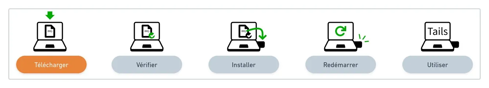
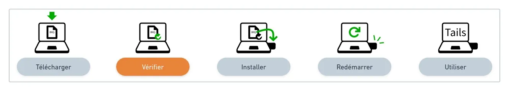
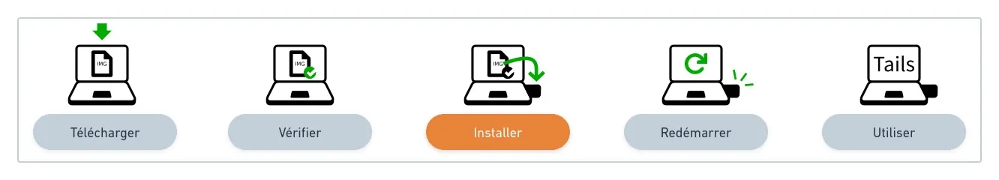
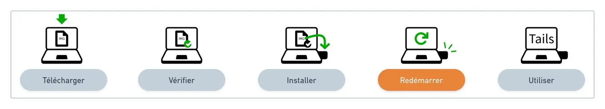
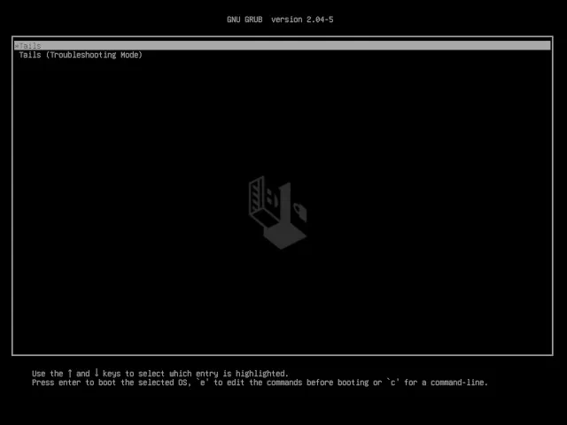
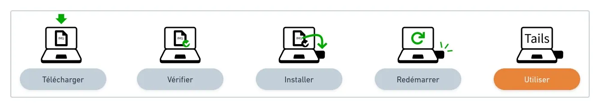
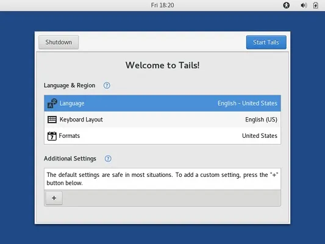
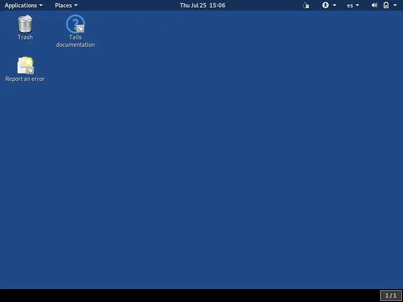
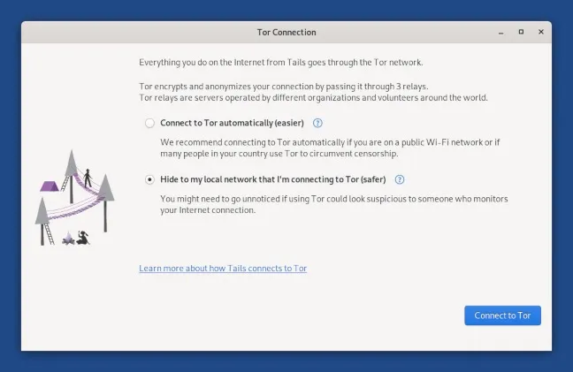

Портативная и амнезическая операционная система, защищающая вас от слежки и цензуры.

## Почему стоит установить Tails на USB-накопитель?

Tails (https://tails.net/) — это самый простой способ всегда иметь под рукой безопасный компьютер, который не оставит никаких следов на используемом вами компьютере.

Чтобы использовать Tails, выключите доступный вам компьютер (дома у родителей, у друзей, в интернет-кафе...) и запустите его с вашего USB-накопителя Tails вместо Windows, macOS или Linux.

После этого у вас будет рабочее пространство и среда для общения, независимые от обычной операционной системы и не использующие жесткий диск.

Tails никогда не записывает данные на жесткий диск и использует только оперативную память компьютера для работы. Эта память полностью стирается при выключении Tails, тем самым удаляя все возможные следы.

## Некоторые конкретные случаи использования

Чтобы дать вам конкретные идеи о преимуществах постоянного наличия USB-накопителя с Tails, вот небольшой неисчерпывающий список, составленный командой Agora256:

- Подключение к Интернету и Tor анонимно и без цензуры для просмотра веб-сайтов без оставления следов;
- Открытие PDF с подозрительного сайта;
- Тестирование резервной копии вашего приватного ключа Bitcoin с помощью кошелька Electrum;
- Использование офисного пакета (LibreOffice) и работа на чужом компьютере;
- Первые шаги в среде Linux для изучения возможности ухода от мира Microsoft и Apple.

## Как доверять Tails?

В использовании программного обеспечения всегда есть элемент доверия, но оно не должно быть слепым. Инструменту, как Tails, необходимо стремиться предоставлять своим пользователям средства для заслуживания доверия. Для Tails это означает:

- Открытый исходный код: https://gitlab.tails.boum.org/;
- Проект, основанный на заслуживающих доверия проектах: Tor и Debian;
- Проверяемые и воспроизводимые загрузки;
- Рекомендации от различных лиц и организаций.

## Руководство по установке и использованию

Цель этого руководства по установке — провести вас через каждый шаг установки. Мы не будем описывать действия подробнее, чем официальное руководство, но мы укажем вам правильное направление, давая советы и рекомендации.

По практическим соображениям, эти советы будут сосредоточены на платформах macOS и Linux.
🛠️
Перед началом этой процедуры, пожалуйста, убедитесь, что у вас есть USB-накопитель с минимальной скоростью чтения 150 МБ/с и емкостью не менее 8 ГБ, идеально USB 3.0.

Предварительные требования:

- 1 USB-накопитель, только для Tails, с емкостью не менее 8 ГБ
- Компьютер, подключенный к Интернету с Linux, macOS, (или Windows)
- Примерно один час свободного времени, в зависимости от скорости вашего интернет-соединения, включая ½ часа на установку (файл для загрузки размером 1.3 ГБ)

## Шаг 1: Загрузите Tails на ваш компьютер

> 🔗 Официальный раздел Tails: https://tails.net/install/linux/index.fr.html#download

Загрузка файла установки с расширением .img может занять некоторое время в зависимости от скорости вашего интернет-соединения, поэтому запланируйте это заранее. С современным и эффективным соединением это займет менее 5 минут.

Сохраните файл в известной папке, например, Загрузки, так как это будет необходимо для следующего шага.

## Шаг 2: Проверьте вашу загрузку

> 🔗 Официальный раздел Tails: https://tails.net/install/linux/index.fr.html#verify
Проверка загрузки гарантирует, что она была осуществлена разработчиками Tails и не была повреждена или перехвачена во время загрузки.

Возможно вручную проверить, что файл, который вы только что загрузили, является ожидаемым, используя PGP, но без продвинутых знаний эта проверка предлагает тот же уровень безопасности, что и проверка JavaScript на странице загрузки, при этом она гораздо более сложная и подвержена ошибкам.

Для проверки файла используйте кнопку "Выберите вашу загрузку..." предоставленную в официальном разделе!

## Шаг 3: Установите Tails на ваш USB-накопитель

> 🔗 Официальный раздел Tails:
>
> - Linux: https://tails.net/install/linux/index.fr.html#install
> - macOS: https://tails.net/install/mac/index.fr.html#etcher и https://tails.net/install/mac/index.fr.html#install

Этот шаг установки Tails на ваш USB-накопитель является самым сложным во всем руководстве, особенно если вы никогда раньше этого не делали. Самое важное - выбрать правильную процедуру в официальном разделе для вашей операционной системы: Linux или macOS.

После того как инструменты установлены и подготовлены в соответствии с рекомендациями, файл с расширением .img может быть скопирован на ваш накопитель (с удалением всех существующих данных), чтобы сделать его "загрузочным" независимо.

Удачи! и до встречи на шаге 4.

## Шаг 4: Перезагрузитесь с вашего USB-накопителя Tails

> 🔗 Официальный раздел Tails: https://tails.net/install/linux/index.en.html#restart
> Пришло время запустить один из ваших компьютеров с вашей новой USB-флешки. Вставьте ее в один из USB-портов и перезагрузите!

> 💡 Большинство компьютеров не загружаются автоматически с USB-накопителя Tails, но вы можете нажать клавишу меню загрузки, чтобы отобразить список возможных устройств для загрузки.

Чтобы определить, какую клавишу вам следует нажать, чтобы у вас было меню загрузки, позволяющее выбрать USB-накопитель вместо вашего обычного жесткого диска, вот неисчерпывающий список по производителям:

| Производитель | Клавиша          |
| ------------ | ---------------- |
| Acer         | F12, F9, F2, Esc |
| Apple        | Option           |
| Asus         | Esc              |
| Clevo        | F7               |
| Dell         | F12              |
| Fujitsu      | F12, Esc         |
| HP           | F9               |
| Huawei       | F12              |
| Intel        | F10              |
| Lenovo       | F12              |
| MSI          | F11              |
| Samsung      | Esc, F12, F2     |
| Sony         | F11, Esc, F10    |
| Toshiba      | F12              |
| другие...    | F12, Esc         |

После выбора USB-накопителя вы должны увидеть этот новый экран загрузки, что является очень хорошим знаком, так что позвольте компьютеру продолжить загрузку...

## Шаг 5: Добро пожаловать в Tails!

> 🔗 Официальный раздел Tails: https://tails.net/install/linux/index.en.html#tails

Через одну-две минуты после загрузчика и экрана загрузки появляется экран приветствия.

На экране приветствия выберите ваш язык и раскладку клавиатуры в разделе Язык и регион. Нажмите на Старт Tails.

Если ваш компьютер не подключен к сети проводным способом, пожалуйста, обратитесь к официальным инструкциям Tails, чтобы помочь вам подключиться к сети без использования Wi-Fi (раздел "Проверьте ваш Wi-Fi").
После подключения к локальной сети появится мастер подключения к сети Tor, который поможет вам подключиться к сети Tor.

Вы можете начать анонимный серфинг, изучить опции и программное обеспечение, включенное в Tails. Наслаждайтесь, у вас есть много возможностей для ошибок, так как на USB-накопителе ничего не изменяется... Ваш следующий перезапуск забудет все ваши переживания!

## В будущем руководстве...

Как только вы немного больше поэкспериментируете со своим собственным USB-накопителем Tails, мы рассмотрим другие более продвинутые темы в другой статье, такие как:

> Обновление ключа до последней версии Tails; Настройка и использование постоянного хранилища; Установка дополнительного программного обеспечения.
> До тех пор, как всегда, если у вас есть вопросы, не стесняйтесь делиться ими с сообществом Agora256. Мы учимся вместе, чтобы быть лучше завтра, чем мы есть сегодня!