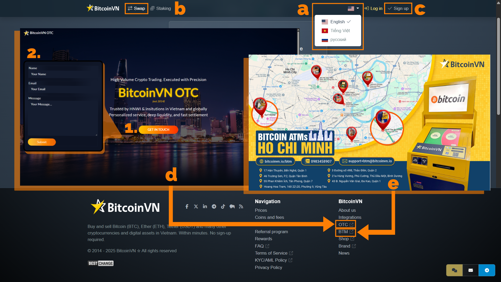
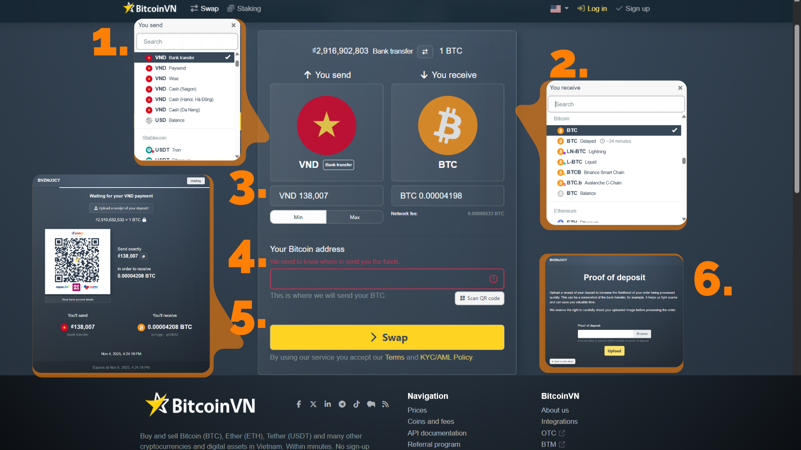
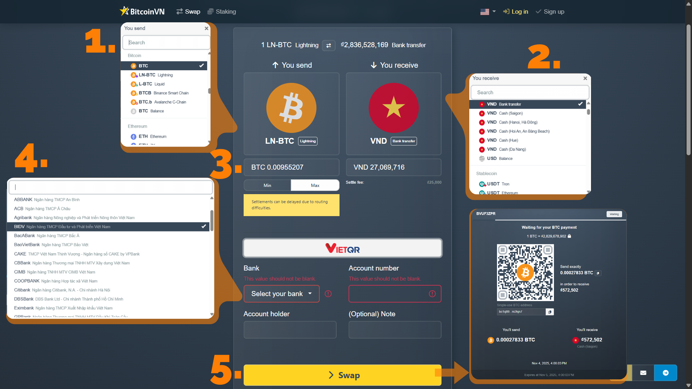

## Johdanto

BitcoinVN.io on ollut Vietnamin ensimmäinen ja luotetuin Bitcoin-pörssi vuodesta 2014. Annamme käyttäjille mahdollisuuden muuntaa digitaalisia varoja suoraan Vietnamin dongiksi (VND) kolmen keskeisen palvelun kautta:

- (b)** Pikavaihdot verkossa
- (e)** Bitcoin ATM:t
- (d)** OTC-kaupankäynti (OTC)

Sitoutumisemme huipputason turvallisuuteen ja vaatimustenmukaisuuteen varmistaa, että paikalliset ja ulkomailla asuvat luottavat meihin turvallisten rahalähetysten, sijoitusten ja päivittäisten digitaalisten maksujen osalta.

Verkkovaihtoalustamme on suunniteltu intuitiiviseen käyttökokemukseen, jonka avulla voit suorittaa välittömiä vaihtoja helposti. Tuemme useita kieliä, kuten **(a)** englantia, vietnamia ja venäjää. Pieniin swappeihin ei tarvita tiliä; voit kuitenkin **(c)** rekisteröityä, jolloin päivittäiset transaktiorajasi kasvavat huomattavasti. Alustassa on tällä hetkellä lueteltu yli 99 digitaalista omaisuutta, jotka voit kätevästi muuntaa joko Bitcoin (BTC) - kovimmaksi omaisuudeksi - tai suoraan Vietnamin Dongiksi (VND), ja käytettävissä on erilaisia maksuvaihtoehtoja.

## Vastuuvapauslauseke

Tämä opas on puhtaasti koulutustarkoituksiin työkaluistamme eikä **ei taloudellinen neuvonta**. Huomaa, että kryptovaluutat ovat erittäin epävakaita eivätkä **ole laillisia maksuvälineitä Vietnamissa**. Kehotamme sinua noudattamaan kaikkia paikallisia lakeja ja harkitsemaan vahvasti ammattimaisen rahoitusneuvonnan hakemista.

## Miten ostaa BTC VND

### Vaihe 1: Valitse lähetettävä valuutta

Valitse "Lähetät" -osiossa - iso neliö, jossa on punainen VND-kuvake - valitse haluamasi maksutavat BTC-maksua varten pudotusvalikosta. Tässä tapauksessa on valittu VND-pankkisiirto (maksa VND paikallisten pankkien kautta). Tuemme **67 paikallista pankkia** Vietnamissa.

### Vaihe 2: Valitse vastaanottava valuutta

Valitse "Saat" -osiossa - iso neliö, jossa on Bitcoin-logo, BTC (Bitcoin blockchain/mainchain) - se on yleensä oletusarvo tai se on helppo löytää pudotusvalikosta.

### Vaihe 3: Syötä VND-määrä ja tarkista sopimuksen yksityiskohdat

Syötä manuaalisesti summa, jonka haluat vaihtaa, ja tarkista kapasiteettisi [Päivittäiset rajat -linkki](https://bitcoinvn.io/info) tai Min/Max-painikkeilla, jos sinulla ei ole tiliä. Järjestelmä laskee välittömästi lopullisen BTC-määrän, jonka saat sen jälkeen, kun olet ottanut huomioon [swap-palkkiot](https://support.bitcoinvn.io/help/en-us/4-orders/12-fees) ja valuuttakurssin kyseisenä ajankohtana. Tarkista lopullinen BTC-määrä nähdäksesi, oletko tyytyväinen sopimukseen.

#### Vinkkejä

Muista, että **transaktiokurssit vaihtelevat**, joten tarkista aina lopullinen hinta ennen vahvistamista.

**Tiliä ei tarvita, ja** päivittäiset maksutapahtumat on rajoitettu 250 000 VND:hen (~ 8 USD). Lisätietoja on saatavilla [pankkisiirtokäytännöissä](https://support.bitcoinvn.io/help/en-us/4-orders-payments/17-vnd-bank-transfer).

**Varoittelut**: Verkkomaksu on yleensä halvempi, kun valitset Lightning Network:n verrattuna onchain-tapahtumamenetelmään.

### Vaihe 4: Anna Bitcoin Address

Kopioi ja liitä vastaanottava BTC wallet -osoitteesi tai skannaa QR-koodi osoitekenttään (kuvakaappauksessa punaisella korostettu). Tarkista se kahteen kertaan, koska BTC:si lähetetään sinne.

### Vaihe 5: Siirry valitsemaasi maksuun

Napsauta isoa keltaista Vaihda-painiketta siirtyäksesi maksusivulle, jossa on BitcoinVN:n pankkitiedot, joihin on liitetty QR-koodi (paikallisille rahoitussovelluksille, kuten Momo ja VNPAY), ja tarkka VND-summa. Siirrä tarkka summa vietnamilaiselta pankkitililtäsi/sovelluksestasi määräajan kuluessa, muuten sopimus päättyy ja sinun on aloitettava uudelleen vaiheesta 3.

### Vaihe 6: Vahvista maksusi ja vastaanota omaisuuserä

Kun olet suorittanut maksun, lataa kuvakaappaus/kuitti maksukuitista tarkistusta varten (yleensä 1-10 minuuttia työpäivinä). Kun maksu on vahvistettu, BTC lähetetään välittömästi wallet:ään. Saat sähköpostipäivityksiä ja voit seurata tilausnumeroa.

## Kuinka myydä BTC VND:lle

### Vaiheet 1, 2 ja 3: Valitse Lähettävä, Vastaanottava valuutta, syötä swap-määrät

Samoin kuin yllä olevassa ostoprosessissa, klikkaa `Sinä lähetät`-osiota ja valitse pudotusvalikosta omaisuuserä, jonka haluat vaihtaa minkä lohkoketjun kautta, esim. BTC (Bitcoin on-chain) tai BTC salamaverkon kautta (off-chain-ratkaisu).

Valitse sitten kohdassa `Sinä vastaanotat` omaisuuserä, jonka haluat vastaanottaa ja miten haluat vastaanottaa; esimerkiksi VND-pankkisiirrolla (vastaanota pankkisi kautta).

Syötä haluamasi BTC:n määrä, jonka haluat vaihtaa. Sovellus laskee välittömästi, kuinka paljon VND:tä saat. Tarkista verkkomaksu, lopulliset vastaanotettavat summat ja selvitysilmoitus (voi viivästyä työajan ulkopuolella).

### Vaihe 4: Tarkista ja anna maksutiedot

Valitse yksi 67 tuetusta paikallisesta pankista avattavasta luettelosta ja täytä sitten tilinomistajan nimi ja tilinumero sekä lisää halutessasi huomautus.

### Vaihe 5: Lähetä omaisuuserä ja vastaanota maksusi

Napsauta Swap-painiketta, jolloin BitcoinVN:n BTC-talletusosoite ja QR-koodi tulevat näkyviin. Lähetä täsmälleen määritetty BTC-määrä wallet-osoitteestasi osoitettuun osoitteeseen skannaamalla QR-koodi tai kopioimalla Bitcoin-osoite.

Varaa aikaa vahvistukseen (sekuntia Lightningissa, minuutteja on-chain:ssä). VND siirretään pankkitilillesi - yleensä 1-2 tunnin kuluessa pankkiaikana. Saat sähköpostin ja tilausnumeron seurantaa varten.

## Päätelmä

Otamme vilpittömästi vastaan kysymyksiä, pyyntöjä ja palautetta tuotteistamme ja palveluistamme.

Tarkempia tietoja saat tutustumalla omaisuuden takaisinperintäkäytäntöihimme [täällä](https://support.bitcoinvn.io/help/en-us/3-general/1-asset-recovery-policy) tai ottamalla meihin suoraan yhteyttä [Telegram](https://t.me/bitcoinvn_community).

Kun digitaalisten varojen käyttöönotto integroituu maailmanlaajuisen rahoituksen valtavirtaan, **BitcoinVN** on strategisesti sijoitettu johtamaan Vietnamin kansainvälisen rahoituskapasiteetin kehittämistä. Me silta kuilu fyysisen ja digitaalisen talouden välillä, sekoittamalla globaalia likviditeettiä paikalliseen helppouteen. Tehtävämme on demokratisoida turvallinen ja helppo pääsy kattavaan valikoimaan laadukkaita tuotteita ja ammatillisia palveluja täällä Vietnamissa.

Katamme tarpeesi, olitpa sitten yksityishenkilö tai yritys. Tämä sisältää kaiken paikallisen valuutan vaihtamisesta BTC:ksi, digitaalisten varojen vaihtamisesta tai varojen lähettämisestä ulkomaille, kauppiaiden työkalujen ja API-ratkaisujen käyttöönottoon liiketoimintasi edistämiseksi tulevaisuuden digitaalisessa taloudessa.

Kannustamme sinua liittymään yhteisöömme ja pysymään ajan tasalla:

- [LinkedIn](https://vn.linkedin.com/company/bitcoinvn)
- [Facebook](https://www.facebook.com/www.bitcoinvn.io)
- [X](https://x.com/Bitcoin_Vietnam) (entinen Twitter)
- [TikTok](https://www.tiktok.com/@bitcoinvn.io)
- [Nostr](https://iris.to/npub1j4lp9hmzd3rqlcw7mml09uwvwap0g5u5wx2qm2lzt9wcqt925jvqf4wzaa)
- [Uusimmat uutiset](https://bitcoinvn.io/news/)